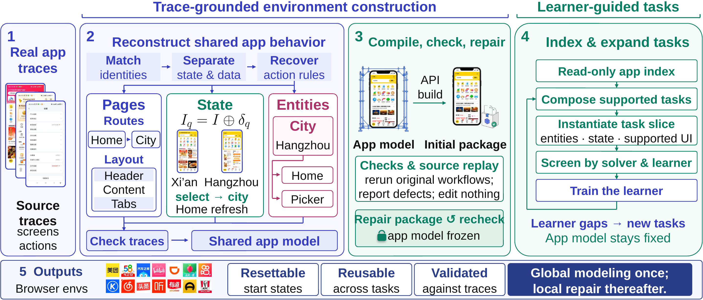

# 从真实轨迹重建可验证 App 世界

语言：中文；[English](2610.30792.en.md)

> 主分类：[`SY`](../../../docs/categories.md#sy)；辅助分类：[`CU`](../../../docs/categories.md#cu)、[`AT`](../../../docs/categories.md#at)、[`EV`](../../../docs/categories.md#ev)

## 元数据

- 英文标题：Trace2World: Reconstructing App Worlds from Real Interaction Traces for Scalable GUI Agent Training
- 作者与机构：Zezhou Wang、Zhuzhong Qian（南京大学）；Hanzhang Zhou、Panrong Tong、Quyu Kong、Steven Hoi、Yue Wang（Alibaba Token Hub，Alibaba Group）；Pengxiang Li（北京理工大学）。
- arXiv：<https://arxiv.org/abs/2610.30792>
- PDF：<https://arxiv.org/pdf/2610.30792>
- 代码、数据与项目页：论文表 D1 声明发布构造代码、源轨迹、50 个环境、训练任务、Trace2World-Bench、保真度记录和真实设备结果；截至 2026-10-25，arXiv 页面、源码和公开 GitHub 精确检索均未找到论文专属仓库入口，故不能把「论文声明发布」写成「公开入口已核验」。
- 首次提交、最近修订与调研日期：v1 首次提交与最近修订均为 2026-10-22 06:10:53 UTC；调研日期为 2026-10-25，复查日期同日。
- 热度证据与采集时间：2026-10-25 08:58～09:03（Asia/Shanghai）采集；Hugging Face Daily Papers 3 票；Hacker News 精确标题检索 0 条；GitHub 精确检索未发现论文专属仓库。互动量只反映发布初期传播。
- 社区评价来源与采集时间：[Pith AI 方法审阅](https://pith.science/paper/2610.30792)与 [Punkslack 技术简报](https://blog.punkslack.com/daily-systems-trends-report-october-23-2026-the-evaluation-scarcity-code-is-cheap-knowing-is-not/)，2026-10-25 采集；均未提供独立实验复跑。
- 飞书独立调研：<https://bytedance.larkoffice.com/docx/JftMd2DqFoNaUzxofF1cQ2S8nPe>

## 结论摘要

- Trace2World 把 App 模拟器构造分成两个边界：先从多条真实轨迹重建共享、带来源链接的行为模型，再编译环境并用独立源轨迹回放验收。未被证据支持的冲突保持不可执行，避免编码 Agent 替证据做语义决定。
- 在同一批 10 个 App、200 条工作流上，Trace2World 的六项全通过保真度为 91.1%，最强匹配的 GUI-GENESIS-style 重实现为 59.8%。只看终点可达性会掩盖错误状态转换：后者终点可达 94.8%，完整工作流却只有 59.8%。
- 同流水线的自验证控制达到 79.1% 保真度，源轨迹验证达到 91.1%；100 个真实设备任务上，两者分别保留 54.7% 与 94.0% 的模拟训练增益。证据支持「验收来源」而非单纯更强生成模型是关键机制。
- 人工复核覆盖同一批 1,200 个匿名方法—工作流包，自动与人工工作流标签一致率为 90.2%，排序不变。它提高了主指标可信度，但不是新的独立任务集，且仍依赖两名标注者和一名裁决者。
- 论文资源合同声称公开完整轨迹、环境、代码与评测记录，但当前没有可核验的论文专属仓库入口。本调研只核对论文正文、官方 arXiv 源文件和公开讨论，没有独立复跑环境构造、RL 训练或真实设备实验。

## 研究问题与背景

GUI Agent 的在线强化学习需要大量可重置、可验证的交互环境。真实 App 最接近部署，但状态难以恢复，探索动作可能产生订单、消息或账户变更；手工模拟器成本高，自动编码模拟器又容易把少量轨迹里的偶然表象硬编码为 App 语义。

关键问题不是「能否生成一个可运行页面」，而是「部分轨迹究竟支持哪些页面身份、状态字段、实体关系、动作前置条件与状态变化」。一条轨迹只能展示一个初始状态和一条路径；若先写代码再解释轨迹，编码 Agent 与它自己生成的测试可能共同接受错误转换。

## 核心方法

Trace2World 维护三个相互隔离的对象。共享 App 模型由源轨迹一次性重建并冻结；可执行包是浏览器环境，也是修复环节唯一允许修改的对象；任务索引是经验证环境的只读投影，只暴露已支持的页面、实体、字段、操作和依赖。

语义重建先跨轨迹匹配页面、控件和实体，再把稳定结构与可变状态、复用数据和任务初值分开。每条动作规则记录页面、控件、动作、前置条件、读写字段、目标页面和可见后置条件，并链接到支持它的源步骤。若不同轨迹的效果无法由已观察状态解释，冲突不会被强行消解，而是留在不可执行范围。

编译阶段用受限 API 调用生成 DOM 浏览器包，中央状态内核负责业务状态与带守卫的更新。代码检查只证明包能运行；随后从原生重置状态重放每条源工作流，由只读检查器比较信息、过程效果和终态。检查与修复角色分离，失败被压缩为具体缺陷包，修复只能改可执行包，不能改冻结语义。

环境通过验收后，学习者失败模式引导新任务组合。任务只能从只读索引中的受支持能力组合并实例化，必须通过支持性、GUI、固定求解器和学习信号筛选；反馈改变「练什么」，不能改变「App 是什么」。

## 实验与证据

**环境保真度。** 论文从 1,570 条轨迹构造 50 个 App 环境。主要保真度实验固定 10 个 App、200 条工作流，六项检查覆盖终点可达、页面表面、状态、动作效果、终态和数据。Trace2World 六项全通过为 91.1%，GUI-GENESIS-style 为 59.8%，PhoneWorld-style 为 22.4%，CUA-Gym + traces 为 19.9%。这些最强基线是按论文描述重实现的路线，不是原始私有构造流水线的直接执行。

**验收机制。** 同构造阶段和输入下，自验证控制为 79.1%，源轨迹验证为 91.1%。独立复查拒绝 22／160 个自验证接受的执行，只拒绝 1／176 个源轨迹验证接受的执行。另一个 400 次执行审计中，把源轨迹提供给同一个审阅模型后，缺陷覆盖率由 43.2% 提高到 68.4%，精确率由 73.6% 提高到 88.2%；再加入对比 Rubric 后分别达到 86.0% 和 93.0%。

**人工标签。** 两名标注者检查 1,200 个匿名包，第三人裁决分歧。自动与人工的工作流标签一致率为 90.2%，人工标注下 Trace2World 为 93.5%，GUI-GENESIS-style 为 63.6%，排序不变。原始两名标注者的六项全通过标签一致率为 87.8%；160 个包至少有一个维度需要裁决。

**任务生成与训练。** 40 个训练 App 提供 1,280 个种子任务和 768 个学习者引导任务。匹配 20 个 RL 迭代和相同 45 步预算时，学习者引导分支在 Trace2World-Bench 上由 56.9% 提高到 61.1%；静态生成、实体替换和种子续训分别为 56.9%、55.3% 和 52.2%。最终 Qwen3.5-9B 策略相对基础策略在内部基准提高 20.2 个百分点，在 MobileGym、AndroidWorld、MobileWorld 和 AndroidDaily 提高 16.2、5.4、8.9 和 11.1 个百分点。

**真实设备迁移。** 100 个任务覆盖 20 个训练 App，每个训练种子在模拟器和真实设备上使用同一任务、起点、终态与步数预算。源轨迹验证的阶段一策略在模拟器提高 16.7 个百分点、真实设备提高 15.7 个百分点，保留率为 94.0%；自验证分别提高 17.7 和 9.7 个百分点，保留率为 54.7%。三种子标准差支持差异方向，但每个 App 只有 5 个任务，不能估计 App 级效果。

**成本。** 每个种子 App 平均估算 3.60 小时、1,160 次模型调用，其中受限 API 流水线 602 次、Agent 工作流 558 次。生成任务与 RL 成本另计；论文没有给出完整 token、GPU、API 金额，也没有测量 App 更新后的刷新成本。

## 局限与风险

**作者明确限制。** 当前环境是从单个时间点轨迹重建的 DOM 浏览器实现，与原生 App 的渲染和运行时仍有差距；真实设备面板只覆盖训练 App，未见 App 的迁移只在模拟环境中评测；所有优化任务都是单 App；构造、修复、筛选与审阅依赖闭源模型；只报告初始构造成本，没有报告增量刷新成本。

**调研判断。** 91.1% 主指标依赖 GPT-5.6 Sol 审阅。人工复核能证明排序在同一批样本上稳定，却没有把闭源审阅器替换为开放或确定性 Oracle。最强基线是研究团队的匹配重实现，原始 PhoneWorld 构造流水线并未公开，31.3 个百分点的领先幅度仍可能受到实现细节影响。

**复现边界。** 论文正文把资源写成「已发布」，表 D1 也列出完整资源合同，但没有给出可验证的仓库或数据入口。当前无法检查许可证、文件摘要、环境包、训练清单、人工裁决记录或运行脚本。资源入口出现前，应把论文级实验视为作者结果，而不是已独立复现的公开基准。

**安全与隐私。** 作者称源轨迹来自有授权账户，发布前筛查凭据、通信、位置、订单和第三方个人信息，无法安全脱敏且会改变语义的轨迹会被扣留。即便如此，真实 App 轨迹、商标界面与行为规则的再分发仍涉及服务条款、版权和数据治理，工程采用不能只依赖技术可行性。

## 复现与应用

本调研从官方 arXiv 源文件提取 Figure 3，并核对正文、附录、表 1～3、表 D1、表 E3～E7 和表 E15。没有取得论文专属代码或数据，未构造浏览器环境、运行 200 条工作流、训练 Qwen3.5-9B 或访问真实设备。因此，当前验证证明论文内部数值、实验边界和来源文件一致，不证明主结果可在外部机器上复现。

工程上最可迁移的机制是「语义承诺边界」：先把证据支持的状态、动作与不确定性固定为独立工件，再让生成器实现；验收器只读源证据并报告差异，修复器只能改实现；后续任务生成只能读取已验证能力。这一模式也适用于工具模拟器、测试夹具和数据 Agent 沙箱。

## 相关工作

- [GUI-GENESIS](https://arxiv.org/abs/2602.14093)：为每条轨迹合成任务局部 Web 环境和可执行奖励；Trace2World 强调跨轨迹共享语义与 App 级状态一致性。
- [CUA-Gym](https://arxiv.org/abs/2605.25624)：联合生成任务、环境与奖励，扩大 GUI RLVR 数据；Trace2World 追问生成环境是否忠实于真实源轨迹。
- [PhoneWorld](https://arxiv.org/abs/2605.29486)：从真实轨迹抽象可复用手机环境；Trace2World 进一步把跨轨迹语义重建和独立源回放设为明确验收边界。
- [Agent-World](https://arxiv.org/abs/2604.18292)：根据能力缺口持续生成环境与任务；Trace2World 限制学习者反馈只能在已验证语义内改变任务供给。
- [DigiRL](https://arxiv.org/abs/2403.02502)：直接在真实设备上进行自主在线强化学习；Trace2World 用可重置模拟器降低真实交互成本，并用配对设备实验测量迁移损失。

## 社区评价

**Pith AI 方法审阅。** Pith 认为研究问题重要，工作流保真度、自验证控制、人工复核和真实设备迁移相互支持；同时提出两项主要异议：最强对手是作者重实现而非原始私有构造流水线，闭源 GPT-5.6 Sol 决定主指标且人工复核规模有限。Pith 明确标注该评论由 AI 撰写、尚无人类专家审阅，因此属于第三方方法观点，不是同行评审或独立复跑。

**Punkslack 技术简报。** 该简报把「源链接模型 + 回放验收」视为可迁移的工程原则，并认可 94.0% 对 54.7% 的对照。它质疑 10 个 App、自采轨迹和作者设备的外推边界，并称环境构造成本未说明。后一点需要校正：论文已报告初始构造小时数和调用数，真正缺失的是完整 token、GPU、API 金额与刷新成本。

**平台检索。** Hugging Face Daily Papers 为 3 票；Hacker News 精确检索为 0 条；GitHub 未发现论文专属仓库。指定六个 Reddit 社区的公开搜索页可访问，但 JSON 结果无法解析，网页精确检索没有取得可核验帖子；公开 X 精确检索也没有取得可核验原帖。上述访问缺口不等于没有讨论。

**样本偏差。** 论文发布约三天，社区材料主要来自自动或半自动论文审阅与英语技术简报，没有独立完整复跑。互动量不能代替研究质量或社区共识。

## 原文关键图表

图 3，正文第 4 页，来源为官方 arXiv 源文件。它说明四个边界：真实轨迹先汇入共享 App 模型；代码生成只实现该模型；源轨迹回放只报告缺陷，局部修复不改语义；任务生成只读取经验证索引。图示解释方法结构，不证明 91.1% 保真度或真实设备迁移结果；这些结论仍需表 1～3 和附录控制实验支持。

## 调研判断

- **阅读优先级：高。** 适合 GUI Agent、模拟器构造、Agent 训练环境、验证流水线和可追溯任务生成团队。
- **可信度：中高。** 多种匹配控制、人工复核、失败分析和真实设备配对构成较完整证据；闭源审阅器、重实现基线和不可发现的公开工件限制独立验证。
- **适用对象：** 需要从不完整操作记录构造可执行环境，并防止生成器与自有测试形成同源错误的团队。
- **后续观察：** 论文专属仓库与许可证、公开环境包能否复现表 1、开放模型替代构造／审阅角色、未见 App 的真实设备迁移、App 变化后的刷新成本，以及原始基线流水线下的对照。

## 来源

- [arXiv 摘要页](https://arxiv.org/abs/2610.30792)
- [官方 HTML／附录](https://arxiv.org/html/2610.30792v1)
- [官方 PDF](https://arxiv.org/pdf/2610.30792)
- [Hugging Face Daily Papers](https://huggingface.co/papers/2610.30792)
- [Pith AI 方法审阅](https://pith.science/paper/2610.30792)
- [Punkslack 技术简报](https://blog.punkslack.com/daily-systems-trends-report-october-23-2026-the-evaluation-scarcity-code-is-cheap-knowing-is-not/)
