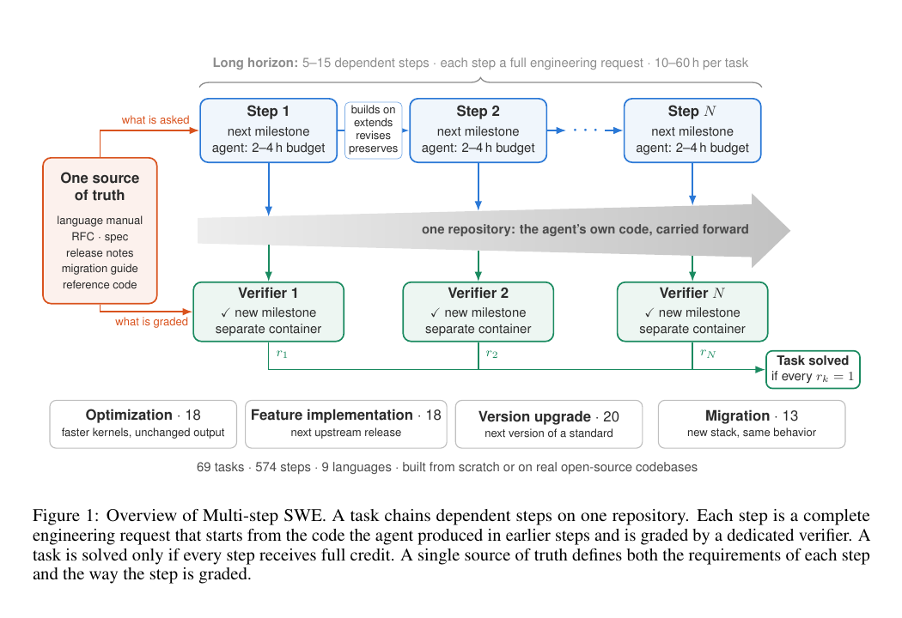

# How Long Can Coding Agents Maintain Their Own Code?

Language: English; [中文](2611.07166.md)

> Primary: [`EV`](../../../docs/categories.en.md#ev); secondary: [`SE`](../../../docs/categories.en.md#se), [`SY`](../../../docs/categories.en.md#sy)

## Metadata

- Original title: Multi-step SWE: Can Coding Agents Keep Building on Their Own Code Over Long Horizons?
- Authors and affiliation: Xiangkai Zeng, Zheng Liu, and Zihao Lin (Klavis AI)
- arXiv: [2611.07166](https://arxiv.org/abs/2611.07166), v1
- PDF: <https://arxiv.org/pdf/2611.07166>
- Code, tasks, and results: <https://github.com/Klavis-AI/Multi-step-SWE>; <https://multistepswe.com/>; pinned commit `346719bbb9eb9afaf16ac1eda038cff87ca9f343`
- First submission and latest revision: 2026-11-04 21:49:40 UTC; research and review: 2026-11-08
- Popularity evidence: GitHub had 2 stars, 1 fork, and 1 open issue; the paper was absent from the Hugging Face 2026-11-06 Daily Papers API; no exact-title or arXiv-URL Hacker News post was found. Collected 2026-11-08 15:15 Asia/Shanghai.
- Community sources: no verifiable independent technical discussion was found. The official project page and an AICoder restatement were not treated as independent reproduction. Collected 2026-11-08 15:15 Asia/Shanghai.

## Conclusion summary

- Multi-step SWE turns software-engineering evaluation from one-shot patching into 5–15 consecutive maintenance steps on the same evolving repository.
- The public suite contains 69 trajectories and 574 ordered steps. The paper reports only an 18.5% end-to-end solve rate for the strongest Claude Opus 5.5／Claude Code system despite a 56.8% step pass rate.
- No evaluated system solves 38 of 69 tasks; the pooled solve rate for version upgrades is 2.9%, versus 15.0% for optimization.
- A step passes 70.2% of the time after a successful predecessor and 14.1% after a failed predecessor. This is consistent with compounding failure, but the benchmark lacks an isolated-step control.
- This review checked 69 task definitions, 574 step directories, and 2,483 public score records. It did not build all Docker environments or rerun model trajectories.

## Research question and background

SWE-bench-style evaluations start from a clean snapshot and end after one issue. Real maintenance requires an agent to keep working on its own prior implementation, so architectural mistakes, compatibility debt, and locally passing shortcuts alter future state. Multi-step SWE asks whether the same agent can preserve a workable repository across an entire requirement chain.

Each task derives from a real open-source project. The agent's changes persist from one step to the next, and a task counts as solved only if every step passes. The metric therefore measures a stricter long-horizon contract than average step accuracy.

## Method

The benchmark covers feature addition, migration, optimization, and version upgrade. Every step supplies a natural-language request, repository state, and hidden verifier. The public repository includes `task.toml`, tests, and reference patches for checking sequence and acceptance criteria.

The evaluation compares model-plus-harness systems including Claude Code, Codex CLI, Gemini CLI, OpenCode, and Fable. Each model-task pair is intended to receive four runs. Solve rate, step pass rate, and Pass@4 are reported. This reflects deployed systems but confounds the base model with harness planning, context compression, and tool policy.

Figure 1, page 2 of the official PDF. It contrasts independent issue evaluation with sequential work on the same repository state. It defines the benchmark mechanism; it does not prove that all degradation is caused by accumulated error.

## Experiments and evidence

Mechanical inspection found 69 `task.toml` files and 574 ordered steps, with 5 to 15 steps per task and no missing step directories. The public results site exposes 2,483 score records for nine model-agent systems; one planned run is absent, so the grid is not exactly 9 × 69 × 4.

The paper reports 18.5% solve rate (95% CI 11.6%–25.7%), 56.8% step pass rate, and 31.9 Pass@4 for Claude Opus 5.5／Claude Code. Fable reaches 17.8%; Gemini 3 Pro／Gemini CLI and GPT-6.1 Sol／Codex CLI each reach 10.1%. These are public project results, not reruns performed here.

Pooled solve rates are 15.0% for optimization, 13.9% for migration, 5.1% for feature addition, and 2.9% for version upgrade. Sixteen of 20 version-upgrade tasks and 38 of all 69 tasks remain unsolved by every system.

The next step passes 70.2% of the time after a passed predecessor and 14.1% after a failed one. Position, intrinsic difficulty, and verifier dependencies may also contribute.

## Limitations and risks

There is no control that executes each step independently from the correct reference state, so intrinsic step difficulty cannot be separated from trajectory position and historical damage. C and C++ account for 38 of 69 tasks, potentially overweighting compilation and migration failures.

Open-source projects may appear in training data. Model and harness are bundled, optimization thresholds follow reference implementations rather than global optima, and four runs per task leave wide uncertainty.

The public site exposes scores and metadata but not complete agent messages, tool calls, and patch trajectories. This review can validate structure and aggregates, not attribute every failure to planning, implementation, testing, or context management.

## Reproduction and application

The MIT-licensed repository provides task definitions, verifiers, reference solutions, and Docker configuration. Structural checks do not require models. A full rerun requires 69 project environments, the evaluated model-harness combinations, and more than 2,000 long trajectories.

The suite is useful for long-horizon coding agents, context compression, recovery, and repository-state management. Deployments should report end-to-end solve rate, step pass rate, recovery rate, and cost rather than treating local step success as long-term delivery.

## Related work

- [SWE-bench](https://arxiv.org/abs/2310.06770) is the principal one-issue repository benchmark that this work extends.
- [SWE-Chain](https://arxiv.org/abs/2605.14415) studies sequential issue resolution; Multi-step SWE emphasizes curated evolution chains on one persistent state.
- [EvoCode-Bench](https://arxiv.org/abs/2605.24110) also evaluates codebase evolution over time.
- [SWE-Milestone](https://arxiv.org/abs/2603.13428) adds intermediate process milestones, while this paper chains multiple requirements.
- [Terminal-Bench](https://arxiv.org/abs/2601.11868) covers complex terminal tasks more broadly without specializing in continuous repository maintenance.

## Community response

No verifiable independent community assessment was found. The paper was absent from Hugging Face Daily Papers, Hacker News had no exact match, direct searches of six specified Reddit communities returned HTTP 403, and public X search yielded no verifiable original post. GitHub's 2 stars and 1 fork show limited current attention, not paper quality.

An AICoder page restates the paper and official project page without an independent experiment. Access gaps do not prove that no discussion exists, and author promotion is not a substitute for community evaluation.

## Figures and tables from the paper

Figure 1 is retained because it clarifies the persistent-state distinction. Main numerical claims were checked against paper tables and public result arrays rather than duplicated as screenshots.

## Research judgment

Reading priority: high. Confidence is high for task construction and public structure, and medium for model ranking and causal claims about long-horizon failure because complete trajectories and isolated-step controls are missing. Watch for released traces, controlled per-step baselines, broader language coverage, and independent reruns under a fixed harness.

## Sources

- <https://arxiv.org/abs/2611.07166>
- <https://arxiv.org/pdf/2611.07166>
- <https://github.com/Klavis-AI/Multi-step-SWE>
- <https://multistepswe.com/>
- <https://www.klavis.ai/blog/multi-step-swe>
