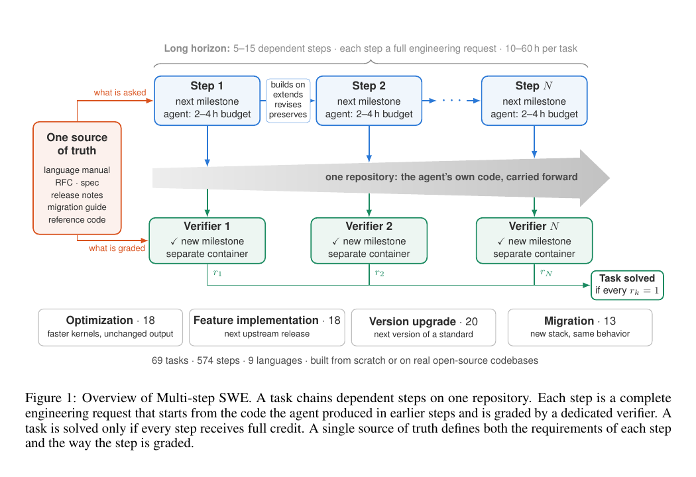

# Coding Agent 连续维护自己的代码能走多远

语言：中文；[English](2611.07166.en.md)

> 主分类：[`EV`](../../../docs/categories.md#ev)；辅助分类：[`SE`](../../../docs/categories.md#se)、[`SY`](../../../docs/categories.md#sy)

## 元数据

- 英文标题：Multi-step SWE: Can Coding Agents Keep Building on Their Own Code Over Long Horizons?
- 作者与机构：Xiangkai Zeng、Zheng Liu、Zihao Lin（Klavis AI）
- arXiv：[2611.07166](https://arxiv.org/abs/2611.07166)；v1
- PDF：<https://arxiv.org/pdf/2611.07166>
- 代码、任务与结果：<https://github.com/Klavis-AI/Multi-step-SWE>；<https://multistepswe.com/>；固定 commit `346719bbb9eb9afaf16ac1eda038cff87ca9f343`
- 首次提交与最近修订：2026-11-04 21:49:40 UTC；调研与复查：2026-11-08
- 热度证据：GitHub 2 stars／1 fork／1 open issue；Hugging Face 2026-11-06 Daily Papers API 未收录；Hacker News 未找到精确标题或 arXiv URL 帖子。采集时间：2026-11-08 15:15（Asia/Shanghai）。
- 社区评价来源：未检索到可核验的独立技术讨论；作者项目页与 AICoder 转述不作为第三方复现。采集时间：2026-11-08 15:15（Asia/Shanghai）。

## 结论摘要

- Multi-step SWE 把软件工程评测从一次性修补改成连续 5～15 步维护：同一 Agent 必须在自己前序代码上继续升级、迁移、优化或增加功能。
- 公开任务包含 69 条轨迹、574 个有序步骤。作者报告最强组合 Claude Opus 5.5／Claude Code 的整条任务通过率仅 18.5%，但步骤通过率为 56.8%；局部成功不能外推为长期交付成功。
- 38／69 个任务没有任何模型完整解决；version upgrade 家族的合并通过率只有 2.9%，明显低于 optimization 的 15.0%。
- 前一步通过后，下一步通过率为 70.2%；前一步失败后只剩 14.1%。该关联支持「失败会沿轨迹累积」，但没有 isolated-step 对照，不能把全部差距归因于历史状态污染。
- 本轮核对了 69 个任务定义、574 个步骤和 2,483 条公开分数记录，没有构建 69 套 Docker 环境或复跑模型轨迹。

## 研究问题与背景

SWE-bench 一类基准通常从干净仓库快照开始，完成一个独立 issue 后结束。真实维护却要求 Agent 接着自己此前的实现工作：前一步选错架构、留下兼容债务或只满足局部测试，都会改变后续状态与决策空间。论文研究的问题不是「Agent 能否修好一次 bug」，而是「同一 Agent 能否在长期演化中保持代码可维护并完成整条需求链」。

每个任务由真实开源项目派生，初始仓库状态固定。Agent 在第 1 步修改代码并接受验证，随后第 2 步直接在该工作树上继续，直到 5～15 步全部完成或预算耗尽。整条任务只有所有步骤都通过才计为 solved，因此对长期一致性的要求高于单步 pass rate。

## 核心方法

基准覆盖 feature addition、migration、optimization 和 version upgrade 四类演化。每一步提供自然语言需求、代码仓库和隐藏验证器；前一步的代码变更被保留，测试结果本身不会自动替 Agent 修复状态。公开仓库为每步提供 `task.toml`、测试与参考补丁，可检查任务顺序和验收条件。

评测把模型与 coding harness 作为一个系统比较，包括 Claude Code、Codex CLI、Gemini CLI、OpenCode 和 Fable 等组合。每个模型—任务原则上运行 4 次，既报告整条任务 solve rate，也报告步骤通过率和 Pass@4。这样的设计更贴近实际工具链，但也把基础模型与 harness 的计划、上下文压缩和工具策略混在一起。

图 1，论文第 2 页，来源为官方 PDF。左侧展示独立 issue 评测，右侧展示在同一代码状态上连续推进的任务链。该图支持「前序实现会成为后续环境」的评测定义，不证明性能下降全部来自累积错误。

## 实验与证据

本轮从公开仓库机械统计出 69 个 `task.toml`、574 个有序步骤，最短 5 步、最长 15 步，没有缺失的步骤目录。项目页公开 9 个模型／Agent 组合的分数数组，共 2,483 条运行记录；一个计划运行缺失，因此不是完整的 9 × 69 × 4。

作者报告 Claude Opus 5.5／Claude Code 的 solve rate 为 18.5%（95% CI 11.6%～25.7%）、步骤通过率 56.8%、Pass@4 31.9%；Fable 为 17.8%，Gemini 3 Pro／Gemini CLI 与 GPT-6.1 Sol／Codex CLI 均为 10.1%。这些数值来自公开项目结果，不是本轮重跑。

任务家族的合并 solve rate 分别为 optimization 15.0%、migration 13.9%、feature addition 5.1%、version upgrade 2.9%；16／20 个 version-upgrade 任务没有任何模型解决。全部 69 个任务中，38 个没有任何模型完整通过。

作者按相邻步骤统计：前一步通过时，当前步骤通过率为 70.2%；前一步失败时为 14.1%。该结果与误差累积一致，但也可能混合了任务后段更难、失败状态更难恢复和验证依赖等因素。

## 局限与风险

论文没有为同一步提供「从参考正确前态单独执行」的对照，因此无法分离步骤本身的难度、轨迹位置与历史错误。69 个任务中 38 个来自 C／C++ 项目，项目与任务分布可能放大迁移和编译问题。

公开开源项目可能进入模型训练语料；模型与 harness 绑定也限制了因果归因。optimization 的阈值依赖参考实现速度，不代表全局最优。每个任务仅 4 次运行，置信区间仍宽。

公开网页提供分数和元数据，没有完整 Agent 消息、工具调用与补丁轨迹。本轮能核对任务结构和聚合分数，不能独立判断每次失败由计划、实现、测试还是上下文管理造成。

## 复现与应用

仓库采用 MIT 许可证，包含任务定义、验证器、参考解和 Docker 配置。结构核对不需要模型；完整复跑需要构建 69 个项目环境、配置对应模型与 coding harness，并承担 2,000 余条长轨迹的调用成本。

该基准适合验证长期 coding agent、上下文压缩、失败恢复和仓库状态管理。工程使用时应同时报告整条任务通过率、步骤通过率、恢复率和成本，不能只用局部步骤成功率代表长期交付能力。

## 相关工作

- [SWE-bench](https://arxiv.org/abs/2310.06770) 以真实 GitHub issue 评测单次仓库修复，是本文要扩展的主要范式。
- [SWE-Chain](https://arxiv.org/abs/2605.14415) 研究连续 issue 解决；Multi-step SWE 更强调预先组织的多步演化和同一代码状态。
- [EvoCode-Bench](https://arxiv.org/abs/2605.24110) 关注代码库随时间演化，为长期评测提供相近问题设置。
- [SWE-Milestone](https://arxiv.org/abs/2603.13428) 用中间里程碑细化软件工程 Agent 的过程评估；本文则把多个需求串成长期任务。
- [Terminal-Bench](https://arxiv.org/abs/2601.11868) 评测终端环境中的复杂任务，覆盖范围更广但不专门刻画同一代码库的连续维护。

## 社区评价

未检索到可核验的独立社区评价。Hugging Face Daily Papers API 未收录；Hacker News 没有精确标题或 arXiv URL 帖子；指定 6 个 Reddit 社区的直接搜索均返回 HTTP 403；公开 X 搜索没有取得可核验原帖。GitHub 的 2 stars／1 fork 只说明当前公开关注有限，不代表论文质量。

AICoder 页面复述了论文与官方项目页，没有独立实验，不作为第三方验证。访问缺口不等于没有讨论，作者发布内容也不替代社区评价。

## 原文关键图表

保留图 1 一张截图，用于说明连续维护与独立 issue 评测的状态差异。主要结果采用项目页公开数组和正文表格核对，不重复截图。

## 调研判断

阅读优先级：高。可信度：任务构造与公开结构为高，模型排名与长期失败归因因轨迹缺失和对照不足为中。适合 coding agent、软件工程评测和长程执行系统研究者。后续应观察完整轨迹、isolated-step 对照、更多语言分布，以及独立团队在固定 harness 下的复跑。

## 来源

- <https://arxiv.org/abs/2611.07166>
- <https://arxiv.org/pdf/2611.07166>
- <https://github.com/Klavis-AI/Multi-step-SWE>
- <https://multistepswe.com/>
- <https://www.klavis.ai/blog/multi-step-swe>
