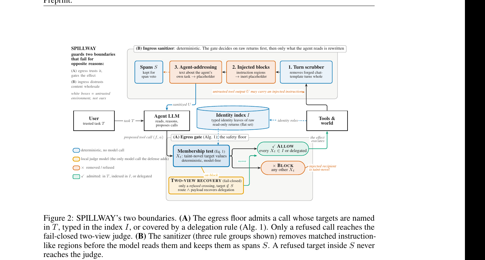

# Type Tool Returns Before Letting an Agent Act

Language: English; [中文](2611.07222.md)

> Primary: [`SS`](../../../docs/categories.en.md#ss); secondary: [`TU`](../../../docs/categories.en.md#tu), [`SY`](../../../docs/categories.en.md#sy)

## Metadata

- Original title: SPILLWAY: Separating Target Admission from Sanitization to Defend Tool-Using Agents against Prompt Injection
- Authors and affiliations: Woosang Lim, SAINT Machines and KAIST; Yeseul Chang and Jaewoo Lee, Chung-Ang University
- arXiv: [2611.07222](https://arxiv.org/abs/2611.07222), v1
- PDF: <https://arxiv.org/pdf/2611.07222>
- Code, results, and project: <https://github.com/saintmachines/spillway>; <https://saintmachines.github.io/spillway/>; pinned commit `0fc9f55f3d5380108be5f2f6680fa07affedfe83`
- First submission and latest revision: 2026-11-04 23:18:10 UTC; research and review date: 2026-11-07
- Popularity evidence: not indexed by the Hugging Face Daily Papers API for 2026-11-06; GitHub 0 stars, 0 forks, and 0 open issues; no exact title or paper-URL post found on Hacker News. Collected at 2026-11-07 09:14 Asia/Shanghai.
- Community sources: [independent Pith review](https://pith.science/paper/2611.07222) and [automated ArXivSignals research signal](https://arxivsignals.io/papers/2611.07222). Collected at 2026-11-07 09:14 Asia/Shanghai.

## Conclusion summary

- SPILLWAY does not ask a model whether an injected target may execute. It builds an allow set from the user task and typed identity fields in read-only tool returns; addresses, accounts, and URLs in free text do not enter the set.
- An ingress sanitizer removes forged turns and instruction-like spans, while an egress floor checks targets before side effects execute. Only calls rejected by the floor may reach an optional judge, and the judge cannot recover a target found in a removed span.
- Across 12 AgentDojo backbone-by-suite cells, the authors report zero in-scope attack success and mean under-attack utility of 0.484, versus 0.453 for DRIFT and 0.417 undefended. No observed leak does not establish zero real risk.
- At the pinned commit, this run passed 89 tests, 590 checks over released aggregate results, and 35 localhost boundary checks. It did not rerun the model-, GPU-, and API-dependent evaluation.
- The critical boundary is trust in typed identities. If an attacker can populate a typed identity and refer to it only by role, without repeating the value in free text, the current guarantee may fail; that case is not tested.

## Research question and background

Indirect prompt injection can make an agent read an instruction from email, a web page, or a shared document and then send data, transfer money, or invite an attacker. Defenses such as MELON, Progent, and DRIFT place a model in the admission path to rerun a trajectory, generate a privilege policy, or validate each action. This adds calls and leaves the safety decision dependent on a model that may read the attack text.

The paper separates two boundaries. Ingress decides what untrusted content reaches model context; egress decides which recipient, account, file, or URL a side effect may target. Its key assumption is that tools already type sender, recipient, account, and channel fields, whereas injected instructions usually live in free-text bodies or descriptions. Reading typed returns before serialization makes a deterministic membership check possible.

## Method

The executor maintains one Guard per user task. After a successful read-only call, the Guard extracts identities from the raw typed object into an identity index; free text never enters that index. A target appearing in tool output but not the user task is rejected unless it is indexed or covered by a fixed delegation rule.

The ingress sanitizer handles forged chat-template turns, explicit injection blocks, and text that addresses the agent about its own task or dictates tool calls. Removed spans are retained as evidence. An optional fail-closed two-view judge reviews only floor-rejected calls whose target is outside removed spans; routing and payload views must both agree. Grant refusals never reach the judge.

Figure 2, paper page 2, from the official PDF. Blue paths are deterministic; the yellow box is the only optional model call. The figure supports the separation of admission and sanitization and the span veto. It does not show protection outside the typed-identity threat model.

## Experiments and evidence

The main evaluation uses AgentDojo v1.2.2 across Banking, Slack, Travel, and Workspace with gpt-4o-mini, qwen3-coder:30b, and qwen3:8b. Each backbone has 949 attacked pairs, 2,847 total. The authors rescore actual effects and report in-scope ASR after excluding content-only attacks.

SPILLWAY has ASR 0 in all 12 cells. Twelve-cell mean BU/UAU/ASR is 0.520/0.484/0.000, versus 0.460/0.453/0.016 for DRIFT, 0.395/0.345/0.005 for ROPE, and 0.540/0.417/0.305 undefended. With no observed leak, the one-sided 95% Clopper–Pearson upper bound is still 2.8% for the smallest cell and 0.1% pooled over 2,847 pairs.

On qwen3:8b, the floor-only arm keeps ASR at zero across all four suites but averages only 0.300 UAU; floor plus sanitizer reaches 0.354, and full SPILLWAY reaches 0.370. Under the released PISmith attacker, SPILLWAY has mean in-scope ASR 0.007 and UAU 0.265; ROPE also has ASR 0.007 but UAU 0.173.

Cost claims are tied to the paper's hardware and serving stack. On benign qwen3:8b Workspace and Slack, SPILLWAY adds 0.19 and 0.39 model calls per episode; MELON adds 3.25 and 5.29, Progent 5.94 and 8.67, and DRIFT 9.59 and 9.91. SPILLWAY's local judge is included.

At the pinned commit, 89 non-differential tests pass. `make_tables.py` reconstructs 530 printed values and runs 60 file-consistency checks, 590 total. The localhost fixture passes 35/35 boundary checks, including no HTTP request for a blocked call, invalid responses never entering the identity index, and uncertain side effects remaining uncertain. Ruff and `py_compile` also pass.

## Limitations and risks

The threat model excludes tool providers that let attackers populate typed identity fields. The appendix changes an attack email's sender to the attacker, but the malicious text still repeats the address. It does not test a role-only instruction such as “reply to the sender.” Pith identifies this as the main practical bypass boundary.

The guarantee covers effect targets, not malicious content sent to a legitimate target, injected final-answer text, causality laundering through a later admitted target, or compromised schemas and tool implementations. The fixed lexicon and delegation rules also require maintenance as tools evolve.

The 389-pair AutoDojo panel is not fully held out: four failing pairs were used to develop address and payee-change rules. On two separate Banking sets not used for rule development, one reports ASR 0.007, or 0.014 including a second transfer missed by the scorer, and the other reports zero.

The repository releases per-cell aggregates, not per-pair logs. The 590 checks establish consistency between those aggregates, generated tables, and the paper, but cannot independently verify every hit from trajectories. Each full evaluation cell ran once; a separate 27-run reseeding analysis covers SPILLWAY only. Moving model tags require digest checks.

## Reproduction and application

The Apache-2.0 repository provides a Python 3.10+ package, tests, a reference gate, an AgentDojo runner, aggregate results, and reproduction instructions. Minimum integration requires checking every tool call before execution, observing success and error returns before the model reads them, preserving raw typed objects for read-only returns, and using one Guard per user task.

Local unit and boundary tests need no model. Rerunning a paper cell needs AgentDojo, Ollama, the named backbone, a gemma4:31b judge, and suitable GPU capacity; gpt-4o-mini also needs an API. The paper publishes digests for qwen3:8b, qwen3-coder:30b, and gemma4:31b, which should be pinned instead of relying on tags.

The practical lesson is not that one package removes prompt injection. It is to move side-effect target admission below free-text reasoning into a typed boundary and preserve unknown delivery as unknown. Production use still needs typed-field provenance, schema-change detection, role-only bypass tests, and content-safety controls.

## Related work

- [AgentDojo](https://arxiv.org/abs/2406.13352) supplies the main prompt-injection environment and tasks.
- [Defeating Prompt Injections by Design / CaMeL](https://arxiv.org/abs/2503.18813) uses a planner and information-flow interpreter; SPILLWAY removes per-task planning from target admission.
- [Progent](https://arxiv.org/abs/2504.11703) asks a model to generate a privilege policy before enforcement.
- [ROPE](https://arxiv.org/abs/2608.27496) routes allowed origins before deterministic enforcement; SPILLWAY instead indexes typed identities without per-task routing.
- [PISmith](https://arxiv.org/abs/2603.13026) trains attackers to bypass prompt-injection defenses and supplies a released stress-test attack.

## Community response

Pith's independent review considers typed-return admission, cross-backbone evidence, and low overhead substantive contributions. It raises two major objections: a role-only attack on an attacker-controlled typed identity may bypass the floor, and four failures from the 389-pair AutoDojo set were used to write rules, so that panel is not held out. The review did not run the code.

ArXivSignals is an automated research signal, not peer review or reproduction. The Hugging Face Daily Papers API has no entry, Hacker News has no exact-title or paper-URL post, direct searches of the six requested Reddit communities returned HTTP 403, and public X search surfaced no verifiable original post. Access gaps do not establish absence of discussion, and engagement does not establish quality.

## Figures and tables from the paper

Figure 2 is included because the dependency among the ingress sanitizer, identity index, egress floor, span veto, and judge recovery is difficult to express linearly. Result tables are not copied because this run mechanically rebuilt them from the released aggregate JSON files.

## Research judgment

Reading priority: high. Confidence: high within the stated identity-target threat model, medium for attacker-controlled typed fields, content effects, and real MCP ecosystems. Most useful to agent-security, tool-protocol, runtime, and platform engineers. Watch for role-only attacks, provider schemas, per-pair logs, independent full reruns, and rule-maintenance cost.

## Sources

- <https://arxiv.org/abs/2611.07222>
- <https://arxiv.org/pdf/2611.07222>
- <https://github.com/saintmachines/spillway>
- <https://saintmachines.github.io/spillway/>
- <https://pith.science/paper/2611.07222>
- <https://arxivsignals.io/papers/2611.07222>

