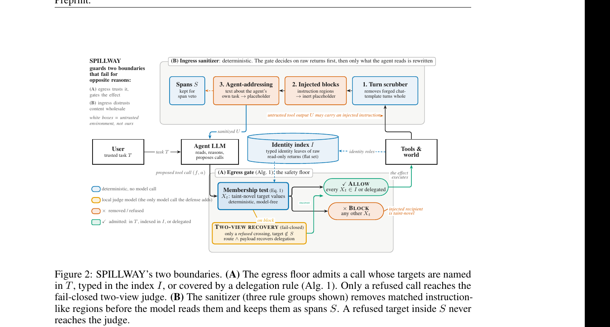

# 把工具返回分型，先挡住注入目标再让模型判断

语言：中文；[English](2611.07222.en.md)

> 主分类：[`SS`](../../../docs/categories.md#ss)；辅助分类：[`TU`](../../../docs/categories.md#tu)、[`SY`](../../../docs/categories.md#sy)

## 元数据

- 英文标题：SPILLWAY: Separating Target Admission from Sanitization to Defend Tool-Using Agents against Prompt Injection
- 作者与机构：Woosang Lim（SAINT Machines、KAIST）、Yeseul Chang（Chung-Ang University）、Jaewoo Lee（Chung-Ang University）
- arXiv：[2611.07222](https://arxiv.org/abs/2611.07222)；v1
- PDF：<https://arxiv.org/pdf/2611.07222>
- 代码、结果与项目页：<https://github.com/saintmachines/spillway>；<https://saintmachines.github.io/spillway/>；固定 commit `0fc9f55f3d5380108be5f2f6680fa07affedfe83`
- 首次提交与最近修订：2026-11-04 23:18:10 UTC；调研与复查：2026-11-07
- 热度证据：Hugging Face 2026-11-06 Daily Papers API 未收录；GitHub 0 stars／0 forks／0 open issues；Hacker News 未找到精确论文标题或 URL 帖子。采集时间：2026-11-07 09:14（Asia/Shanghai）。
- 社区评价来源：[Pith 独立评述](https://pith.science/paper/2611.07222)；[ArXivSignals 自动研究信号](https://arxivsignals.io/papers/2611.07222)。采集时间：2026-11-07 09:14（Asia/Shanghai）。

## 结论摘要

- SPILLWAY 不让模型直接决定注入目标能否执行。它从用户任务和 read-only tool return 的 typed identity 字段建立允许集合；自由文本中的地址、账号或 URL 不进入集合。
- ingress 清洗器移除伪造对话轮次和指令式片段，egress floor 在副作用执行前检查目标。只有 floor 拒绝的调用才进入可选 judge；目标若来自被移除片段，judge 不能恢复。
- AgentDojo 的 12 个 backbone × suite cell 中，作者报告 in-scope attack success 全为 0，平均 under-attack utility 为 0.484，高于 DRIFT 的 0.453 和未防护的 0.417。无观测泄漏不等于真实风险为 0。
- 本轮在固定 commit 下通过 89 项测试、590 项公开结果检查和 35 项 localhost 边界检查；没有复跑需要模型、GPU 和 API 的完整评测。
- 最关键边界是 typed identity 的可信性。攻击者若能写入 typed identity 字段，并只用「回复发送者」这类角色指代而不在自由文本重复目标，论文现有保证可能不成立，该情形未被实测。

## 研究问题与背景

间接 prompt injection 的典型失败是：Agent 从邮件、网页或共享文档读到攻击者指令，随后把数据发给攻击者、转账或邀请陌生账户。MELON、Progent 和 DRIFT 等防护把模型放在执行准入路径上，让模型重跑轨迹、生成权限策略或逐步核对计划；这既增加调用，也让安全决定继续依赖会读取攻击文本的模型。

论文把问题拆成两个边界。ingress 决定哪些非可信文本可以进入模型上下文；egress 决定一个副作用调用可以作用到哪个收件人、账号、文件或 URL。核心假设是：工具返回已经把 sender、recipient、account、channel 等身份字段结构化，而攻击指令通常位于 body、description 等自由文本字段。若执行器在序列化前读取 typed return，就能用确定性集合检查区分二者。

## 核心方法

执行器为每个用户任务维护独立 Guard。read-only 工具成功返回后，Guard 从原始 typed object 中提取身份字段，写入 identity index；自由文本不进入索引。目标值若出现在工具输出、没有出现在用户任务，且既不在 identity index 中也不满足固定 delegation rule，egress floor 就拒绝副作用调用。

ingress 清洗器处理三类内容：伪造 chat-template 轮次、显式 injection block，以及对 Agent 自身任务或工具调用的指令式文本。被移除的 span 会保留为证据。可选的 two-view judge 只复核 floor 已拒绝、且目标不在被移除 span 内的调用；routing 与 payload 两个视图都同意才恢复，解析失败则继续拒绝。grant 类拒绝不交给 judge。

图 2，论文第 2 页，来源为官方 PDF。图中蓝色路径是确定性处理，黄色框是唯一可选模型调用。它支持「准入与清洗分离、被清洗目标不能被 judge 恢复」这一机制说明；不证明威胁模型之外的 typed-field 攻击也会被阻止。

## 实验与证据

主评测使用 AgentDojo v1.2.2，覆盖 Banking、Slack、Travel、Workspace 四个 suite 和 gpt-4o-mini、qwen3-coder:30b、qwen3:8b 三个 backbone。每个 backbone 有 949 个 attacked pairs，共 2,847 对。作者按实际执行效果重评分，并去掉只改变内容、不改变目标的任务后报告 in-scope ASR。

SPILLWAY 在 12 个 cell 的 ASR 均为 0，12-cell 平均 BU／UAU／ASR 为 0.520／0.484／0.000；DRIFT 为 0.460／0.453／0.016，ROPE 为 0.395／0.345／0.005，未防护为 0.540／0.417／0.305。最小 cell 无泄漏时，单侧 95% Clopper–Pearson 上界仍为 2.8%；2,847 对合并上界为 0.1%，因此结果应写成「样本内未观测到泄漏」。

qwen3:8b 消融显示 floor-only 已在四个 suite 上保持 ASR 0，但平均 UAU 只有 0.300；floor + sanitizer 为 0.354，完整 SPILLWAY 为 0.370。PISmith 强化学习攻击下，SPILLWAY 的 mean in-scope ASR 为 0.007，UAU 为 0.265；ROPE 同为 0.007，但 UAU 为 0.173。

开销比较只覆盖论文指定硬件与服务栈。qwen3:8b 的 benign Workspace／Slack 中，SPILLWAY 每 episode 比未防护多 0.19／0.39 次模型调用；MELON 为 3.25／5.29，Progent 为 5.94／8.67，DRIFT 为 9.59／9.91。论文把 SPILLWAY 的本地 judge 计入调用数。

本轮固定 commit 通过 89 项非 differential 测试；`make_tables.py` 从公开 per-cell aggregate 重建 530 个表格值并完成 60 项一致性检查，共 590 项通过。localhost 示例的 35/35 项检查通过，包括 blocked call 不发 HTTP、无效响应不进入 identity index、传输失败保持副作用未知等。ruff 与 `py_compile` 通过。

## 局限与风险

作者明确把攻击者写入 typed identity 字段的工具提供者排除在威胁模型之外。附录把攻击邮件的 sender 改为攻击者地址，但测试指令仍在自由文本重复该地址；「只按角色指代发送者」没有测试。Pith 的第三方评述认为这是最重要的现实绕过边界。

保证只覆盖 effect target。发送到合法目标的恶意内容、最终回答中的注入文本、通过后续合法目标完成的 causality laundering，以及工具 Schema 或实现本身被攻破，均不由 target floor 解决。固定 lexicon 与 delegation rule 也需要随工具和字段演化维护。

AutoDojo 的 389 对结果不是完整 held-out：作者用其中 4 个失败 pair 开发 address 和 payee-change rule。真正未参与规则开发的两组 Banking 集合中，一组 ASR 为 0.007（若计入 scorer 漏掉的第二次转账则为 0.014），另一组为 0。

公开仓库只有 per-cell aggregates，没有 per-pair logs；590 项检查证明聚合文件、生成表与论文一致，不能从轨迹独立复核每个 hit。完整评测每 cell 只运行一次，另有 27 次 reseeding 只覆盖 SPILLWAY。模型 tag 会移动，复跑必须核对 digest。

## 复现与应用

仓库采用 Apache-2.0，提供 Python 3.10+ 包、单元测试、参考 gate、AgentDojo runner、公开聚合结果和复现说明。最小集成要求：所有工具调用在执行前检查；所有成功与错误返回在交给模型前观察；read-only return 必须保留 typed object；每个用户任务使用独立 Guard。

本地单元与边界测试不需要模型。重跑一个论文 cell 需要 AgentDojo、Ollama、指定 backbone、gemma4:31b judge 与相应 GPU；gpt-4o-mini cell 还需要 API。论文公开 qwen3:8b、qwen3-coder:30b 和 gemma4:31b 的 digest，复跑时应固定这些权重而不是只固定 tag。

工程应用的最小价值不是「安装后消除 prompt injection」，而是把副作用目标的准入从自由文本推理下沉到 typed boundary，并把未知执行结果保留为未知。部署前还需补 typed-field provenance、Schema 变更检测、role-only 绕过测试和业务特定的内容安全策略。

## 相关工作

- [AgentDojo](https://arxiv.org/abs/2406.13352) 提供本文的主要 prompt-injection 环境与评分任务；SPILLWAY 在其 full grid 上比较防护。
- [Defeating Prompt Injections by Design / CaMeL](https://arxiv.org/abs/2503.18813) 用规划器和信息流解释器控制数据来源；SPILLWAY 取消每任务 planner，直接读取 typed return。
- [Progent](https://arxiv.org/abs/2504.11703) 让模型生成 privilege policy，再由检查器执行；本文试图把最终目标判断改成确定性集合查询。
- [ROPE](https://arxiv.org/abs/2608.27496) 用 router 设定来源，再做确定性 origin enforcement；本文重点比较不用 per-task routing 的 typed-identity floor。
- [PISmith](https://arxiv.org/abs/2603.13026) 训练攻击者绕过 prompt-injection 防护；本文用其公开攻击做 open-loop stress test。

## 社区评价

Pith 的第三方评述认为 typed-return 目标准入、跨 backbone 结果和低额外调用构成实质贡献，并认可作者公开威胁模型与工件。它同时提出两个主要质疑：一是 attacker-controlled typed identity 加 role-only 指令可能绕过 floor；二是 AutoDojo 389 对中 4 个失败 pair 被用于写规则，因此该组不能按 held-out 结果解读。该评述没有独立运行代码。

ArXivSignals 只提供自动研究信号，不是同行评审或复现。Hugging Face Daily Papers API 未收录；Hacker News 没有精确标题或论文 URL 帖子；指定 6 个 Reddit 社区的直接搜索均返回 HTTP 403，公开 X 搜索未取得可核验原帖。访问缺口不代表没有讨论，互动量也不代表论文质量。

## 原文关键图表

本文保留图 2 一张截图，因为 ingress sanitizer、identity index、egress floor、span veto 和 judge recovery 的依赖关系难以用线性文字完整表达。关键结果表不截图：本轮已从公开 JSON 聚合文件机械重建论文表格。

## 调研判断

阅读优先级：高。可信度：在作者声明的 identity-target 威胁模型内为高；对 attacker-controlled typed field、content effect 和真实 MCP 生态的外部效度为中。最适合 Agent 安全、工具协议、运行时和平台工程人员。后续应观察 role-only 攻击、真实 provider Schema、per-pair logs、独立完整重跑，以及规则维护成本。

## 来源

- <https://arxiv.org/abs/2611.07222>
- <https://arxiv.org/pdf/2611.07222>
- <https://github.com/saintmachines/spillway>
- <https://saintmachines.github.io/spillway/>
- <https://pith.science/paper/2611.07222>
- <https://arxivsignals.io/papers/2611.07222>
