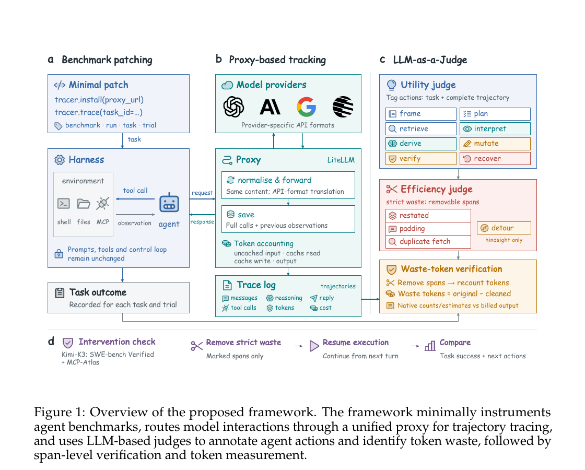

# Deleting Reasoning Does Not Mean Saving the Same Amount

Language: English; [中文](2611.07238.md)

> Primary: [`EV`](../../../docs/categories.en.md#ev); secondary: [`SY`](../../../docs/categories.en.md#sy)

## Metadata

- Original title: How Do AI Agents Waste Your Money?
- Authors and affiliations: Huimin Zeng, Yuxuan Lu, Jesse Cai, Eric Hanchen Jiang, Di Wu, Po-Nien Kung, Wenbo Hu, Ziyi Wang, Dakuo Wang, Jiaxin Pei, and Kai-Wei Chang (UIUC, Northeastern University, independent researcher, UCLA, and UT Austin)
- arXiv: [2611.07238](https://arxiv.org/abs/2611.07238), v1
- PDF: <https://arxiv.org/pdf/2611.07238>
- Code: <https://github.com/huiminzeng/How_Do_AI_Agents_Waste_Your_Money>; pinned commit `22848d88c830e88354adbb387db95f979a67bfa7`
- Data: <https://huggingface.co/datasets/huiminz3/How_Do_AI_Agents_Waste_Your_Money>; CC BY 4.0, manually gated
- First submission and latest revision: 2026-11-04 23:43:03 UTC; research and review: 2026-11-09
- Popularity evidence: GitHub had 0 stars, 0 forks, and 0 open issues; the Hugging Face dataset had 0 likes and 707 downloads; exact arXiv-ID search on Hacker News returned zero stories. Collected 2026-11-09 09:12 Asia/Shanghai.
- Community sources: [Pith T0 AI review](https://pith.science/paper/2611.07238) and [New Runtime method note](https://newruntime.com/posts/how-do-ai-agents-waste-your-money-framework-4b5aa5/). Collected 2026-11-09 09:12 Asia/Shanghai.

## Conclusion summary

- The paper reframes agent efficiency from total tokens consumed to tokens that can be removed without eliminating useful work. A unified proxy, an LLM-as-a-Judge (LLMaJ), and intervention-based continuation form the measurement pipeline.
- The authors report that roughly 18% of output tokens across collected trajectories are waste. For more than 45% of tasks, one agent's wasted output alone exceeds another successful agent's entire output.
- Online pruning deletes 41% of reasoning on SWE-bench Verified while success changes from 89.0% to 89.5%; on MCP-Atlas it deletes 46% while success changes from 65.0% to 62.3%. These are deletion ratios, not demonstrated net-token or bill reductions after regeneration.
- Deleting marked waste significantly changes 3.0% of next-action distributions on SWE-bench Verified, compared with 25.0% after deleting all reasoning. MCP-Atlas reports 10.5% versus 37.9%.
- The repository exposes tracing, four benchmark patches, and LLMaJ. At the pinned commit, `compileall` and 32 proxy tests pass. Dataset metadata are visible, but manual gating blocks unauthenticated downloads, so the headline aggregates were not independently recomputed.

## Research question and background

Total tokens, latency, and bills describe resource consumption but do not identify which work was necessary. A long trajectory may reflect genuine task difficulty; a short one can still repeat context, refetch the same information, or take avoidable detours. Optimizing only aggregate usage risks cutting useful reasoning while leaving removable content intact.

The paper defines token waste as content whose removal does not eliminate useful work from the trajectory. A defensible measurement therefore needs both span identification and evidence that execution still works after those spans are removed.

## Method

First, minimal benchmark patches route model calls through a LiteLLM proxy. It records messages, reasoning, visible responses, tool calls, provider token counts, and cost, keyed by benchmark, run, task, and trial.

Second, LLMaJ labels action utility and identifies four waste patterns inside reasoning, responses, and tool interactions: Restate, Duplicate-Fetch, Padding, and Detour. The first three are strict waste. A detour may be unnecessary in hindsight but reasonable when attempted.

Third, marked spans are mapped to source text and recounted with provider-native tokenizers or counting tools. Validation removes prior strict-waste spans, resumes execution, and compares task outcomes and next-action distributions. The online experiment removes only Restate and Padding, then regenerates the visible response and tool call.

Figure 1, page 2 of the official PDF. It links benchmark patching, proxy tracing, LLMaJ labeling, and continuation after deletion. The static formula “waste tokens = original − cleaned” does not account for content regenerated during online pruning, so it is not a net-savings equation for Table 3.

## Experiments and evidence

The study covers Kimi-K3, Gemini 3.1 Pro, GPT-5.6 Terra, GPT-6 Astra, Claude Sonnet 5, and Claude Fable 5.1 on τ²-bench airline and retail, SWE-bench Verified, Claw-Eval, and MCP-Atlas. Reasoning-effort analysis uses Kimi-K3 because it exposes full reasoning. Harness comparisons cover OpenCode, OpenClaw, OpenHands, Hermes, and Kimi Code CLI.

After deleting historical strict waste, original/pruned success on SWE-bench Verified is 81.7%/81.7%, 86.0%/86.0%, and 91.3%/91.3% at the 25%, 50%, and 75% intervention points. MCP-Atlas changes from 75.3% to 65.6% at the first turn, stays at 74.2% at the second, and changes from 71.8% to 73.2% at the third. Short early contexts are more sensitive.

For next actions, the study samples 16 continuations per condition and turn, using token-set Jaccard distance, energy distance, and 2,000 permutation assignments. Deleting marked waste changes 3.0% of turns on SWE-bench Verified versus 25.0% after deleting all reasoning; MCP-Atlas reports 10.5% versus 37.9%. The aggregate SWE-bench effect has `p=0.007` but is only 1.8% of natural control-rollout spread.

Online pruning deletes 41% of SWE-bench reasoning while success changes from 89.0% to 89.5%; on MCP-Atlas, 46% deletion changes success from 65.0% to 62.3%. Deleting all reasoning reduces them to 73.0% and 56.0%. Because the paper omits total regenerated output, this validates limited task impact, not a 41–46% bill reduction.

Waste varies more by task and harness than by model or trajectory length. Kimi-K3 Max produces 6.6× as many reasoning tokens per trajectory as Low, yet 66% are still judged non-wasteful on average. Low to High adds 0.99M tokens and improves success from 69.7% to 78.4%; High to Max adds another 0.80M tokens without measurable improvement.

## Limitations and risks

LLMaJ is not compared with expert span annotations. Continuation after deletion provides external validation, but it cannot estimate missed waste and does not eliminate shared-model-family bias.

Full reasoning is observable only for Kimi-K3. Other providers are audited mainly through visible responses and tool calls, so internal-reasoning conclusions do not generalize automatically. Main intervention tables also omit per-row sample counts.

The metric targets removable content. An agent can continue taking locally reasonable steps after the environment makes success impossible, creating substantial trajectory-level inefficiency without individual spans being labeled waste.

The Hugging Face API lists 64 files and about 57.4 MB of visible tree metadata, but the dataset is manually gated and unauthenticated download returns 401. This review did not obtain full trajectories or recompute the 18% aggregate.

## Reproduction and application

The MIT repository includes pinned upstream commits and patches for four benchmarks, the tracing proxy, LLMaJ prompts and aggregation, and run scripts. At commit `22848d8…`, Python compilation and 32 proxy tests pass. These checks validate the public implementation, not the model experiments.

Full reproduction needs Linux, Python 3.12, Docker, several provider keys, 36 MCP-Atlas service credentials, and paid judging. A practical first deployment is unified tracing plus A/B reporting of waste ratio, task success, net tokens, latency, and bill, so deletion ratios are not mistaken for realized savings.

## Related work

- [How Do AI Agents Spend Your Money?](https://arxiv.org/abs/2604.22750) predicts aggregate token consumption in coding agents; this paper localizes removable spans.
- [RedundancyBench](https://arxiv.org/abs/2605.29893) detects redundant whole steps; this work audits spans inside reasoning, responses, and tool interactions.
- [BAGEN](https://arxiv.org/abs/2606.00198) tests whether agents understand remaining budget; this work asks which consumed tokens contributed no useful work.
- [Harness-Bench](https://arxiv.org/abs/2605.27922) compares completion and efficiency across model-harness combinations; this work attributes harness-specific waste patterns under a fixed model and task.
- [Life-Harness](https://arxiv.org/abs/2605.22166) adapts runtime interfaces around frozen models; this framework can diagnose repetition, recovery, and detour costs introduced by such interfaces.

## Community response

Pith's T0 AI review credits the unified tracing, span labeling, and intervention validation, treating Tables 1–2 as substantive evidence that marked spans are removable. Its main objection is that Table 3 reports deleted reasoning but not net output tokens or cost after regeneration. It also flags the absence of human agreement for LLMaJ. The page explicitly states that the review is AI-generated, has no human expert review, and did not run the code.

New Runtime similarly distinguishes intervention evidence from realized savings and warns that 41–46% is a reasoning-deletion fraction, not total-spend reduction. It did not independently rerun the experiments.

GitHub had 0 stars, 0 forks, and 0 open issues; Hacker News exact search returned zero stories; targeted searches in the six specified Reddit communities found no exact match; public X search returned no verifiable original post. Sparse visible discussion is not evidence of low paper quality.

## Figures and tables from the paper

Figure 1 is retained to explain the trace-identify-verify pipeline and the difference between static recounting and online continuation. Numerical claims still come from the text and Tables 1–3.

## Research judgment

Reading priority: high. Confidence is high for the public implementation and intervention evidence, and medium for the 18% cross-system aggregate, LLMaJ recall, and net savings from online pruning. The paper is most useful for agent-platform, evaluation, cost-optimization, and harness engineers. Watch for open dataset access, human span labels, post-regeneration net tokens and bills, different judge families, and production A/B tests.

## Sources

- <https://arxiv.org/abs/2611.07238>
- <https://arxiv.org/pdf/2611.07238>
- <https://github.com/huiminzeng/How_Do_AI_Agents_Waste_Your_Money>
- <https://huggingface.co/datasets/huiminz3/How_Do_AI_Agents_Waste_Your_Money>
- <https://pith.science/paper/2611.07238>
- <https://newruntime.com/posts/how-do-ai-agents-waste-your-money-framework-4b5aa5/>
