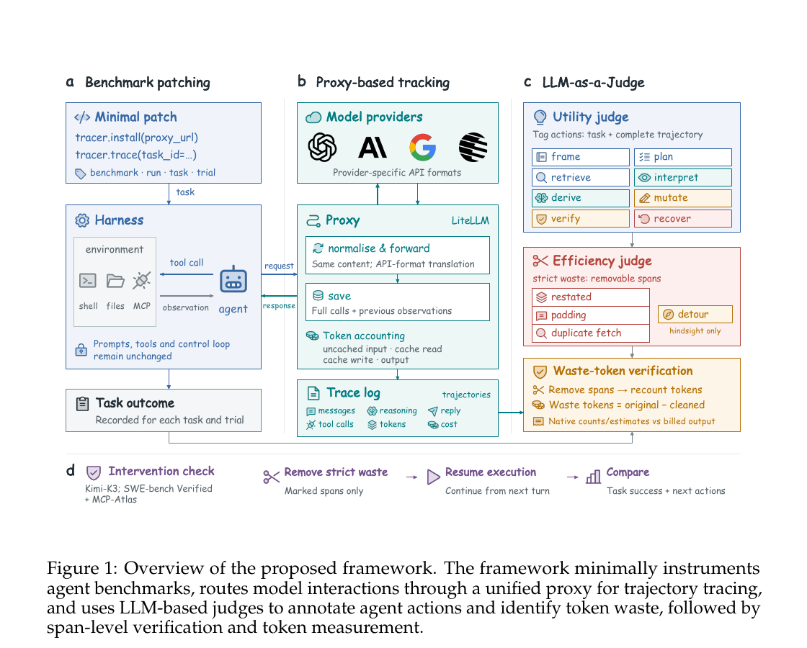

# 删掉推理不等于省下同样多的钱

语言：中文；[English](2611.07238.en.md)

> 主分类：[`EV`](../../../docs/categories.md#ev)；辅助分类：[`SY`](../../../docs/categories.md#sy)

## 元数据

- 英文标题：How Do AI Agents Waste Your Money?
- 作者与机构：Huimin Zeng、Yuxuan Lu、Jesse Cai、Eric Hanchen Jiang、Di Wu、Po-Nien Kung、Wenbo Hu、Ziyi Wang、Dakuo Wang、Jiaxin Pei、Kai-Wei Chang（UIUC、Northeastern University、独立研究者、UCLA、UT Austin）
- arXiv：[2611.07238](https://arxiv.org/abs/2611.07238)；v1
- PDF：<https://arxiv.org/pdf/2611.07238>
- 代码：<https://github.com/huiminzeng/How_Do_AI_Agents_Waste_Your_Money>；固定 commit `22848d88c830e88354adbb387db95f979a67bfa7`
- 数据：<https://huggingface.co/datasets/huiminz3/How_Do_AI_Agents_Waste_Your_Money>；CC BY 4.0，manual gated
- 首次提交与最近修订：2026-11-04 23:43:03 UTC；调研与复查：2026-11-09
- 热度证据：GitHub 0 stars／0 forks／0 open issues；Hugging Face 数据集 0 likes、707 downloads；Hacker News arXiv ID 精确检索 0 条。采集时间：2026-11-09 09:12（Asia/Shanghai）。
- 社区评价来源：[Pith T0 AI 评述](https://pith.science/paper/2611.07238)、[New Runtime 方法解读](https://newruntime.com/posts/how-do-ai-agents-waste-your-money-framework-4b5aa5/)。采集时间：2026-11-09 09:12（Asia/Shanghai）。

## 结论摘要

- 论文把 Agent 效率问题从「用了多少 token」改成「哪些 token 删除后仍不影响有用工作」，并用统一代理、LLM-as-a-Judge（LLMaJ）和续跑干预形成测量流程。
- 作者报告，跨收集轨迹约 18% 输出 token 被标为 waste；超过 45% 的任务中，某个 Agent 单是浪费的输出就超过另一个成功 Agent 的全部输出。
- 在 SWE-bench Verified 中，在线删除 41% reasoning 后成功率由 89.0% 变为 89.5%；MCP-Atlas 删除 46% 后由 65.0% 变为 62.3%。这些是「删除比例」，论文没有报告重生成后的净 token 或净账单，不能按同一比例解释为成本下降。
- 删除已标注 waste 后，SWE-bench Verified 只有 3.0% 的下一动作分布显著变化，删除全部历史 reasoning 则为 25.0%；MCP-Atlas 对应为 10.5% 与 37.9%。
- 公开仓库含追踪代理、四基准补丁与 LLMaJ；本轮固定 commit 下 `compileall` 和代理层 32 项 pytest 通过。数据集目录可见，但 manual gated 阻止未登录下载，未复算论文主结果。

## 研究问题与背景

总 token、延迟和账单只能说明 Agent 消耗了多少资源，不能说明哪些消耗是必要的。长轨迹可能因为任务本身困难而合理，短轨迹也可能不断复述、重复查询或绕路。若只压缩总量，可能删掉真正影响任务的推理，却保留可以移除的冗余。

论文因此定义 token waste：删除后不会消除轨迹中有用工作的内容。该定义要求同时回答两个问题：哪些 span 看似可移除，以及删除后续跑是否仍保持任务结果和后续动作。

## 核心方法

第一阶段用少量 benchmark patch 把模型调用路由到 LiteLLM 代理，记录消息、reasoning、可见回复、工具调用、provider token 计数和成本，并按 benchmark、run、task、trial 关联完整轨迹。

第二阶段由 LLMaJ 给动作标记 utility 类别，并在 reasoning、回复和工具交互中定位四类 waste：重复上下文的 Restate、重复获取已有信息的 Duplicate-Fetch、没有实质作用的 Padding，以及事后看无效但当时可能合理的 Detour。前三类被视为 strict waste；Detour 不等同于执行时显然错误。

第三阶段把标注 span 映射回原始文本，用 provider 自有 tokenizer 或计数工具重新计数。验证不是只看 judge 标签：作者删除历史 strict-waste span 后继续执行，比较最终成功率与下一动作分布；在线实验只删除当前可判断的 Restate 和 Padding，再让模型重生成回复与工具调用。

图 1，论文第 2 页，来源为官方 PDF。它说明从 benchmark patch、代理追踪、LLMaJ 标注到删除后续跑的证据关系。图中「waste tokens = original − cleaned」描述静态清理计数；在线裁剪还会重生成后续内容，因此不能直接推出净 token 节省。

## 实验与证据

实验覆盖 Kimi-K3、Gemini 3.1 Pro、GPT-5.6 Terra、GPT-6 Astra、Claude Sonnet 5、Claude Fable 5.1，以及 τ²-bench airline／retail、SWE-bench Verified、Claw-Eval、MCP-Atlas。reasoning-effort 分析只使用完整暴露 reasoning 的 Kimi-K3；harness 对照包含 OpenCode、OpenClaw、OpenHands、Hermes 与 Kimi Code CLI。

删除历史 strict waste 后，SWE-bench Verified 在 25%、50%、75% 三个干预点的原始／裁剪成功率分别为 81.7%／81.7%、86.0%／86.0%、91.3%／91.3%。MCP-Atlas 首轮干预从 75.3% 降到 65.6%，第二轮保持 74.2%，第三轮由 71.8% 变为 73.2%；早期短轨迹对删除更敏感。

下一动作实验对每个 turn 的原始与干预上下文各采样 16 次，用 token-set Jaccard distance、energy distance 和 2,000 次 permutation test 判断分布变化。SWE-bench Verified 删除已标注 waste 后 3.0% turn 显著变化，删除全部 reasoning 为 25.0%；MCP-Atlas 为 10.5% 与 37.9%。SWE-bench 的聚合变化虽有 `p=0.007`，幅度只有控制样本自然离散的 1.8%。

在线裁剪中，SWE-bench Verified 删除 41% reasoning，成功率 89.0%→89.5%；MCP-Atlas 删除 46%，成功率 65.0%→62.3%。删除全部 reasoning 时两者分别降到 73.0% 与 56.0%。论文没有报告裁剪后重生成文本的总 token，因此这些结果验证「被删 span 对成功率影响较小」，不证明账单按 41%～46% 下降。

作者还发现 waste 更受任务与 harness 影响，而不是简单由模型或轨迹长度决定。Kimi-K3 Max 相比 Low 每条轨迹生成 6.6 倍 reasoning，但其中平均 66% 仍被 judge 判为非 waste；Low→High 多用 0.99M token，成功率 69.7%→78.4%，High→Max 再用 0.80M token 却没有可测提升。

## 局限与风险

LLMaJ 没有与专家人工 span 标注做一致性比较。删除后续跑提供了外部验证，但不能测出遗漏的 waste，也不能完全排除 judge 与被测模型共享偏差。

完整 reasoning 只对 Kimi-K3 可见；其他模型主要测可观察回复和工具调用，不能把内部 reasoning 结论外推到所有 provider。主表也没有为每项干预同时报告样本数。

metric 只覆盖「可删除内容」。当环境已经让任务不可行时，Agent 继续执行一连串局部合理动作，可能造成巨大消耗却不被逐 span 标成 waste。论文明确把这类轨迹级低效列为未覆盖范围。

Hugging Face 数据集虽列出 64 个文件和约 57.4 MB 可见目录，但当前 manual gated；未登录请求返回 401。本轮没有取得完整轨迹，也没有复算 18% 聚合结果。

## 复现与应用

代码仓库以 MIT 发布，包含四个基准的固定 upstream commit 与 patch、追踪代理、LLMaJ prompt／聚合代码和运行脚本。固定 commit `22848d8…` 下 Python 静态编译通过，代理层 32 项 pytest 通过；这些检查只覆盖公开实现，不是模型实验复现。

完整复现需要 Linux、Python 3.12、Docker、多个模型 provider key、MCP-Atlas 的 36 个服务密钥与 judge 成本。更现实的工程用法是先接入统一 tracing，再把 waste ratio 与任务成功率、净 token、延迟和账单同时纳入 harness A/B，避免把删除比例当作实际节省。

## 相关工作

- [How Do AI Agents Spend Your Money?](https://arxiv.org/abs/2604.22750) 预测 coding agent 的总 token 消耗；本文进一步定位可移除 span。
- [RedundancyBench](https://arxiv.org/abs/2605.29893) 检测完整步骤是否冗余；本文把粒度下沉到 reasoning、回复和工具交互内的 span。
- [BAGEN](https://arxiv.org/abs/2606.00198) 研究 Agent 是否感知剩余预算；本文关注消耗之后哪些内容没有贡献。
- [Harness-Bench](https://arxiv.org/abs/2605.27922) 比较模型—harness 组合的完成度与效率；本文用同一模型和任务解释 harness 引入的 waste 类型。
- [Life-Harness](https://arxiv.org/abs/2605.22166) 通过运行时接口适应改善冻结模型；本文提供诊断接口是否引入重复、恢复与绕路成本的测量工具。

## 社区评价

Pith 的 T0 AI 评述认可统一 tracing、span 标注与干预验证，认为 Table 1～2 对「已标注 span 可移除」提供了实质支持。其主要质疑是 Table 3 只报告删除比例，没有报告重生成后的净输出 token 或成本；另一项质疑是 LLMaJ 缺少人类标注一致性。页面明确标注评述由 AI 生成、没有人类专家审核，也没有运行代码。

New Runtime 的方法解读认可删除后续跑比静态 judge 更强，同时提醒 41%～46% 是 reasoning 删除比例，不是总支出降幅。该文没有独立复跑。

GitHub 为 0 stars／0 forks／0 open issues；Hacker News 精确检索 0 条；六个指定 Reddit 社区定向检索无精确命中；公开 X 检索没有取得可核验原帖。以上只说明当前可见讨论有限，不代表没有讨论或研究质量较低。

## 原文关键图表

保留图 1 一张截图，用于说明「追踪—识别—验证」流程及静态计数与在线续跑的区别。关键数值仍以正文和表 1～3 为准。

## 调研判断

阅读优先级：高。可信度：公开实现与删除后续跑证据为高；18% 跨系统聚合、LLMaJ 的 recall、在线裁剪净节省为中。适合 Agent 平台、评测、成本优化和 harness 工程人员。后续应关注数据集开放下载、人类 span 标注、重生成后的净 token／账单、不同 judge 家族，以及真实生产流量上的 A/B。

## 来源

- <https://arxiv.org/abs/2611.07238>
- <https://arxiv.org/pdf/2611.07238>
- <https://github.com/huiminzeng/How_Do_AI_Agents_Waste_Your_Money>
- <https://huggingface.co/datasets/huiminz3/How_Do_AI_Agents_Waste_Your_Money>
- <https://pith.science/paper/2611.07238>
- <https://newruntime.com/posts/how-do-ai-agents-waste-your-money-framework-4b5aa5/>
