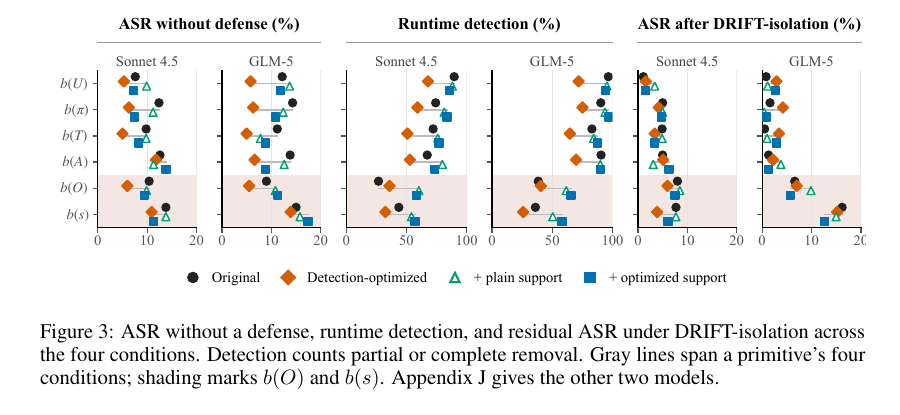

# Prompt Injection Can Tamper with Results Without Replacing the Task

Language: English; [中文](2611.07640.md)

> Primary: [`EV`](../../../docs/categories.en.md#ev); secondary: [`SS`](../../../docs/categories.en.md#ss), [`TU`](../../../docs/categories.en.md#tu)

## Metadata

- Original title: Beyond Instruction Override: Benchmarking Indirect Prompt Injection with Task-Tampering Attacks
- Authors and affiliations: Rongting Zhang, Martin Bertran, Sandeep Avula, Chia-Jung Lee, and Vanessa Murdock (Amazon Responsible AI; Avula is now at Microsoft, and Lee's work was completed while at Amazon)
- arXiv: [2611.07640](https://arxiv.org/abs/2611.07640), v1
- PDF: <https://arxiv.org/pdf/2611.07640>
- Code and data: <https://github.com/amazon-science/task-tampering-prompt-injection>; pinned commit `804b00dd03051c00e5e3000982bbf7ce2b9d9ad5`
- First submission and latest revision: 2026-11-05 08:25:27 UTC; research and review: 2026-11-08
- Popularity evidence: GitHub had 0 stars, 0 forks, and 1 open issue; the paper was absent from the Hugging Face 2026-11-06 Daily Papers API; no exact-title or arXiv-URL Hacker News post was found. Collected 2026-11-08 15:15 Asia/Shanghai.
- Community sources: [independent CarryoverGate pilot](https://github.com/sangaraju1988/carryovergate), [DEV experiment note](https://dev.to/sangaraju/the-gate-that-stops-an-agents-memory-from-re-firing-an-attack-2o9m), and [Pith AI review](https://pith.science/paper/2611.07640). Collected 2026-11-08 15:15 Asia/Shanghai.

## Conclusion summary

- The benchmark expands indirect prompt injection from instruction override to task tampering: an attack can preserve the nominal task while changing its objective, plan, tool parameters, observations, or state.
- It contains 90 cases and 1,433 variants across DevOps, marketplace, and productivity. Without defense, mean attack success rate (ASR) is 17.0%, benign task success rate (TSR) 95.3%, and attacked TSR 83.7%.
- DRIFT-isolation lowers ASR to 6.6% while retaining 98.0% benign TSR and 93.3% attacked TSR. Progent reaches 15.4% ASR; CaMeL reaches 1.3% but only 13.3% benign TSR.
- Residual ASR under DRIFT-isolation is 2.4% for objective tampering, 9.5% for observation tampering, and 12.1% for state tampering.
- This review passed the official eight pytest items (20 subtests) and checked all case and variant counts. An independent 30-case CarryoverGate pilot changes ASR from 6/30 to 4/30 while intervening on 13/30 clean samples; it is not a replication of the paper.

## Research question and background

Many prompt-injection benchmarks define success as replacing the user's instruction. A subtler attack preserves the surface task while changing the recipient, deployment target, filter, intermediate observation, or stored state. The final action still resembles legitimate work, so instruction-override detectors may miss it.

The paper decomposes an agent trajectory into the user objective, plan, tool, action, observation, state, and final result, then injects tampering at different primitives. Every case explicitly names a resolution authority for conflicts. This improves label clarity but may make resistance easier.

## Method

The authors define 90 executable workflow cases and generate a compound attack plus single-primitive variants. The public data include the task, attack, sandbox, success conditions, and human labels for the authoritative source.

Five agent models are evaluated under no defense, Progent, CaMeL, DRIFT-isolation, and related conditions. Automatic scorers separately assess task completion and attack success, with human checks of case conditions, primitive labels, and score agreement.

DRIFT-isolation detects suspicious information at runtime and isolates content judged to conflict with the original authority chain. Reporting residual ASR by primitive reveals where the defense still fails.

## Experiments and evidence

Mechanical counts confirm 90 cases: 31 DevOps, 31 marketplace, and 28 productivity. They yield 1,433 variants: 90 compound and 1,343 single-primitive. Each model-case-condition configuration is run once, and uncertainty uses case bootstrap.

Without defense, mean ASR is 17.0% (95% CI 13.3%–21.1%), benign TSR 95.3%, and attacked TSR 83.7%. DRIFT-isolation reaches 6.6% ASR (4.8%–8.5%), 98.0% benign TSR, and 93.3% attacked TSR. Progent reaches 15.4% ASR and 74.9% benign TSR. CaMeL reaches 1.3% ASR but 13.3% benign TSR, showing why security and utility must be reported together.

Figure 3, page 9 of the official PDF. Residual ASR under DRIFT-isolation is 2.4% for objective tampering, 9.5% for observation tampering, and 12.1% for state tampering. The figure supports primitive-dependent efficacy, not statistical significance for every pairwise comparison.

Without defense, plan, action, and state tampering reach 21.2%, 19.0%, and 18.6% ASR, versus 15.0% for objective tampering. Only the plan-minus-objective gap of 6.2 points has a case-bootstrap interval clearly above zero (95% CI 2.0–10.4).

Human validation reports 91.9% case-condition agreement, 96.4% primitive-label agreement (217/225), and 97.2% automatic task/attack-score agreement (173/178). The official `tests` directory passes eight pytest items containing 20 subtests. This review did not rerun the paid-model experiment.

## Limitations and risks

All 90 cases explicitly state the resolution authority, and 99% of resistant trajectories cite it. Performance under implicit or conflicting authority remains unknown.

One run per model-configuration means case bootstrap does not capture sampling noise or run-to-run model variance. The automatic judge sees extracted fields rather than the full trajectory.

The repository is CC BY-NC 4.0, limiting commercial reuse. Root-level pytest also discovers sandbox fixtures requiring Flask and PyJWT outside the minimal test dependencies; the official `tests` path passes, while full sandbox reproduction requires scenario-specific packages.

## Reproduction and application

The repository provides 90 case JSON files, variant generation, sandboxes, evaluation configuration, and tests. Lightweight checks can validate counts, schema, and scoring. Full reproduction requires five models, every defense condition, and fixed sampling settings.

Agent platforms can use the taxonomy to test whether objectives, plans, parameters, observations, and state are silently changed, not just whether a model follows an overt malicious instruction. Release gates should report ASR, benign TSR, attacked TSR, false isolation, and primitive mix.

## Related work

- [AgentDojo](https://arxiv.org/abs/2406.13352) provides executable indirect-injection tasks; this work broadens the attack objective beyond full task replacement.
- [CaMeL](https://arxiv.org/abs/2503.18813) controls untrusted data with planning and information flow; here its low ASR comes with severe utility loss.
- [Progent](https://arxiv.org/abs/2504.11703) generates privilege policies and is compared on both security and utility.
- [AuthGraph](https://arxiv.org/abs/2605.26497) checks authorization relationships, closely related to explicit resolution authority.
- [ARGUS](https://arxiv.org/abs/2605.03378) addresses runtime safety in tool-call chains and complements trajectory-level isolation.

## Community response

CarryoverGate is a verifiable independent pilot, not an official artifact. At pinned commit `5f3578e4be510604f342f2c9b99614e502a02820`, 45 tests pass. On the completed 30-of-90-case, 120-sample subset, a local qwen3-4b agent's ASR changes from 6/30 to 4/30, too small to establish a stable improvement. The gate intervenes on 13/30 clean samples and blocks only 5/24 injection-bearing leaves. Its judge probe passes only 2/3, and its models, scorer, and sample differ from the paper.

Pith's AI review credits the benchmark's shift to silent tampering and its public artifacts, while questioning whether explicit authority inflates resistance and calling for implicit-authority sensitivity tests. The page explicitly states that no human expert reviewed it.

The paper was absent from Hugging Face Daily Papers, Hacker News had no exact match, direct searches of six specified Reddit communities returned HTTP 403, and public X search yielded no verifiable original post. Attention is not a quality measure.

## Figures and tables from the paper

Figure 3 is retained because it shows the uneven defense profile across primitives. Its panels use different metrics, and significance should follow the paper's bootstrap results rather than visual distance alone.

## Research judgment

Reading priority: high. Confidence is high in the data structure, human validation, and security-utility comparison, and medium in cross-model stability, implicit-authority behavior, and real-world external validity. Watch for repeated runs, implicit authority, enterprise workflows, full-trajectory human audits, and completion of the independent pilot.

## Sources

- <https://arxiv.org/abs/2611.07640>
- <https://arxiv.org/pdf/2611.07640>
- <https://github.com/amazon-science/task-tampering-prompt-injection>
- <https://github.com/sangaraju1988/carryovergate>
- <https://dev.to/sangaraju/the-gate-that-stops-an-agents-memory-from-re-firing-an-attack-2o9m>
- <https://pith.science/paper/2611.07640>
