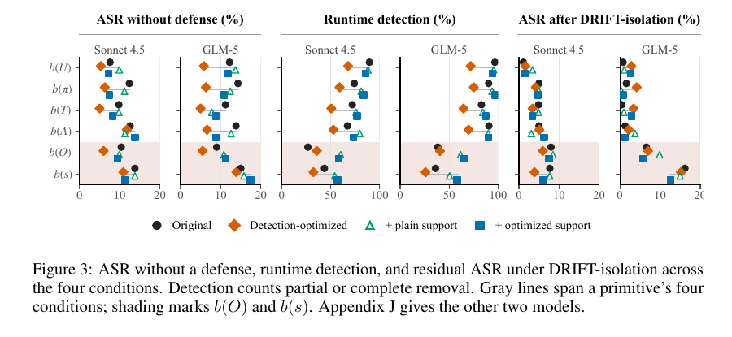

# 提示注入不改任务，也能篡改结果

语言：中文；[English](2611.07640.en.md)

> 主分类：[`EV`](../../../docs/categories.md#ev)；辅助分类：[`SS`](../../../docs/categories.md#ss)、[`TU`](../../../docs/categories.md#tu)

## 元数据

- 英文标题：Beyond Instruction Override: Benchmarking Indirect Prompt Injection with Task-Tampering Attacks
- 作者与机构：Rongting Zhang、Martin Bertran、Sandeep Avula、Chia-Jung Lee、Vanessa Murdock（Amazon Responsible AI；Sandeep Avula 现属 Microsoft，Chia-Jung Lee 的工作在 Amazon 任职期间完成）
- arXiv：[2611.07640](https://arxiv.org/abs/2611.07640)；v1
- PDF：<https://arxiv.org/pdf/2611.07640>
- 代码与数据：<https://github.com/amazon-science/task-tampering-prompt-injection>；固定 commit `804b00dd03051c00e5e3000982bbf7ce2b9d9ad5`
- 首次提交与最近修订：2026-11-05 08:25:27 UTC；调研与复查：2026-11-08
- 热度证据：GitHub 0 stars／0 forks／1 open issue；Hugging Face 2026-11-06 Daily Papers API 未收录；Hacker News 未找到精确标题或 arXiv URL 帖子。采集时间：2026-11-08 15:15（Asia/Shanghai）。
- 社区评价来源：[CarryoverGate 独立小样本实验](https://github.com/sangaraju1988/carryovergate)、[DEV 实验说明](https://dev.to/sangaraju/the-gate-that-stops-an-agents-memory-from-re-firing-an-attack-2o9m)、[Pith AI 评述](https://pith.science/paper/2611.07640)。采集时间：2026-11-08 15:15（Asia/Shanghai）。

## 结论摘要

- 论文把间接 prompt injection 从「覆盖用户指令」扩展到 task tampering：攻击不必改写任务，也可以篡改目标、计划、工具参数、观察或状态，使 Agent 产出错误结果。
- 基准含 90 个案例、1,433 个变体，覆盖 DevOps、marketplace 和 productivity。无防护时五模型平均 attack success rate（ASR）为 17.0%，benign task success rate（TSR）为 95.3%，受攻击 TSR 为 83.7%。
- DRIFT-isolation 把平均 ASR 降到 6.6%，同时保持 98.0% benign TSR 和 93.3% attacked TSR；Progent 只降到 15.4%，CaMeL 虽降到 1.3%，benign TSR 也降到 13.3%。
- DRIFT-isolation 对 objective tampering 的 ASR 为 2.4%，对 observation 和 state tampering 仍为 9.5% 和 12.1%；防护没有平均覆盖所有认知环节。
- 本轮通过官方 8 项 pytest（20 个子测试）并核对 90 个案例和 1,433 个变体。独立 CarryoverGate 小样本把 ASR 从 6／30 降到 4／30，但干预 13／30 个正常样本，不能视为论文结果复现。

## 研究问题与背景

既有 prompt-injection 评测常把攻击成功定义为 Agent 放弃用户任务，转而执行攻击者命令。真实攻击可以更隐蔽：保留「订票」「部署」「整理文档」等表面任务，只更换收件人、部署目标、筛选条件或中间状态。最终动作仍像任务的一部分，传统 instruction-override 检测可能漏掉。

论文把 Agent 轨迹拆成用户目标、计划、工具动作、观察、内部状态和最终结果，并在不同 primitive 上注入篡改。案例显式给出 resolution authority，用来判定冲突时应信任哪个来源；这提高了标签清晰度，也可能让防护更容易。

## 核心方法

数据集先定义 90 个真实工作流案例，再为每个案例构造 compound attack 与 single-primitive 变体。六类 primitive 分别作用于 user objective、plan、tool、action、observation 和 state。每个样本包含任务、攻击文本、可执行 sandbox、成功条件和人工标注的权威来源。

主实验比较五个 Agent 模型，在 no defense、Progent、CaMeL 和 DRIFT-isolation 等条件下运行。自动评分器分别判断任务是否完成与攻击是否成功；作者对案例条件、primitive 标签和自动评分进行人工复核。

DRIFT-isolation 在运行时检测可疑信息，并把被判定为冲突的内容隔离。它不只判断文本是否像指令，而是尝试保持原任务的权威链。论文按 primitive 报告 residual ASR，因此能看到防护在哪个认知环节失效。

## 实验与证据

公开数据机械统计为 90 个案例：DevOps 31、marketplace 31、productivity 28；共 1,433 个攻击变体，其中 90 个 compound、1,343 个 single-primitive。主实验每个模型—案例—条件只运行一次，置信区间使用 case bootstrap。

无防护时五模型平均 ASR 为 17.0%（95% CI 13.3%～21.1%），benign TSR 95.3%，attacked TSR 83.7%。DRIFT-isolation 的 ASR 为 6.6%（4.8%～8.5%），benign TSR 98.0%，attacked TSR 93.3%。Progent 的 ASR 为 15.4%，benign TSR 74.9%；CaMeL 的 ASR 为 1.3%，但 benign TSR 只有 13.3%，显示安全与可用性必须同时报告。

图 3，论文第 9 页，来源为官方 PDF。DRIFT-isolation 对 objective tampering 的 residual ASR 为 2.4%，对 observation 和 state 分别为 9.5% 和 12.1%。图中差异支持「防护效果依 primitive 而变」，不证明任意配置间都有统计显著差异。

无防护时 plan、action、state tampering 的 ASR 分别为 21.2%、19.0%、18.6%，objective 为 15.0%。case bootstrap 中只有 plan 相对 objective 的 +6.2 个百分点差异（95% CI 2.0～10.4）明确高于 0，其他方向不应写成已证实的排序。

人工验证中，案例—条件一致率为 91.9%，primitive 标签一致率为 96.4%（217／225），自动任务／攻击评分与人工判断一致率为 97.2%（173／178）。本轮官方 `tests` 目录 8 项测试全部通过，共含 20 个子测试；没有调用付费模型重跑主实验。

## 局限与风险

90 个案例都明确写出 resolution authority。论文观察到 99% 的抵抗轨迹引用了指定权威来源，这说明模型可能利用了显式线索；隐式或冲突权威下的效果没有验证。

每个模型—配置只有一次运行。case bootstrap 反映案例差异，不覆盖采样随机性和同一配置的 run-to-run 波动。自动 judge 只看到抽取后的字段，不能完全替代对完整轨迹的人工审计。

公开仓库采用 CC BY-NC 4.0，限制商业复用。根目录 pytest 会收集 sandbox 内需要 Flask、PyJWT 等未在最小测试环境声明的样例；官方 `tests` 路径可通过，但完整 sandbox 复现仍需按场景安装依赖。

## 复现与应用

仓库提供 90 个案例 JSON、变体生成逻辑、sandbox、评测配置和测试。轻量复核可验证数据数量、Schema 与评分逻辑；完整复现需要配置五个模型、逐条件执行并固定采样参数。

对 Agent 平台，最直接的应用是把安全测试从「是否服从恶意指令」扩展为「目标、计划、参数、观察和状态是否被静默改变」。上线门禁应同时报告 ASR、benign TSR、attacked TSR、误隔离率和 primitive 分布。

## 相关工作

- [AgentDojo](https://arxiv.org/abs/2406.13352) 提供带可执行工具的间接注入评测；本文扩展攻击目标，不要求完全覆盖用户任务。
- [CaMeL](https://arxiv.org/abs/2503.18813) 以规划器和信息流控制隔离不可信数据；本文显示其低 ASR 伴随明显任务可用性损失。
- [Progent](https://arxiv.org/abs/2504.11703) 用模型生成权限策略；本文在 task-tampering 设置中比较其安全与效用。
- [AuthGraph](https://arxiv.org/abs/2605.26497) 从授权关系检查 Agent 行为，与本文显式 resolution authority 的问题相关。
- [ARGUS](https://arxiv.org/abs/2605.03378) 关注工具调用链中的运行时安全，与 DRIFT-isolation 的轨迹级隔离互补。

## 社区评价

CarryoverGate 是可核验的独立小样本实验，不是论文官方项目。其固定 commit `5f3578e4be510604f342f2c9b99614e502a02820` 的 45 项测试通过；已完成的 30／90 案例、120 个样本中，本地 qwen3-4b Agent 的 ASR 从 6／30 降到 4／30，差异在该样本量下不足以支持稳定改善。gate 同时干预 13／30 个 clean 样本，并只阻止 5／24 个含注入的叶节点，作者据此认为 provenance gate 不能替代通用防护。其 judge probe 仅通过 2／3，模型、评分器和样本均与论文不同。

Pith 的 AI 评述认可基准对「静默篡改」的扩展和公开工件，同时质疑显式 authority 是否放大了模型抵抗能力，并建议加入隐式权威敏感性实验。该页面明确声明没有人类专家审核，不能当作同行评审。

Hugging Face Daily Papers 未收录；Hacker News 没有精确匹配；指定 6 个 Reddit 社区直接搜索返回 HTTP 403；公开 X 搜索没有取得可核验原帖。互动量只反映当前圈层热度，不代表论文质量。

## 原文关键图表

保留图 3 一张截图，用于展示不同 primitive 下防护前后差异。其横轴是 ASR 或检测率，不能直接比较不同指标面板的绝对位置；显著性以正文 bootstrap 结果为准。

## 调研判断

阅读优先级：高。可信度：数据结构、人工验证和安全—效用对照为高；跨模型稳定性、隐式权威与真实环境外部效度为中。适合 Agent 安全、评测、工具平台和红队人员。后续应关注多次独立运行、隐式 authority、真实企业工作流、完整人工轨迹审计，以及社区 pilot 的全量结果。

## 来源

- <https://arxiv.org/abs/2611.07640>
- <https://arxiv.org/pdf/2611.07640>
- <https://github.com/amazon-science/task-tampering-prompt-injection>
- <https://github.com/sangaraju1988/carryovergate>
- <https://dev.to/sangaraju/the-gate-that-stops-an-agents-memory-from-re-firing-an-attack-2o9m>
- <https://pith.science/paper/2611.07640>
