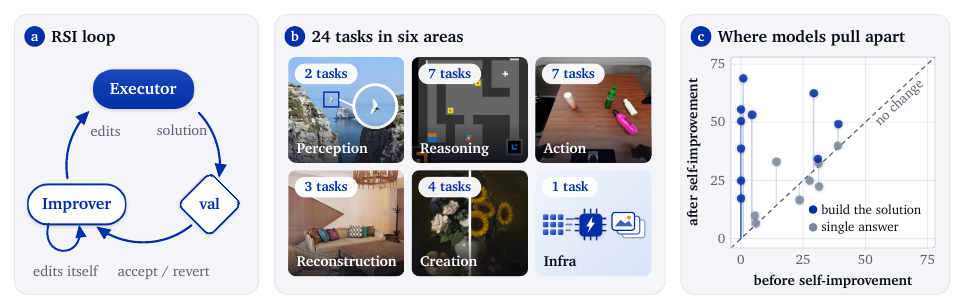

# Self-Improvement Must Change Both the Solution and the Harness

Language: English; [中文](2611.08946.md)

> Primary: [`EV`](../../../docs/categories.en.md#ev); secondary: [`LT`](../../../docs/categories.en.md#lt), [`EA`](../../../docs/categories.en.md#ea)

## Metadata

- Original title: Flex-RSI: Benchmarking Recursive Self-Improvement of Frontier Agents
- Authors and affiliations: Jingdong Zhang, Jionghao Wang, Zhengming Yu, and the Flex-RSI Team (Texas A&M, Cambridge, NUS, NVIDIA, MIT CSAIL, MIT-IBM Watson AI Lab, UT Austin, CMU, UPenn, USC, Purdue, Adobe, and Toronto)
- arXiv: [2611.08946](https://arxiv.org/abs/2611.08946), v1
- PDF: <https://arxiv.org/pdf/2611.08946>
- Project: <https://flex-rsi.github.io/>; code: <https://github.com/flex-rsi/rsi-bench>; pinned commit `ebff61558d15dfd0ad64f636ca8318aec0386adb`
- Data: <https://huggingface.co/datasets/Flex-RSI/RSI-Dataset>; prepared splits are listed for five tasks, while other tasks require preparation from upstream sources
- First submission and latest revision: 2026-11-06 03:51:20 UTC; research and review: 2026-11-10
- Popularity evidence: GitHub had 9 stars, 0 forks, and 0 open issues; the Hugging Face Papers API did not list the paper; exact arXiv-ID search on Hacker News returned zero stories. An indirect public-X mirror exposed an author post, but its engagement fields could not be mapped reliably, so exact counts remain unverified. Collected 2026-11-10 09:07–09:13 Asia/Shanghai.
- Community sources: [rsi.watch benchmark audit](https://rsi.watch/benchmarks/) and the author project page. Exact-ID searches in the six specified Reddit communities returned no matches. Collected 2026-11-10 09:10–09:13 Asia/Shanghai.

## Conclusion summary

- Flex-RSI separates recursive self-improvement into an executor that edits the task solution and an improver that edits the executor and itself: prompts, tools, workflow, settings, and lessons. Candidates survive only if hidden validation improves beyond a noise margin, and the final solution is scored once on hidden test data.
- The benchmark spans 24 vision, reasoning, robotics, 3D, creation, and infrastructure tasks and evaluates 18 closed and open-weight models. Validation improves in 150 of 177 runs (85%), with a median gain of 10.4 points.
- Improvement is conditional on the task. Median validation rises from 19.4 to 62.2 on 3D Tracking, while ARC-AGI-1 and ARC-AGI-2 have strong starters and median gains of zero. ARC-AGI-3 and Scene from Video start low yet barely improve.
- In seven matched model-task-budget-protocol-seed pairs, enabling the improver produces a higher test score in six, with gains from 2.0 to 40.0 points. The sample is small and does not estimate an average general effect.
- A task run consumes a median 49.7M tokens, with the middle 80% ranging from 8.6M to 93.4M. Relative token use and leaderboard score have a rank correlation of -0.05; more tokens do not reliably buy a higher score.

## Research question and background

Most agent benchmarks freeze the harness and compare only the final answer or artifact. This mixes base-model capability with prompts, tools, memory, and control flow, and it cannot test whether an agent learns to improve how it works. Prior self-improvement evaluations also concentrate on machine-learning research tasks, leaving vision, robotics, and 3D tasks with physical or exact checks underrepresented.

Flex-RSI asks a stricter question: under the same starting point and fixed budget, with validation and test hidden from the agent, can the agent improve both the task solution and the harness that produces it, and do those changes survive hidden-test evaluation?

## Method

Every task provides a starter solution, development data, hidden validation and test splits, and a budget. The executor may use only development data. The orchestrator scores each candidate on hidden validation and accepts it only when it improves by more than noise margin `δ`. The starting `δ` is twice the standard deviation of the starter's validation score, although the improver may revise it.

After each round, the improver reads accumulated trajectories, experiments, and scores, then edits the executor's prompts, tools, and workflow as well as its own prompts, settings, and lessons. Model weights remain fixed. The evaluator, data splits, and budget accounting are fixed by the orchestrator, and sandboxed agent code cannot read validation or test data.

Figure 1, page 2 of the official PDF. The left panel shows the executor-validation-improver loop; the middle panel summarizes the six task areas; the right panel shows that tasks requiring the agent to build a solution separate models more after self-improvement. The points are task-level comparisons, not causal effect estimates.

## Experiments and evidence

The 24 tasks cover Action, Reasoning, Creation, Reconstruction, Perception, and Infrastructure. Sources include RoboCasa, LIBERO, ARC-AGI, VSI-Bench, ScanNet, and HARMONY300, plus author-collected image-generation tasks. Metrics include success rate, accuracy, SPL, T-mIoU, VLM judging, physical/geometric composite scores, and decode speedup.

Main results aggregate the 20 tasks evaluated with at least six models. A model-task pair is generally represented by one run; when repeated, only the latest run is reported. Claude Opus 5.5 obtains an overall rank score of 91.6 and the best test score on 11 of 20 tasks. Gemini 4 Argon scores 89.0 but covers only nine tasks. Uneven task coverage makes the aggregate unsuitable as a complete capability ranking.

Validation improves in 150 of 177 runs, with a median gain of 10.4 points. Closed models improve in 94% of 85 runs, median 14.9 points; open-weight models improve in 76% of 92 runs, median 8.5 points. Median validation on 3D Tracking, RoboLab, and Active Search rises from 19.4, 8.3, and 23.0 to 62.2, 45.8, and 52.7. ARC-AGI-1 and ARC-AGI-2 start strong and have median gains of zero.

Feedback granularity is a major divider. Across nine solution-building tasks with graded episode feedback, the median task-level gain for open-weight runs is 9.9 points versus 28.4 for closed runs. On four binary-success tasks, these figures fall to 1.6 and 16.9. This is an observational cross-task comparison; the task sets differ in more than feedback granularity.

Strict checks widen the gap. On Scene from Video, all four open-weight models have a Physics score of 0.0, versus 70.7 for Claude Opus 5.5 and 37.7 for GPT-6 Astra. The gap is much smaller on judge- or tolerance-scored tasks such as Video Quality, Mass, and Multi-turn Editing.

Six of seven frozen/self-improving matched pairs improve on test: DeepSeek-V4.1 Flash goes from 0 to 40 on Open Drawer; Qwen3.8-Flash-Next goes from 21.0 to 59.3 on Active Search; two 3D Tracking pairs gain 6.5 and 2.0 points. Claude Opus 5.5 stays at 80 on Turn On Sink Faucet. In six pairs the self-improving run also lasts more rounds, so the comparison does not isolate harness editing from additional rounds.

## Limitations and risks

Most model-task combinations have one run, and the latest repeat is reported. The paper provides no across-seed variance or confidence intervals, despite noisy robotics, generation, and judge-based metrics.

Task coverage is uneven. Gemini 4 Argon's 89.0 aggregate uses nine tasks, while Claude Opus 5.5's 91.6 covers all 20 main tasks. Overall rank scores are therefore not fully comparable.

Validation is queried after every candidate. Test remains one-shot, but adaptive selection can still overfit validation. Allowing the improver to change `δ` also changes acceptance behavior across runs.

The matched ablation has only seven pairs, and most self-improving runs execute more rounds than their frozen counterparts. The evidence supports gains in these settings but does not isolate the mechanism generally.

The public repository currently has no license. Its README lists 16 directly configurable tasks while the paper reports 24, and prepared public splits cover five. This review did not obtain the complete leaderboard run branches, model-call records, or all hidden splits, so the main tables were not independently recomputed.

## Reproduction and application

At commit `ebff615…`, `python -m compileall` passes. On macOS, 157 tests pass and 11 skip; five failures all arise from Linux sandbox assumptions, namely direct `/proc` traversal and `umount2`. The remaining long-running tests were interrupted after roughly four minutes. This validates much of the public offline logic but confirms that the official path assumes Linux/SLURM, containers, and a Linux sandbox.

Full reproduction needs task data, GPUs or SLURM, model APIs or local serving, and very large token budgets. The most reusable engineering protocol is lighter: freeze the starter and budget, isolate dev/validation/test, record every harness and solution diff, gate changes with rollback, and include extra model calls and environment cost in the score.

## Related work

- [RE-Bench](https://arxiv.org/abs/2411.15114) evaluates machine-learning research engineering; Flex-RSI broadens the domain and lets the harness change.
- [PaperBench](https://arxiv.org/abs/2504.01848) evaluates paper replication; Flex-RSI evaluates joint solution and process improvement under a fixed budget.
- [Darwin Gödel Machine](https://arxiv.org/abs/2505.22954) retains empirically validated self-modifications; Flex-RSI emphasizes common starts, hidden splits, and benchmark-wide comparison.
- [STOP](https://arxiv.org/abs/2310.02304) applies an improver to itself; Flex-RSI operationalizes this recursion as an executor-improver harness and adds frozen-harness controls.

## Community response

rsi.watch credits Flex-RSI for a protocol with hidden validation/test data, fixed budgets, and joint solution/harness edits. Its audit also notes that the repository license remains “To be added,” prepared data cover only part of the benchmark, and the leaderboard run-submission channel is not open. This is an independent artifact audit, not a rerun of the main experiments.

The public project page emphasizes extensibility, traceable runs, and community contributions. Those are author claims, not third-party quality judgments.

GitHub currently has 9 stars, 0 forks, and 0 open issues; the Hugging Face Papers API does not list the paper; Hacker News exact search returns zero stories; exact-ID searches in the six specified Reddit communities return no matches. An indirect X mirror shows an author post but does not expose reliably mapped engagement fields. Sparse visible discussion is not evidence of low quality or of no discussion elsewhere.

## Figures and tables from the paper

Figure 1 is retained because it explains the two-level loop, task scope, and larger improvement headroom on solution-building tasks. Numerical claims still come from the text, Table 8, and the full-results appendix.

## Research judgment

Reading priority: high. Confidence is medium-high for the benchmark design, public framework, and within-paper matched evidence, and medium for aggregate model rankings and average self-improvement effects. The work is useful for agent evaluation, harness engineering, robotics and vision agents, and long-lived self-modifying systems. Watch for a license, complete run records, reproducible preparation for all 24 tasks, multi-seed results, exactly budget-matched harness ablations, and tests for adaptive validation overfitting.

The paper scores 94 and uses the eleventh slot in the 2026-11-04 through 2026-11-10 extended rolling window. It is selected for direct agent relevance, a unified 24-task protocol, a public framework, and matched ablations, not for strong current community attention.

## Sources

- <https://arxiv.org/abs/2611.08946>
- <https://arxiv.org/html/2611.08946>
- <https://arxiv.org/pdf/2611.08946>
- <https://flex-rsi.github.io/>
- <https://flex-rsi.github.io/people.html>
- <https://github.com/flex-rsi/rsi-bench>
- <https://huggingface.co/datasets/Flex-RSI/RSI-Dataset>
- <https://rsi.watch/benchmarks/>
