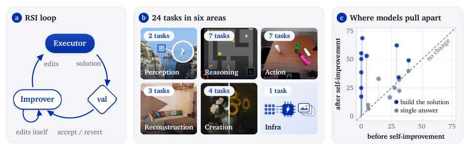

# 自我改进要同时改答案和工作流

语言：中文；[English](2611.08946.en.md)

> 主分类：[`EV`](../../../docs/categories.md#ev)；辅助分类：[`LT`](../../../docs/categories.md#lt)、[`EA`](../../../docs/categories.md#ea)

## 元数据

- 英文标题：Flex-RSI: Benchmarking Recursive Self-Improvement of Frontier Agents
- 作者与机构：Jingdong Zhang、Jionghao Wang、Zhengming Yu 等 Flex-RSI Team（Texas A&M、Cambridge、NUS、NVIDIA、MIT CSAIL、MIT-IBM Watson AI Lab、UT Austin、CMU、UPenn、USC、Purdue、Adobe、Toronto）
- arXiv：[2611.08946](https://arxiv.org/abs/2611.08946)；v1
- PDF：<https://arxiv.org/pdf/2611.08946>
- 项目页：<https://flex-rsi.github.io/>；代码：<https://github.com/flex-rsi/rsi-bench>；固定 commit `ebff61558d15dfd0ad64f636ca8318aec0386adb`
- 数据：<https://huggingface.co/datasets/Flex-RSI/RSI-Dataset>；公开仓库列出其中 5 个任务的 prepared split，其余任务需从上游数据源准备
- 首次提交与最近修订：2026-11-06 03:51:20 UTC；调研与复查：2026-11-10
- 热度证据：GitHub 9 stars、0 forks、0 open issues；Hugging Face Papers API 未收录；Hacker News 按 arXiv ID 精确检索 0 条。公开 X 二级镜像可见作者发布帖，但互动字段无法可靠映射，记为「间接验证、未验证具体数值」。采集时间：2026-11-10 09:07～09:13（Asia/Shanghai）。
- 社区评价来源：[rsi.watch 的基准核对](https://rsi.watch/benchmarks/)及作者公开项目页；六个指定 Reddit 社区按 arXiv ID 定向检索无精确命中。采集时间：2026-11-10 09:10～09:13（Asia/Shanghai）。

## 结论摘要

- Flex-RSI 把递归自我改进拆成两层：executor 改任务解，improver 改 executor 和自身的 prompt、工具、流程与经验；候选解只在未向 Agent 开放的 validation split 上提高超过噪声阈值时保留，最终只在 hidden test 上评分。
- 论文覆盖 24 个视觉、推理、机器人、3D、生成与基础设施任务，评测 18 个闭源和开放权重模型。177 次运行中有 150 次（85%）提高 validation 分数，中位提升 10.4 分。
- 「自我改进有效」不等于「所有任务都适合」。3D Tracking 的中位 validation 分数由 19.4 提高到 62.2；ARC-AGI-1／2 的 starter 已很强，中位提升均为 0；ARC-AGI-3 和 Scene from Video 即使起点低也几乎不改善。
- 7 组同模型、同任务、同预算、同 protocol 与 seed 的配对实验中，允许 improver 改 harness 的版本有 6 组 test 分数更高，增幅为 2.0～40.0 分；样本仍小，不能据此估计一般化的平均收益。
- 单任务运行的 token 中位数为 49.7M，80% 中间区间为 8.6M～93.4M；相对 token 与排行榜分数的秩相关为 -0.05。更多 token 没有稳定换来更高分。

## 研究问题与背景

多数 Agent benchmark 固定 harness，只比较最终答案或工件。这会把基座模型能力、初始 prompt、工具集合、记忆和控制循环混在一个分数里，也不能回答「Agent 是否能根据任务反馈改进自己的工作方式」。已有自改进工作又常集中在机器学习研究任务，缺少视觉、机器人和 3D 等需要执行、物理稳定性或精确校验的统一比较。

Flex-RSI 的核心问题不是 Agent 能否多试几次，而是：在固定预算、相同起点和隔离的验证/测试数据下，Agent 能否同时改进任务解与产生任务解的 harness，并让改动在隐藏测试上成立。

## 核心方法

每个任务提供 starter solution、开发集、隐藏 validation／test split 与预算。executor 只能使用开发集修改任务解并运行实验；orchestrator 在隐藏 validation 上评分，只有提升超过噪声阈值 `δ` 的候选才替换当前解。起始 `δ` 为 starter validation 分数标准差的两倍，improver 可以调整该阈值。

每轮结束后，improver 读取累计轨迹、实验与分数，修改 executor 的 prompt、工具和工作流，也可以修改自己的 prompt、设置和 lessons。模型权重不变；evaluator、数据切分和预算计数由 orchestrator 固定，Agent 代码在沙箱中不能读取 validation 与 test 数据。

图 1，论文第 2 页，来源为官方 PDF。左图给出 executor—validation—improver 循环；中图展示 24 个任务的六类分布；右图说明「需要 Agent 自行构建 solution」的任务更容易在自我改进后拉开模型差距。散点是任务级比较，不是因果效应量。

## 实验与证据

24 个任务分为 Action、Reasoning、Creation、Reconstruction、Perception 与 Infrastructure。任务既包含 RoboCasa、LIBERO、ARC-AGI、VSI-Bench、ScanNet、HARMONY300 等公开来源，也包含图像编辑和 text-to-image 等自建数据；指标覆盖成功率、准确率、SPL、T-mIoU、VLM judge、物理/几何复合分数和解码加速。

主结果只汇总至少评测 6 个模型的 20 个任务。每个模型—任务组合原则上只报告一次运行；重复时报告最新运行。Claude Opus 5.5 的跨区 rank score 为 91.6，在 20 个任务中 11 个取得最佳 test 分数；Gemini 4 Argon 为 89.0，但只覆盖 9 个任务。这个 rank 聚合受任务覆盖不齐影响，不能当作完整模型能力排名。

177 次运行中，150 次 validation 分数提高，中位增幅 10.4 分。闭源模型在 85 次运行中 94% 有提升，中位 14.9 分；开放权重模型在 92 次运行中 76% 有提升，中位 8.5 分。任务初始空间决定收益上限：3D Tracking、RoboLab、Active Search 的中位分数分别由 19.4、8.3、23.0 提高到 62.2、45.8、52.7；starter 已强的 ARC-AGI-1／2 中位提升为 0。

反馈粒度是明显分界。对 9 个由 Agent 构建 solution、且每个 episode 返回连续分数的任务，开放权重模型的任务级中位提升再取中位为 9.9 分，闭源模型为 28.4 分；在只返回成败的 4 个任务上，两者分别降到 1.6 和 16.9 分。该比较是观察性汇总，任务集合并不只在反馈粒度上不同。

严格校验进一步拉开差距。Scene from Video 中，四个开放权重模型的 Physics 分数均为 0.0，Claude Opus 5.5 为 70.7，GPT-6 Astra 为 37.7；而依赖 judge 或容差指标的 Video Quality、Mass、Multi-turn Editing 等任务，最佳闭源与最佳开放模型差距更小。

7 组 frozen/self-improving harness 配对里，6 组 test 分数提高：DeepSeek-V4.1 Flash 的 Open Drawer 为 0→40，Qwen3.8-Flash-Next 的 Active Search 为 21.0→59.3，3D Tracking 两组分别提高 6.5 与 2.0 分；Claude Opus 5.5 的 Turn On Sink Faucet 为 80→80。配对数量有限，且 6／7 组自改进运行轮数更多，因此它证明「在这些匹配设置中加入 improver 有增益」，不能单独分离额外轮数与 harness 编辑的贡献。

## 局限与风险

每个模型—任务组合通常只有一次运行，重复时采用最新结果，论文没有报告跨 seed 方差或置信区间。机器人、生成和 judge 指标本身噪声较大，单次结果不足以支撑精细排名。

模型覆盖不齐：总体 rank score 允许模型只在部分任务上参与，Gemini 4 Argon 的 89.0 基于 9 个任务，而 Claude Opus 5.5 的 91.6 覆盖全部 20 个主任务。不同覆盖面使整体排名不完全可比。

validation 被每轮反复用于候选接受，虽然 test 只在结束后使用，但自适应选择仍可能逐渐过拟合 validation。`δ` 可被 improver 修改，会进一步改变不同运行的接受门槛。

配对消融只有 7 组，其中多数 self-improving run 比 frozen run 多执行若干轮。论文把额外收益归于编辑 harness，但没有在所有组中强制相同轮数或模型调用量。

公开仓库当前没有许可证；README 只列出 16 个可直接配置的任务，论文报告 24 个任务，公开 prepared split 只有 5 个。完整 leaderboard 的原始 run branches、模型调用记录和全部 hidden split 未在本轮取得，无法独立重算主表。

## 复现与应用

固定 commit `ebff615…` 下，`python -m compileall` 通过。macOS 本地运行中有 157 项测试通过、11 项跳过；5 项失败均落在 Linux 沙箱依赖：代码直接遍历 `/proc` 或调用 `umount2`。长时测试在约 4 分钟后中止。该结果说明公开框架的大部分离线逻辑可执行，但官方运行路径实际以 Linux/SLURM、容器与沙箱为前提。

完整复现需要准备任务数据、GPU 或 SLURM backend、模型 API／本地推理服务以及很高的 token 预算。更适合工程团队先复用的是协议：固定 starter 与预算、把 dev／validation／test 隔离、记录每轮 harness diff 与任务 diff、用 rollback gate 接受改动，并把额外模型调用和环境成本纳入评分。

## 相关工作

- [RE-Bench](https://arxiv.org/abs/2411.15114) 衡量 Agent 完成机器学习研究工程任务的能力；Flex-RSI 把对象扩展到视觉、机器人、3D 与基础设施，并允许修改 harness。
- [PaperBench](https://arxiv.org/abs/2504.01848) 评测从论文复现研究结果；Flex-RSI 关注固定预算下 solution 与执行流程能否共同改进。
- [Darwin Gödel Machine](https://arxiv.org/abs/2505.22954) 用经验验证保留自修改 Agent；Flex-RSI 更强调统一起点、隐藏切分与跨任务 benchmark。
- [STOP](https://arxiv.org/abs/2310.02304) 让代码 improver 改进自身；Flex-RSI 把这种递归结构落到 executor／improver 双层 harness，并提供匹配的 frozen-harness 对照。

## 社区评价

rsi.watch 的基准核对认可 Flex-RSI 把 hidden validation／test、固定预算、solution 与 harness 双层修改写进统一 protocol，并核对到项目页覆盖 24 个任务、公开仓库和部分数据。其同时指出，公开仓库许可证仍为「To be added」，准备好的数据只覆盖部分任务，提交 runs 到 leaderboard 的通道尚未开放。这是独立资料核对，不是主实验复跑。

作者团队的公开项目页强调可扩展 benchmark、可追踪 run 与社区贡献。该材料属于作者主张，不作为第三方质量评价。

GitHub 当前为 9 stars、0 forks、0 open issues；Hugging Face Papers API 未收录；Hacker News 精确检索 0 条；六个指定 Reddit 社区均无 arXiv ID 精确命中。公开 X 二级镜像能看到作者发布帖，但无法可靠映射互动字段，因此不报告具体数值。以上只说明可见讨论有限，不代表论文质量或不存在其他讨论。

## 原文关键图表

保留图 1 一张截图，用于解释双层自改进循环、任务覆盖与「自行构建 solution」任务的更大改进空间。关键数值仍以正文、表 8 与附录完整结果为准。

## 调研判断

阅读优先级：高。可信度：benchmark 设计、公开框架与论文内部配对证据为中高；跨模型总排名与自改进平均收益为中。适合 Agent 评测、harness 工程、机器人/视觉 Agent 和长期自修改系统团队。后续应关注许可证、完整 run records、全部 24 个任务的可复现准备、跨 seed 结果、严格等预算的 harness 消融，以及 validation 自适应选择的过拟合测试。

本篇 94 分，作为 2026-11-04～2026-11-10 滚动窗口第 11 篇使用扩展名额。入选依据是直接 Agent 相关、跨 24 个任务的统一协议、公开框架与配对消融；未因当前社区热度较低降低证据门槛。

## 来源

- <https://arxiv.org/abs/2611.08946>
- <https://arxiv.org/html/2611.08946>
- <https://arxiv.org/pdf/2611.08946>
- <https://flex-rsi.github.io/>
- <https://flex-rsi.github.io/people.html>
- <https://github.com/flex-rsi/rsi-bench>
- <https://huggingface.co/datasets/Flex-RSI/RSI-Dataset>
- <https://rsi.watch/benchmarks/>
