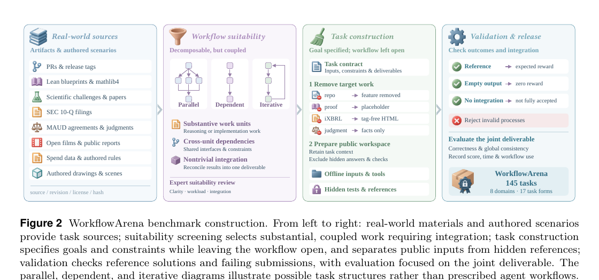

# Workflow Orchestration Is a Distinct Capability

Language: English; [中文](2611.12856.md)

> Primary: [`EV`](../../../docs/categories.en.md#ev); secondary: [`MA`](../../../docs/categories.en.md#ma), [`AF`](../../../docs/categories.en.md#af), and [`SY`](../../../docs/categories.en.md#sy)

## Metadata

- Original title: WorkflowArena: Benchmarking Executable Workflow Orchestration in LLM-Based Multi-Agent Systems
- Authors and affiliations: Zheng Jiang, Fang Niu, Bo Peng, Houde Qian, Wenyi Li, Deyao Hong, Mingju Gao, Yizhe Chi, Youjie Zheng, Kaisen Yang, Calvin Xiao, Lifeng Sun, and Huan-ang Gao (Navers Lab, Einsia.AI, and Tsinghua University)
- arXiv: [2611.12856](https://arxiv.org/abs/2611.12856), v1
- PDF: <https://arxiv.org/pdf/2611.12856>
- Project: <https://lab.einsia.ai/workflowarena>; code and task data: <https://github.com/Einsia/WorkflowArena>; pinned commit `637adecbe59ced8780279301de22b0f582495dea`
- First submission and latest revision: 2026-11-09 18:45:28 UTC; research and review: 2026-11-11
- Popularity evidence: GitHub had 6 stars, 1 fork, and 0 open issues. The Hugging Face Papers API did not list the paper, and exact-ID Hacker News search returned zero results. An official X post was only indirectly verified through a secondary page; exact engagement remains unverified. Collected 2026-11-11 09:03–09:10 Asia/Shanghai.
- Community sources: [Pith review](https://pith.science/paper/2611.12856) and [Feed7 judgment](https://feed7.dev/p/2611-12856v1-1ez03cj). All six specified Reddit communities returned HTTP 403, an access gap rather than evidence of no discussion. Collected 2026-11-11 09:08–09:12 Asia/Shanghai.

## Conclusion summary

- The paper separates workflow orchestration from end-to-end task capability. The agent decides whether to delegate, how to partition work, what context workers receive, and when to verify and integrate, while orchestration consumes the same time budget as execution.
- WorkflowArena contains 145 long-horizon tasks across eight professional domains and 17 task forms. Every task requires an interdependent deliverable, checked for correctness, global consistency, or process compliance by a hidden verifier.
- The strongest configuration resolves only 36.95% overall. The gap between continuous scores and resolved rates shows that broad partial progress is not the same as an accepted deliverable.
- On 32 challenging tasks with fixed executors, Opus-authored static workflows improve the mean score by 6.41 points over self-dynamic execution. This supports the importance of orchestration, but does not separate workflow structure from worker-instruction quality.
- Public artifacts support checking the task inventory, assembly boundary, and aggregate tables, but not an independent main-benchmark rerun. Model-harness confounding, single runs, and uncalibrated LLM judging constrain ranking claims.

## Research question and background

Long-horizon agent benchmarks usually treat the system as one unit and score only the final outcome. Multi-agent benchmarks often prescribe roles and coordination. Neither setup directly tests the quality of a workflow that a model writes and revises at run time.

WorkflowArena evaluates executable orchestration rather than an offline plan. Tasks must contain separable but interdependent work whose pieces must be reconciled in the final artifact; otherwise additional workers or parallel branches would not constitute a meaningful orchestration test.

## Method

Each task specifies an initial state, goal, public tool surface, artifacts and environments, budget, and independent verifier. An agent may remain sequential or launch up to 16 concurrent workers through a common Workflow tool. Delegations, worker runs, and revisions are recorded. The main agent and workers share a four-hour wall-clock budget.

Tasks are built from repositories, Lean proofs, scientific challenges, SEC filings, legal agreements, public media, spending records, and authored business scenarios. Selection requires substantial work, cross-unit dependencies, and nontrivial integration. Hidden checks reject unintegrated components and invalid processes.

The main experiment compares nine models in 25 model-harness-effort configurations. A transfer experiment then fixes execution models while Opus or Astra authors workflows and worker instructions for four weaker executors.

Figure 2, page 5 of the official PDF. It shows real-world sources, workflow-suitability screening, task construction, and joint-deliverable validation. Parallel, dependent, and iterative diagrams are examples of task structure, not prescribed agent workflows.

## Experiments and evidence

Claude Opus 5.5 with Claude Code at max effort reaches a 36.95% overall resolved rate, while high effort yields the best continuous score, 80.21. No configuration leads every domain. LAW and FIN top out at resolved rates of 9.09% and 18.75%, respectively.

The transfer experiment spans 32 difficult tasks from all eight domains. Relative to self dynamic, Opus static and dynamic workflows average +6.41 and +6.27 points across Kimi K3.1 Pro, GPT-6 Luna, Doubao-Seed-Evolving, and DeepSeek V4.1 Flash. Astra static and dynamic average -2.53 and +1.34. Strong solo performance does not automatically produce transferable workflows, but the gains cannot be attributed to graph structure alone.

At commit `637adec…`, five assembly-boundary tests and Python compilation pass. The manifest contains 145 unique IDs, eight domains, and 17 task forms. All 25 eight-domain means in the resolved-rate and continuous-score JSON files recompute exactly, as does the +6.41 transfer average. These checks validate the release structure and paper-reported aggregates, not the original model runs.

## Limitations and risks

Each configuration is run once per task, so close rankings have no variance estimates. Claude and GPT systems are bound to Claude Code and Codex, making cross-family differences model-plus-harness comparisons. Content and 3D artifacts use Gemini-3.8-Flash judging without reported human agreement. The transfer study covers 32 selected difficult tasks and two source models.

The source model also writes worker instructions, so workflow structure and task knowledge are not separately ablated. The repository explicitly excludes per-task experimental records, participant submissions, execution frameworks, and development logs. It also lacks a repository-wide license; source-specific notices do not automatically settle reuse of the whole benchmark.

## Reproduction and application

The repository publishes task packages, evaluation materials, aggregate results, hashes, assembly scripts, and release assets. Full preparation requires Python 3.11+, Git, the GitHub CLI, large scientific datasets, Linux/amd64 media images, task-specific containers, and, for some tasks, commercial models or an LLM judge.

A practical path is to run the assembly tests and manifest checks, assemble one task with a programmatic verifier, and only then attempt model evaluation. The reusable lesson is to record delegation graphs, shared budgets, accepted deliverables, and integration failures together—not merely worker counts or partial completion.

## Related work

- OrchBench isolates orchestration-plan quality in deterministic simulation; WorkflowArena executes and revises workflows on real artifacts.
- WorFBench scores workflow structures and downstream utility, whereas WorkflowArena charges run-time delegation and integration to the same budget.
- DynaFlow generates executable workflows dynamically and represents the kind of system WorkflowArena aims to evaluate.
- MAST catalogs multi-agent failure modes; WorkflowArena adds accepted deliverables and full delegation records for failure analysis.
- SkillsBench compares conditions with and without procedural skills; WorkflowArena focuses on autonomous worker and verification organization.

## Community response

Pith values the benchmark's executable, observable treatment of organization and the fixed-executor experiment. It objects that the study does not isolate workflow structure from worker instructions, lacks repeat runs, confounds model and harness, and does not calibrate its LLM judge against humans.

Feed7 similarly sees broader multi-agent evaluation coverage but warns that no configuration leads across domains and that the results do not establish a universally better delegation strategy.

The Hugging Face Papers API did not list the paper, Hacker News exact search returned zero results, and all six specified Reddit communities returned HTTP 403. The official X announcement was only indirectly verified, with no reliable engagement count. These gaps do not imply no discussion or low paper quality.

## Figures and tables from the paper

Figure 2 is retained because it explains source selection, suitability screening, public-hidden separation, and joint-deliverable validation. Numerical claims still come from the paper text, Tables 1 and 2, and the appendices.

## Research judgment

Reading priority: high. Confidence is medium-high for task design, aggregate tables, and public artifacts, and medium for cross-system rankings and the mechanism behind orchestration gains. The paper is most useful to teams building sub-agents, workflow runtimes, long-horizon coding agents, or evaluation platforms.

The paper scores 94 and uses the tenth slot in the 2026-11-05 through 2026-11-11 extended rolling window. Watch for per-task trajectories and execution code, same-model cross-harness controls, repeated-run variance, and an ablation that separates workflow structure from worker instructions.

## Sources

- <https://arxiv.org/abs/2611.12856>
- <https://arxiv.org/html/2611.12856v1>
- <https://arxiv.org/pdf/2611.12856>
- <https://lab.einsia.ai/workflowarena>
- <https://github.com/Einsia/WorkflowArena>
- <https://pith.science/paper/2611.12856>
- <https://feed7.dev/p/2611-12856v1-1ez03cj>
- <https://fourweekmba.com/ai-claude-opus-5-5-leads-codex-gpts-at-running-ai-agent-teams/>
