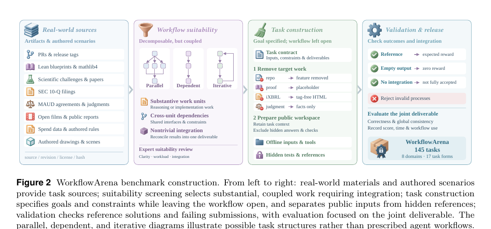

# 工作流编排是一种独立能力

语言：中文；[English](2611.12856.en.md)

> 主分类：[`EV`](../../../docs/categories.md#ev)；辅助分类：[`MA`](../../../docs/categories.md#ma)、[`AF`](../../../docs/categories.md#af)、[`SY`](../../../docs/categories.md#sy)

## 元数据

- 英文标题：WorkflowArena: Benchmarking Executable Workflow Orchestration in LLM-Based Multi-Agent Systems
- 作者与机构：Zheng Jiang、Fang Niu、Bo Peng、Houde Qian、Wenyi Li、Deyao Hong、Mingju Gao、Yizhe Chi、Youjie Zheng、Kaisen Yang、Calvin Xiao、Lifeng Sun、Huan-ang Gao（Navers Lab、Einsia.AI、Tsinghua University）
- arXiv：[2611.12856](https://arxiv.org/abs/2611.12856)；v1
- PDF：<https://arxiv.org/pdf/2611.12856>
- 项目页：<https://lab.einsia.ai/workflowarena>；代码与任务数据：<https://github.com/Einsia/WorkflowArena>；固定 commit `637adecbe59ced8780279301de22b0f582495dea`
- 首次提交与最近修订：2026-11-09 18:45:28 UTC；调研与复查：2026-11-11
- 热度证据：GitHub 6 stars、1 fork、0 open issues；Hugging Face Papers API 未收录；Hacker News 按 arXiv ID 精确检索 0 条。公开 X 仅通过二级页面间接验证官方发布帖，互动数值未验证。采集时间：2026-11-11 09:03～09:10（Asia/Shanghai）。
- 社区评价来源：[Pith 独立评述](https://pith.science/paper/2611.12856)、[Feed7 判断](https://feed7.dev/p/2611-12856v1-1ez03cj)。六个指定 Reddit 社区均返回 HTTP 403，属于访问缺口。采集时间：2026-11-11 09:08～09:12（Asia/Shanghai）。

## 结论摘要

- 论文把「工作流编排」从端到端能力中拆出来：Agent 自主决定是否委派、怎样分解、给 worker 哪些上下文、何时验证和整合，编排成本计入同一份时间预算。
- WorkflowArena 包含 145 个长周期任务、8 个专业领域和 17 种任务形式。每项任务要求交付相互依赖的完整产物，并用隐藏 verifier 检查正确性、全局一致性或过程约束。
- 最强配置的整体 resolved rate 只有 36.95%；连续分数与 resolved rate 的明显差异表明，大量局部进展不等于交付可验收结果。
- 32 个困难任务上的固定执行器实验显示，Opus 静态工作流相对 self dynamic 平均提高 6.41 分。这支持「编排会影响结果」，但没有拆开工作流结构与 worker 指令质量。
- 公开工件足以核对任务清单、装配边界和论文聚合表，不足以独立复跑主榜。模型与 harness 混杂、单次运行无方差、部分领域依赖未校准的 LLM judge，是解释排名时必须保留的边界。

## 研究问题与背景

现有长周期 Agent 基准通常把系统视为一个整体，只看最终任务是否完成；多 Agent 基准又常由研究者预先规定角色和协作结构。两者都难以回答一个更具体的问题：当模型可以在运行时自行创建 worker、编写工作流并根据反馈修改计划时，组织工作的质量能否被单独观察和测量。

WorkflowArena 将目标限定为可执行编排，而不是离线评估计划文本。任务必须包含可拆分但相互依赖的工作单元，局部结果还需要在最终交付物中整合；否则增加 worker 数量或并行分支并不会形成有意义的编排测试。

## 核心方法

每项任务表示为初始状态、目标、公开工具面、任务工件与环境、资源预算和独立 verifier。Agent 可以顺序执行，也可以通过统一的 Workflow 工具启动最多 16 个并发 worker；所有委派、worker 执行和修订都会被记录。主 Agent 与 worker 共享 4 小时墙钟预算，组织工作的时间因此与实际执行直接竞争。

任务从开源仓库、Lean 证明、科学挑战、SEC 文件、法律协议、公共媒体、支出记录和作者构造的业务场景中生成。筛选要求同时满足工作量、跨单元依赖和非平凡整合；隐藏检查不仅验证局部正确性，还会拒绝未整合的组件或违规过程。

论文安排两层实验。主实验比较 9 个模型、25 个模型—harness—努力配置；迁移实验再把执行器固定，让 Opus 或 Astra 只负责编写工作流和 worker 指令，以观察不同来源工作流对 4 个弱执行模型的影响。

图 2，论文第 5 页，来源为官方 PDF。它从左到右展示真实材料、工作流适配筛选、任务构造和联合交付验证。图中的并行、依赖和迭代是任务结构示例，不是预设给 Agent 的工作流。

## 实验与证据

Claude Opus 5.5 + Claude Code max 的整体 resolved rate 为 36.95%，high 的连续分数为 80.21。没有配置在 8 个领域全部领先；LAW 和 FIN 的最高 resolved rate 分别只有 9.09% 和 18.75%。这说明排序依赖领域，也说明连续分数不能替代完整验收率。

迁移实验覆盖 32 个困难任务和全部 8 个领域。对 Kimi K3.1 Pro、GPT-6 Luna、Doubao-Seed-Evolving 和 DeepSeek V4.1 Flash 四个执行器，Opus 静态工作流相对 self dynamic 的平均差为 +6.41 分，动态工作流为 +6.27 分；Astra 静态和动态工作流分别为 -2.53 和 +1.34 分。强单体表现不会自动转化为可迁移的编排，但提升仍不能只归因于图结构。

固定 commit `637adec…` 下，5 项装配边界测试与 Python 静态编译通过；任务清单包含 145 个唯一 ID、8 个领域和 17 种任务形式。公开 JSON 中 25 组 resolved rate 与连续分数的 8 领域均值全部复算一致，迁移表的 +6.41 分也可复算。这验证发布工件与论文聚合表的一致性，不是主实验独立复现。

## 局限与风险

作者明确说明：每个配置在每项任务上只运行一次，接近的排名没有方差估计；Claude 与 GPT 系统分别绑定 Claude Code 与 Codex，跨系统差异同时包含模型和 harness；内容设计与 3D 任务由 Gemini-3.8-Flash 评分，论文未报告与人工评分的一致性；迁移实验只覆盖 32 个较难任务和两个源模型。

迁移实验中的源模型不仅决定并行、依赖和验证节点，还写入 worker 指令，因此「编排结构」与「任务知识／指令质量」没有被消融分开。公开仓库明确不包含逐任务实验记录、参与者提交、执行框架和开发日志，无法复核单次运行轨迹、成本或隐藏 verifier 的真实执行。仓库未声明整体许可证，任务素材虽有逐源 notices，复用边界仍需逐项确认。

## 复现与应用

公开仓库提供任务包、评测材料、聚合结果、文件哈希、装配脚本和发布资产。完整准备需要 Python 3.11+、Git、GitHub CLI、大体量科学数据、Linux／amd64 媒体镜像和多个任务专属容器；部分任务还需要商业模型或 LLM judge。

更现实的复现顺序是先运行装配边界测试和清单校验，再选择一个程序化 verifier 领域做单任务 Harbor 组装，最后才尝试模型评测。工程上可复用的关键不是「多启动几个 worker」，而是同时记录委派图、共享预算、最终交付和整合失败。

## 相关工作

- OrchBench 在确定性模拟中隔离编排计划质量；WorkflowArena 进一步让工作流在真实工件上执行和修订。
- WorFBench 同时评估工作流结构和下游效用，但更偏生成的序列／图；WorkflowArena 将运行时委派和整合成本纳入同一预算。
- DynaFlow 动态生成可执行工作流，是被测能力的代表系统；WorkflowArena 关注如何统一评测这类系统。
- MAST 归纳多 Agent 系统失败模式；WorkflowArena 用可验收交付物和完整委派记录为失败分析提供数据面。
- SkillsBench 通过有／无技能对照测量程序知识；WorkflowArena 关注模型在任务中自行组织 worker 和验证节点的能力。

## 社区评价

Pith 的独立评述认可该基准把组织工作变成可观察、可执行的评测对象，也认为固定执行器实验有解释价值。主要质疑是没有拆分工作流结构与 worker 指令、缺少重复运行、模型与 harness 混杂，以及 LLM judge 没有人类一致性数据。

Feed7 的独立判断认为论文扩大了多 Agent 评测的覆盖面，但没有任何配置跨领域领先，现有结果不足以证明某种委派策略普遍更好。

Hugging Face Papers API 未收录，Hacker News 精确检索无结果；六个指定 Reddit 社区均返回 HTTP 403。公开 X 只通过二级页面间接验证官方发布帖，未验证互动数值。上述缺口不代表没有讨论，互动量也只反映平台内关注度。

## 原文关键图表

保留图 2 一张截图，用于解释任务来源、适配筛选、公开／隐藏边界和联合交付验证。关键数值仍以正文、表 1、表 2 和附录完整结果为准。

## 调研判断

阅读优先级：高。可信度：任务设计、聚合表和公开工件为中高；跨系统排名和「编排独立性」的机制归因为中。适合构建子 Agent、工作流运行时、长周期 Coding Agent 或评测平台的研究与工程人员。

本篇 94 分，作为 2026-11-05～2026-11-11 滚动窗口第 10 篇使用扩展名额。后续应关注逐任务轨迹和执行框架、同一模型跨 Claude Code／Codex 的控制实验、重复运行方差，以及把工作流结构与 worker 指令分开的消融。

## 来源

- <https://arxiv.org/abs/2611.12856>
- <https://arxiv.org/html/2611.12856v1>
- <https://arxiv.org/pdf/2611.12856>
- <https://lab.einsia.ai/workflowarena>
- <https://github.com/Einsia/WorkflowArena>
- <https://pith.science/paper/2611.12856>
- <https://feed7.dev/p/2611-12856v1-1ez03cj>
- <https://fourweekmba.com/ai-claude-opus-5-5-leads-codex-gpts-at-running-ai-agent-teams/>
