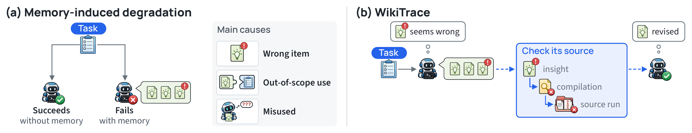

# Give Agent Memory a Path Back to Evidence

English | [中文](2611.14320.md)

> Primary: [`KM`](../../../docs/categories.en.md#km); secondary: [`EV`](../../../docs/categories.en.md#ev) and [`LT`](../../../docs/categories.en.md#lt)

## Metadata

- Original title: Don't Just Trust Your Memory: Evidence-Linked Memory Reduces Memory-Induced Degradation in LLM Agents
- Authors and affiliations: Yukyeong Lee, Yumin Choi, Jinheon Baek, and Sung Ju Hwang; KAIST and DeepAuto.ai
- arXiv: [2611.14320](https://arxiv.org/abs/2611.14320), v1
- PDF: <https://arxiv.org/pdf/2611.14320>
- Code: <https://github.com/yukyeongleee/wikitrace>; project: <https://yukyeongleee.github.io/wikitrace/>; pinned commit `9ee357fbb95db9caae09808f3472a9fce6409c90`
- First submission and latest revision: 2026-11-10 16:46:59 UTC; research and recheck date: 2026-11-12
- Popularity evidence: 45 Hugging Face Daily Papers upvotes and one verifiable comment; GitHub has 10 stars, zero forks, and one open issue. Exact-title and exact-ID Hacker News searches returned no item, and exact matches were not retrieved from the six specified Reddit communities. The original X post was not directly accessible; a secondary index reported about 5.8K views, 76 likes, and 8 reposts for a DAIR.AI post, recorded as indirect verification. Collected 08:10–08:32 Asia/Shanghai on 2026-11-12.
- Community sources: [Hugging Face Papers](https://huggingface.co/papers/2611.14320), [AGI Hunt review](https://agihunt.info/en/papers/2611.14320), and the [Papers with Code page](https://paperswithcode.co/paper/2611.14320). Engagement measures attention within a platform, not research quality.

## Conclusion summary

- The paper separates two effects hidden by average success: Gain is the share of previously failed tasks fixed by memory, while Regression is the share of previously solved tasks broken by memory.
- WikiTrace links each concise insight to a compilation of why its source run succeeded or failed and then to the raw trajectory. The agent traverses those links when advice is incomplete, conflicting, failure-derived, or followed by a blocked action.
- Across five benchmarks, eight suites, and three trials, WikiTrace averages 90.2 versus 79.5 for No Memory and 87.0 for the same insights without evidence traversal. Regression falls from 6.5% to 4.5%.
- WikiTrace differs from Insights Only in both evidence access and traversal instructions, so the 3.2-point gain is not an isolated causal estimate of filesystem links alone.
- The repository exposes the method, configuration, setup scripts, and more than 500 tests, but not the historical experiment outputs. This audit validates public code boundaries, not the Docker-, benchmark-, and API-intensive main experiment.

## Research question and background

Experience memory compresses past trajectories into rules, workflows, or reflections for reuse. A trajectory has only one success or failure label; it does not identify the causal action or prove that an extracted rule applies in a new state. Average accuracy can cancel improvements on former failures against regressions on tasks the agent already solved.

The authors analyze tasks that are stable No-Memory successes but fail with memory. They attribute 52% of those failures to a memory item the agent actually followed, most commonly a wrong item and then an out-of-scope or misread item. This reframes the problem from retrieving more experience to checking the evidence behind experience when it is used.

## Method

WikiTrace stores three linked, read-only document layers. An insight states reusable guidance, applicability, and its source run. A compilation summarizes the decisions and observations behind the source outcome. The raw layer preserves the full trajectory. Each training run is compiled independently into at most three insights; insights are not merged across runs or rewritten later.

At test time, the agent receives all insights plus an index of the three most similar source runs. It is instructed to traverse to the compilation or raw trajectory when advice lacks an actionable detail, comes from a failed run, conflicts with another item, or follows a blocked action. It may extract only facts that can be checked in the current task and must not replay a historical run. The evidence mount is read-only, and reads do not consume environment steps.

Figure 1, page 1 of the paper, from the authors' official repository. It contrasts a wrong memory item that breaks a previously solved task with traversal through insight, compilation, and source run. It explains the mechanism; it does not isolate evidence access, traversal prompting, and model behavior causally.

## Experiments and evidence

The DeepSeek-V4.1-Flash2 main experiment covers ALFWorld seen and unseen, ScienceWorld, PlanCraft seen and unseen, τ³-bench Retail, and AppWorld normal and challenge. Each benchmark contributes 38–54 training tasks and 76–134 test tasks. Three trials compare No Memory, AWM, ReasoningBank, ExpeL, Insights Only, and WikiTrace.

WikiTrace is highest on all eight suites and averages 90.2±1.6. Insights Only averages 87.0±2.5 and No Memory 79.5±1.6. Task-level bootstrap 95% intervals are used for Gain and Regression. WikiTrace Regression is 4.5%, below Insights Only at 6.5% and the 9.7% No-Memory rerun band.

Evidence is consulted more often on harder tasks. The opened run changes the plan in 43% of traversal cases: 24% revise an insight, 14% add an omitted detail, and 4% supply a fact absent from the insights. Those runs lead Insights Only by 8.3 points. Traversal triggered by a blocked action leads by 17.3 points, while routine checks lead by 3.4.

On three GLM-5.3-Flash suites, WikiTrace averages 92.7, Insights Only 90.9, and No Memory 71.2. WikiTrace test-time cost is 1.17 times Insights Only per task. This supports directional consistency across two models but does not cover all eight suites.

At pinned commit `9ee357f…`, the first `dev`-only run stopped during collection because analysis tests need `pandas`. After adding the declared `analysis` extra and shortening pytest's temporary path, the audit reached 514 passed, 34 skipped, and one failed. The failure is a macOS mismatch: a test uses Linux `/proc` to infer orphan-process exit and checks Unix-socket cleanup too early. The result validates much of the released unit and integration surface; it is not a rerun of the model experiments.

## Limitations and risks

The authors state that compilations and insights are still inferred from binary outcomes. A source link permits inspection but does not verify a lesson. All insights are inserted into the first message, so prompt size grows with memory; retrieval for larger corpora remains open. Degradation causes and traversal labels come from an LLM judge reading stated reasoning, not an identified causal process.

Baselines are normalized to a single offline memory build. ExpeL loses its original retry-and-compare behavior, and ReasoningBank no longer updates during testing. This controls the training trajectories but may understate complete baseline systems.

Insights Only and WikiTrace differ in both mounted evidence and traversal instructions. The paper does not report file-access-only or prompt-only ablations. Historical `outputs/` are absent from the repository, and this run did not reproduce commercial-model experiments.

## Reproduction and application

The repository requires Python 3.11+, `uv`, Node 20, and Docker, plus separate installations for ALFWorld, ScienceWorld, PlanCraft, τ³-bench, and AppWorld. Full reproduction must first create No-Memory training trajectories, compile one corpus per trial, run each method, and analyze paired sample results through a configured OpenRouter account.

Two ideas are easier to adopt independently: retain source-run and applicability links for each lesson, and trigger evidence checks on conflicts, failure-derived guidance, or blocked actions. Production use must also handle sensitive trajectory data, prompt injection, stale authorization, and the fact that a read-only memory does not authorize downstream actions.

## Related work

- ExpeL distills experience into editable rules; WikiTrace keeps reverse links to source trajectories, although the experiment uses an offline single-build variant.
- ReasoningBank builds strategies from successful and failed runs and retrieves by similarity; WikiTrace adds in-task traversal to source evidence.
- AWM extracts reusable workflows from successful trajectories; WikiTrace targets guidance that may itself be wrong.
- PREPING and SkillOpt validate practice trajectories or skill updates before admission; WikiTrace reassesses already stored guidance at use time.
- ReMe updates or removes memory based on later utility; WikiTrace leaves the shared corpus unchanged and revises interpretation in the current task.

## Community response

One verifiable Hugging Face comment highlighted the Gain/Regression framing, the 9.7% No-Memory rerun flip rate, and the much larger benefit when evidence traversal follows a blocked action. It is supportive commentary and does not report an independent rerun.

AGI Hunt's independent review accepts the 90.2 average and 4.5% Regression result as a useful reliability improvement rather than a new capability class. It flags four boundaries: offline normalization may understate ExpeL, evidence access and traversal prompting are not separated, all-insight prompting does not scale, and judge agreement for degradation causes is limited. The review provides no independent execution record.

Exact Hacker News results were not retrieved, no exact match was found in the six specified Reddit communities, and X engagement was available only through a secondary index. These are retrieval boundaries, not evidence that discussion does not exist.

## Figures and tables from the paper

One copy of Figure 1 is retained to explain the relationship among a wrong lesson, source evidence, and the current task. Full eight-suite values in Table 1, Gain and Regression in Figure 5, and appendix confidence intervals remain grounded in the paper rather than the screenshot.

## Research judgment

Reading priority: high. Confidence is high for the mechanism and released code, medium-high for the directional experimental claim, and medium for attribution to evidence links as a single mechanism. The work is especially relevant to agent memory, experience reuse, long-horizon recovery, and execution auditing.

Score: 94. The prior six days, November 6–11, contain eight published papers; this selection raises the seven-day total to nine and stays within the regular cap. Follow-up should target released raw outputs, isolated file-access and prompt ablations, long-memory retrieval, sensitive-trajectory governance, and a full multi-benchmark Docker rerun.

## Sources

- <https://arxiv.org/abs/2611.14320>
- <https://arxiv.org/html/2611.14320v1>
- <https://arxiv.org/pdf/2611.14320>
- <https://github.com/yukyeongleee/wikitrace>
- <https://yukyeongleee.github.io/wikitrace/>
- <https://huggingface.co/papers/2611.14320>
- <https://agihunt.info/en/papers/2611.14320>
- <https://paperswithcode.co/paper/2611.14320>
