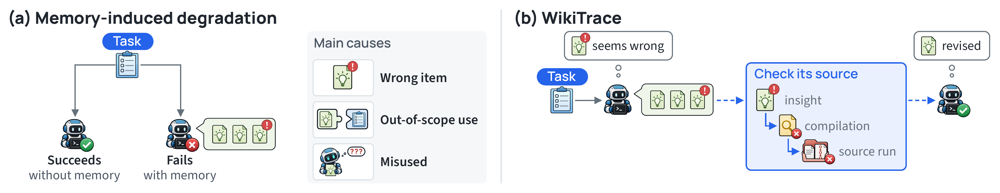

# 让 Agent 记忆保留证据回路

中文 | [English](2611.14320.en.md)

> 主分类：[`KM`](../../../docs/categories.md#km)；辅助分类：[`EV`](../../../docs/categories.md#ev)、[`LT`](../../../docs/categories.md#lt)

## 元数据

- 英文标题：Don't Just Trust Your Memory: Evidence-Linked Memory Reduces Memory-Induced Degradation in LLM Agents
- 作者与机构：Yukyeong Lee、Yumin Choi、Jinheon Baek、Sung Ju Hwang（KAIST、DeepAuto.ai）
- arXiv：[2611.14320](https://arxiv.org/abs/2611.14320)；v1
- PDF：<https://arxiv.org/pdf/2611.14320>
- 代码：<https://github.com/yukyeongleee/wikitrace>；项目页：<https://yukyeongleee.github.io/wikitrace/>；固定 commit `9ee357fbb95db9caae09808f3472a9fce6409c90`
- 首次提交与最近修订：2026-11-10 16:46:59 UTC；调研与复查：2026-11-12
- 热度证据：Hugging Face Daily Papers 45 upvotes、1 条可核验社区评论；GitHub 10 stars、0 forks、1 个 open issue。Hacker News 按标题与 arXiv ID 精确检索未取得条目；六个指定 Reddit 社区未取得精确命中；X 原帖未直接访问，二级索引显示 DAIR.AI 相关帖约 5.8K views、76 likes、8 reposts，记为间接验证。采集时间：2026-11-12 08:10～08:32（Asia/Shanghai）。
- 社区评价来源：[Hugging Face Papers](https://huggingface.co/papers/2611.14320)、[AGI Hunt 独立评述](https://agihunt.info/en/papers/2611.14320)、[Papers with Code 页面](https://paperswithcode.co/paper/2611.14320)。互动量只反映平台内关注度，不直接代表论文质量。

## 结论摘要

- 论文把 Agent 记忆的风险从平均成功率中拆出：Gain 衡量记忆把失败变成功的比例，Regression 衡量记忆把原本成功的任务变失败的比例。后者直接暴露「记忆诱发退化」。
- WikiTrace 不把压缩后的经验当作孤立规则，而是把每条 insight 链接到成功或失败原因的 compilation，再链接到原始轨迹；Agent 在规则不完整、相互冲突、来自失败运行或行动受阻时，用终端工具回查证据。
- 在 5 个基准、8 个 suite、3 次试验上，WikiTrace 平均得分 90.2，高于无记忆的 79.5 和相同 insights 但不能回查证据的 87.0；Regression 从 6.5% 降至 4.5%。
- 与 Insights Only 的差异不仅是文件访问：WikiTrace 同时增加只读证据目录和「何时下钻」的提示，因此 3.2 分提升不能完全归因于证据链接这一单一变量。
- 公开仓库完整提供方法、配置、安装脚本和 500 余项测试，但不包含论文历史运行结果；本轮验证代码工件与测试边界，没有独立复跑需要 Docker、五套基准和商业模型 API 的主实验。

## 研究问题与背景

经验记忆通常把过去轨迹压缩成规则、工作流或反思，再把这些内容提供给新任务。单个轨迹只有成功或失败标签，无法指出哪一步真正导致结果，也无法保证抽取出的规则适用于新的状态。平均成功率会把「帮助了原本失败的任务」与「破坏了原本能完成的任务」相互抵消。

作者先分析稳定无记忆成功、加入记忆后失败的案例，报告 52% 的失败可追溯到 Agent 实际遵循的记忆条目，最常见原因是条目本身错误，其次是越界适用或误读。论文据此把问题从「怎样检索更多经验」改写为「怎样让 Agent 在使用经验时检查其依据」。

## 核心方法

WikiTrace 的记忆由三层只读文档组成。最上层 insight 说明可复用建议、适用条件和来源运行；中层 compilation 总结该运行成功或失败的关键决策与观察；底层保留完整原始轨迹。每个训练运行独立编译，最多生成 3 条 insight，不跨运行合并，也不在写入后改写。

测试时，Agent 首先看到全部 insights，以及与当前任务最相似的 3 个历史运行索引。若某条建议缺少执行细节、来自失败运行、与其他建议冲突，或当前行动受阻，提示词要求 Agent 沿链接读取 compilation 或原始轨迹，只提取能在当前任务中核验的事实，禁止机械重放历史动作。证据目录以只读方式挂载，读取不计入环境步数。

图 1，论文第 1 页，来源为作者官方仓库中的论文图。左侧说明错误记忆如何让原本成功的任务失败；右侧展示 Agent 沿 insight、compilation、source run 回查并修正规则。该图说明机制，不代表因果消融已经隔离文件访问、提示词和模型行为。

## 实验与证据

主实验使用 DeepSeek-V4.1-Flash2，覆盖 ALFWorld seen／unseen、ScienceWorld、PlanCraft seen／unseen、τ³-bench Retail、AppWorld normal／challenge，共 8 个 suite。每个基准使用 38～54 个训练任务和 76～134 个测试任务，执行 3 次试验；对比 No Memory、AWM、ReasoningBank、ExpeL、Insights Only 和 WikiTrace。

WikiTrace 在 8 个 suite 上均为最高分，平均 90.2±1.6；Insights Only 为 87.0±2.5，无记忆为 79.5±1.6。论文用任务级 bootstrap 95% 区间分别估计 Gain 与 Regression：WikiTrace 的 Regression 为 4.5%，低于 Insights Only 的 6.5%，也低于无记忆重复运行的 9.7% 噪声带。

Agent 在较难任务中更常回查证据。回查后改变计划的运行占 43%，其中修订 insight 占 24%、补充缺失细节占 14%、找到 insight 未覆盖的新事实占 4%；这些运行相对 Insights Only 高 8.3 分。行动受阻后定向查找具体事实时，领先达到 17.3 分；例行检查的领先只有 3.4 分。

GLM-5.3-Flash 的 3 个 suite 复核中，WikiTrace 平均 92.7，Insights Only 为 90.9，无记忆为 71.2。测试时 WikiTrace 的单任务成本是 Insights Only 的 1.17 倍。该结果支持跨两个模型的方向一致性，但没有覆盖全部 8 个 suite。

固定 commit `9ee357f…` 下，本轮先按 `dev` extra 运行，测试收集因分析测试需要 `pandas` 而中断；补齐仓库声明的 `analysis` extra 并缩短 pytest 临时目录后，514 passed、34 skipped、1 failed。唯一失败项在 macOS 上用 Linux `/proc` 判断孤儿进程退出，随后过早检查 Unix socket 是否删除。`ruff` 与静态编译未作为最终全绿证据，因为完整命令在失败前终止。上述结果验证公开实现的大部分单元与集成边界，不是论文的模型实验复现。

## 局限与风险

作者明确说明：compilation 和 insight 仍从二元结果推断，来源链接只允许检查，不能证明规则正确；全部 insights 放入首条消息，记忆规模增长会带来提示长度和检索问题；退化原因与下钻标签由 LLM judge 读取 Agent 的显式推理判定，描述的是推理文本所声称的原因，不是可识别的真实因果。

对照方法被统一为「离线构建一次再冻结」：ExpeL 不再拥有同任务重试并比较成功／失败运行的原始工作方式，ReasoningBank 也不在测试过程中持续更新。该统一有利于比较同一训练轨迹，但可能低估部分基线的完整系统能力。

Insights Only 与 WikiTrace 的输入并非只差「能否读取文件」：后者还包含下钻时机与使用规则。论文没有单独给出「有文件访问但无下钻提示」或「仅加入下钻提示但无文件访问」的消融，不能把全部提升归因于某个单一机制。主实验均为作者自报，公开仓库没有原始 `outputs/`，本轮也没有重做商业模型运行。

## 复现与应用

仓库要求 Python 3.11+、`uv`、Node 20 和 Docker，并需要分别安装 ALFWorld、ScienceWorld、PlanCraft、τ³-bench 与 AppWorld。模型调用通过 OpenRouter 配置；完整重跑还需要构建无记忆训练轨迹、编译每个 corpus，再对每种方法执行测试和分析。

工程上更容易先复用两个设计：为每条经验保留来源运行与适用条件；在 Agent 行动失败、规则冲突或规则来自失败运行时触发证据回查。落地时仍需限制历史轨迹中的敏感数据、提示注入和过期权限，并把「只读记忆」与「下游动作授权」分开处理。

## 相关工作

- ExpeL 将经验归纳成可编辑规则；WikiTrace 保留规则到原始轨迹的反向引用，但本实验使用离线单次构建版本。
- ReasoningBank 从成功和失败轨迹构建推理策略，并按任务相似度检索；WikiTrace 进一步允许执行中回查来源证据。
- AWM 从成功轨迹抽取可复用工作流；WikiTrace 关注规则本身不可靠时如何在使用阶段复核。
- PREPING 和 SkillOpt 在写入前验证练习轨迹或技能更新；WikiTrace 处理已经进入记忆的规则在新任务中的适用性。
- ReMe 根据后续效用更新或删除记忆；WikiTrace 不改写共享记忆，而是在当前任务上下文中重新解释。

## 社区评价

Hugging Face 的一条可核验评论认为 Gain／Regression 的拆分很有解释力，并特别指出无记忆重复运行也有 9.7% 翻转，以及 Agent 在行动受阻后回查证据时收益最大。该评论是支持性观点，未报告独立复跑。

AGI Hunt 的独立评述认可 WikiTrace 在 8 个 suite 上平均提高到 90.2、Regression 降至 4.5%，同时把它界定为可靠性系统改进，而不是新的能力类别。评述提出 4 个主要限制：基线离线化可能低估 ExpeL；文件访问与下钻提示没有拆开；全量 insights 的扩展性未解决；退化原因 judge 的一致性有限。该页面未提供独立运行记录。

Hacker News 精确检索未取得条目，六个指定 Reddit 社区未取得精确命中；X 只能通过二级索引间接验证 DAIR.AI 讨论及互动量。这些结果属于检索和证据边界，不代表对应平台没有讨论。

## 原文关键图表

保留图 1 一张，用于解释「错误规则—来源证据—当前任务」的关系。表 1 的完整 8-suite 数值、图 5 的 Gain／Regression 和附录中的置信区间仍以论文原文为准；截图不能替代数值核对。

## 调研判断

阅读优先级：高。可信度：方法与代码工件为高，作者实验的方向性结论为中高，把提升归因于单一证据链接机制为中。适合构建 Agent 记忆、经验复用、长周期任务恢复和运行审计的研究与工程人员。

本篇 94 分。2026-11-06～2026-11-12 的前 6 日已发布 8 篇，本篇加入后滚动 7 天为 9 篇，位于总览常态上限内，不使用第 10～12 篇放宽名额。后续应关注公开原始运行结果、文件访问与提示词的独立消融、长记忆检索、敏感轨迹治理，以及完整 Docker／多基准复跑。

## 来源

- <https://arxiv.org/abs/2611.14320>
- <https://arxiv.org/html/2611.14320v1>
- <https://arxiv.org/pdf/2611.14320>
- <https://github.com/yukyeongleee/wikitrace>
- <https://yukyeongleee.github.io/wikitrace/>
- <https://huggingface.co/papers/2611.14320>
- <https://agihunt.info/en/papers/2611.14320>
- <https://paperswithcode.co/paper/2611.14320>
