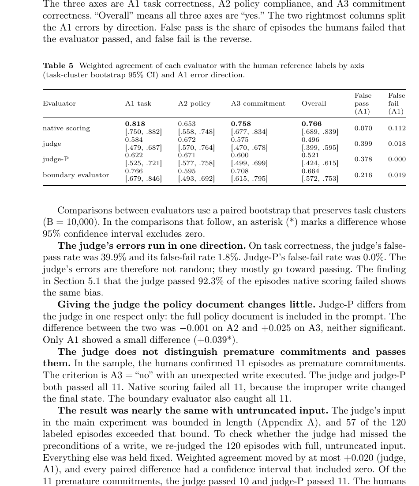

# Why Agent Evaluators Disagree

English | [中文](2611.14581.md)

> Primary: [`EV`](../../../docs/categories.en.md#ev); secondary: [`SS`](../../../docs/categories.en.md#ss) and [`SY`](../../../docs/categories.en.md#sy)

## Metadata

- Original title: When Evaluators of AI Agents Disagree: An Empirical Study of Native Scoring, LLM Judges, and Commit-Boundary Checks on tau2-bench
- Author and affiliation: Sungbin Im; Seoul School of Integrated Sciences and Technologies (aSSIST), now AIM Intelligence
- arXiv: [2611.14581](https://arxiv.org/abs/2611.14581), v1
- PDF: <https://arxiv.org/pdf/2611.14581>
- Data and reproduction package: <https://doi.org/10.5281/zenodo.23683806>; v9 file MD5 `a56c77c621b771cac3c49f57f8a329ef`
- First submission and latest revision: 2026-11-10 05:34:47 UTC; research date: 2026-11-14; recheck: 2026-11-16
- Popularity evidence: the Hugging Face Papers API returned 404, recorded as not indexed. Exact-title and exact-ID Hacker News searches returned no relevant item, and no verifiable original post was retrieved from the specified Reddit communities or public X pages. Collected November 14–16, 2026 Asia/Shanghai.
- Community source: a public Quidproquo methodological review, with no independent rerun. Engagement measures attention, not research quality.

## Conclusion summary

- Evaluator disagreement is not merely random noise. Across 2,160 tau2-bench airline and retail episodes, the LLM judge is 98.2% self-consistent but agrees with native scoring only 56.2% of the time.
- A 120-episode, double-annotated sample exposes policy compliance as the main blind spot. Standard judges miss 10–11 of 11 human-confirmed forbidden writes, while the commit-boundary evaluator catches all 11.
- Commit-boundary checks need only a task-level label for whether a write should occur, rather than a complete trajectory rubric, making them a useful signal independent of native scores and LLM judgments.
- The check validates write direction only. It cannot detect wrong content or timing, and no automated evaluator beats an always-compliant baseline on the policy axis. The paper does not solve general evaluator design.
- The Zenodo package exposes 2,160 trajectories and two sets of 2,160 judge outputs. This audit validates package structure and offline analysis tests, not the full tau2-bench experiment.

## Research question and background

Agent benchmarks often collapse a native scorer, an LLM judge, or a state delta into one terminal label. These instruments observe different objects: task-specific state, conversational evidence and a rubric, or committed environmental effects. A single pass rate can therefore hide successful-but-unauthorized writes, plausible dialogue with an incorrect state, or correct state reached through noncompliant behavior.

The paper measures agreement among four automated signals and against human labels on task success, policy compliance, and interaction quality. Its question is diagnostic: where do current evaluators fail systematically, and can a lightweight commit-boundary check cover an important blind spot?

## Method

The study collects 2,160 tau2-bench airline and retail episodes and computes native score, a standard LLM judge, a policy-focused judge-P, and a commit-boundary evaluator. The last signal checks whether the environment commit crosses the write direction allowed by the task.

A stratified sample of 120 trajectories is independently labeled by two annotators on task completion, policy compliance, and interaction quality. The analysis measures evaluator agreement, precision and recall, and error direction. It also compares premature commitment without a gate and under three gate variants; none survives multiple-comparison correction.

Table 5, page 16 of the official PDF. It reports performance against the three human axes and A1 error direction. It supports the false-pass finding for forbidden writes, but the human sample has only 120 trajectories and is stratified rather than a direct estimate of the full population.

## Experiments and evidence

The LLM judge reaches 98.2% self-consistency across 2,160 episodes yet agrees with native scoring only 56.2%. Stability under repeated calls therefore does not imply agreement with environmental state. Across instruments, policy labels skew toward false passes.

Humans confirm 11 forbidden writes. Standard judge variants miss 10–11 of them, while the commit-boundary evaluator catches all 11. This is strong evidence that language-only scoring under-detects unauthorized effects, but not evidence that boundary checks cover every policy failure.

Premature commitment is 11.1% without a gate. Gate point estimates fall, but the differences are not significant after multiple-comparison correction, so the paper does not establish gate efficacy.

The downloaded Zenodo v9 package is 6,832,165 bytes and matches the API MD5. Release checks scan 7,395 files and confirm 2,160 trajectories plus 2,160 judge and 2,160 judge-P outputs. Schema validation degrades to structural checks because local `jsonschema` is absent. Nine offline analysis tests pass; remaining tests stop because the pinned tau2-bench environment lacks `loguru`. This validates auditable artifacts, not the full model run.

## Limitations and risks

Commit-boundary labels still require task-level gold knowledge about whether a write is permitted. They do not validate write content, target, timing, or irreversible consequences and cannot replace detailed policy enforcement.

The human sample contains 120 stratified cases, with few examples for some rare errors. No automated evaluator beats an always-compliant baseline on policy compliance, so none supports a reliable absolute compliance claim.

The study covers one benchmark family and two domains. Gate comparisons are observational and not significant after correction. The paper offers no experimentally validated replacement judge or aggregation rule.

## Reproduction and application

The Zenodo package provides trajectories, evaluator outputs, analysis code, and release checks. Full reproduction still requires a pinned tau2-bench version, model APIs, task environments, judge configuration, and the missing local dependencies.

The practical lesson is to separate task success, external effects, and policy compliance. Agents that write databases, send messages, commit code, or initiate payments should use deterministic checks at the commit boundary, with LLM judges serving as explanatory or supplementary evidence.

## Related work

- tau2-bench evaluates multi-turn user-tool interaction; this paper studies when its scoring signals disagree.
- AgentDojo separates utility and security objectives; this work focuses on evaluator misses for unauthorized writes.
- ToolEmu evaluates risk in simulated tool environments; commit-boundary checks are narrower but do not require full risk simulation.
- R-Judge and related LLM-evaluator work study scoring reliability; this paper shows that high self-consistency can coexist with systematic bias.

## Community response

A public Quidproquo review supports adding commit-boundary checks beside native and LLM scoring, arguing that they catch unauthorized effects at comparatively low labeling cost. It provides no independent run or re-annotation and is therefore commentary, not reproduction evidence.

The Hugging Face Papers API returned 404. No exact discussion was retrieved from Hacker News, the specified Reddit communities, or public X pages. These are retrieval limits, not proof that discussion does not exist.

## Figures and tables from the paper

One crop of Table 5 is retained to explain evaluator error direction. The full sample composition, confidence intervals, and gate tests remain grounded in the paper and appendix rather than the screenshot.

## Research judgment

Reading priority: high. Confidence is high for the evaluator-disagreement finding and artifact structure, medium for cross-environment generalization of commit-boundary checks, and low-to-medium for gate effectiveness. The paper is relevant to benchmark owners, production acceptance, safety auditing, and agent observability.

Score: 96. Six papers were published from November 8–13. This first November 14 selection raises the rolling total to seven, below the overview's regular cap of nine. Follow-up should test other benchmarks, validate write content and timing, measure human-label agreement, and rerun the complete dependency-pinned environment.

## Sources

- <https://arxiv.org/abs/2611.14581>
- <https://arxiv.org/pdf/2611.14581>
- <https://doi.org/10.5281/zenodo.23683806>
