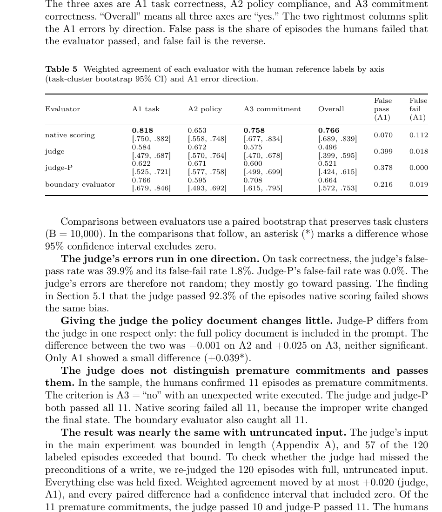

# Agent 评测器为何互相矛盾

中文 | [English](2611.14581.en.md)

> 主分类：[`EV`](../../../docs/categories.md#ev)；辅助分类：[`SS`](../../../docs/categories.md#ss)、[`SY`](../../../docs/categories.md#sy)

## 元数据

- 英文标题：When Evaluators of AI Agents Disagree: An Empirical Study of Native Scoring, LLM Judges, and Commit-Boundary Checks on tau2-bench
- 作者与机构：Sungbin Im；Seoul School of Integrated Sciences and Technologies（aSSIST），现 AIM Intelligence
- arXiv：[2611.14581](https://arxiv.org/abs/2611.14581)；v1
- PDF：<https://arxiv.org/pdf/2611.14581>
- 数据与复现包：<https://doi.org/10.5281/zenodo.23683806>；v9 文件 MD5 `a56c77c621b771cac3c49f57f8a329ef`
- 首次提交与最近修订：2026-11-10 05:34:47 UTC；调研：2026-11-14；复查：2026-11-16
- 热度证据：Hugging Face Papers API 返回 404，记为未收录；Hacker News 按标题与 arXiv ID 精确检索未取得相关条目；指定 Reddit 社区和公开 X 页面未取得可核验原帖。采集时间：2026-11-14～2026-11-16（Asia/Shanghai）。
- 社区评价来源：Quidproquo 的公开方法解读；未取得独立复跑。互动量只反映平台内关注度，不直接代表论文质量。

## 结论摘要

- 同一条 Agent 轨迹被不同评测器判成不同结果，不只是随机噪声：2,160 个 tau2-bench airline／retail episode 中，LLM judge 的自一致率为 98.2%，但与 native scoring 的一致率只有 56.2%。
- 120 个双人独立人工标注样本显示，政策合规是主要盲区。11 次人工确认的 forbidden write 中，常规 judge 放过 10～11 次，commit-boundary evaluator 捕获全部 11 次。
- commit-boundary 检查只需要任务级「是否应发生写入」标签，不需要为每条轨迹完整重写 rubric；这使它成为 native score 与 LLM judge 之外有价值的独立信号。
- 该检查只验证写入方向，不能发现写入内容或时机错误；所有自动评测器在政策合规轴上都没有超过「始终判合规」基线，论文没有解决完整评测器设计问题。
- Zenodo 包可审计 2,160 条轨迹和两类各 2,160 份 judge 输出。本轮验证发布结构与离线分析测试，不是 tau2-bench 主实验的独立复跑。

## 研究问题与背景

Agent 基准常把 native scorer、LLM judge 或状态差分的某一个输出当作终值。三者实际观察的对象不同：native scorer 通常检查任务指定状态，LLM judge 根据对话与 rubric 判断，commit-boundary 则检查 Agent 是否在不该产生外部副作用时写入环境。单一通过率因此可能掩盖「任务完成但越权」「对话看似合理但状态错误」或「状态正确但步骤不合规」。

论文不提出新的通用评测器，而是测量四种自动信号之间及其与人工三轴标签之间的关系：任务成功、政策合规和交互质量。核心问题是哪些评测器在何种错误上稳定失真，以及轻量边界检查能否补上现有盲区。

## 核心方法

作者在 tau2-bench airline 与 retail 领域收集 2,160 个 episode，对每条轨迹计算 native score、常规 LLM judge、强调政策的 judge-P 和 commit-boundary evaluator。最后一项根据任务声明的允许写入方向，检查环境提交是否越过边界。

人工复核从结果组合中分层抽取 120 条轨迹，由两名标注者分别判断任务完成、政策合规与交互质量。分析既看自动评测器之间的一致性，也看它们相对人工标签的 precision、recall 与具体误判方向。论文还比较无 gate 与三类 gate 的 premature commitment，但这些检验经过多重比较校正后没有显著差异。

表 5，论文第 16 页。截图来自官方 PDF，展示四类自动评测器相对人工三轴标签的表现及 A1 错误方向。它支持「常规 judge 容易放过 forbidden write」的结论，但样本只有 120 条，且分层抽样不能直接替代全体 episode 的总体比例。

## 实验与证据

2,160 个 episode 覆盖 airline 与 retail 两类任务。LLM judge 自一致率达到 98.2%，说明重复调用相对稳定；但它与 native scorer 的一致率只有 56.2%，稳定并不等于与环境终态一致。四种自动信号在任务成功轴上各有差异，在政策合规轴上普遍偏向 false pass。

人工样本中有 11 次确认的 forbidden write。常规 judge 与 judge-P 分别漏掉其中 10～11 次，而 commit-boundary evaluator 捕获全部 11 次。该结果说明只看自然语言评价会系统性低估越界写入，但不能外推为 boundary evaluator 能发现所有政策问题。

作者还报告无 gate 条件的 premature commitment 为 11.1%。三类 gate 的点估计有所下降，但在多重比较校正后没有显著证据，因此不能写成 gate 已被证明有效。

本轮下载并核对 Zenodo DOI `10.5281/zenodo.23683806` 的 v9 包：文件大小 6,832,165 bytes，MD5 与 API 元数据一致。发布自检扫描 7,395 个文件，确认 2,160 条轨迹、2,160 份 judge 与 2,160 份 judge-P 输出；因本机缺少 `jsonschema`，Schema 校验降级为结构检查。离线 analysis pipeline 的 9 项测试通过；其余测试在固定 tau2-bench 依赖缺少 `loguru` 时停止。以上证明公开包内部结构可审计，不等同于完整实验重跑。

## 局限与风险

作者的 commit-boundary 标签仍依赖每个任务的 gold 信息：评测者必须知道该任务是否允许外部写入。它只检查写入方向，不检查写入内容、对象、时机或不可逆影响，因此不能替代细粒度政策验证。

人工样本为 120 条，且采用分层抽样；部分罕见错误在样本中数量很小。政策合规轴上，所有自动评测器都没有超过「始终判合规」基线，说明现有指标尚不能提供可靠的绝对判断。

论文主要分析一个 benchmark family 和两个领域，不能直接外推到 Web、桌面、软件工程或机器人 Agent。gate 分析是观察性比较，且校正后不显著。作者没有提出经实验验证的新 judge 或组合规则。

## 复现与应用

Zenodo 包提供轨迹、评测器输出、分析脚本与发布自检，适合重算一致性、误判方向和人工样本统计。完整复现仍需要固定 tau2-bench 版本、模型 API、任务环境与 judge 配置，并补齐当前本机缺失的依赖。

工程上最直接的应用不是替换 judge，而是把任务成功、外部副作用和政策合规拆成独立信号；对会写数据库、发送消息、提交代码或付款的 Agent，应在动作提交边界增加确定性检查，再把 LLM judge 限定为解释或补充证据。

## 相关工作

- tau2-bench 通过多轮用户—工具交互评测 Agent；本篇研究其评分信号何时互相矛盾。
- AgentDojo 把工具任务成功与安全目标分开；本篇进一步关注评测器本身对越界写入的漏检。
- ToolEmu 用模拟工具环境和审计器评估风险；commit-boundary 检查更窄，但不依赖完整风险模拟。
- R-Judge 与同类 LLM evaluator 工作研究模型评分可靠性；本篇用环境终态与人工三轴标签展示高自一致仍可能系统性偏差。

## 社区评价

Quidproquo 的公开解读支持在 native score 与 LLM judge 之外加入 commit-boundary 检查，认为它以较低标注成本捕捉了越界副作用。该页面没有提供独立运行记录，也没有重新标注 120 条样本，因此属于方法解读，不是复现证据。

Hugging Face Papers API 返回 404；Hacker News、指定 Reddit 社区与公开 X 页面未取得可核验的精确讨论。以上是检索边界，不代表对应平台没有讨论。

## 原文关键图表

保留表 5 一张，用于解释不同评测器相对人工三轴标签的错误方向。完整样本构成、置信区间和 gate 检验仍以论文正文与附录为准；截图不能替代统计核对。

## 调研判断

阅读优先级：高。对「自动评测器互相矛盾」与公开数据结构的可信度为高；对 commit-boundary 在其他环境中的外推为中；对 gate 有效性的可信度为低到中。适合 Agent 基准、生产验收、安全审计和可观测性负责人。

本篇 96 分。2026-11-08～2026-11-13 已发布 6 篇，本篇作为 2026-11-14 的第一篇，使滚动 7 天增至 7 篇，仍低于总览常态上限 9 篇。后续应补齐跨 benchmark 验证、写入内容与时机检查、人工标签一致性及完整依赖环境复跑。

## 来源

- <https://arxiv.org/abs/2611.14581>
- <https://arxiv.org/pdf/2611.14581>
- <https://doi.org/10.5281/zenodo.23683806>
