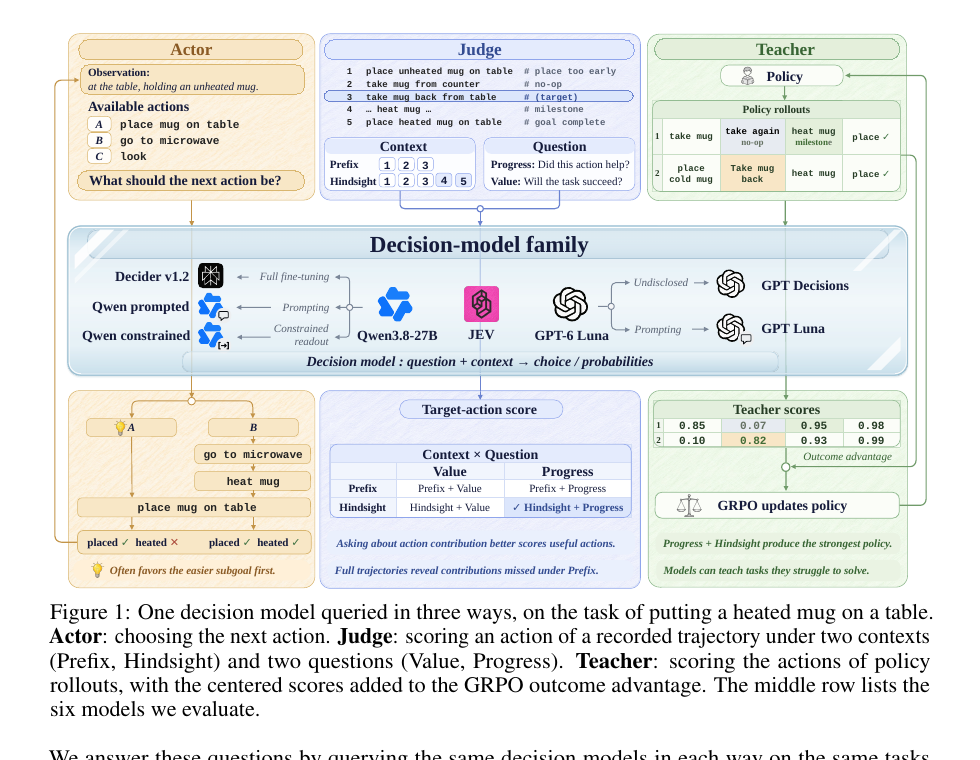

# Decision Models as Actors, Judges, and Teachers

English | [中文](2611.17167.md)

> Primary: [`AT`](../../../docs/categories.en.md#at); secondary: [`EV`](../../../docs/categories.en.md#ev) and [`RP`](../../../docs/categories.en.md#rp)

## Metadata

- Original title: Actor, Judge, or Teacher? Understanding Decision Models in Long-Horizon Agents
- Authors: Haochen Liu, Qianhao Zhu, Zixuan Wang, Dingming Li, Tongbo Chen, Peng Qiu, Yingqi Qu, Weiming Lu, Jun Xiao, and Yongliang Shen
- Affiliations: Zhejiang University and Baidu
- arXiv: [2611.17167](https://arxiv.org/abs/2611.17167), v1
- PDF: <https://arxiv.org/pdf/2611.17167>
- Code: <https://github.com/ZJU-REAL/decision-agents>; project: <https://zjureal.com/decision-agents/>; pinned commit `824b394878f2aa5473a85bcf0b9d8d3bbfeaad6f`
- First submission and latest revision: 2026-11-12 17:42:46 UTC; research date: 2026-11-14; recheck: 2026-11-16
- Popularity evidence: 34 Hugging Face Daily Papers upvotes and zero comments; GitHub has 46 stars, zero forks, and zero open issues. No exact match was retrieved from Hacker News, the specified Reddit communities, or public X pages. Collected at 09:10 Asia/Shanghai on November 16, 2026.
- Community sources: public DAIR.AI and PaperPeel explainers, neither with an independent rerun. Engagement measures attention, not research quality.

## Conclusion summary

- A decision model can be a weak long-horizon actor. On ALFWorld, JEV succeeds on 70.8% of tasks with two independent subgoals but only 14.7% when one subgoal depends on the other.
- The failure is not simply missing capability. Removing the easy distractor subgoal raises the probability of selecting the required state-changing action from 14.6% to 77.6%, implicating competition during prospective action choice.
- The same model can judge useful steps after seeing the complete trajectory. Adding Hindsight and Progress step scores to GRPO raises Qwen2.5-1.5B from 72.8% to 82.9% on ALFWorld and from 56.8% to 71.4% on WebShop.
- The results support “a poor actor can still teach well,” but the teacher is the closed JEV model and the experiment covers only two text environments. A single training run costs $22–30 in decision-model queries, with incomplete variance reporting.
- The official repository exposes training entry points and its relevant code compiles, but it includes no main-experiment outputs, trajectories, or model responses. This run does not repeat GPU training.

## Research question and background

Decision models return typed choices and probabilities. They can select an action or evaluate an action that has already occurred. Prior work mostly evaluates them as actors and assumes poor action performance implies poor supervision.

The paper separates one model into Actor, Judge, and Teacher roles. Acting requires forecasting consequences from incomplete history; judging can inspect a finished trajectory; teaching converts those retrospective labels into reinforcement-learning rewards. The question is whether these roles share the same capability boundary.

## Method

Controlled ALFWorld tasks contain independent or dependent subgoals. Three decision models and three general LLMs are compared as actors, including their preference for state-changing prerequisite actions.

As judges, models inspect a complete episode and score whether each action helped final success and whether it advanced the current subgoal. These become Hindsight and Progress scores. The teacher combines them with terminal reward to train Qwen2.5-1.5B through GRPO, then evaluates on ALFWorld and WebShop.

Figure 1, page 2 of the official PDF. It contrasts the context, question, and output available to each role. It explains why retrospective judgment has more consequence information; it does not prove transfer to other decision models or real environments.

## Experiments and evidence

JEV as an actor solves 70.8% of ALFWorld tasks with two independent subgoals but 14.7% when dependencies matter. Removing the easy subgoal raises selection of the necessary state-changing action from 14.6% to 77.6%, supporting the proposed competition mechanism.

With complete trajectories, judge scores better identify steps that advance necessary subgoals. Hindsight plus Progress rewards raise Qwen2.5-1.5B over GRPO from 72.8% to 82.9% on ALFWorld and from 56.8% to 71.4% on WebShop. Directional consistency across both environments suggests value beyond terminal reward alone.

The paper reports $22–30 in decision-model queries for one training run. This excludes GPU, environment, and retry costs. Complete per-seed records and enough variance information are not released, so effect sizes remain author-reported point estimates.

At pinned commit `824b394…`, `decision_model/` and `examples/decision_model/` compile. The Apache-2.0 repository contains training scripts and configuration entry points but no paper trajectories, outputs, or model responses. This audit verifies code availability, not ALFWorld or WebShop training.

## Limitations and risks

The authors limit experiments to ALFWorld and WebShop, with episodes of at most 30 actions. Results do not directly generalize to long web workflows, software repositories, or embodied environments.

The teacher is closed-source JEV, whose base model, adaptation, and training data are unavailable. Gains may combine model capability, prompting, and reward composition. Hindsight is available only after episode completion and cannot directly establish online filtering.

Main experiments lack released trajectories, complete repeats, and independent reruns. Dense teacher rewards may amplify shortcuts or bias into the policy; reward hacking and cross-teacher robustness are not systematically tested.

## Reproduction and application

The Apache-2.0 repository exposes decision-model calls, GRPO training, and examples. Full reproduction requires ALFWorld, WebShop, Qwen2.5-1.5B, GPU resources, and closed JEV API access, with no fixed result package for offline recomputation.

A practical first step is to separate online action from retrospective evaluation. A cheaper or more stable actor can execute, while a decision model later labels prerequisites, dead ends, and progress for replay sampling, reward shaping, or failure analysis. Retrospective scores should not be treated as an online safety gate.

## Related work

- Agent Lightning and related agentic RL systems convert environmental outcomes into training signals; this paper adds Hindsight and Progress step rewards.
- Reflexion generates textual feedback after failure; this work turns retrospective assessment into GRPO-compatible scores.
- Process reward models supervise intermediate reasoning; this paper scores executable actions and their state consequences.
- ALFWorld and WebShop provide text interaction environments; neither establishes transfer to longer or multimodal tasks.

## Community response

DAIR.AI highlights the “poor actor can still teach well” result and supports separating retrospective judgment from online acting. PaperPeel similarly frames the contribution as dense long-horizon reward from complete trajectories. Neither source reports execution, error analysis, or independent training.

Hugging Face shows 34 upvotes and zero comments; GitHub shows 46 stars, zero forks, and zero open issues. No exact Hacker News, specified Reddit, or public X discussion was retrieved. Engagement indicates attention, not experimental quality.

## Figures and tables from the paper

One copy of Figure 1 is retained to show the information difference among Actor, Judge, and Teacher. Numerical results, costs, and limitations remain grounded in the paper rather than the screenshot.

## Research judgment

Reading priority: high. Confidence is medium-high for the role separation and controlled behavioral analysis, medium for the directional teacher gains, and medium-low for transfer to other models, longer environments, or online use. The work is relevant to agent training, reward design, trajectory analysis, and long-horizon planning.

Score: 95. The first November 14 selection raises the rolling total to seven; this paper raises it to eight, still below the overview's regular cap of nine. Follow-up should release trajectories, add multiple seeds and teachers, isolate reward terms, measure online latency, and test reward hacking.

## Sources

- <https://arxiv.org/abs/2611.17167>
- <https://arxiv.org/pdf/2611.17167>
- <https://github.com/ZJU-REAL/decision-agents>
- <https://zjureal.com/decision-agents/>
- <https://huggingface.co/papers/2611.17167>
