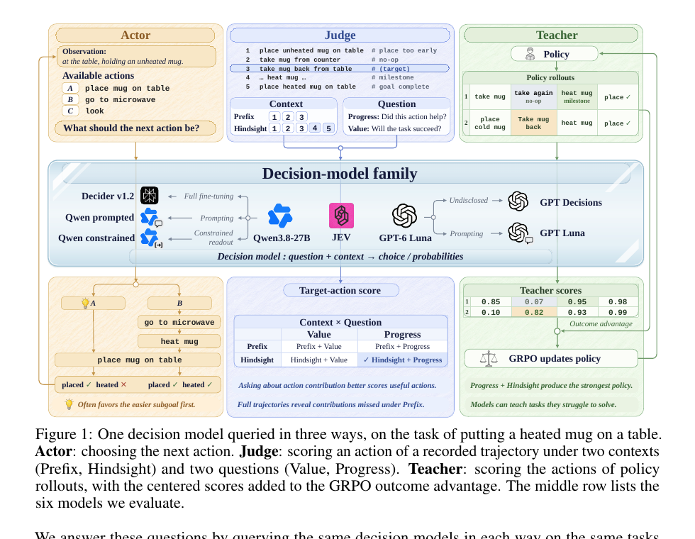

# 决策模型如何充当 Actor、Judge 与 Teacher

中文 | [English](2611.17167.en.md)

> 主分类：[`AT`](../../../docs/categories.md#at)；辅助分类：[`EV`](../../../docs/categories.md#ev)、[`RP`](../../../docs/categories.md#rp)

## 元数据

- 英文标题：Actor, Judge, or Teacher? Understanding Decision Models in Long-Horizon Agents
- 作者：Haochen Liu、Qianhao Zhu、Zixuan Wang、Dingming Li、Tongbo Chen、Peng Qiu、Yingqi Qu、Weiming Lu、Jun Xiao、Yongliang Shen
- 机构：浙江大学、百度
- arXiv：[2611.17167](https://arxiv.org/abs/2611.17167)；v1
- PDF：<https://arxiv.org/pdf/2611.17167>
- 代码：<https://github.com/ZJU-REAL/decision-agents>；项目页：<https://zjureal.com/decision-agents/>；固定 commit `824b394878f2aa5473a85bcf0b9d8d3bbfeaad6f`
- 首次提交与最近修订：2026-11-12 17:42:46 UTC；调研：2026-11-14；复查：2026-11-16
- 热度证据：Hugging Face Daily Papers 34 upvotes、0 comments；GitHub 46 stars、0 forks、0 open issues。Hacker News、指定 Reddit 社区与公开 X 页面未取得精确命中。采集时间：2026-11-16 09:10（Asia/Shanghai）。
- 社区评价来源：DAIR.AI 与 PaperPeel 的公开解读；均未提供独立复跑。互动量只反映关注度，不直接代表论文质量。

## 结论摘要

- 决策模型作为 Actor 时不一定擅长长程任务：在 ALFWorld 的两个独立子目标上成功率为 70.8%，但存在依赖关系时只有 14.7%。
- 失败不是简单的能力缺失。移除容易但会分散注意力的子目标后，模型选择必要状态变更动作的概率从 14.6% 升到 77.6%，说明行动时的前瞻竞争是关键障碍。
- 同一模型看到完整轨迹后可以较好判断哪些动作推动了子目标。把 Hindsight 与 Progress step score 作为 GRPO 奖励后，Qwen2.5-1.5B 在 ALFWorld 从 72.8% 提高到 82.9%，在 WebShop 从 56.8% 提高到 71.4%。
- 结果支持「弱 Actor 仍可能是有效 Teacher」，但 Teacher 使用闭源 JEV，实验只覆盖两个文本环境；单次训练成本为 22～30 USD，完整训练重复次数和方差不足。
- 官方仓库公开训练入口并通过相关代码静态编译，但没有论文主实验结果、轨迹或模型输出；本轮没有复跑 GPU 训练。

## 研究问题与背景

决策模型以结构化选项和概率回答问题，可直接选择 Agent 动作，也可评价已经发生的动作。既有工作多把它作为 Actor，用任务成功率判断模型是否有用；这种评估默认「行动弱」也意味着「监督弱」。

论文把同一模型拆成 Actor、Judge 与 Teacher 三种角色：Actor 必须在信息不完整时预测动作后果，Judge 可以看到完整轨迹再评价，Teacher 则把逐步评价转化为强化学习信号。研究问题是这三种角色是否共享同一能力边界，以及事后判断能否弥补在线行动的前瞻困难。

## 核心方法

作者先在 ALFWorld 中构造带有独立或相互依赖子目标的任务，比较 3 个 decision model 与 3 个 general LLM 作为 Actor 的表现，并分析模型对必要状态变更动作的偏好。

作为 Judge 时，模型读取完整 episode，分别回答动作是否对最终成功有帮助，以及动作是否推动当前子目标。后者形成 Progress score，前者形成 Hindsight score。Teacher 将两类 step score 与环境终值结合，为 Qwen2.5-1.5B 的 GRPO 训练提供密集奖励，并在 ALFWorld 与 WebShop 上评估。

图 1，论文第 2 页。截图来自官方 PDF，展示三种角色接收的上下文、问题与输出。它解释为什么事后 Judge 比在线 Actor 拥有更多后果信息，但不证明 JEV 的收益可迁移到其他决策模型或真实环境。

## 实验与证据

ALFWorld 的受控分析显示，JEV 作为 Actor 时，在两个独立子目标上成功率为 70.8%，有依赖关系的任务只有 14.7%。移除容易子目标后，选择必要状态变更动作的概率从 14.6% 提升至 77.6%，支持「容易目标竞争导致关键前置动作被忽略」这一机制解释。

Judge 看到完整轨迹后，对推动必要子目标的动作评分更稳定。论文据此使用 Hindsight + Progress step score 训练 Qwen2.5-1.5B：ALFWorld 成功率从 GRPO 的 72.8% 提高到 82.9%，WebShop 从 56.8% 提高到 71.4%。两套环境方向一致，说明 step-level teacher 信号可能比只用终值更有效。

论文报告一次训练的 decision-model 查询成本为 22～30 USD。该成本不等于完整训练账单，也没有覆盖 GPU、环境执行和失败重试。主表没有提供足以判断训练方差的完整重复记录，因此提升幅度仍主要是作者自报点估计。

官方仓库固定到 `824b394…`，Apache-2.0；`decision_model/` 与 `examples/decision_model/` 静态编译通过。仓库包含训练脚本和配置入口，但没有论文主实验结果、轨迹或模型输出。本轮未复跑 ALFWorld／WebShop 的 GPU 训练，验证范围仅为代码可读性与入口存在。

## 局限与风险

作者明确把实验限制在 ALFWorld 与 WebShop 两个文本环境，episode 最多 30 个动作；结论不能直接外推到长网页工作流、软件仓库或物理环境。

Teacher 使用闭源 JEV，其基座、适配方法与训练数据未公开。收益可能同时来自模型能力、提示设计和奖励组合，当前实验不能分离这些因素。Hindsight 必须在 episode 结束后计算，不能直接用于在线过滤，也会增加离线轨迹处理成本。

主实验缺少公开逐次结果、完整方差和第三方复跑。奖励模型若学到环境捷径或偏见，密集 step score 可能把错误偏好放大到策略中；论文没有系统分析 reward hacking 或跨 Teacher 稳健性。

## 复现与应用

仓库公开 decision model 调用、GRPO 训练和示例配置，许可证为 Apache-2.0。完整复现需要 ALFWorld、WebShop、Qwen2.5-1.5B、GPU 训练资源和闭源 JEV API；没有公开的主实验轨迹或固定结果包可供离线重算。

工程应用可先把「在线选动作」与「事后评动作」分离：让更便宜或更稳定的模型执行，在 episode 完成后由决策模型标记关键前置动作、无效分支和进度，再用于回放采样、奖励塑形或失败分析。不能把事后分数直接当作在线安全门禁。

## 相关工作

- Agent Lightning 与同类 agentic RL 工作把环境终值转成训练信号；本篇用决策模型补充逐步 Hindsight 与 Progress 奖励。
- Reflexion 在失败后生成文本反馈；本篇将事后判断转成可用于 GRPO 的 step score。
- Process Reward Models 监督中间推理步骤；本篇关注可执行环境中的动作及其状态后果。
- ALFWorld 与 WebShop 提供文本化交互环境；本篇用二者验证角色分离，但尚未覆盖更长或多模态任务。

## 社区评价

DAIR.AI 的公开解读强调「poor actor can still teach well」，支持将事后 Judge 与在线 Actor 分离。PaperPeel 也把主要价值概括为利用完整轨迹为长程 Agent 提供密集奖励。两者均为方法转述，没有公开运行记录、误差分析或独立训练结果。

Hugging Face 页面当前为 34 upvotes、0 comments；GitHub 为 46 stars、0 forks、0 open issues。Hacker News、指定 Reddit 社区和公开 X 页面未取得精确讨论。互动量只表示讨论热度，不代表实验质量。

## 原文关键图表

保留图 1 一张，用于说明 Actor、Judge 与 Teacher 的信息差异。主要数值、成本和限制仍以论文正文与表格为准；截图不能替代训练结果核对。

## 调研判断

阅读优先级：高。角色分离与受控行为分析的可信度为中高；Teacher 带来的方向性提升为中；对其他模型、长环境和在线应用的外推为中低。适合 Agent 训练、奖励设计、轨迹分析和长程规划研究人员。

本篇 95 分。加入前滚动 7 天为 7 篇，加入后为 8 篇，仍低于总览常态上限 9 篇，不使用扩展名额。后续应关注公开主实验轨迹、多随机种子、不同 Teacher、奖励消融、在线延迟与 reward hacking。

## 来源

- <https://arxiv.org/abs/2611.17167>
- <https://arxiv.org/pdf/2611.17167>
- <https://github.com/ZJU-REAL/decision-agents>
- <https://zjureal.com/decision-agents/>
- <https://huggingface.co/papers/2611.17167>
