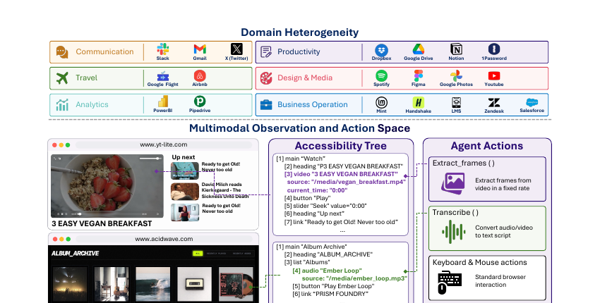

# WebArena-Pro: A Reproducible Multimodal Web-Agent Benchmark

English | [中文](2611.17955.md)

> Primary: [`EV`](../../../docs/categories.en.md#ev); secondary: [`CU`](../../../docs/categories.en.md#cu), [`MV`](../../../docs/categories.en.md#mv), and [`SY`](../../../docs/categories.en.md#sy)

## Metadata

- Original title: WebArena-Pro: A Heterogeneous, Multimodal, Reproducible Benchmark for Web Agents
- Authors and affiliations: Imene Kerboua, Fatemeh Pesaran Zadeh, Xing Han Lù, and 19 coauthors; McGill University, Mila, ServiceNow AI Research, Université Laval, The Ohio State University, University of Hong Kong, INSA Lyon, Esker, Seoul National University, and others
- arXiv: [2611.17955](https://arxiv.org/abs/2611.17955), v1
- PDF: <https://arxiv.org/pdf/2611.17955>
- Project: <https://webarena-pro.github.io/>
- Code: <https://github.com/McGill-NLP/webarena-pro>; audited commit `61afdd15aa3d6b90355bc136fa5297d8c04ab43a`; MIT
- Data: <https://huggingface.co/WebArena-Pro>; public metadata reports 400 rows
- First submission and latest revision: November 13, 2026; research and recheck: November 17. The paper entered the target-category announcement batch and Hugging Face Daily Papers on November 16.
- Popularity evidence: 11 Hugging Face Daily Papers upvotes; GitHub has 1 star, 0 forks, and 1 open issue. Exact-ID Hacker News search returns zero results. All six specified Reddit communities return HTTP 403, and no verifiable original public X post was retrieved. Collected 09:00–09:15 Asia/Shanghai on November 17, 2026.
- Community sources: the Hugging Face page exposes the author submission but no verifiable third-party comment. Engagement measures attention, not research quality.

## Conclusion summary

- WebArena-Pro expands web-agent evaluation to 20 self-hosted applications, 300 Test tasks, and 100 Dev tasks across six domains and text, vision, audio, and video. Every Test task has a distinct template and isolated container state.
- The Test split contains 204 single-site and 96 cross-site tasks; 221 use text/vision and 79 involve audio/video. Temporal media enters the loop through `transcribe()`, `extract_frames()`, or native `listen()` and `watch()` actions.
- Codex with GPT 6.1 Sol and Claude Code with Claude Opus 5.5 both reach the best success rate, 62.3%. Cross-site tasks remain substantially harder. Model and harness change together, so leaderboard gaps are not model-only effects.
- Media ablations provide stronger causal evidence: on 43 tasks audited as content-dependent, Gemini 3.1 Pro rises from 2.3% to 30.2%/34.9%, and Claude Code with Opus 5.5 rises from 14.0% to 48.8% when media access is restored.
- The repository contains the claimed 300 + 100 task configurations, and Core tests pass 1,353 with one skip after Chromium installation. Full reproduction still requires 20 applications, commercial models, substantial cost, and unreleased result trajectories. Strict `uv sync --locked` also stops because project metadata and the lockfile differ.

## Research question and background

Existing reproducible web-agent benchmarks typically cover few applications and center on text or static vision. Real browser work crosses applications and often depends on audio or video. Live websites broaden coverage but drift in content, layout, data, and policy, weakening controlled comparison.

WebArena-Pro asks whether a benchmark can combine application heterogeneity, temporal media, and reproducible state. Its primary contribution is the environment and evaluation design, hence `EV` rather than a new computer-use policy.

## Method

Twenty applications span productivity, communication, analytics, business operations, design and media, and travel. Each task launches isolated state, loads seeded data, authenticates the browser, and allows at most 50 actions. Audio and video URLs appear in the accessibility tree; conventional VLMs call transcription and frame extraction, while omni models can consume media directly.

Human-written action and outcome rubrics form a dependency DAG. Deterministic backend checks run first, heuristic trajectory checks second, and a Qwen 3.6 27B judge handles remaining criteria. A task succeeds only if every node passes. Authors draft tasks, an LLM flags trivial or infeasible candidates, and a second annotator verifies the task on the live application.

Figure 1, page 2 of the official PDF. It connects the 20-application domain coverage to the accessibility tree and media actions. It explains the interface but does not establish task quality, evaluator reliability, or live-web generalization.

## Experiments and evidence

The main table spans twelve models and multiple harnesses. The best GenericAgent result is 30.3%; OpenCode with Kimi 3.1 Pro reaches 60.7%; Codex with GPT 6.1 Sol and Claude Code with Claude Opus 5.5 each reach 62.3%. Codex falls from 67.2% on single-site tasks to 52.1% cross-site, while Claude Code falls from 65.7% to 55.2%.

The media ablation evaluates 79 AcidWave/YT-Lite tasks and an audited 43-task subset that cannot be solved from metadata or thumbnails alone. On this subset, Qwen 3.6 27B moves from 0% without media tools to 16.3%; Gemini 3.1 Pro moves from 2.3% to 30.2%, with native media at 34.9%; Claude Code with Opus 5.5 moves from 14.0% to 48.8%.

At commit `61afdd15…`, local inspection finds 300 unique Test tasks and 100 Dev tasks, matching the Hugging Face dataset metadata. Core tests initially produce 23 environment failures because Playwright Chromium is absent; after installing the documented browser, 1,353 pass and one skips. This run does not launch the 20 Docker applications or rerun the 300-task commercial-model evaluations.

## Limitations and risks

The leaderboard changes both model and harness, confounding model quality with tool interfaces, prompts, context handling, and recovery logic. The paper appears to run one full task set per configuration and does not report multi-seed variance; a 62.3% tie is not proof of statistical equivalence.

Scoring still uses a Qwen 3.6 27B judge for some rubrics. Human agreement is discussed, but final labels remain sensitive to rubric coverage and judge bias. The media-dependent subset is selected post hoc rather than preregistered.

Self-hosting improves control but omits production-site drift, authorization systems, and anti-automation constraints. Full reproduction needs many containers, browser infrastructure, model APIs, and about USD 166–800 for a 300-task evaluation, excluding hosting. The current lockfile mismatch also breaks the repository's documented strict locked install.

## Reproduction and application

The public repository includes task configurations, twenty websites, BrowserGym, MCP and Harbor adapters, media tools, and 411 test files. Listing tasks does not require model runs; a full evaluation requires Python 3.12, Docker, Playwright, and model and judge credentials.

Teams should use it as a controlled regression environment, not a direct proxy for production success. Internal acceptance should freeze the model, harness, budget, retries, judge, and container images, then add separate tests for live drift, authority boundaries, and irreversible effects.

## Related work

- WebArena provides six self-hosted sites and 812 instances; WebArena-Pro expands application coverage and isolates task state.
- VisualWebArena and WebChoreArena stress vision and long workflows; this benchmark adds audio and video as core observations.
- WorkArena and TheAgentCompany emphasize enterprise work; WebArena-Pro broadens application and modality coverage.
- OSWorld covers full desktops; WebArena-Pro is narrower but offers more controlled web-state reset and backend grading.
- OnlineMind2Web and other live benchmarks offer realism at the cost of repeatability; both benchmark types are complementary.

## Community response

Hugging Face Daily Papers has 11 upvotes but no verifiable third-party comment in the retrieved page. GitHub has 1 star, 0 forks, and one open issue. Hacker News has no exact-ID result; the specified Reddit communities return HTTP 403; no verifiable original public X post was retrieved.

No reliable supportive or critical community sample is therefore available. The author submission and small vote count are not community consensus and are strongly affected by recency and platform sampling.

## Figures and tables from the paper

One crop of Figure 1 is retained to explain application coverage and the media-action interface. Main results, ablations, cost, and judge reliability remain grounded in Tables 5–7, the appendix, and the code.

## Research judgment

Reading priority: high. Confidence is high for the released task structure, runnable tests, and media ablation; medium for model-only interpretation of leaderboard gaps, live-web generalization, and cost comparability. Relevant to evaluation, computer use, browser runtime, and multimodal-tool owners.

Score: 94. Four papers were published from November 11–16. This first November 17 selection raises the rolling count to five, below the regular cap of nine, and the November total to nineteen. Follow-up should track lockfile repair, released trajectories, repeated-run variance, detailed judge-human agreement, and independent reruns.

## Sources

- <https://arxiv.org/abs/2611.17955>
- <https://arxiv.org/pdf/2611.17955>
- <https://webarena-pro.github.io/>
- <https://github.com/McGill-NLP/webarena-pro>
- <https://huggingface.co/papers/2611.17955>
- <https://huggingface.co/WebArena-Pro>
