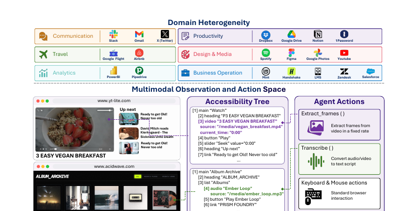

# WebArena-Pro：可复现的多模态 Web Agent 基准

中文 | [English](2611.17955.en.md)

> 主分类：[`EV`](../../../docs/categories.md#ev)；辅助分类：[`CU`](../../../docs/categories.md#cu)、[`MV`](../../../docs/categories.md#mv)、[`SY`](../../../docs/categories.md#sy)

## 元数据

- 英文标题：WebArena-Pro: A Heterogeneous, Multimodal, Reproducible Benchmark for Web Agents
- 作者与机构：Imene Kerboua、Fatemeh Pesaran Zadeh、Xing Han Lù 等 22 人；McGill University、Mila、ServiceNow AI Research、Université Laval、The Ohio State University、University of Hong Kong、INSA Lyon、Esker、Seoul National University 等
- arXiv：[2611.17955](https://arxiv.org/abs/2611.17955)；v1
- PDF：<https://arxiv.org/pdf/2611.17955>
- 项目页：<https://webarena-pro.github.io/>
- 代码：<https://github.com/McGill-NLP/webarena-pro>；固定复核提交 `61afdd15aa3d6b90355bc136fa5297d8c04ab43a`；MIT
- 数据：<https://huggingface.co/WebArena-Pro>；公开数据集元数据显示 400 行
- 首次提交与最近修订：2026-11-13；调研与复查：2026-11-17。论文在 2026-11-16 公布批次进入目标分类，并于当日提交 Hugging Face Daily Papers。
- 热度证据：Hugging Face Daily Papers 11 upvotes；GitHub 1 star、0 forks、1 open issue。Hacker News 按 arXiv ID 精确检索为 0；六个指定 Reddit 社区均返回 HTTP 403；公开 X 页面未取得可核验原帖。采集时间：2026-11-17 09:00～09:15（Asia/Shanghai）。
- 社区评价来源：Hugging Face 页面只有作者提交信息，未取得可核验的第三方评论。互动量只反映平台内关注度，不直接代表研究质量。

## 结论摘要

- WebArena-Pro 把 Web Agent 评测扩展到 20 个自托管应用、300 个 test 任务和 100 个 dev 任务，覆盖 6 类业务与文本、视觉、音频、视频；每个 test 任务使用独立模板和隔离的容器状态。
- 300 个 test 任务中，204 个为单站任务、96 个为跨站任务；221 个依赖文本／视觉，79 个涉及音频／视频。音视频通过 `transcribe()`、`extract_frames()` 或原生 `listen()`、`watch()` 进入观察—行动循环。
- 最佳结果是 Codex + GPT 6.1 Sol 与 Claude Code + Claude Opus 5.5 的 62.3% 成功率；跨站任务仍明显更难。结果证明基准有区分度，但模型与 Agent 外壳同时变化，不能把差异只归因于模型。
- 媒体工具消融提供了较强因果证据：在 43 个确实依赖媒体内容的子集上，Gemini 3.1 Pro 从 2.3% 升至 30.2%／34.9%，Claude Code + Opus 5.5 从 14.0% 升至 48.8%。
- 公开仓库的 300 + 100 个任务配置与论文口径一致，核心测试在补齐 Chromium 后为 1,353 passed、1 skipped。主要复现边界是 20 个容器、商业模型、运行成本和结果轨迹未随论文打包；`uv sync --locked` 还会因锁文件与声明依赖不一致而停止。

## 研究问题与背景

现有自托管 Web Agent 基准通常只覆盖少量应用，并主要依赖文本或静态视觉；真实网页工作还会跨多个应用，并需要理解页面中的音频和视频。使用线上网站可以增加覆盖面，却会受页面、数据和策略漂移影响，难以让不同 Agent 在同一环境中比较。

WebArena-Pro 试图同时满足三项要求：扩大应用异质性、把时序媒体纳入观察空间，并通过每任务独立状态和自托管版本提高可复现性。其首要贡献是评测环境和评分机制，因此主分类为 `EV`，而非单纯的 Computer Use 方法。

## 核心方法

20 个应用分布在生产力、通信、分析、业务运营、设计与媒体、旅行六类。每个任务启动独立容器、载入种子数据并完成登录；Agent 最多执行 50 个浏览器动作。音频和视频 URL 进入 accessibility tree，普通 VLM 可调用转写与抽帧工具，原生 omni 模型可直接收听或观看。

每个任务包含人工编写的 action／outcome rubric，并组成有依赖关系的 DAG。确定性后端检查优先，其次是启发式轨迹检查，最后才由 Qwen 3.6 27B judge 处理无法确定的 rubric；只有所有节点通过，任务才计为成功。任务由作者团队编写，经 LLM 初筛与第二位标注者实际操作验证后进入基准。

图 1，官方 PDF 第 2 页。图中同时展示 20 个应用的领域覆盖，以及 accessibility tree 与音视频动作的连接。它能解释基准的观察—行动接口，但不证明任务质量、评分可靠性或线上泛化。

## 实验与证据

主表覆盖 12 个模型与多种 Agent 外壳。GenericAgent 的最佳成功率为 30.3%；OpenCode + Kimi 3.1 Pro 为 60.7%，Codex + GPT 6.1 Sol 与 Claude Code + Claude Opus 5.5 均为 62.3%。Codex 在单站任务为 67.2%，跨站降至 52.1%；Claude Code 为 65.7% 与 55.2%。这说明跨应用协调仍是主要难点。

媒体消融检查 79 个 AcidWave／YT-Lite 任务，并进一步人工审计出 43 个不能只靠标题、元数据或缩略图完成的任务。在该子集上，Qwen 3.6 27B 无媒体工具为 0%，加入转写／抽帧后为 16.3%；Gemini 3.1 Pro 从 2.3% 升至 30.2%，原生 watch／listen 为 34.9%；Claude Code + Opus 5.5 从 14.0% 升至 48.8%。该对照比总榜更能支持「媒体接口有实际作用」。

本轮固定公开仓库提交 `61afdd15…`，直接统计得到 300 个唯一 test 任务与 100 个 dev 任务；Hugging Face 数据元数据同样为 400 行。Core 测试首次因缺少 Playwright Chromium 出现 23 个环境性失败；按仓库说明安装浏览器后，1,353 项通过、1 项跳过。未启动 20 个 Docker 应用，也未调用商业模型复跑 300 个任务。

## 局限与风险

论文把不同模型与不同 Agent 外壳放在同一榜单，结果不能分离模型能力、工具接口、提示、上下文管理和恢复策略的贡献。每个配置看起来只运行一次完整任务集，未报告多随机种子方差；62.3% 的并列也不等于统计上完全相同。

评分链仍部分依赖 Qwen 3.6 27B judge。论文报告 judge 与人工标注近似一致，但成功判定仍受 rubric 编写、后端检查覆盖和最后一层 judge 偏差影响。媒体依赖子集是事后审计所得，不能当作预注册分析。

自托管提高复现性，也牺牲真实线上网站的变化、权限系统和反自动化约束。完整复现需要大量容器、浏览器、模型 API 与约 166～800 美元的 300 任务推理费用；论文记录的成本不含托管基础设施。仓库当前 `uv.lock` 与项目声明有差异，严格 `--locked` 安装失败，是一个实际复现摩擦点。

## 复现与应用

公开仓库包含任务配置、20 个网站、BrowserGym、MCP、Harbor 适配、媒体工具和 411 个测试文件。仅查看任务不需要启动 Agent；完整运行要求 Python 3.12、Docker、Playwright、模型与 judge 凭据。适合比较浏览器 Agent、跨应用工作流、音视频工具和状态隔离策略。

工程团队应把它视为可控回归环境，而不是线上成功率代理。若用于内部验收，宜固定模型、外壳、预算、重试、judge 和容器镜像，并另设线上漂移、权限边界与不可逆副作用测试。

## 相关工作

- WebArena 提供 6 个自托管网站和 812 个实例；WebArena-Pro 扩到 20 个应用，并加入每任务隔离。
- VisualWebArena 与 WebChoreArena强调视觉和长流程；本篇进一步把音频／视频设为核心观察。
- WorkArena／TheAgentCompany 更聚焦企业工作；本篇增加应用类型和媒体覆盖，但工作真实性仍由模拟环境近似。
- OSWorld 覆盖完整桌面；本篇范围更窄，但 Web 状态重置与后端评分更可控。
- OnlineMind2Web 等线上基准更贴近真实网站，却难以稳定复现；两类基准应互补使用。

## 社区评价

Hugging Face Daily Papers 在采集时有 11 个 upvotes，但页面未取得可核验的第三方评论；GitHub 只有 1 star、0 forks 和 1 个 open issue。Hacker News 没有精确 ID 命中，指定 Reddit 社区均返回 HTTP 403，公开 X 页面未取得可核验原帖。

因此本篇没有可靠的支持／质疑社区样本，不能把作者提交信息或少量 upvote 写成社区共识。现有互动量更可能受论文刚发布、平台圈层和仓库开放时间影响。

## 原文关键图表

保留图 1 一张，用于说明应用覆盖与媒体动作接口。主结果、媒体消融、成本与 judge 可靠性仍以论文表 5～7、附录和公开代码为准。

## 调研判断

阅读优先级：高。对公开任务结构、测试可运行性和媒体消融的可信度为高；对不同 Agent 榜单的纯模型归因、真实线上泛化和成本可比性的可信度为中。适合 Agent 评测、Computer Use、浏览器运行时和多模态工具负责人。

本篇 94 分。2026-11-11～2026-11-16 已发布 4 篇，本篇作为 11 月 17 日第一篇，使滚动 7 天增至 5 篇，低于常态上限 9 篇；11 月累计增至 19 篇。后续应关注锁文件修复、公开轨迹、重复运行方差、judge 人工一致性明细与第三方复跑。

## 来源

- <https://arxiv.org/abs/2611.17955>
- <https://arxiv.org/pdf/2611.17955>
- <https://webarena-pro.github.io/>
- <https://github.com/McGill-NLP/webarena-pro>
- <https://huggingface.co/papers/2611.17955>
- <https://huggingface.co/WebArena-Pro>
