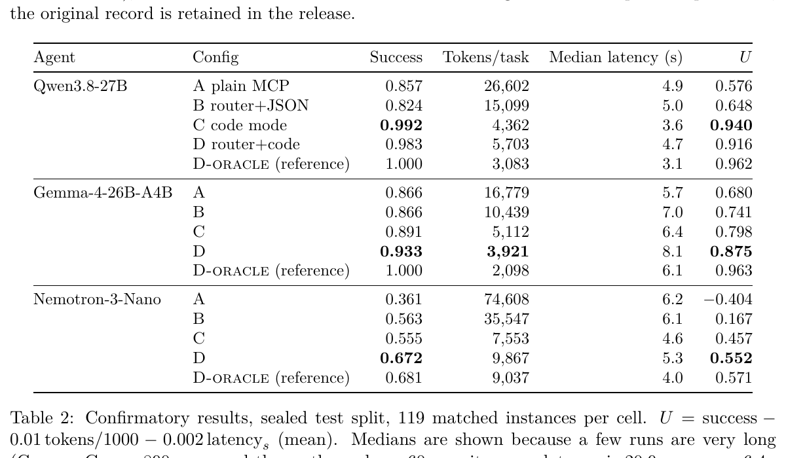

# MCP Tool Use: Code Mode Matters More Than Routing

English | [中文](2611.19123.md)

> Primary: [`TU`](../../../docs/categories.en.md#tu); secondary: [`SY`](../../../docs/categories.en.md#sy) and [`EV`](../../../docs/categories.en.md#ev)

## Metadata

- Original title: Beyond Plain MCP: Do Decision Models and Code Mode Make Tool Use Cheaper and Faster?
- Author and affiliation: Abhishek Rai; independent researcher
- arXiv: [2611.19123](https://arxiv.org/abs/2611.19123), v1
- PDF: <https://arxiv.org/pdf/2611.19123>
- Code, model, and traces: <https://github.com/abhishek085/mcp-decision-layer>; audited commit `a86e26293ecd98129e6b70757f0b802db5f27729`; Apache-2.0
- Preregistration freeze: tag `confirmatory-freeze-v1`, remotely resolving to `01e2c77b247b8ab9b647726974af04b72f0f8449`
- First submission and latest revision: November 14, 2026, 03:15:59 UTC; research and recheck: November 18. The paper entered the November 17 arXiv announcement batch.
- Popularity evidence: the Hugging Face Papers API returns 404, recorded as not indexed; GitHub has 0 stars, 0 forks, and 0 open issues. Hacker News ID-substring results are unrelated older posts. All six specified Reddit communities return HTTP 403. Collected 09:03–09:15 Asia/Shanghai on November 18.
- Community source: a third-party `fusion-harness` issue and pull request explicitly cite the paper and implement code mode, reporting 33 new tests and 453 passing tests overall. Its 30-turn token replay is a self-reported synthetic check, not an independent reproduction of the paper.

## Conclusion summary

- The paper compares plain MCP, router + JSON, code mode, and router + code mode in a controlled harness with 12 mock servers, 42 functional tools, up to 1,958 real distractor schemas, three models, and 1,785 serial runs over 119 sealed-test instances.
- Code mode reduces tokens by 70–90% versus plain MCP. Qwen3.8-27B success rises from 85.7% to 99.2%, and Nemotron-3-Nano from 36.1% to 55.5%; Gemma's 2.5-point gain is not significant.
- The central hypothesis that routing improves code mode is not confirmed. Over 238 instances, utility differences are -0.028, +0.099, and +0.109 for the three models, none significant after Holm correction.
- Return-shape hints are a first-order design choice: removing them lowers Gemma and Nemotron code-mode success by 22.7 and 39.5 points.
- Public traces regenerate the main tables and twelve corrected comparisons. This validates artifact-to-report consistency, not model reruns or external validity on real MCP servers.

## Research question and background

Large MCP catalogs incur schema-prompt cost and repeatedly feed intermediate tool outputs back through the model. Two common remedies are a cheap decision model that narrows the catalog and code mode, where the agent writes a script against stubs and returns only a final result. Prior work supports each idea separately but rarely compares them under one controlled harness.

The paper preregisters four hypotheses covering code mode, routing, their combination, and code mode after routing. Its contribution changes tool exposure, invocation, and result transport, so `TU` is the primary category.

## Method

The synthetic world contains twelve servers and 42 tools across issues, chat, billing, logs, CRM, documents, files, calendar, deployments, inventory, HR, and support. World state, not model claims, determines success. Scale arms add up to 1,958 real schemas as distractors.

Configurations share tasks, seeds, turn caps, and sandboxing. A exposes all JSON schemas; B routes before JSON calls; C writes scripts against typed stubs; D routes before scripting. Utility subtracts token and latency penalties from success. The sealed test uses temperature zero, serial execution, paired bootstrap intervals, and Holm correction.

Table 2, page 5 of the official PDF. It jointly shows success, tokens, latency, and utility for three models. It supports directional code-mode gains but does not establish benefits on real servers, network latency, or production authority boundaries.

## Experiments and evidence

For Qwen, A→C moves success from 0.857 to 0.992 and mean tokens from 26,602 to 4,362; utility difference is +0.364, 95% CI [0.251, 0.504]. Nemotron moves from 0.361 to 0.555 and 74,608 to 7,553 tokens, with +0.861 [0.674, 1.046]. Gemma drops tokens from 16,779 to 5,112, but its utility difference, +0.118 [-0.011, 0.244], is inconclusive.

H3 differences on the sealed split are -0.025, +0.077, and +0.095. A prespecified extension repeats C, D, and oracle on 119 new instances; pooled 238-instance results remain nonsignificant. “Not confirmed” means underpowered and inconclusive, not proof that routers never help.

At commit `a86e262…`, this review installed minimal analysis dependencies with `uv run` and executed `bench/confirm_analysis.py`. It regenerated the 119-instance main tables, confidence intervals, Holm correction, and scale table, matching the paper. It did not serve the models or rerun 1,785 calls.

## Limitations and risks

The largest limitation is the absence of an external benchmark or real MCP servers. Tools are almost latency-free and tasks come from one synthetic world. Results may change with networks, permissions, recovery, realistic outputs, or thinking-enabled agents. Each temperature-zero cell is run once; the scale arm has only ten tasks.

The utility weights are a research choice rather than a cloud bill. Code mode adds an execution attack surface; limited prompt-injection exploration does not validate production sandboxing, allowlists, or auditing.

Preregistration strengthens the core evidence, but extensions were written after analysis of core results and before extension runs. Core, extension, and exploratory findings should remain separate. There is no independent full rerun yet.

## Reproduction and application

The repository includes the world, task generators, gateways, training scripts, sealed traces, and analysis. Tables can be recomputed offline; full reproduction needs three model endpoints, a router endpoint, and many serial runs.

The practical default is to test code mode, return shapes, bounded fallbacks, and sandboxing before adding a router. Production evaluations should report success, end-to-end tokens, wall time, billable cost, safety denials, and recovery separately.

## Related work

- The Bitter Lesson of Tool Calling (arXiv:2608.06370) compares code and JSON calls; this paper adds preregistration, routing combinations, and catalog scaling.
- From Tool Orchestration to Code Execution (arXiv:2602.15945) studies MCP design choices; this work isolates routing, code mode, and return-shape hints.
- RAG-MCP (arXiv:2505.03275) and MCP-Zero (arXiv:2506.01056) focus on retrieval; this paper finds model-dependent interaction with code mode.
- MCP-Bench (arXiv:2508.20453) offers realistic MCP tasks; the present harness is more controlled but less externally valid.
- Executable Code Actions Elicit Better LLM Agents (arXiv:2402.01030) establishes capability gains; this paper adds token, latency, and routing controls.

## Community response

No verifiable third-party comment was found on Hugging Face, Hacker News, Reddit, or public X. The two HN substring hits are unrelated, and Reddit HTTP 403 is an access gap rather than proof of no discussion.

Early adoption is visible in third-party `fusion-harness` issue #50 and PR #51. They implement stub rendering, permission admission, and a code-executor protocol, reporting 453 passing tests. Their extra allowlist and fail-closed rules expose production concerns beyond the paper. The replay is self-reported and AI-generated, so it is not an independent reproduction of the paper's success rates.

## Figures and tables from the paper

One crop of Table 2 is retained to compare success, tokens, latency, and utility. Significance, return-shape ablations, and validity threats remain grounded in Tables 3–11, text, and released traces.

## Research judgment

Reading priority: high. Confidence is high for sealed-test internal results, statistical analysis, and trace/report consistency; medium-low for real MCP servers, production latency, and security. Relevant to tool-protocol, MCP-gateway, runtime, and cost owners.

Score: 93. Five papers were published from November 12–17. This selection raises the rolling count to six, below the regular cap of nine, and the November total to 21. Follow-up should track real MCP reruns, thinking-enabled models, sandbox variants, router cost, and independent experiments.

## Sources

- <https://arxiv.org/abs/2611.19123>
- <https://arxiv.org/pdf/2611.19123>
- <https://github.com/abhishek085/mcp-decision-layer>
- <https://github.com/dahai80/fusion-harness/issues/50>
- <https://github.com/dahai80/fusion-harness/pull/51>
