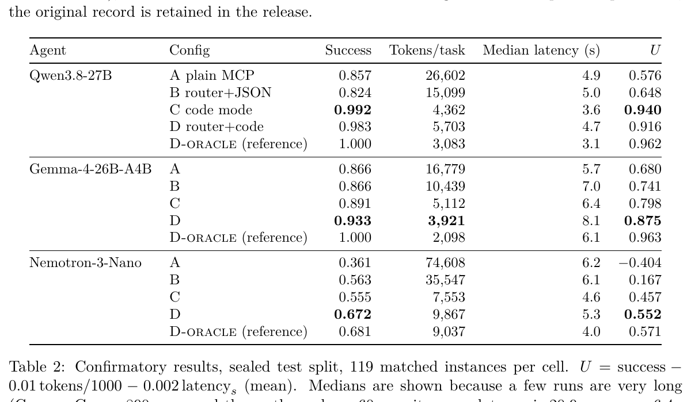

# MCP 工具调用：Code Mode 比路由更关键

中文 | [English](2611.19123.en.md)

> 主分类：[`TU`](../../../docs/categories.md#tu)；辅助分类：[`SY`](../../../docs/categories.md#sy)、[`EV`](../../../docs/categories.md#ev)

## 元数据

- 英文标题：Beyond Plain MCP: Do Decision Models and Code Mode Make Tool Use Cheaper and Faster?
- 作者与机构：Abhishek Rai；独立研究者
- arXiv：[2611.19123](https://arxiv.org/abs/2611.19123)；v1
- PDF：<https://arxiv.org/pdf/2611.19123>
- 代码、模型与轨迹：<https://github.com/abhishek085/mcp-decision-layer>；固定复核提交 `a86e26293ecd98129e6b70757f0b802db5f27729`；Apache-2.0
- 预注册冻结标签：`confirmatory-freeze-v1`，远端指向 `01e2c77b247b8ab9b647726974af04b72f0f8449`
- 首次提交与最近修订：2026-11-14 03:15:59 UTC；调研与复查：2026-11-18。论文进入 arXiv 2026-11-17 公布批次。
- 热度证据：Hugging Face Papers API 返回 404，记为未收录；GitHub 为 0 stars、0 forks、0 open issues。Hacker News 的 ID 子串结果均为无关旧帖；六个指定 Reddit 社区均返回 HTTP 403。采集时间：2026-11-18 09:03～09:15（Asia/Shanghai）。
- 社区评价来源：第三方 `fusion-harness` issue／PR 在 2026-11-18 明确引用论文并实现 code mode，报告 33 项新增测试、完整测试 453 passed；其 30 轮 token 回放是项目自报的合成验证，不是论文主实验的独立复现。

## 结论摘要

- 论文在 12 个模拟 MCP server、42 个真实功能工具与最多 1,958 个真实 distractor tool 上，对 plain MCP、路由 + JSON、code mode、路由 + code mode 做受控比较；119 个封闭测试实例、3 个模型、5 种配置组成 1,785 次串行运行。
- Code mode 相对 plain MCP 为三个模型减少 70%～90% token。Qwen3.8-27B 的成功率从 85.7% 升至 99.2%，Nemotron-3-Nano 从 36.1% 升至 55.5%；Gemma 的 2.5 分增益未达到显著性。
- 「路由 + code mode 优于 code mode」这一中心假设没有得到确认。扩展到 238 个实例后，三个模型的效用差异分别为 -0.028、+0.099、+0.109，Holm 校正后均不显著。
- 工具 stub 的返回形状不是实现细节：去掉 return-shape hints 后，Gemma 与 Nemotron 的 code-mode 成功率分别下降 22.7 和 39.5 个百分点。
- 公开轨迹可重新生成主结果表与 12 项多重比较，输出与论文一致；这证明发布工件与报告相符，不等于重新调用模型或验证真实 MCP server 上的外部效度。

## 研究问题与背景

大型 MCP 工具目录会同时放大 schema prompt 和中间结果回灌成本。常见工程做法有两类：先用低成本 decision model 缩小工具集，或让 Agent 针对工具 stub 写代码，只把最终结果送回模型。现有研究已经分别说明工具检索和可执行代码有用，但很少在同一 harness 中控制模型、任务、种子与 sandbox，比较两者是否互补。

论文把问题拆成四个预注册假设：code mode 是否优于 plain MCP，路由是否优于 plain MCP，「路由 + code mode」是否优于 code mode，以及 code mode 是否改善已路由的 JSON 调用。主要贡献直接作用于工具暴露、调用与结果传递协议，因此主分类为 `TU`。

## 核心方法

模拟世界含 issue、chat、billing、logs、CRM、docs、files、calendar、deployment、inventory、HR、support 等 12 个 server 和 42 个工具。任务用世界终态判分，不以模型自述成功为准。规模实验另加入最多 1,958 个真实工具 schema 作为 distractor。

四种配置共享任务、种子、turn cap 与 sandbox：A 将全部 JSON schema 暴露给模型；B 先路由再做 JSON 调用；C 生成针对 typed stub 的脚本，在 sandbox 内串联调用；D 先路由再执行脚本。效用定义为成功率减 token 与延迟惩罚。封闭测试使用 temperature 0、单并发和 119 个任务实例；12 个主比较用配对 bootstrap 与 Holm 校正。

表 2，官方 PDF 第 5 页。截图展示三个模型在五种配置下的成功率、token、延迟和效用；它支持 code mode 的方向性收益，也显示最优配置随模型变化。表格不能证明真实 server、网络延迟或生产权限边界上的收益。

## 实验与证据

Qwen 的 A→C 成功率为 0.857→0.992，平均 token 为 26,602→4,362；效用差 +0.364，95% CI 为 [0.251, 0.504]。Nemotron 为 0.361→0.555、74,608→7,553，效用差 +0.861 [0.674, 1.046]。Gemma 的 token 从 16,779 降至 5,112，但成功率只从 0.866 升至 0.891，效用差 +0.118 [-0.011, 0.244]。

中心假设 H3 在封闭测试中对 Qwen、Gemma、Nemotron 的效用差为 -0.025、+0.077、+0.095，Holm 校正后均不显著。论文又在 119 个新实例上运行 C、D 和 oracle；合并 238 个实例后仍没有显著支持。这里的「未确认」是样本不足下的 inconclusive，不等于证明路由没有价值。

本轮固定提交 `a86e262…`，用 `uv run` 安装最小分析依赖并执行 `bench/confirm_analysis.py`，重新生成 119 实例主表、置信区间、Holm 校正和 10 任务规模表，结果与仓库报告及论文一致。未加载三组模型，也未重跑 1,785 次实验。

## 局限与风险

最大限制是没有外部基准或真实 MCP server。工具执行接近零延迟，任务集中在一个合成世界；收益可能随网络、权限检查、错误恢复、真实返回数据和模型思考模式改变。每个 cell 在 temperature 0 下只运行一次，10 任务规模实验尤其小。

效用函数的 token 与延迟权重是研究设定，不等于任一云厂商账单。Code mode 还引入代码执行攻击面；论文只做有限的 prompt-injection 探索，不能证明 sandbox、allowlist 和审计机制足以用于生产。

预注册提高证据可信度，但扩展协议是在主结果分析后、扩展运行前追加；应继续区分核心预注册结论、预指定扩展和探索性结果。论文由单一作者完成，尚无独立团队复跑。

## 复现与应用

仓库包含模拟世界、任务生成器、四类 gateway、训练脚本、封闭测试轨迹和分析代码。主结果表可以离线重算；完整实验需要三种开源模型服务、router endpoint 和大量串行运行。

工程上最直接的结论不是「必须增加 router」，而是优先验证 code mode、返回形状、fallback 上限和 sandbox。部署前应在真实工具目录中固定任务集，分别报告成功率、端到端 token、墙钟延迟、调用费用、安全拒绝与恢复次数，避免只用论文效用函数。

## 相关工作

- The Bitter Lesson of Tool Calling（arXiv:2608.06370）比较代码与 JSON 工具调用；本篇增加预注册、路由组合与规模干扰。
- From Tool Orchestration to Code Execution（arXiv:2602.15945）研究 MCP 设计选择；本篇进一步分离 code mode、decision layer 和 return-shape hints。
- RAG-MCP（arXiv:2505.03275）与 MCP-Zero（arXiv:2506.01056）侧重工具检索；本篇发现检索层与 code mode 的组合收益依赖模型。
- MCP-Bench（arXiv:2508.20453）提供真实 MCP 任务；本篇环境更可控，但外部效度更弱。
- Executable Code Actions Elicit Better LLM Agents（arXiv:2402.01030）说明代码动作的能力收益；本篇补充 token、延迟与路由对照。

## 社区评价

未检索到 Hugging Face、Hacker News、Reddit 或公开 X 上可核验的第三方评论。Hacker News 的两条 ID 子串命中与论文无关；Reddit 返回 HTTP 403，因此不能解释为没有讨论。

可核验的早期采用来自第三方 `fusion-harness`：issue #50 把论文的 70%～90% 多轮 token 降幅作为验收参考，PR #51 实现 stub renderer、权限准入和 code executor protocol，并报告 453 项测试通过。该项目也主动加入 allowlist 与 fail-closed 规则，说明生产化需要补上论文之外的权限边界。其回放是项目自报、由 Claude Code 生成的合成测试，不能当作独立复现论文成功率。

## 原文关键图表

保留表 2 一张，用于同时查看三个模型的成功率、token、延迟和效用。显著性、return-shape 消融和外部效度限制仍以表 3～11、正文和公开轨迹为准。

## 调研判断

阅读优先级：高。对封闭测试内部结果、统计分析与公开轨迹一致性的可信度为高；对真实 MCP server、生产延迟和安全性的外推可信度为中低。适合 Agent 工具协议、MCP gateway、运行时与成本优化负责人。

本篇 93 分。2026-11-12～2026-11-17 已发布 5 篇，本篇使滚动 7 天增至 6 篇，低于常态上限 9 篇；11 月累计增至 21 篇。后续应关注真实 MCP 任务复跑、thinking-enabled 模型、不同 sandbox、router 成本与第三方独立实验。

## 来源

- <https://arxiv.org/abs/2611.19123>
- <https://arxiv.org/pdf/2611.19123>
- <https://github.com/abhishek085/mcp-decision-layer>
- <https://github.com/dahai80/fusion-harness/issues/50>
- <https://github.com/dahai80/fusion-harness/pull/51>
