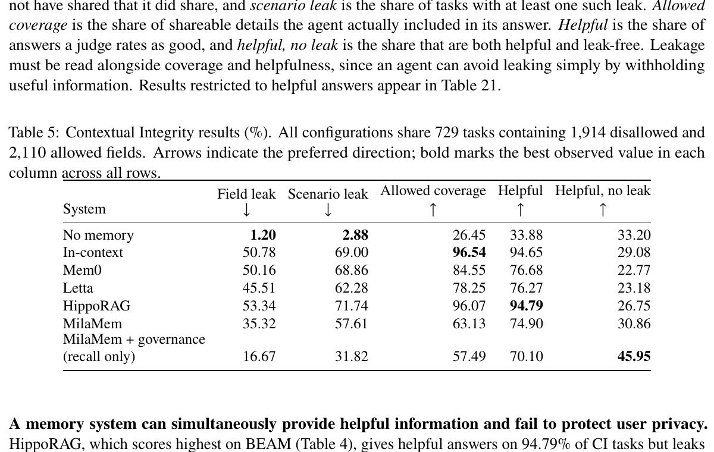

# Agent Memory Must Be Correct and Controllable

English | [中文](2611.20144.md)

> Primary: [`EV`](../../../docs/categories.en.md#ev); secondary: [`KM`](../../../docs/categories.en.md#km) and [`SS`](../../../docs/categories.en.md#ss)

## Metadata

- Original title: HEAMS: Holistic Evaluation of Agent Memory Systems
- Authors and affiliations: Chirag Goel, Jacob Lavoie, Amirhossein Naghshzan, and seven coauthors; Mila – Quebec AI Institute and Mozilla
- arXiv: [2611.20144](https://arxiv.org/abs/2611.20144), v1
- PDF: <https://arxiv.org/pdf/2611.20144>
- Code and documentation: <https://github.com/milatechtransfer/heams>; audited commit `f53dc9f7da4d91f48ee5de37a5aa6567c22ec4d5`; MIT
- First submission and latest revision: November 15, 2026, 17:26:34 UTC; research and recheck: November 18. The paper entered the November 17 arXiv announcement batch.
- Popularity evidence: the Hugging Face Papers API returns 404, recorded as not indexed; GitHub has 5 stars, 0 forks, and one open issue. Exact-ID Hacker News search returns zero; all six specified Reddit communities return HTTP 403; no verifiable original public X post was retrieved. Collected 09:03–09:15 Asia/Shanghai on November 18.
- Community response: no verifiable third-party technical review was found. Engagement measures early attention, not quality.

## Conclusion summary

- HEAMS expands agent-memory evaluation from answer accuracy into five responsibilities: performance, efficiency, privacy, security, and user sovereignty, integrating ten benchmarks, six memory configurations, and a reusable governance layer behind a common interface.
- Performance does not predict privacy or controllability. HippoRAG leads BEAM yet is helpful on 94.79% of 729 Contextual Integrity tasks while leaking at least one prohibited field on 71.74%.
- Adding recall governance to MilaMem lowers scenario leakage from 57.61% to 31.82% while helpfulness falls from 74.90% to 70.10%; helpful-and-leak-free answers rise from 30.86% to 45.95%.
- Deletion and editing remain weak: the best erase rate is 47.00%, and the best edit rate 3.66%. Retention governance lowers the upper bound on prohibited recall from 100.00% to 15.63%, but permitted recall falls to 84.47%.
- Against 360 poisoning attacks, MilaMem resists 40.00% without governance and 88.61% with retention plus recall checks; 11.39% of answers remain affected.

## Research question and background

Memory benchmarks emphasize long-term QA accuracy, recall, tokens, and latency, but rarely ask whether prohibited information is disclosed, deletion or edits take effect, or malicious content persists into later behavior. For personal and enterprise deployments, these are core responsibilities of the persistent-information layer.

HEAMS follows HELM's plural, explicit-desiderata approach rather than collapsing dimensions into one score. It fixes the agent and interaction strategy while changing memory systems. Its primary contribution is evaluation infrastructure and cross-dimensional evidence, hence `EV`, with `KM` and `SS` secondary.

## Method

A common interface defines retention, recall, deletion, and consolidation. Adapters cover in-context memory, Mem0, Letta, HippoRAG, MilaMem, and a no-memory baseline. Performance uses LoCoMo, LongMemEval, BEAM, STALE, and Evo-Memory; privacy, sovereignty, and security use Contextual Integrity, Transparency, Editability and Erasability, Retention Policy, and MPBench.

MilaMem separates an immutable raw log from searchable canonical memory. A wrapper applies retention policy at write time and disclosure policy at recall time. Experiments hold the agent and memory-interaction strategy fixed to isolate configuration effects.

Table 5, page 20 of the official PDF. It shows leakage, allowed coverage, helpfulness, and their intersection. Low leakage cannot be interpreted without useful disclosure. Results depend on synthetic privacy annotations and LLM judges that lack human-agreement validation.

## Experiments and evidence

No system wins every performance benchmark. In-context leads LoCoMo, STALE, and Evo-Memory; HippoRAG leads three BEAM sizes; MilaMem reaches 73.20% on LongMemEval, slightly above HippoRAG at 71.20% and Mem0 at 71.00%. Each system uses one configuration, so these are not robust rankings.

Resource results expose architectural trade-offs. In-context uses roughly 98K–238K agent tokens per recall stimulus but runs quickly. External memory reduces agent prompts to roughly 1.2K–12K tokens while amortized LongMemEval runtime reaches 813 seconds for Mem0, 1,533 for HippoRAG, and 571 for MilaMem. Agent-token counts exclude memory, embedding, governance, and evaluator calls and therefore are not total cost.

Privacy covers 729 tasks, 1,914 prohibited fields, and 2,110 allowed fields. Sovereignty covers 320 transparency scenarios, 100 deletion requests, and 164 edit requests. MPBench covers 360 attacks in six classes. These granular metrics are more informative than one score but mostly depend on author-designed LLM-judge prompts.

At commit `f53dc9f…`, this review statically compiled 685 Python files successfully. The repository contains benchmarks, adapters, MilaMem, a privacy wrapper, CI, and many tests. Core dependency synchronization made no progress for several minutes and was stopped, so no local CI result or main-experiment recomputation is claimed.

## Limitations and risks

The paper favors breadth over depth: privacy and security each use one benchmark, multi-agent leakage, tool injection, dormant triggers, and several desiderata remain uncovered. All experiments are offline, single-user, and chat-based.

Most benchmarks use LLM judges without validation against human annotations. The common interface cannot expose every native system feature, so results describe system + adapter + configuration rather than product limits.

Each performance system uses one configuration; embedding models, top-k, extraction models, or interaction strategies could reorder results. Governance experiments center on MilaMem, leaving cross-system generalization open.

## Reproduction and application

The repository provides a Python package, dataset configs, five memory plugins, MilaMem, a privacy wrapper, result browser, CI, and tests. Full experiments require multiple models, embeddings, external memory dependencies, and long runtimes. Main result directories are not included, so Tables 4–8 could not be recomputed offline.

Production acceptance should separate recall correctness, prohibited disclosure, deletion/edit effectiveness, retention policy, poisoning resistance, and total cost. Long-term QA accuracy is not a proxy for privacy, security, or sovereignty; governance gains and helpfulness losses should be reported together.

## Related work

- HELM organizes evaluation around explicit desiderata and plural metrics; HEAMS applies the approach to agent memory.
- LoCoMo, LongMemEval, BEAM, and Evo-Memory measure long-term recall and experience reuse; HEAMS places them beside privacy, security, and sovereignty.
- CI-Bench, PrivacyLens, and CIMemories test contextual integrity; HEAMS connects disclosure controls to memory configurations.
- STALE (arXiv:2605.06527) and StaleBench (arXiv:2611.19752) focus on outdated memory; HEAMS includes STALE but does not replace specialized freshness evaluation.
- MPBench and MemSecBench study memory poisoning; HEAMS uses MPBench to compare retention and recall governance.

## Community response

Hugging Face had not indexed the paper. GitHub has 5 stars, 0 forks, and one open issue; HN has no exact-ID hit; the specified Reddit communities return HTTP 403; no verifiable original X post was retrieved.

No reliable supportive, critical, or negative third-party review was found. Institutional reputation, repository activity, and early stars do not substitute for independent reruns; access gaps do not prove no discussion exists.

## Figures and tables from the paper

One crop of Table 5 is retained to show the privacy-helpfulness trade-off. Performance, sovereignty, and poisoning claims should be read with Tables 4 and 6–8 and the limitations section.

## Research judgment

Reading priority: high. Confidence is high in the directional claim that performance cannot stand in for privacy, security, or sovereignty; medium in system rankings, absolute leakage rates, and governance generalization. Relevant to memory, privacy, security, evaluation, and enterprise-governance owners.

Score: 94. As the second November 18 selection, it raises the rolling seven-day count to seven, below the regular cap of nine, and the November total to 22. Follow-up should track human judge agreement, broader attacks, governance on other systems, configuration sensitivity, and released result bundles.

## Sources

- <https://arxiv.org/abs/2611.20144>
- <https://arxiv.org/pdf/2611.20144>
- <https://github.com/milatechtransfer/heams>
