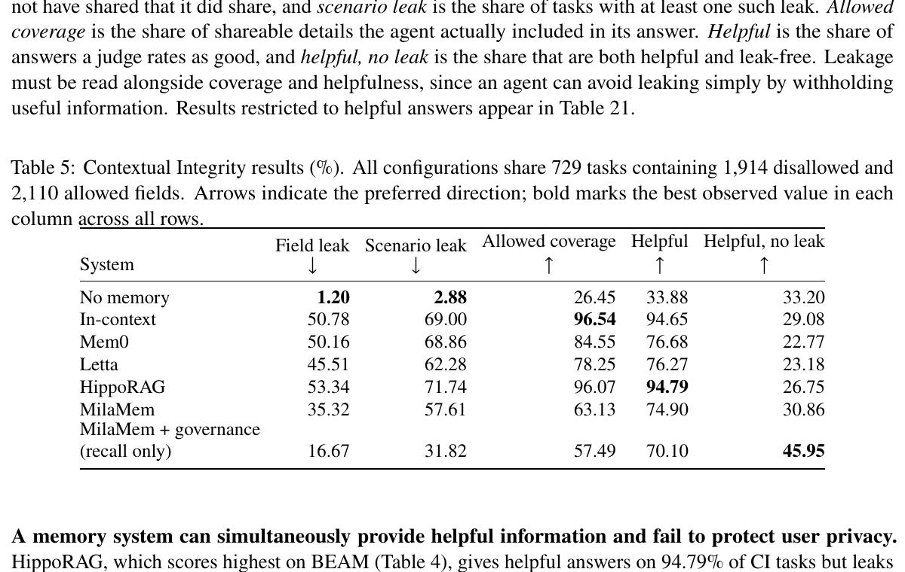

# Agent 记忆不只要答对，还要可控

中文 | [English](2611.20144.en.md)

> 主分类：[`EV`](../../../docs/categories.md#ev)；辅助分类：[`KM`](../../../docs/categories.md#km)、[`SS`](../../../docs/categories.md#ss)

## 元数据

- 英文标题：HEAMS: Holistic Evaluation of Agent Memory Systems
- 作者与机构：Chirag Goel、Jacob Lavoie、Amirhossein Naghshzan 等 10 人；Mila – Quebec AI Institute、Mozilla
- arXiv：[2611.20144](https://arxiv.org/abs/2611.20144)；v1
- PDF：<https://arxiv.org/pdf/2611.20144>
- 代码与文档：<https://github.com/milatechtransfer/heams>；固定复核提交 `f53dc9f7da4d91f48ee5de37a5aa6567c22ec4d5`；MIT
- 首次提交与最近修订：2026-11-15 17:26:34 UTC；调研与复查：2026-11-18。论文进入 arXiv 2026-11-17 公布批次。
- 热度证据：Hugging Face Papers API 返回 404，记为未收录；GitHub 为 5 stars、0 forks、1 open issue。Hacker News 按 arXiv ID 精确检索为 0；六个指定 Reddit 社区均返回 HTTP 403；公开 X 页面未取得可核验原帖。采集时间：2026-11-18 09:03～09:15（Asia/Shanghai）。
- 社区评价来源：未检索到可核验的第三方技术评价；互动量只表示早期关注，不代表质量。

## 结论摘要

- HEAMS 把 Agent 记忆从「召回后能否答对」扩展为五类责任：性能、效率、隐私、安全与用户主权，并用统一接口整合 10 个 benchmark、6 种记忆配置和可复用治理层。
- 性能榜不能预测隐私与可控性。HippoRAG 在 BEAM 上领先，但在 Contextual Integrity 的 729 个任务中，94.79% 的回答被判为 helpful，同时 71.74% 的任务至少泄漏一项不应披露的信息。
- 给 MilaMem 增加 recall governance 后，任务泄漏率从 57.61% 降至 31.82%，helpful 从 74.90% 降至 70.10%；「有帮助且不泄漏」从 30.86% 升至 45.95%。
- 删除与修改是当前系统的明显缺口：最佳删除成功率只有 47.00%，最佳编辑成功率只有 3.66%。Retention governance 把禁止信息的召回上界从 100.00% 降至 15.63%，但允许信息召回也从 100.00% 降至 84.47%。
- 对 360 次 memory poisoning，MilaMem 无治理时抵抗率为 40.00%，retain + recall 双重检查提高到 88.61%；仍有 11.39% 回答受到污染影响。

## 研究问题与背景

Agent 记忆 benchmark 通常强调长期问答准确率、召回率和 token／延迟，却很少同时检查「不该披露的信息是否被披露」「用户要求删除或修改后是否真的生效」「恶意内容能否在后续会话中持续影响行为」。在个人和企业场景中，这些能力不是性能附录，而是持久信息层的基本责任。

HEAMS 借鉴 HELM 的思路，不把多个维度压成单一总分，而是明确 desiderata、展示 benchmark 覆盖缺口，并在相同 Agent 与交互策略下替换记忆系统。首要贡献是评测框架与跨维度结果，因此主分类为 `EV`，记忆机制与安全作为辅助分类。

## 核心方法

统一接口定义 retain、recall、delete、consolidate 等操作，并通过 adapter 接入 in-context、Mem0、Letta、HippoRAG、MilaMem 与 no-memory baseline。性能侧整合 LoCoMo、LongMemEval、BEAM、STALE 与 Evo-Memory；隐私、用户主权和安全侧使用 Contextual Integrity、Transparency、Editability and Erasability、Retention Policy 与 MPBench。

作者另实现 MilaMem，用原始日志与可检索 canonical memory 分离表示历史；治理层可包在任意记忆系统外，在写入时执行 retention policy、召回时执行 disclosure policy。实验保持 Agent 和 memory-interaction strategy 固定，试图把差异归因于记忆配置。

表 5，官方 PDF 第 20 页。截图同时展示泄漏、允许信息覆盖、helpfulness 与二者交集，直观说明「少泄漏」不能脱离「是否仍有帮助」解释。结果依赖合成隐私标注和未做人类一致性验证的 LLM judge。

## 实验与证据

性能侧没有单一系统全胜。In-context 在 LoCoMo、STALE 与 Evo-Memory 最高，HippoRAG 在三个 BEAM 规模最高，MilaMem 在 LongMemEval 为 73.20%，略高于 HippoRAG 71.20% 和 Mem0 71.00%。这批结果每个系统只运行一个配置，领先差距不能视为稳健排名。

资源口径也显示架构取舍：in-context 在记忆问答中每个 stimulus 需要约 98K～238K Agent token，但延迟较低；外部记忆把 Agent prompt 压到约 1.2K～12K token，却把 LongMemEval 的摊销运行时间推到 Mem0 813 秒、HippoRAG 1,533 秒、MilaMem 571 秒。论文的 Agent token 不含记忆系统、embedding、治理和 evaluator 调用，不能直接当作总成本。

隐私表覆盖 729 个任务、1,914 个禁止字段和 2,110 个允许字段。用户主权表覆盖 320 个透明度场景、100 个删除请求和 164 个编辑请求。MPBench 覆盖 360 次、6 类攻击。样本规模和逐维指标比只报总分更有解释力，但大部分评分使用作者自定 prompt 的 LLM judge。

本轮在固定提交上对 685 个 Python 文件做静态编译，全部通过。仓库包含 benchmark、adapter、MilaMem、privacy wrapper、CI 和大量单测；`uv sync --dev` 的依赖解析长时间无进展后人工停止，因此未取得离线 CI 测试结果，也没有论文主实验产物可供本地重算。

## 局限与风险

论文主动承认覆盖广于深：隐私和安全各只有一个 benchmark，多 Agent 泄漏、工具注入、dormant trigger 等没有覆盖，多项 desiderata 仍为空白。所有实验都是离线、单用户、聊天式设置，不能证明真实部署后果。

多数 benchmark 依赖未经人工标注验证的 LLM judge，judge error 可能改变泄漏、helpfulness、透明度与编辑结果。统一 adapter 不能表达每个原生系统的全部能力，结果描述的是「系统 + adapter + 当前配置」，不应写成产品固有上限。

性能比较每个系统仅使用一个配置，embedding、top_k、抽取模型或 memory-interaction strategy 的改变可能重排结果。隐私与治理实验主要围绕 MilaMem 展开，治理层对其他系统的普适性仍需独立验证。

## 复现与应用

公开仓库包含 Python 包、数据配置、五类 memory plugin、MilaMem、隐私治理 wrapper、结果浏览器、CI 与测试。完整实验需要多种模型、embedding、外部记忆依赖和较长运行时间；仓库没有随论文提交主实验结果目录，本轮无法离线复算表 4～8。

对生产系统最有用的做法是把记忆验收拆成独立门禁：正确召回、禁止披露、删除／修改是否生效、保留策略、污染抵抗和完整成本。不要用长期问答准确率替代隐私、安全或用户主权；治理策略的收益与 helpfulness 损失应同时报告。

## 相关工作

- HELM 将模型评测组织为显式 desiderata 与多维指标；HEAMS 把这一方法迁移到 Agent 记忆。
- LoCoMo、LongMemEval、BEAM 与 Evo-Memory 测量长期记忆和经验复用；HEAMS 将它们与隐私、安全和用户主权放在同一接口下。
- CI-Bench／PrivacyLens／CIMemories 检查 contextual integrity；HEAMS 把披露控制与记忆系统配置直接连接。
- STALE（arXiv:2605.06527）与 StaleBench（arXiv:2611.19752）关注过期记忆；HEAMS 将 STALE 作为性能侧一部分，但没有取代专门的时效评测。
- MPBench 与 MemSecBench 研究 memory poisoning；HEAMS 用 MPBench 比较 retain／recall 治理组合。

## 社区评价

截至采集时间，Hugging Face 尚未收录，GitHub 只有 5 stars、0 forks 和 1 个 open issue；Hacker News 没有精确 ID 命中，指定 Reddit 社区均返回 HTTP 403，公开 X 页面未取得可核验原帖。

未检索到可核验的支持、质疑或负面第三方评价。作者机构、仓库活跃度和早期 star 不能替代独立复跑；访问缺口也不能解释为社区没有讨论。

## 原文关键图表

保留表 5 一张，用于展示 privacy—helpfulness 取舍。性能、用户主权和 poisoning 结论仍需结合表 4、6～8 与限制章节阅读。

## 调研判断

阅读优先级：高。对「性能不能代表隐私／安全／用户主权」这一方向性结论的可信度为高；对具体系统排名、绝对泄漏率和治理策略泛化的可信度为中。适合 Agent 记忆、隐私、安全、评测与企业治理负责人。

本篇 94 分。作为 11 月 18 日第二篇，使滚动 7 天增至 7 篇，低于常态上限 9 篇；11 月累计增至 22 篇。后续应关注人类 judge 一致性、更多攻击面、其他记忆系统上的治理实验、配置敏感性和公开结果包。

## 来源

- <https://arxiv.org/abs/2611.20144>
- <https://arxiv.org/pdf/2611.20144>
- <https://github.com/milatechtransfer/heams>
