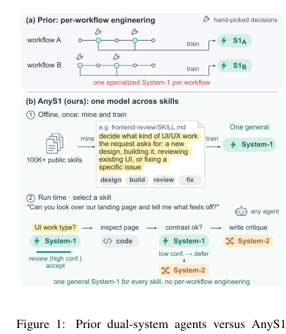

# One System-1 from skills for many agent workflows

[中文](2611.23751.md) | English

> Primary: [`SY`](../../../docs/categories.en.md#sy); secondary: [`AF`](../../../docs/categories.en.md#af), [`TU`](../../../docs/categories.en.md#tu)

## Metadata

- Original title: Thinking Fast, Anywhere: One System-1 for the Decision Points of Any Agent Workflow
- Authors and affiliations: Rui Li, Liyang He, Zheng Zhang, Zhenya Huang, and Qi Liu; University of Science and Technology of China and Nanyang Technological University
- arXiv: [2611.23751](https://arxiv.org/abs/2611.23751), v1; PDF: <https://arxiv.org/pdf/2611.23751>
- Code, data, model, and project: <https://github.com/middle-chunjie/AnyS1>, <https://huggingface.co/datasets/smSquirrel/SkillDP>, <https://huggingface.co/smSquirrel/AnyS1-4B>, <https://middle-chunjie.github.io/AnyS1/>; reviewed commit `1ed6a09e057a090d8322e9de1807af9a6876554a`
- License: repository states Apache-2.0; Any-DP is CC BY 4.0.
- First submission and latest revision: 2026-11-18 03:05:41 UTC; researched and rechecked on 2026-11-20; part of the 2026-11-19 arXiv listing.
- Popularity evidence: Hugging Face Daily Papers had 5 upvotes and 0 comments; GitHub had 2 stars, 0 forks, and 1 open issue. No exact Hacker News hit was found. All six requested Reddit communities returned HTTP 403, and exact public X searches returned no result. Collected 2026-11-20 09:08–09:16 Asia/Shanghai.

## Conclusion summary

- AnyS1 mines 17,865 decision points from 1,072 public skills, compiles deterministic steps to code, routes bounded choices to a shared 4B System-1, and defers open generation or low-confidence choices to System-2.
- Any-DP contains 25,986 container-executed states. Removing confidence gating collapses ALFWorld success from 96.3% to 40.3%, so the fast model cannot safely take every bounded-looking decision.
- AnyS1 warm reports 75–91% episode-cost savings and 63–92% critical-path model-time reductions against an uncompiled System-2 agent. All-S2 compilation already provides most of the gain; System-1 delegation is a second, separable layer.
- The same AnyS1-4B weights transfer across DeepSeek-V4.1-Flash and GPT-6 Sol. The cold threshold stays within 0.8 macro points of All-S2, but only 80.0% of delegated WebShop decisions agree with System-2 at 55% coverage.
- Local validation compiled the Python package and an example skill offline into four D/E/G points and three runtime artifacts. The model, training, and online benchmarks were not reproduced.

## Research question and background

Many agent steps are bounded choices rather than open generation, yet existing dual-system agents hand-code System-1 hooks per environment. AnyS1 treats procedural skill files as a cross-workflow source of decisions. Its primary contribution is runtime and efficiency (`SY`), with architecture and tool-protocol implications (`AF`, `TU`).

## Method

The compiler assigns each step to D, E, or G. D nodes are deterministic predicates. E nodes select from a finite option set using AnyS1-4B and defer below a confidence threshold. G nodes always use System-2. Three extraction passes are merged, tasks are executed in isolated containers, and only forward/reverse teacher-consensus states enter Any-DP. The pointer model uses Qwen3.5-4B-Base, rank-16 LoRA, an option-interaction head, and 0.1 label smoothing. Warm mode fits a threshold on roughly 50 unlabeled episodes; cold mode transfers 0.918.

Figure 1, paper page 2. It contrasts per-workflow System-1 engineering with one skill-mined System-1. It explains control flow, not empirical effectiveness.

## Experiments and evidence

The unseen evaluations contain 268 SOPBench tasks, 134 ALFWorld tasks, and 500 WebShop instructions. Compiling skills into All-S2 already raises macro effectiveness by about 18 points and saves 71–81% of cost.

With DeepSeek-V4.1-Flash, AnyS1 warm scores 84.3/95.5/68.1 on SOPBench, ALFWorld, and WebShop versus 83.2/96.3/66.9 for All-S2, a +0.5 macro-point difference and 89% average saving. With GPT-6 Sol, warm scores 82.5/95.5/70.4 versus 82.1/96.3/70.6, a -0.2 difference and 82% saving.

Container-executed states beat LLM-written summaries by 18.8 points on held-out dev. Label smoothing reduces mean ECE from 0.146 to 0.094 and raises gated agreement from 92.4% to 97.7%. The online tables mostly report point estimates without episode-level confidence intervals.

## Limitations and risks

The authors note that the largest savings require roughly 50 development episodes and explicit skill compilation. Open-ended repository skills and online threshold adaptation remain unsolved. The seven-commit repository has no test suite or online result logs, so the public code does not independently regenerate Tables 2–5. Teacher agreement is not objective correctness, and listed-price plus GPU-throughput estimates are not billing evidence.

## Reproduction and application

At commit `1ed6a09…`, Python compilation passed and offline compilation produced four points (D=1, E=2, G=1) plus `decisions.json`, `SKILL.anys1.md`, and `workflow.py`. This validates the compiler path only. Full reproduction needs Any-DP, AnyS1-4B, GPU capacity, three benchmarks, two System-2 services, and the paper's request cache. Deployments should separately measure compilation gain, delegation gain, cascading errors, fallback rate, task success, and actual bills.

## Related work

- SearchJev (arXiv:2610.05107) trains a search-specific System-1; AnyS1 targets cross-skill reuse.
- R2V Agent (arXiv:2605.16604) learns when a small model should ask for help; AnyS1 also compiles options and runtime structure.
- FrugalGPT (arXiv:2305.05176) routes whole requests across models; AnyS1 routes bounded decisions inside a workflow.
- DSPy (arXiv:2310.03714) compiles declarative LM programs; AnyS1 adds D/E/G decomposition and calibrated delegation.
- Skill Following (arXiv:2609.00549) measures whether agents invoke skills; AnyS1 assumes a selected skill and compiles its internal decisions.

## Community response

Hugging Face recorded 5 votes and no comments; GitHub had 2 stars, 0 forks, and 1 open issue. Pith's machine review praised the multi-benchmark, cross-System-2 evaluation and ablations, while questioning whether the headline comparison mixes compilation and delegation. The All-S2 baseline partially resolves that concern. This is machine-generated review, not an independent rerun. No verifiable human technical discussion was found; access failures do not prove none exists.

## Figures and tables from the paper

Figure 1 is retained to explain the architecture. Numerical claims remain grounded in Tables 2–5.

## Research judgment

Priority: high. The paper connects skills, workflow compilation, and calibrated delegation with unusually clear ablations. Mechanism evidence is strong; independent reproduction of the headline numbers remains incomplete. Score: 94. Together with Truthgate, this brings the rolling seven-day count to the normal cap of nine and the November total to 25.

## Sources

- <https://arxiv.org/abs/2611.23751>
- <https://arxiv.org/pdf/2611.23751>
- <https://middle-chunjie.github.io/AnyS1/>
- <https://github.com/middle-chunjie/AnyS1>
- <https://huggingface.co/datasets/smSquirrel/SkillDP>
- <https://huggingface.co/smSquirrel/AnyS1-4B>
- <https://pith.science/paper/2611.23751>
