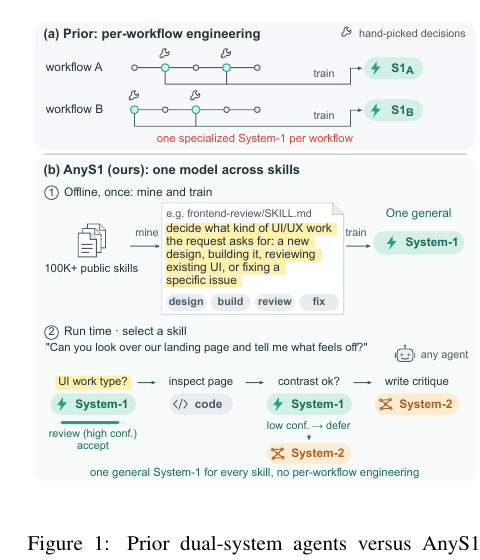

# 从 Skill 中抽取决策点，让一个 System-1 服务不同 Agent 工作流

中文 | [English](2611.23751.en.md)

> 主分类：[`SY`](../../../docs/categories.md#sy)；辅助分类：[`AF`](../../../docs/categories.md#af)、[`TU`](../../../docs/categories.md#tu)

## 元数据

- 英文标题：Thinking Fast, Anywhere: One System-1 for the Decision Points of Any Agent Workflow
- 作者与机构：Rui Li、Liyang He、Zheng Zhang、Zhenya Huang、Qi Liu；中国科学技术大学、南洋理工大学
- arXiv：[2611.23751](https://arxiv.org/abs/2611.23751)；v1
- PDF：<https://arxiv.org/pdf/2611.23751>
- 代码、数据、模型与项目页：<https://github.com/middle-chunjie/AnyS1>；<https://huggingface.co/datasets/smSquirrel/SkillDP>；<https://huggingface.co/smSquirrel/AnyS1-4B>；<https://middle-chunjie.github.io/AnyS1/>；复核提交 `1ed6a09e057a090d8322e9de1807af9a6876554a`
- 许可证：代码仓库声明 Apache-2.0；Any-DP 数据集为 CC BY 4.0。
- 首次提交与最近修订：2026-11-18 03:05:41 UTC；调研与复查：2026-11-20。属于 arXiv 2026-11-19 公布批次。
- 热度证据：Hugging Face Daily Papers 5 upvotes、0 comments；GitHub 2 stars、0 forks、1 open issue；Hacker News 无精确命中。六个指定 Reddit 社区均返回 HTTP 403，公开 X 精确检索无结果。采集时间：2026-11-20 09:08～09:16（Asia/Shanghai）。
- 社区评价来源：Pith 的机器评审给出方法与实验结构评价；未检索到可核验的人类第三方复跑或技术讨论。

## 结论摘要

- AnyS1 不再为每个工作流手写 System-1 hook，而是从 1,072 个公开 `SKILL.md` 中抽取 17,865 个决策点，把确定性步骤编译为代码、把有限选项交给 4B System-1、把开放生成和低置信选择交回 System-2。
- Any-DP 包含 25,986 个容器执行状态。作者用 label smoothing 训练指针模型，并用阈值控制委派；去掉置信度门控后，ALFWorld 成功率从 96.3% 降至 40.3%，说明「快模型」不能无条件接管长程搜索。
- 在 SOPBench、ALFWorld 和 WebShop 上，AnyS1 warm 相对直接读取 Skill 的 System-2 Agent 节省 75%～91% 的单轮成本、缩短 63%～92% 的关键路径模型时间；相对已编译的 All-S2，平均主指标为 +0.5 分，说明大部分收益先来自工作流编译，System-1 委派是第二层增益。
- 同一 AnyS1-4B 权重迁移到 DeepSeek-V4.1-Flash 与 GPT-6 Sol 两类 System-2；零目标运行的 cold 阈值与 All-S2 相差不超过 0.8 个平均点，但 WebShop 上 55% 的委派只有 80.0% 与 System-2 一致，不能把单一阈值当作跨域保证。
- 本轮在固定提交上完成 Python 静态编译和离线 Skill 编译烟测，生成 4 个 D／E／G 决策点及 3 个运行工件；未下载 4B 权重、未训练模型，也未复跑三项在线基准。

## 研究问题与背景

通用 Agent 的很多中间步骤并不需要开放生成，例如在有限工具中选一个、判断状态是否满足或检查候选是否存在。现有双系统方案通常为单一环境手工标注决策点和 hook，换工作流后又回到每步调用大模型。

AnyS1 的核心假设是：`SKILL.md` 已经用自然语言记录了分支、条件和可选项，因此可以作为跨工作流的决策点来源。论文同时改变运行时调度、工作流编译和工具决策协议，主分类为 `SY`，辅助分类为 `AF`、`TU`。

## 核心方法

编译器把步骤分成 D、E、G 三类。D 是文件存在性、正则或数值边界等可直接运行的确定性判断；E 是候选集合有限的路由、状态和工具选择；G 是代码生成、搜索词生成等开放任务。E 节点由 AnyS1-4B 输出候选概率，最高置信度低于阈值时转给 System-2。

训练数据来自三步流程：对 Skill 做三次独立抽取并合并；在隔离容器中合成可验证任务并运行轨迹；只保留正向／反向教师一致的状态。模型基于 Qwen3.5-4B-Base，以 rank-16 LoRA、排列等变的 OptionInteractionHead 和 0.1 label smoothing 训练。warm 模式用约 50 个无标签开发 episode 拟合阈值，cold 模式直接使用 0.918。

图 1，官方 PDF 第 2 页。上半部分是每个工作流单独训练 System-1 的既有方式；下半部分展示 AnyS1 从 Skill 统一抽取决策点，并在低置信时回退 System-2。图示解释控制结构，不证明论文中的成本或成功率。

## 实验与证据

三项测试集在训练中未出现：SOPBench 268 个任务、ALFWorld 134 个任务、WebShop 500 条指令。All-S2 先把原始 Skill 编译为显式工作流，已经使平均效果提高约 18 点，并节省 71%～81% 成本；这意味着不能把全部 75%～91% 节省归因于 4B System-1。

在 DeepSeek-V4.1-Flash 组，AnyS1 warm 的 SOPBench／ALFWorld／WebShop 主指标为 84.3／95.5／68.1，All-S2 为 83.2／96.3／66.9；平均差 +0.5 点，平均节省 89%。换成 GPT-6 Sol，warm 为 82.5／95.5／70.4，All-S2 为 82.1／96.3／70.6；平均差 -0.2 点，平均节省 82%。

消融表明，容器执行状态相对 LLM 编写的合成状态在 held-out dev 上提高 18.8 点；label smoothing 把平均 ECE 从 0.146 降至 0.094，并把门控后平均一致率从 92.4% 提高到 97.7%。但三项在线基准主要报告点估计，论文没有给 episode 级置信区间；不同编译器结构也可能改变任务难度。

## 局限与风险

作者明确指出，最大节省依赖每个工作流约 50 个开发 episode；大量 episode 级节省来自把 Skill 编译成显式程序，而不只是 System-1。当前编译器还不能自动处理开放、仓库级 Skill，在线阈值自适应仍是后续工作。

调研补充：代码仓库只有 7 个提交，没有测试目录或论文在线结果日志；公开代码可验证编译接口，但不能从仓库独立重算论文表 2～5。Any-DP 标签来自教师共识，System-1 与 System-2 一致并不等于选择客观正确。成本使用 API 列价和 L4 GPU 吞吐估算，不是账单级复核。

## 复现与应用

固定提交 `1ed6a09…` 下，`python -m compileall` 通过；离线编译示例 Skill 得到 4 个决策点（D=1、E=2、G=1），并生成 `decisions.json`、`SKILL.anys1.md` 和 `workflow.py`。该烟测验证离线编译链路，不验证 AnyS1-4B 的准确率、阈值校准或在线节省。

完整复现需要下载 Any-DP 与 AnyS1-4B、H100 或等价 GPU、三套基准、两个 System-2 服务及论文中的请求缓存。工程落地应先区分「编译带来的收益」与「小模型委派带来的增益」，并以错误级联、回退率、任务成功率和实际账单共同验收。

## 相关工作

- SearchJev（arXiv:2610.05107）为搜索 Agent 训练专用 System-1；AnyS1 试图跨 Skill 复用一个模型。
- R2V Agent（arXiv:2605.16604）训练小模型判断何时求助；AnyS1 进一步把候选选项和 Skill 编译纳入运行时。
- FrugalGPT（arXiv:2305.05176）研究模型级级联；AnyS1 的路由单元是工作流内部的有限决策点。
- DSPy（arXiv:2310.03714）把声明式 LM 调用编译为程序；AnyS1 聚焦 D／E／G 分解及校准委派。
- Skill Following（arXiv:2609.00549）评测 Agent 是否真正调用 Skill；AnyS1 假设 Skill 已被选择，再编译其内部决策。

## 社区评价

Hugging Face Daily Papers 记录 5 票、无评论；GitHub 为 2 stars、0 forks、1 open issue。互动量只反映早期可见度，不代表研究质量。Hacker News 无精确 arXiv ID 命中，六个指定 Reddit 社区均返回 HTTP 403，公开 X 精确检索无结果，不能据此声称「没有讨论」。

Pith 的机器评审认为论文的主要优点是跨三个未见基准、两类 System-2 和组件消融；其关键质疑是主对照把工作流编译与 System-1 委派混在一起。论文确实提供 All-S2 对照，使两层收益可分开读取。该评价属于机器生成的第三方评审，不是独立复跑，也没有人类评论。

## 原文关键图表

保留图 1 一张，用于说明「每工作流专用 System-1」与「跨 Skill 共用 System-1」的结构差异。效果数值仍以论文表 2～5 为准。

## 调研判断

阅读优先级：高。论文把 Agent Skill、工作流编译和校准委派连接成可执行架构，机制和消融较完整；代码可用性中等，主实验独立复算条件不足。适合 Agent 运行时、Skill 平台、成本优化和工具协议负责人。

本篇 94 分。与 Truthgate 同日入选后，滚动 7 天达到常态上限 9 篇；11 月累计增至 25 篇。后续重点观察公开结果日志、第三方基准复跑、复杂仓库 Skill 的编译覆盖率，以及 warm 校准是否能用在线回退数据替代专门开发 episode。

## 来源

- <https://arxiv.org/abs/2611.23751>
- <https://arxiv.org/pdf/2611.23751>
- <https://middle-chunjie.github.io/AnyS1/>
- <https://github.com/middle-chunjie/AnyS1>
- <https://huggingface.co/datasets/smSquirrel/SkillDP>
- <https://huggingface.co/smSquirrel/AnyS1-4B>
- <https://pith.science/paper/2611.23751>
