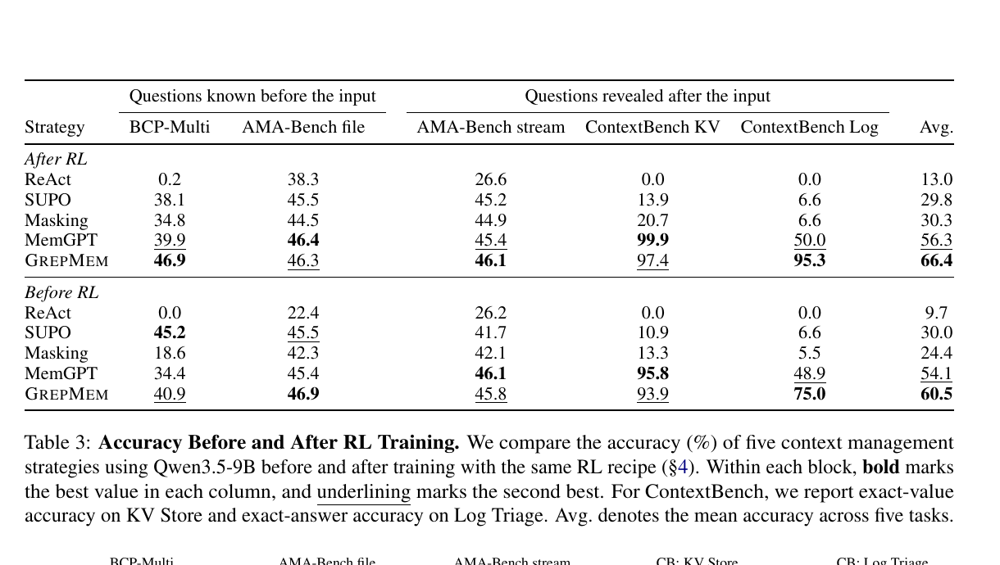

# Keep the Full History, Retrieve Details on Demand

Language: English; [中文](2611.25123.md)

> Primary: [`KM`](../../../docs/categories.en.md#km); secondary: [`SY`](../../../docs/categories.en.md#sy), [`AT`](../../../docs/categories.en.md#at)

## Metadata

- Original title: Forget Freely, Grep Later: Lossless, Index-Free Memory for Long-Horizon LLM Agents
- Authors and affiliation: Ziyan Yang, Taiwei Shi, and Jieyu Zhao; University of Southern California
- arXiv ID: 2611.25123; version: v1
- arXiv: <https://arxiv.org/abs/2611.25123>
- PDF: <https://arxiv.org/pdf/2611.25123>
- Code: <https://github.com/limenlp/GrepMem>
- Project: <https://grepmem.lovable.app/>
- Third-party component review: <https://daiwk.github.io/auto-research/agent-research/2611.25123-grepmem/README-en/>
- First submission and latest revision: 2026-11-18 20:02:57 UTC; v1, no later revision
- Research and review date: 2026-11-22
- Popularity evidence: at 2026-11-22 09:28 Asia/Shanghai, GitHub showed 6 stars, 1 fork, and 0 open issues; Hugging Face Daily Papers had no entry, and Hacker News had no exact match
- Community sources: a public component-level review by Auto Research and a machine-generated Pith review; no verifiable human discussion or independent reproduction of the main experiment was found

## Conclusion summary

- GrepMem does not make a compressed summary the sole memory. It appends the full interaction to a plain-text log, keeps the summary as working state, and lets the agent recover details with a regex tool.
- Under the same Qwen3.5-9B base model and RL recipe, GrepMem averages 66.4% across five tasks, above MemGPT at 56.3%, masking at 30.3%, and SUPO at 29.8%. Most of the advantage comes from exact recall and log search over long streams.
- It does not win everywhere. On AMA-Bench file it scores 46.3% versus MemGPT's 46.4%; its AMA-Bench stream advantage is small, several subgroup differences are not statistically significant, and token use is 2.3 times SUPO's.
- All 41 CPU tests pass at author commit `b7e3744c2f7489feac4060b379be6936960dc7bd`. The trained checkpoint is not public, full training is reported at roughly 6,000 H100 GPU-hours, and the main results were not independently rerun.

## Research question and background

Long-running agents often summarize their context near the window limit and discard the original interaction. That forces the system to predict which parameters, evidence, and unresolved state may matter later. Once the summary omits something, later steps cannot recover it. Structured memories and vector retrieval preserve more information but add extraction, indexing, embedding models, or write policies.

The paper asks a narrower, testable question: if the full history remains in an append-only log, can regex retrieval compensate for lossy summaries and provide a useful accuracy-token-runtime baseline?

## Method

GrepMem extends SUPO's compaction loop. Every user message, model response, and tool result is appended to a plain-text log. When the working context reaches a threshold, the model writes a summary and restarts from it, while the log remains intact. The model can later call `grep_history(pattern)` to search the log and return matching lines grouped by step.

Training uses a shared episode-level reward so one policy learns task actions, compaction timing, summary content, and search expressions together. Summaries and individual grep calls receive no separate reward. Unlike MemGPT, GrepMem has no working-memory slots, archival extraction, or BM25 index. Unlike masking, it never permanently replaces old observations with placeholders. Unlike SUPO, it retains auditable raw records.

## Experiments and evidence

The evaluation spans five settings: multi-question research in BCP-Multi, file and streaming trajectory questions in AMA-Bench, and ContextBench KV Store and Log Triage. All main-table strategies use Qwen3.5-9B and the same RL recipe, with checkpoint selection at step 80. The training mixture contains 4,000 episodes. A full strategy run uses 24 H100 GPUs, and the paper reports about 6,000 H100 GPU-hours across all training.

After RL, GrepMem scores 46.9, 46.3, 46.1, 97.4, and 95.3 on BCP-Multi, AMA file, AMA stream, ContextBench KV, and ContextBench Log, averaging 66.4. MemGPT scores 39.9, 46.4, 45.4, 99.9, and 50.0, averaging 56.3. GrepMem is not first in every column: MemGPT is slightly higher on AMA file and ContextBench KV.

> Table 3, page 7 of the paper PDF. The table supports GrepMem's average and long-stream log-recall advantage, while also showing exceptions on AMA-Bench and KV Store. These are author-reported results; the trained weights are not public.

Cost depends on the task. Relative to SUPO, GrepMem uses 6% more tokens on BCP-Multi, 5% fewer on AMA file, and 19% more on ContextBench. On AMA stream it uses 869K tokens and 56 calls versus SUPO's 377K and 24. On ContextBench, GrepMem is faster than SUPO at 38 versus 61 minutes for KV Store and 56 versus 84 for Log Triage, but the authors describe runtime as approximate because episodes shared concurrent servers.

## Limitations and risks

The authors identify one base model, controlled benchmarks, dependence on explicit lexical patterns, and unnecessary retrieval overhead on some tasks as limitations. Our additional boundary is that “lossless” describes storage, not guaranteed recovery. Small AMA-Bench gains do not establish better general state reasoning. Checkpoint selection inspected evaluation curves, and an early evaluation harness discarded some compaction summaries containing tool calls; the authors fixed it and reran affected strategies, but this increases audit complexity.

Persistent full histories also expand privacy, access-control, and retention risks. Production use needs explicit log permissions and deletion rules and should not retain secrets, personal data, or restricted content by default.

## Reproduction and application

The repository provides the method, data preparation, evaluation scripts, training settings, pinned upstream revisions, an MIT license, and CPU fake-model tests. On Python 3.13 with the README's pinned rLLM revision, all 41 tests pass at commit `b7e3744c2f7489feac4060b379be6936960dc7bd`. A first dependency install under Python 3.15 stalled; switching to a compatible version resolved installation and is not counted as a code-test failure.

The main experiment is not directly reproducible yet: trained checkpoints are absent, the OpenResearcher retrieval matrix is about 122 GB, and full training requires multi-node H100s, dedicated retrieval GPUs, datasets, and judge-model configuration. Auto Research independently reviewed only a low-cost component at a fixed author commit and explicitly did not reproduce the full experiment.

As an engineering baseline, retain an append-only log, expose restricted grep after compaction, and record patterns, hit ranges, and retrieval cost. This is relevant to long-running coding, research, and workspace agents, but full production interaction logs should not be stored without permission and retention controls.

## Related work

- [SUPO](https://aclanthology.org/2026.acl-long.966/) learns policy-generated summaries for long-horizon search; GrepMem keeps its compaction loop and adds a complete log plus retrieval.
- [MemGPT](https://arxiv.org/abs/2310.08560) manages working and archival memory; the paper's baseline uses BM25 archival search and substring conversation search and is structurally more complex.
- [The Complexity Trap](https://arxiv.org/abs/2508.21433) compares observation masking with summarization and motivates simple context-management baselines; GrepMem additionally preserves raw observations.
- [Agent-Controlled Search over Raw Chat Logs](https://arxiv.org/abs/2608.12888) also studies raw-log retrieval; GrepMem places it inside a compaction loop and trains it end to end with RL.
- [AMA-Bench](https://arxiv.org/abs/2602.22769) evaluates trajectory memory and state understanding; GrepMem's limited gains there are an important boundary on the paper's claim.

## Community response

No verifiable human community discussion or independent reproduction of the main experiment was found. Auto Research labels its public review `component_only`, confirms a fixed author commit, the MIT license, and a low-cost runnable component, and explicitly states that it did not reproduce the full experiment. This is third-party artifact evidence, not independent confirmation of the paper's main results. Pith provides a machine-generated method review and is not human community consensus.

At collection time, Hugging Face Daily Papers had no entry, Hacker News had no exact match, all six specified Reddit communities returned HTTP 403, and public X exact-title searches yielded no verifiable original post. GitHub's 6 stars and 1 fork indicate attention at that time, not research quality.

## Research judgment

- Reading priority: high
- Confidence: medium-high; protocol, tables, and code boundaries are clear, while the main training result remains independently unverified
- Audience: researchers and engineers working on agent memory, context compaction, long-running research agents, and coding agents
- Watch items: trained-weight release, cross-model validation, privacy and storage cost on real long tasks, need for semantic retrieval, and limited gains on AMA-Bench

## Sources

- [arXiv abstract](https://arxiv.org/abs/2611.25123)
- [Official PDF](https://arxiv.org/pdf/2611.25123)
- [Author repository](https://github.com/limenlp/GrepMem)
- [Author project page](https://grepmem.lovable.app/)
- [GitHub repository state](https://api.github.com/repos/limenlp/GrepMem)
- [Auto Research component review](https://daiwk.github.io/auto-research/agent-research/2611.25123-grepmem/README-en/)
- [Pith machine-generated review](https://pith.science/paper/2611.25123)
- [Hacker News search](https://hn.algolia.com/?q=2611.25123)
