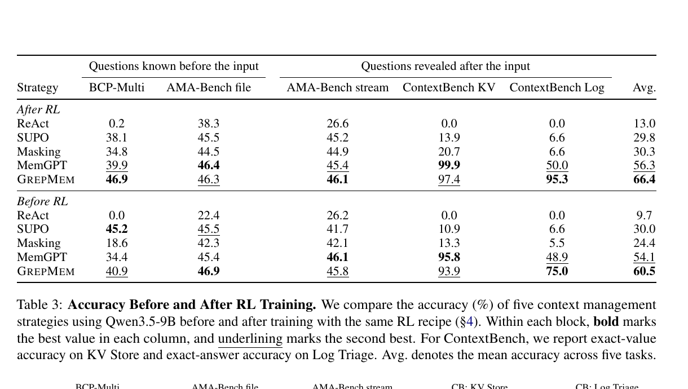

# 保留完整历史，再按需找回细节

语言：中文；[English](2611.25123.en.md)

> 主分类：[`KM`](../../../docs/categories.md#km)；辅助分类：[`SY`](../../../docs/categories.md#sy)、[`AT`](../../../docs/categories.md#at)

## 元数据

- 英文标题：Forget Freely, Grep Later: Lossless, Index-Free Memory for Long-Horizon LLM Agents
- 作者与机构：Ziyan Yang、Taiwei Shi、Jieyu Zhao；University of Southern California
- arXiv ID：2611.25123；版本：v1
- arXiv：<https://arxiv.org/abs/2611.25123>
- PDF：<https://arxiv.org/pdf/2611.25123>
- 代码：<https://github.com/limenlp/GrepMem>
- 项目页：<https://grepmem.lovable.app/>
- 第三方组件复核：<https://daiwk.github.io/auto-research/agent-research/2611.25123-grepmem/README-en/>
- 首次提交与最近修订：2026-11-18 20:02:57 UTC；v1，无后续修订
- 调研与复查日期：2026-11-22
- 热度证据：截至 2026-11-22 09:28（Asia/Shanghai），GitHub 为 6 stars、1 fork、0 open issues；Hugging Face Daily Papers 未收录，Hacker News 无精确命中
- 社区评价来源：Auto Research 的公开组件级复核；Pith 的机器生成评述；未检索到可核验的人工评论或独立主实验复现

## 结论摘要

- GrepMem 不把压缩摘要当作唯一记忆，而是把完整交互追加到纯文本日志；摘要继续承载工作状态，Agent 可用正则工具按需查回历史细节。
- 在同一 Qwen3.5-9B、同一强化学习配方下，GrepMem 的五项任务平均准确率为 66.4%，高于 MemGPT 的 56.3%、Masking 的 30.3% 和 SUPO 的 29.8%。优势主要来自长流精确召回与日志检索。
- 方法并非所有任务都占优：AMA-Bench file 为 46.3%，略低于 MemGPT 的 46.4%；AMA-Bench stream 的领先幅度很小，论文报告的细分差异多处无统计显著性，且 token 用量是 SUPO 的 2.3 倍。
- 作者仓库固定提交 `b7e3744c2f7489feac4060b379be6936960dc7bd` 的 41 项 CPU 测试通过。训练后 checkpoint 尚未发布，完整训练约需 6,000 H100 GPU 小时，主结果未独立复跑。

## 研究问题与背景

长时程 Agent 通常在上下文接近窗口上限时生成摘要，再丢弃原始交互。这个过程必须提前判断哪些细节以后有用；一旦摘要遗漏参数、证据或未完成状态，后续步骤无法恢复。结构化记忆和向量检索可以保留更多内容，但需要抽取、索引、嵌入模型或额外写入策略。

论文的问题更窄也更可检验：如果完整历史以追加日志保留，Agent 能否只靠正则检索弥补摘要损失，并在准确率、token 与运行时间之间形成可用基线。

## 核心方法

GrepMem 建立在 SUPO 的压缩循环上。每轮交互先把用户消息、模型回复和工具结果追加到纯文本日志；上下文达到阈值时，模型生成摘要并以摘要重启工作上下文，但完整日志不删除。后续模型可调用 `grep_history(pattern)`，用正则搜索日志并按步骤返回匹配行。

训练使用共享的 episode-level reward，让同一策略同时学习任务动作、何时压缩、摘要写法和检索表达式；摘要或单次 grep 不单独获得奖励。与 MemGPT 相比，GrepMem 没有工作记忆槽、归档抽取或 BM25 索引；与 Masking 相比，它不把旧观察永久替换为占位符；与 SUPO 相比，它保留可追溯的原始记录。

## 实验与证据

评测覆盖 5 个设置：BCP-Multi 的多问题研究、AMA-Bench 的文件检索与流式轨迹问答、ContextBench KV Store 和 Log Triage。训练与主表统一使用 Qwen3.5-9B；每种策略共享同一训练配方，论文在第 80 步选择 checkpoint。训练集含 4,000 个 episode，完整训练每次使用 24 张 H100，所有策略合计约 6,000 H100 GPU 小时。

强化学习后，GrepMem 在 BCP-Multi、AMA file、AMA stream、ContextBench KV 与 ContextBench Log 上分别为 46.9、46.3、46.1、97.4、95.3，五项均分 66.4。MemGPT 为 39.9、46.4、45.4、99.9、50.0，均分 56.3。GrepMem 并未在每列第一：MemGPT 在 AMA file 与 ContextBench KV 略高。

> 表 3，论文 PDF 第 7 页。表格显示 GrepMem 的平均分和长流日志任务优势，也显示 AMA-Bench 与 KV Store 上的例外。该表来自作者实验，训练后权重尚未发布，不能视为独立复现。

成本结果需要分任务解释。相对 SUPO，GrepMem 在 BCP-Multi 多用 6% token，在 AMA file 少用 5%，ContextBench 多用 19%；AMA stream 则使用 869K token／56 次调用，约为 SUPO 的 377K／24 次。ContextBench 中，GrepMem 的运行时间低于 SUPO：KV Store 为 38 对 61 分钟，Log Triage 为 56 对 84 分钟；作者说明并发共享服务器使这些时间只能近似比较。

## 局限与风险

作者明确限制包括单一基础模型、受控基准、正则检索依赖显式关键词，以及某些任务中不必要的检索开销。调研进一步认为：「lossless」只描述日志存储没有丢失，不保证模型会检索到正确证据；AMA-Bench 的小幅差异不能支持通用状态推理改善；checkpoint 选择检查过评测曲线，且早期评测外壳曾丢弃带工具调用的压缩摘要，虽已修复并重跑相关策略，仍增加了结果复核复杂度。

完整历史还会扩大隐私、权限和保留期限风险。生产系统必须限制日志访问、设置删除策略，并避免把密钥、个人数据或受限内容无条件长期保留。

## 复现与应用

作者仓库提供方法实现、数据准备、评测脚本、训练配置、固定上游 revision、MIT 许可证和 CPU 假模型测试。固定提交 `b7e3744c2f7489feac4060b379be6936960dc7bd` 在 Python 3.13 环境下按 README 安装锁定的 rLLM 后，41 项测试全部通过。第一次使用 Python 3.15 安装依赖无进展，改用兼容版本后完成；这不属于代码测试失败。

完整主实验仍不可直接复现：训练后 checkpoint 未发布；OpenResearcher 检索矩阵约 122 GB，训练需要多机 H100、专用检索 GPU、数据集和判分模型配置。第三方 Auto Research 仅复核了低成本组件与固定作者提交，并明确没有复现完整实验。

工程上可先把 GrepMem 作为透明基线：保留追加日志，在压缩后提供受限 grep，并记录检索模式、命中范围和调用成本。适合长时程 Coding Agent、研究 Agent 与工作区 Agent；不应在没有权限与保留政策时直接保存全部生产交互。

## 相关工作

- [SUPO](https://aclanthology.org/2026.acl-long.966/)：以策略生成摘要继续长时程搜索；GrepMem 保留其压缩循环，并增加完整日志与检索工具。
- [MemGPT](https://arxiv.org/abs/2310.08560)：通过工作记忆与归档记忆管理上下文；论文基线使用 BM25 归档搜索和子串会话搜索，结构比 GrepMem 更复杂。
- [The Complexity Trap](https://arxiv.org/abs/2508.21433)：比较观察遮蔽与摘要，说明简单上下文管理可能足以形成强基线；GrepMem 进一步保留原始观察。
- [Agent-Controlled Search over Raw Chat Logs](https://arxiv.org/abs/2608.12888)：同样研究原始聊天日志检索；GrepMem 把该机制放入压缩循环并使用端到端强化学习。
- [AMA-Bench](https://arxiv.org/abs/2602.22769)：检验 Agent 轨迹记忆和状态理解；GrepMem 在该基准上的提升有限，是结论边界的重要证据。

## 社区评价

未检索到可核验的人工社区讨论或独立主实验复现。Auto Research 的公开复核将其标为「component_only」，确认固定作者提交、MIT 许可证与低成本组件可运行，同时明确完整实验因成本未复现；这是第三方工件复核，不是对论文主结果的独立确认。Pith 提供机器生成的方法评述，不代表人工社区共识。

截至采集时，Hugging Face Daily Papers 页面返回未收录，Hacker News 没有精确命中；六个指定 Reddit 社区均返回 HTTP 403；公开 X 精确检索没有取得可核验原帖。GitHub 的 6 stars、1 fork 只表示采集时点关注度，不代表研究质量。

## 调研判断

- 阅读优先级：高
- 可信度：中高；主表、协议与代码边界清楚，主训练结果尚未独立复现
- 适用对象：Agent 记忆、上下文压缩、长时程研究和 Coding Agent 工程人员
- 后续观察：训练后权重发布、跨模型验证、真实长任务中的隐私与存储成本、语义检索需求，以及 AMA-Bench 上的有限收益

## 来源

- [arXiv 摘要页](https://arxiv.org/abs/2611.25123)
- [官方 PDF](https://arxiv.org/pdf/2611.25123)
- [作者代码仓库](https://github.com/limenlp/GrepMem)
- [作者项目页](https://grepmem.lovable.app/)
- [GitHub 仓库状态](https://api.github.com/repos/limenlp/GrepMem)
- [第三方 Auto Research 组件复核](https://daiwk.github.io/auto-research/agent-research/2611.25123-grepmem/README-en/)
- [Pith 机器评述](https://pith.science/paper/2611.25123)
- [Hacker News 检索](https://hn.algolia.com/?q=2611.25123)
