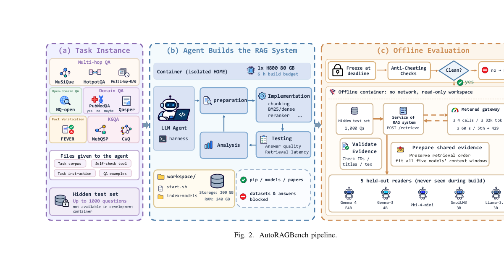

# Can agents build and improve RAG systems from scratch?

[中文](2611.25582.md) | English

> Primary: [`EV`](../../../docs/categories.en.md#ev); secondary: [`RA`](../../../docs/categories.en.md#ra), [`SE`](../../../docs/categories.en.md#se), [`SY`](../../../docs/categories.en.md#sy)

## Metadata

- Original title: AutoRAGBench: A Benchmark for LLM Agents Automating RAG System Development
- Authors and affiliations: Hang Zhang, Yuzhi Pan, Ziyao Zhong, and 12 others; Tsinghua University and Sina Weibo Corp
- arXiv ID and version: 2611.25582v1
- arXiv: <https://arxiv.org/abs/2611.25582>
- PDF: <https://arxiv.org/pdf/2611.25582>
- Code: <https://github.com/ZhanGHanG9991/AutoRAGBench>
- Project: <https://zhanghang9991.github.io/AutoRAGBench_Website>
- Data: <https://drive.google.com/drive/folders/1Gy0x_-PuFCC4wX0WV-P7wmZeWVWowT2t>
- First submission and latest revision: 2026-11-19 06:26:28 UTC; v1
- Research and recheck date: 2026-11-21
- Popularity evidence at 2026-11-21 09:03 Asia/Shanghai: 3 GitHub stars, no forks or open issues; no Hugging Face Papers entry and no exact Hacker News hit

## Conclusion summary

- AutoRAGBench turns RAG development into a six-hour, single-H800, open-code agent task instead of configuration search over a fixed menu.
- All nine agent configurations beat naive BM25 across nine tasks. GPT-6.1 Sol with Codex CLI averages 56.08 over five held-out readers, versus 46.42 for Reference RAG.
- “Human-SOTA” is a per-task composite envelope with a 24-hour development budget, not one deployable human system. The 56.08 versus 44.43 comparison does not establish that agents generally outperform humans.
- At pinned commit `bb3ac9df0ee9096efa4b503d950e293d1e037f92`, all 18 evaluation-contract tests passed. The full experiment needs about 8 GB of data, H800 GPUs, five reader models, and commercial agents and was not reproduced.

## Research question and background

RAG quality depends on corpus processing, indexing, query reformulation, graph traversal, reranking, and evidence selection. Prior automation usually selects components inside a predefined search space. This paper instead asks whether an agent can understand a task, write code, run experiments, and improve a new RAG system from feedback.

## Method

Each task gives an agent a corpus, training questions, instructions, and a self-check tool but no starter implementation. The agent receives one H800, 12 CPU cores, 240 GB RAM, 200 GB storage, and six hours in an isolated container. It may install packages and models but may not download external datasets or answers.

At the deadline, the workspace is frozen and checked for leakage, provenance, and other integrity violations. A clean system retrieves evidence for a hidden test set in an offline, read-only environment. Evidence is validated against the corpus and then shared with five reader models that were unavailable during development. This separates retriever quality from one answer model and preserves latency and development traces.

> Figure 2, paper page 4. It explains the task, build, freeze, audit, evidence validation, and five-reader evaluation boundary. It does not prove that every leakage route is covered.

## Experiments and evidence

- The suite covers NQ, HotpotQA, MuSiQue, MultiHop-RAG, PubMedQA, QASPER, FEVER, WebQSP, and CWQ, usually with 1,000 hidden questions per task.
- GPT-6.1 Sol + Codex CLI averages 56.08 and leads seven tasks. GPT-6 Sol scores 54.10, Reference RAG 46.42, composite Human-SOTA 44.43, BM25 36.66, and closed-book 25.30.
- Only GPT-6.1 Sol and GPT-6 Sol beat Reference RAG on all nine tasks. Four agent systems remain below BM25 on MH-RAG.
- Mean retrieval latency is 0.50–2.01 seconds, 1.4–5.8 times Reference RAG. More latency does not guarantee higher scores.
- Starting from seven human systems, GPT-6.1 Sol improves the score by 16.6 points on average, yet remains 1.92 points below its from-scratch builds because it must preserve the original retrieval mechanism.

## Limitations and risks

The authors leave broader tasks, multimodal retrieval, and newer agents to future work. The nine tasks are all QA-style RAG and do not cover production permissions, continual corpus updates, online traffic, or answer governance. Five readers reduce single-model bias but still share the benchmark's task and prompt design. Human-SOTA is a budget-mismatched composite envelope. Strategy labels await a second coder, and trajectory correlations cannot isolate model capability from harness and output volume.

## Reproduction and application

The repository includes nine tasks, data fingerprints, agent launchers, integrity audits, baselines, multi-reader evaluation, and trace parsing. Static compilation and the README's 18 tests passed at the pinned commit. The CPU example correctly stopped because formal data were absent. Full reproduction requires about 8 GB of data, multiple model environments, an H800, and commercial credentials.

The durable contribution is the protocol: freeze the artifact, hide the test set, validate evidence provenance, score with multiple readers, and retain development traces and latency.

## Related work

- [Agentic AutoRAG](https://arxiv.org/abs/2610.08452): agent-guided optimization inside a defined configuration space; AutoRAGBench permits arbitrary code and new components.
- [FlashRAG](https://github.com/RUC-NLPIR/FlashRAG): a modular RAG research toolkit used as an automated baseline.
- [HippoRAG 2](https://arxiv.org/abs/2502.14802): a graph-memory retrieval method used in the human-system comparison.
- [RAPTOR](https://arxiv.org/abs/2401.18059): hierarchical retrieval that illustrates the gap between a fixed human method and open agent construction.

## Community response

No verifiable third-party reproduction or native discussion was found. Source-oriented summaries repeat the from-scratch framing and 56.1 score without independently checking cost, leakage, or the Human-SOTA denominator. Exact Hacker News search returned zero; six requested Reddit communities returned HTTP 403; exact public X search yielded no verifiable post. Three GitHub stars measure attention at collection time, not quality.

## Research judgment

- Reading priority: high
- Confidence: medium-high; strong protocol and artifacts, no independent main-result reproduction
- Audience: coding-agent, RAG, agent-evaluation, and autonomous-system-development researchers
- Watch next: formal-data reruns, hardware stability, cost accounting, integrity coverage, and transfer to production RAG

## Sources

- [arXiv](https://arxiv.org/abs/2611.25582)
- [Official PDF](https://arxiv.org/pdf/2611.25582)
- [Official repository](https://github.com/ZhanGHanG9991/AutoRAGBench)
- [Official project page](https://zhanghang9991.github.io/AutoRAGBench_Website)
- [GitHub repository metadata](https://api.github.com/repos/ZhanGHanG9991/AutoRAGBench)
- [Exact Hacker News search](https://hn.algolia.com/?q=2611.25582)
