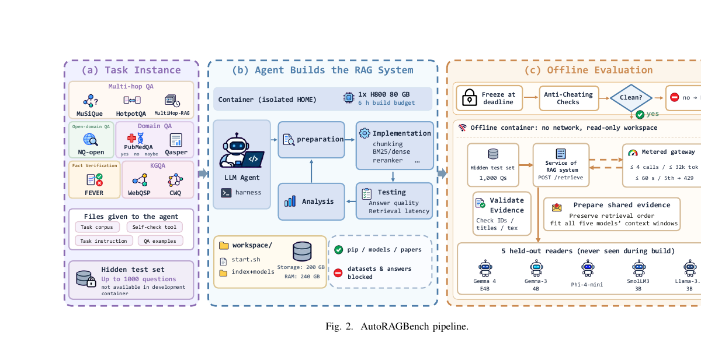

# Agent 能否从零构建并改进 RAG 系统

语言：中文；[English](2611.25582.en.md)

> 主分类：[`EV`](../../../docs/categories.md#ev)；辅助分类：[`RA`](../../../docs/categories.md#ra)、[`SE`](../../../docs/categories.md#se)、[`SY`](../../../docs/categories.md#sy)

## 元数据

- 英文标题：AutoRAGBench: A Benchmark for LLM Agents Automating RAG System Development
- 作者与机构：Hang Zhang、Yuzhi Pan、Ziyao Zhong 等 15 人；清华大学软件学院、Sina Weibo Corp
- arXiv ID：2611.25582；版本：v1
- arXiv：<https://arxiv.org/abs/2611.25582>
- PDF：<https://arxiv.org/pdf/2611.25582>
- 代码：<https://github.com/ZhanGHanG9991/AutoRAGBench>
- 项目页：<https://zhanghang9991.github.io/AutoRAGBench_Website>
- 数据：<https://drive.google.com/drive/folders/1Gy0x_-PuFCC4wX0WV-P7wmZeWVWowT2t>
- 首次提交与最近修订：2026-11-19 06:26:28 UTC；v1，无后续修订
- 调研与复查日期：2026-11-21
- 热度证据：截至 2026-11-21 09:03（Asia/Shanghai），GitHub 为 3 stars、0 forks、0 open issues；Hugging Face Papers API 未收录，Hacker News 无精确 ID 命中
- 社区评价来源：公开搜索中的来源型摘要与基准索引；未检索到可核验的第三方复跑或评论讨论

## 结论摘要

- AutoRAGBench 把「开发 RAG」定义为六小时、单张 H800、开放代码空间中的完整 Agent 任务，而不是在预设组件菜单里搜索参数。
- 九种 Agent 配置在九项任务上都超过朴素 BM25；GPT-6.1 Sol + Codex CLI 的五读者平均分为 56.08，高于 Reference RAG 的 46.42。
- 论文所称 Human-SOTA 是逐任务选择的复合包络线，开发预算为 24 小时，并非单一可部署的人类系统；56.08 对 44.43 不能直接解释为「Agent 普遍超过人类」。
- 固定提交 `bb3ac9df0ee9096efa4b503d950e293d1e037f92` 的 18 项评测契约测试通过；完整实验依赖约 8 GB 数据、H800、五个读者模型和商业 Agent，未独立复跑。

## 研究问题与背景

RAG 系统的效果取决于语料处理、索引、查询改写、图遍历、重排与证据选择。已有自动化方法通常只在固定搜索空间内选择组件，不能回答 Agent 是否能读懂任务、写代码、运行实验并根据结果改进一个新系统。论文因此把研究对象从「某个 RAG 配置的质量」移到「Agent 的系统开发能力」。

## 核心方法

每项任务向 Agent 提供语料、训练问答、任务说明和自检工具，不提供起始实现。Agent 在隔离容器中获得一张 H800、12 个 CPU 核、240 GB 内存、200 GB 工作区和六小时预算，可以安装库和下载模型，但不能下载外部数据集或答案。

截止时冻结工作区，先执行泄漏、来源和反作弊检查；不通过时回退到 BM25 分数。通过后，系统在无网络、只读工作区中对隐藏测试集检索证据。评测器验证证据确实来自语料，再把同一份证据交给五个构建阶段不可见的读者模型作答。该设计把检索器质量与单一回答模型偏好分开，并保留延迟与开发轨迹。

> 图 2，论文第 4 页。左侧是九项任务和隐藏测试集，中间是六小时开放代码开发，右侧是冻结、反作弊、证据验证与五读者离线评测。图能解释评测边界，但不证明反作弊检查覆盖所有泄漏方式。

## 实验与证据

- 任务覆盖 NQ、HotpotQA、MuSiQue、MultiHop-RAG、PubMedQA、QASPER、FEVER、WebQSP 与 CWQ；测试集通常为 1,000 题，最少为 500 题。
- GPT-6.1 Sol + Codex CLI 平均 56.08，在七项任务上最高；GPT-6 Sol 为 54.10，Reference RAG 为 46.42，复合 Human-SOTA 为 44.43，BM25 为 36.66，closed-book 为 25.30。
- 只有 GPT-6.1 Sol 与 GPT-6 Sol 在九项任务上都超过 Reference RAG；MH-RAG 上仍有四个 Agent 系统低于 BM25，说明平均分会掩盖任务级失败。
- Agent 系统平均检索延迟为 0.50～2.01 秒，是 Reference RAG 的 1.4～5.8 倍。更长延迟不保证更高分。
- 从七个人工系统出发时，GPT-6.1 Sol 平均提高 16.6 分；但与从零构建相比仍平均低 1.92 分，原因之一是必须保留原系统的核心检索机制。

## 局限与风险

作者明确限制未来工作仍需扩展更多 RAG 任务、多模态检索与更先进的 Agent。调研进一步认为：九项任务都属于问答式 RAG，不能外推到生产权限、持续更新、在线流量或端到端回答治理；五读者虽降低单模型偏差，仍共享任务和提示设计；Human-SOTA 是复合包络线且预算不同，名称容易造成过度解读。策略标签尚未由第二位编码者复核，开发轨迹相关性也不能分离模型能力、输出量和外壳作用。

## 复现与应用

仓库提供九项任务、数据指纹、Agent 启动器、反作弊检查、基线、五读者评测和轨迹解析。固定提交上，`compileall` 与 README 所列 18 项单元测试通过；CPU 最小示例正确检测到缺少正式数据并停止。完整复现需要下载约 8 GB 数据、安装多个模型环境、准备 H800 和商业模型凭据，成本与硬件门槛较高。

工程上更有价值的是评测协议：冻结提交、隐藏测试、证据来源验证、多读者评分、开发轨迹与运行时延迟可以用于评估任何「Agent 构建信息系统」任务，而不应只复制论文的模型排名。

## 相关工作

- [Agentic AutoRAG](https://arxiv.org/abs/2610.08452)：让 Agent 在预定义配置空间内诊断并优化 RAG；AutoRAGBench 允许直接写代码和添加新组件。
- [FlashRAG](https://github.com/RUC-NLPIR/FlashRAG)：模块化 RAG 研究工具包；论文把它作为自动化基线，但其搜索空间仍是预先定义的流水线。
- [HippoRAG 2](https://arxiv.org/abs/2502.14802)：图记忆与检索方法，是 Human-SOTA 组合和人工系统起点之一。
- [RAPTOR](https://arxiv.org/abs/2401.18059)：层次化摘要检索方法，用于说明人工 RAG 方法与 Agent 开放构建的差异。

## 社区评价

未检索到可核验的第三方复跑或原生社区评论。来源型摘要普遍关注「从零构建」与 56.1 分，但没有独立核验运行成本、数据泄漏或 Human-SOTA 口径。Hacker News 精确 arXiv ID 检索为 0；六个指定 Reddit 社区均返回 HTTP 403；公开 X 精确搜索没有取得可核验原帖。GitHub 的 3 stars 只表示采集时点关注度，不代表论文质量。

## 调研判断

- 阅读优先级：高
- 可信度：中高；协议与工件完整，主结果尚未独立复跑
- 适用对象：Coding Agent、RAG、Agent 评测与自动系统开发研究者
- 后续观察：正式数据复跑、跨硬件稳定性、开发成本口径、反作弊覆盖率，以及生产 RAG 场景外推

## 来源

- [arXiv 摘要页](https://arxiv.org/abs/2611.25582)
- [官方 PDF](https://arxiv.org/pdf/2611.25582)
- [官方代码仓库](https://github.com/ZhanGHanG9991/AutoRAGBench)
- [官方项目页](https://zhanghang9991.github.io/AutoRAGBench_Website)
- [GitHub 仓库状态](https://api.github.com/repos/ZhanGHanG9991/AutoRAGBench)
- [Hacker News 精确检索](https://hn.algolia.com/?q=2611.25582)
