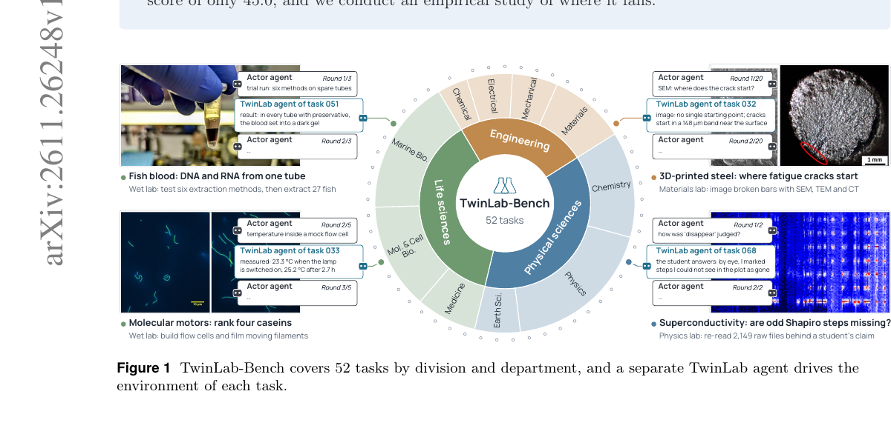

# Let agents design experiments, not just run workflows

[中文](2611.26248.md) | English

> Primary: [`EV`](../../../docs/categories.en.md#ev); secondary: [`RA`](../../../docs/categories.en.md#ra), [`SY`](../../../docs/categories.en.md#sy)

## Metadata

- Original title: TwinLab-Bench: Evaluating AI Scientists in Agentic Twins of Real Labs
- Authors and affiliation: Yang Wan and Linchao Zhu; Zhejiang University
- arXiv ID and version: 2611.26248v1
- arXiv: <https://arxiv.org/abs/2611.26248>
- PDF: <https://arxiv.org/pdf/2611.26248>
- Code: <https://github.com/ZJUSCL/TwinLab-Bench>
- Data: <https://huggingface.co/datasets/ZJUSCL/TwinLab-Bench>
- Project: <https://twinlab-bench.github.io/>
- First submission and latest revision: 2026-11-19 15:25:34 UTC; v1
- Research and recheck date: 2026-11-21
- Popularity evidence at 2026-11-21 09:03 Asia/Shanghai: 5 Hugging Face votes and no comments; 4 GitHub stars; dataset 73 downloads and 1 like

## Conclusion summary

- TwinLab-Bench builds interactive laboratory twins from records of 52 real labs to test whether agents can design experiments rather than merely run given workflows or choose from candidate measurements.
- Seventy-six percent of experimental outputs come from records or calculators calibrated on the same lab's data. Expert-route replay scores 97.8, while the best model scores 45.0.
- Failure is usually not just insufficient budget. Twelve of Opus 5.5's 16 zero-score runs fail on experimental decisions; doubling the budget converts only two of eight near-budget failures into passes.
- Code and all 52 tasks are public. Pinned commit `d0ba160891c3a7e8643a2ff7c02de47dd87105e3` compiled statically. Full reproduction needs Linux, bubblewrap, Claude Code or Codex, DeepSeek API access, and paid frontier models and was not run.

## Research question and background

Most AI-scientist benchmarks provide data, a workflow, or a menu of experiments. Real science also requires choosing measurements in an open space, managing material budgets, revising hypotheses from observations, and producing evidence-backed conclusions. Live laboratories are expensive, while unconstrained language simulators invent readings. TwinLab-Bench attempts a reusable middle ground.

## Method

The authors selected tasks from about 375 public laboratory records, raw instrument exports, supplementary materials, and datasets. Each task cuts a real research timeline: pre-cutoff material goes to the actor, while later experiments and conclusions form hidden truth.

The actor requests experiments from a task-specific TwinLab agent. The environment prefers recorded measurements and otherwise calls calculators calibrated on the same lab's data. Experiments consume a budget. A judge scores the final report against a frozen rubric; missing full credit on any core item zeros the task, and core full-credit decisions receive two independent checks.

> Figure 1, paper page 1. Four examples show actor requests and TwinLab responses across three divisions. It demonstrates breadth, not equal representation of every scientific field or experiment type.

## Experiments and evidence

- The benchmark has 20 physical-science, 20 life-science, and 12 engineering tasks with more than 100 action types.
- Claude Fable 5.2 scores 45.0, Opus 5.5 scores 40.2, and GPT-6.1 Sol scores 31.7; other systems range from 5.4 to 30.7. Expert-route replay scores 97.8.
- Seventy-six percent of experiment results come from records or same-lab calibrated calculators; records contain the conditions of 78% of decisive expert-route experiments.
- Deviation from real records falls from 41% with only the task description to 14% with raw materials and 2% with the TwinLab agent. Repeated-request inconsistency falls from 31% to 8% and 4%.
- One partial hidden-truth leak was found among 7,808 environment replies in 831 evaluation runs, and that run scored zero. Forty-four of 875 runs were invalid.
- Actor costs span roughly $424 for Fable 5.2, $141 for Opus 5.5, and $46 for GPT-6.1 Sol; environment and judge calls add about $54.6.

## Limitations and risks

Public records may have entered model training. State changes, closed-book probes, and zero-budget controls reduce but do not eliminate contamination concerns. A twin remains an approximation, particularly outside recorded conditions. Both environment and scoring use LLMs; repeated judgments, human comparisons, and deterministic replay do not remove all systematic bias. The dataset has no single license field because tasks inherit source-specific licenses, so reuse requires per-task review.

## Reproduction and application

The public dataset contains 7,269 files, 52 cases, raw materials, calculators, hidden truth, and evaluation configuration. The repository provides sandboxing, environment and judge agents, batch execution, resume support, memorization probes, and offline checks. Static compilation passed at the pinned commit. Offline validation was not run locally because PyYAML and the dataset were absent. Full runs require Linux, bubblewrap, commercial CLIs, and model APIs.

The reusable idea is the temporal split of a real research record and separate scoring for conclusion correctness and evidence obtained during the current run.

## Related work

- [ScienceAgentBench](https://arxiv.org/abs/2410.05080): evaluates scientific data-analysis code; TwinLab-Bench adds self-designed experiments.
- [MLE-bench](https://arxiv.org/abs/2410.07095): evaluates machine-learning engineering agents on Kaggle tasks, still mainly in code and supplied data.
- [DiscoveryWorld](https://arxiv.org/abs/2406.06769): an interactive simulated science world; TwinLab-Bench emphasizes real records and lab-specific calculators.
- [Terminal-Bench: Science](https://www.tbench.ai/news/terminal-bench-science-0-1): terminal-based scientific tasks with more predefined computational workflows.

## Community response

Hugging Face shows 5 votes and no comments; GitHub has 4 stars; the dataset has 73 downloads. Public summaries focus on self-designed experiments and the 45.0 score but do not independently assess extrapolation, judge bias, or cost. Exact Hacker News search returned zero; six requested Reddit communities returned HTTP 403; exact public X search yielded no verifiable post. These counts indicate limited attention at collection time, not quality.

## Research judgment

- Reading priority: high
- Confidence: medium-high; extensive fidelity and contamination controls, no independent main-experiment reproduction
- Audience: AI-scientist, experiment-planning, agent-environment, and evaluation researchers
- Watch next: per-task licenses, independent judging, cross-lab transfer, calculator boundaries, and full-cost reproduction

## Sources

- [arXiv](https://arxiv.org/abs/2611.26248)
- [Official PDF](https://arxiv.org/pdf/2611.26248)
- [Official repository](https://github.com/ZJUSCL/TwinLab-Bench)
- [Official dataset](https://huggingface.co/datasets/ZJUSCL/TwinLab-Bench)
- [Official project page](https://twinlab-bench.github.io/)
- [Hugging Face Daily Papers](https://huggingface.co/papers/2611.26248)
- [Exact Hacker News search](https://hn.algolia.com/?q=2611.26248)
