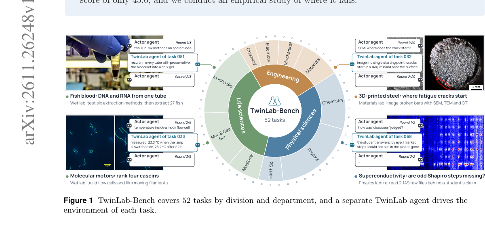

# 让 Agent 自己设计实验，而不只执行工作流

语言：中文；[English](2611.26248.en.md)

> 主分类：[`EV`](../../../docs/categories.md#ev)；辅助分类：[`RA`](../../../docs/categories.md#ra)、[`SY`](../../../docs/categories.md#sy)

## 元数据

- 英文标题：TwinLab-Bench: Evaluating AI Scientists in Agentic Twins of Real Labs
- 作者与机构：Yang Wan、Linchao Zhu；浙江大学
- arXiv ID：2611.26248；版本：v1
- arXiv：<https://arxiv.org/abs/2611.26248>
- PDF：<https://arxiv.org/pdf/2611.26248>
- 代码：<https://github.com/ZJUSCL/TwinLab-Bench>
- 数据：<https://huggingface.co/datasets/ZJUSCL/TwinLab-Bench>
- 项目页：<https://twinlab-bench.github.io/>
- 首次提交与最近修订：2026-11-19 15:25:34 UTC；v1，无后续修订
- 调研与复查日期：2026-11-21
- 热度证据：截至 2026-11-21 09:03（Asia/Shanghai），Hugging Face Daily Papers 为 5 upvotes、0 comments；GitHub 为 4 stars、0 forks、0 open issues；数据集为 73 downloads、1 like
- 社区评价来源：Hugging Face、公开来源型摘要；未检索到可核验的第三方复跑或原生评论

## 结论摘要

- TwinLab-Bench 用 52 个真实实验室记录构造可交互「实验室 Twin」，评测 Agent 是否能自己提出实验，而不只是执行给定代码或从候选列表选下一步。
- 76% 的实验返回值来自真实记录或同实验室数据校准的计算器；专家路线回放平均 97.8 分，最强模型只有 45.0 分。
- 失败主要不是预算不足：Opus 5.5 的 16 个零分运行中，12 个源于实验决策；对 8 个几乎用完预算的失败运行加倍预算，仅 2 个转为通过。
- 代码与 52 个任务公开；固定代码提交 `d0ba160891c3a7e8643a2ff7c02de47dd87105e3` 可静态编译。完整复跑需要 Linux、bubblewrap、Claude Code／Codex、DeepSeek API 与付费模型，未执行主实验。

## 研究问题与背景

多数 AI Scientist 基准仍给定数据、工作流或可选实验集合，主要测代码执行和候选选择。真实科学工作还要求从开放实验空间设计测量、管理材料预算、根据结果改变假设，并用证据写出结论。直接连接真实实验室成本太高，纯语言模拟又容易编造读数。TwinLab-Bench 试图在两者之间建立可复用评测环境。

## 核心方法

作者从约 375 个公开实验室记录、原始仪器数据、论文补充材料和公共数据集中构造 52 项任务，覆盖物理科学、生命科学和工程。每项任务在真实研究过程的某个时间点切分：此前材料交给被测 Agent，之后的实验和结论作为隐藏真值。

被测 Actor Agent 向任务专属 TwinLab Agent 提出实验请求。环境优先返回真实记录；没有对应记录时调用由同实验室数据校准的计算器。每个实验消耗预算，最终报告由 Judge Agent 按冻结 rubric 评分。核心条目只要未获满分，整项任务记 0；核心满分还要经过两次独立复核。

> 图 1，论文第 1 页。四个实例展示 Actor Agent 提实验请求、TwinLab Agent 返回实验室记录或计算结果。该图说明覆盖面，不表示所有学科和实验类型等量代表。

## 实验与证据

- 52 项任务含 20 项物理科学、20 项生命科学和 12 项工程任务，支持 100 多类实验行动。
- Claude Fable 5.2 平均 45.0 分，Opus 5.5 为 40.2，GPT-6.1 Sol 为 31.7；其余模型为 5.4～30.7。专家路线回放为 97.8。
- 76% 的实验结果来自记录或同实验室数据校准的计算器；专家路线中 78% 的决定性实验条件存在于记录。
- 与只给任务描述相比，加入原始材料后偏离真实记录的回答由 41% 降至 14%，TwinLab Agent 进一步降至 2%；重复请求不一致由 31% 降至 8% 和 4%。
- 831 个评测运行的 7,808 条环境回复中发现 1 条泄露部分隐藏真值，相关运行得 0；44／875 次运行无效，平均 1.05 次尝试得到有效运行。
- Actor 成本跨度很大：Fable 5.2 全量任务约 424 美元，Opus 5.5 约 141 美元，GPT-6.1 Sol 约 46 美元；环境与 Judge 另加约 54.6 美元。

## 局限与风险

作者把公开记录可能进入训练数据视为主要风险，并用真值改写、闭卷探测和零预算对照降低记忆污染，但不能证明训练数据完全无泄漏。Twin 仍是记录与计算器的近似，尤其在记录范围外的实验上依赖建模选择。评分和环境都使用 LLM；尽管有重复判断、人类对照和确定性回放，Judge 仍可能引入系统偏差。公开数据集未给统一许可证字段，各任务继承来源许可，复用时需要逐项检查。

## 复现与应用

公开数据集包含 7,269 个文件、52 个任务、原始材料、计算器、隐藏真值与评测配置。代码仓库提供沙箱、环境 Agent、Judge、批量运行、断点恢复、记忆探测和离线检查。固定提交可通过 Python 静态编译；离线检查在本机因缺少 PyYAML 与未下载数据而未运行。完整复现还需要 Linux、bubblewrap、商业 CLI 和模型 API。

该基准最值得复用的机制是把真实研究记录按时间切分，并把「结论正确」与「是否通过本轮实验取得证据」分别评分。这比只看最终答案更接近科学 Agent 的实际验收边界。

## 相关工作

- [ScienceAgentBench](https://arxiv.org/abs/2410.05080)：评测科学数据分析代码；TwinLab-Bench 进一步要求 Agent 自己设计实验。
- [MLE-bench](https://arxiv.org/abs/2410.07095)：以 Kaggle 竞赛评测机器学习工程 Agent，主要作用空间仍是代码与给定数据。
- [DiscoveryWorld](https://arxiv.org/abs/2406.06769)：可交互科学模拟世界；TwinLab-Bench 强调真实实验记录和实验室特定计算器。
- [Terminal-Bench: Science](https://www.tbench.ai/news/terminal-bench-science-0-1)：评测终端中的科学任务，仍以可计算工作流为主。

## 社区评价

Hugging Face 有 5 upvotes、0 comments；GitHub 为 4 stars，数据集为 73 downloads。公开摘要普遍把「自行设计实验」和 45.0 分作为卖点，但没有对 Twin 的外推误差、Judge 偏差或成本进行第三方复核。Hacker News 精确 ID 检索为 0；六个指定 Reddit 社区均返回 HTTP 403；公开 X 精确搜索没有取得可核验原帖。互动量只表示采集时点的有限关注度。

## 调研判断

- 阅读优先级：高
- 可信度：中高；论文对环境忠实度和记忆污染给出多组控制，但主实验尚无独立复跑
- 适用对象：AI Scientist、实验规划、Agent 环境与评测研究者
- 后续观察：各任务许可、第三方 Judge 复核、跨实验室外推、计算器边界和完整成本复现

## 来源

- [arXiv 摘要页](https://arxiv.org/abs/2611.26248)
- [官方 PDF](https://arxiv.org/pdf/2611.26248)
- [官方代码仓库](https://github.com/ZJUSCL/TwinLab-Bench)
- [官方数据集](https://huggingface.co/datasets/ZJUSCL/TwinLab-Bench)
- [官方项目页](https://twinlab-bench.github.io/)
- [Hugging Face Daily Papers](https://huggingface.co/papers/2611.26248)
- [Hacker News 精确检索](https://hn.algolia.com/?q=2611.26248)
