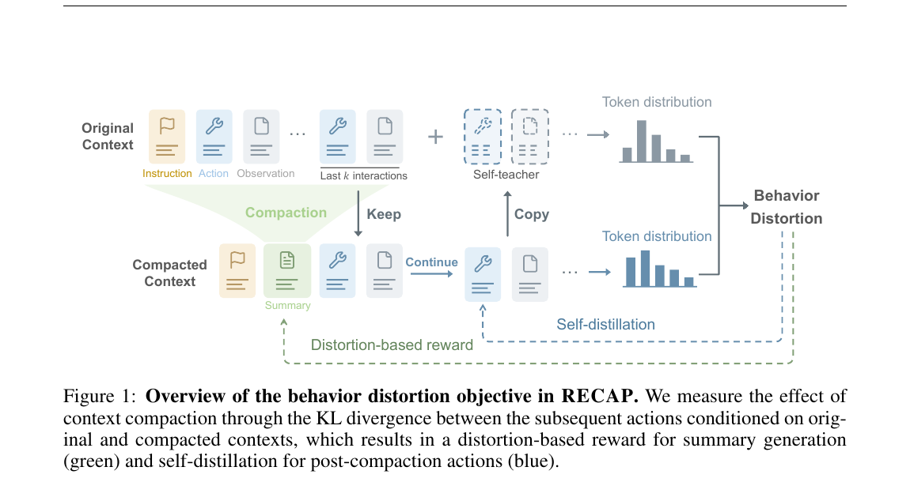

# Preserve Agent Behavior After Context Compaction

Language: English; [中文](2611.31258.md)

> Primary: [`AT`](../../../docs/categories.en.md#at); secondary: [`KM`](../../../docs/categories.en.md#km), [`SY`](../../../docs/categories.en.md#sy)

## Metadata

- Original title: RECAP: Training Long-horizon LLM Agents with Context Compaction
- Authors and affiliations: Yulun Jiang, Maria Brbic, and Michael Moor; EPFL and ETH Zurich
- arXiv ID: 2611.31258; version: v1
- arXiv: <https://arxiv.org/abs/2611.31258>
- PDF: <https://arxiv.org/pdf/2611.31258>
- Code: <https://github.com/eth-medical-ai-lab/recap>
- Project: <https://recap-site.github.io>
- First submission and latest revision: 2026-10-19; v1, with no later revision. The paper entered the target-category listing in the 2026-11-25 announcement batch
- Research and review date: 2026-11-26
- Popularity evidence: at 2026-11-26 09:03 Asia/Shanghai, Hugging Face Papers showed 1 upvote and two comments, one from an author and one third-party engineering critique. GitHub showed 1 star, 0 forks, and 1 open issue
- Community sources: one third-party Hugging Face comment; no exact Hacker News hit, while all six specified Reddit communities returned HTTP 403

## Conclusion summary

- RECAP does not train context compaction only from final task reward. It asks the compacted policy distribution to remain close to the full-history policy, producing learning signals for both the summary and post-compaction actions.
- With Qwen3.5-4B and a 32K working context, RECAP reaches 62.8% on BrowseComp-Plus and 51.1% on SWE-bench Verified, 4.6 and 4.3 points above GRPO with the same compaction setup.
- The paper covers executable deep-research and software-engineering environments and reports four-run averages, ablations, context-window sweeps, tool calls, and tokens. The evidence supports better compaction training, not broad cross-model generality.
- Author commit `a7bd9c05d2c0f822427e11daf8347ad9f01980d4` compiles statically and exposes training and evaluation code. There is no repository license, trained checkpoint, or main-result bundle; the default training setup uses 16 GPUs, and the main experiment was not independently rerun.

## Research question and background

Long-running agents eventually exceed their working context. A common harness replaces old interaction history with a summary, but final task reward is too sparse to identify which summary decision removed information needed many steps later. Existing end-to-end RL often asks one terminal reward to supervise both execution and summarization.

RECAP asks whether the behavioral difference between full and compacted histories can be measured directly and converted into local, dense supervision.

## Method

At the compaction threshold, the policy generates a summary and retains the task instruction, summary, and most recent interaction. The same policy under the full history acts as a self-teacher; the compacted policy is the student. Token-level KL divergence between their later action distributions defines behavior distortion.

The gradient yields two signals: a lower-distortion reward for summary generation and self-distillation for post-compaction actions. Both are combined with terminal task reward. This adds no environment interaction, but it does require extra teacher forward passes.

> Figure 1, page 2 of the paper PDF. The upper path is the full-history self-teacher and the lower path is the compacted policy. Green trains the summary and blue trains later actions. The figure explains the objective; it does not establish cross-model generality.

## Experiments and evidence

The study evaluates Qwen3.5-4B on 150 held-out BrowseComp-Plus questions and all 500 SWE-bench Verified tasks, with maximum interaction limits of 100 and 200 steps. Working context is 32K, total interaction budget is 128K, and up to three compactions are allowed. Accuracy is averaged over four runs.

The 128K no-compaction GRPO baseline scores 63.8% ± 3.0% and 55.5% ± 1.2%. The 32K compaction GRPO baseline scores 58.2% ± 1.5% and 46.8% ± 1.4%. RECAP reaches 62.8% ± 3.9% and 51.1% ± 1.0%. It closes much of the compaction gap but does not exceed 128K GRPO.

Summary reward alone lowers BrowseComp-Plus by 1.5 points and raises SWE-bench by 1.1. Post-compaction self-distillation alone reaches 60.3% and 47.1%; combining both is best. Gains are larger at 16K. The paper reports fewer tool calls and cumulative tokens, but does not convert the extra teacher computation into a complete training-cost comparison.

## Limitations and risks

The authors limit the claim to one 4B model, two task domains, and a small number of compactions. The full-history teacher is not always correct, so self-distillation can preserve its mistakes. SWE-bench trajectories are longer and more sensitive to the objective weight.

The study compares peak working context rather than total compute. Extra teacher inference and long summaries can erode the efficiency gain. A third-party Hugging Face commenter specifically asks for the compression ratio where behavior preservation fails and for mid-episode task-switch tests; neither is covered.

## Reproduction and application

The repository is based on `verl` v0.9.0 and provides data, training, evaluation, and Slurm configurations for BrowseComp-Plus and SWE-agent. Python files compile at commit `a7bd9c05d2c0f822427e11daf8347ad9f01980d4`. The reference stack is Linux, Python 3.12, CUDA 13, PyTorch 2.11, and vLLM 0.26; the default uses 16 GPUs, plus additional retrieval and judge GPUs for BrowseComp-Plus.

No trained checkpoint, result trajectories, or repository license is present. GPU dependencies were not installed and the main experiment was not rerun. A lower-cost first use is to treat the full-history policy as an offline behavioral reference and measure what compaction changes before training.

## Related work

- [CompactionRL](https://arxiv.org/abs/2607.05378) also jointly trains compaction and long-horizon behavior; RECAP adds behavior distortion and self-distillation.
- [SUPO](https://aclanthology.org/2026.acl-long.966/) trains policy-generated summaries from task reward; RECAP targets the resulting credit-assignment gap.
- [GrepMem](https://arxiv.org/abs/2611.25123) keeps a complete log for retrieval; RECAP remains lossy but learns to preserve downstream behavior.
- [Prune the Summary, Not the History](https://arxiv.org/abs/2610.20927) source-checks summary entries as a training-free post-process rather than training the policy.
- [SWE-bench](https://arxiv.org/abs/2310.06770) is RECAP's software-engineering environment and an important boundary on the claim.

## Community response

Hugging Face Papers showed 1 upvote and two comments. The author comment restates the method and headline results. A third-party commenter, Aamer Mihaysi, says the behavioral objective matches a production failure mode where readable summaries silently lose constraints, but asks for the compression-ratio failure point and mid-episode task switching. This is one English-language engineering perspective, not verified production evidence or consensus.

No exact arXiv-ID post was found on Hacker News. All six specified Reddit communities returned HTTP 403, and exact public Web and X searches produced no verifiable third-party original post. GitHub's 1 star and one open issue are attention signals, not quality evidence.

## Research judgment

- Reading priority: high
- Confidence: medium-high; protocol, four-run evaluation, and ablations are clear, while the main result is not independently reproduced
- Audience: agent-training, context-compaction, coding-agent, and deep-research-agent researchers and engineers
- Watch items: checkpoints, license, larger models, task switching, compression-ratio curves, and complete teacher-compute accounting

## Sources

- [arXiv abstract](https://arxiv.org/abs/2611.31258)
- [Official PDF](https://arxiv.org/pdf/2611.31258)
- [Author repository](https://github.com/eth-medical-ai-lab/recap)
- [Project page](https://recap-site.github.io)
- [Hugging Face Papers](https://huggingface.co/papers/2611.31258)
- [GitHub repository state](https://api.github.com/repos/eth-medical-ai-lab/recap)
- [Hacker News search](https://hn.algolia.com/?q=2611.31258)
