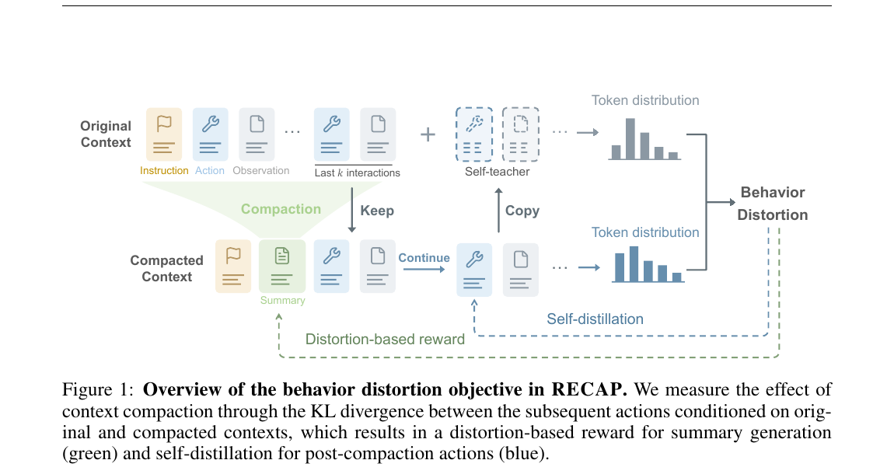

# 让压缩后的 Agent 保持原有行为

语言：中文；[English](2611.31258.en.md)

> 主分类：[`AT`](../../../docs/categories.md#at)；辅助分类：[`KM`](../../../docs/categories.md#km)、[`SY`](../../../docs/categories.md#sy)

## 元数据

- 英文标题：RECAP: Training Long-horizon LLM Agents with Context Compaction
- 作者与机构：Yulun Jiang、Maria Brbic、Michael Moor；EPFL、ETH Zurich
- arXiv ID：2611.31258；版本：v1
- arXiv：<https://arxiv.org/abs/2611.31258>
- PDF：<https://arxiv.org/pdf/2611.31258>
- 代码：<https://github.com/eth-medical-ai-lab/recap>
- 项目页：<https://recap-site.github.io>
- 首次提交与最近修订：2026-10-19；v1，无后续修订。论文在 2026-11-25 公布批次进入目标分类列表
- 调研与复查日期：2026-11-26
- 热度证据：截至 2026-11-26 09:03（Asia/Shanghai），Hugging Face Papers 为 1 upvote、2 条评论；其中 1 条是作者介绍，1 条是第三方工程质疑。GitHub 为 1 star、0 forks、1 open issue
- 社区评价来源：Hugging Face Papers 的 1 条第三方评论；Hacker News 无精确命中，六个指定 Reddit 社区均返回 HTTP 403

## 结论摘要

- RECAP 不只用最终任务奖励训练上下文压缩，而是要求压缩后的策略分布尽量接近完整历史下的策略分布；该「行为失真」目标同时给摘要生成和压缩后动作提供训练信号。
- 在 Qwen3.5-4B、32K 工作上下文下，RECAP 在 BrowseComp-Plus 和 SWE-bench Verified 上分别达到 62.8% 与 51.1%，比同样启用压缩的 GRPO 高 4.6 和 4.3 个百分点。
- 论文覆盖深度检索与软件工程两个可执行环境，并报告四次评测均值、消融、不同上下文长度和工具调用／token 开销；证据支持「更好的压缩训练」，但不足以证明跨模型、跨任务通用。
- 作者仓库固定提交 `a7bd9c05d2c0f822427e11daf8347ad9f01980d4` 可静态编译，训练与评测脚本公开；没有许可证、训练后 checkpoint 或主实验结果包，默认训练需要 16 张 GPU，主结果未独立复跑。

## 研究问题与背景

长时程 Agent 的交互历史会超过工作上下文。常见做法是把旧历史压缩成摘要，再继续执行；但最终任务奖励很稀疏，难以判断某次摘要究竟删掉了哪条会影响后续决策的信息。现有端到端强化学习通常让任务成功同时监督执行策略和摘要，压缩决策的影响可能隔着许多动作甚至多轮压缩才显现。

RECAP 的问题是：能否直接度量压缩前后「后续行为是否一致」，并把这个差异变成局部、密集的训练信号。

## 核心方法

当工作上下文达到阈值时，策略生成摘要，保留任务说明、摘要和最近一次交互。完整历史下的同一策略作为 self-teacher；压缩历史下的策略作为 student。论文用两者后续动作 token 分布的 KL 散度定义行为失真。

梯度分解得到两项互补信号：第一项把较小的行为失真作为摘要生成的奖励，训练模型保留会改变后续决策的信息；第二项对压缩后的动作做自蒸馏，使 student 接近完整历史下的 teacher。两项再与最终任务奖励共同优化，不增加环境交互次数，但需要额外 teacher 前向计算。

> 图 1，论文 PDF 第 2 页。上路是完整历史下的 self-teacher，下路是压缩后的策略；绿色信号训练摘要，蓝色信号训练压缩后的动作。该图解释训练目标，不证明跨模型有效性。

## 实验与证据

实验使用 Qwen3.5-4B，在 BrowseComp-Plus 的 150 个留出问题和 SWE-bench Verified 的 500 个任务上评测；最大交互步数分别为 100 和 200。工作上下文为 32K，任务总交互预算为 128K，最多压缩三次；准确率按四次运行求均值和标准差。

主表中，不压缩的 128K GRPO 在两项任务上为 63.8% ± 3.0% 和 55.5% ± 1.2%；32K 压缩 GRPO 为 58.2% ± 1.5% 和 46.8% ± 1.4%；RECAP 为 62.8% ± 3.9% 和 51.1% ± 1.0%。因此 RECAP 明显缩小压缩相对完整上下文的差距，但仍未超过同模型 128K GRPO。

消融显示，只加入摘要奖励时 BrowseComp-Plus 下降 1.5 个百分点、SWE-bench Verified 上升 1.1 个百分点；只加入压缩后动作自蒸馏时达到 60.3% 与 47.1%；两项共同使用最好。16K 上下文下优势更明显。论文还报告 RECAP 平均使用更少工具调用和累计 token，但没有把额外 teacher 前向计算折算为完整训练成本。

## 局限与风险

作者明确指出只评测一个 4B 模型、两个任务域和有限压缩次数，尚未覆盖更大模型、更长轨迹和其他环境。完整历史策略被当作 teacher，但它并不总是正确；自蒸馏可能保留 teacher 的错误。SWE-bench 的轨迹更长，超参数对结果更敏感。

调研进一步认为，论文比较的是峰值工作上下文，不是完整计算成本。行为失真需要额外 teacher 前向；若摘要很长或压缩频繁，推理与训练收益可能缩小。Hugging Face 第三方评论也提出应报告压缩比失效点，并测试任务中途切换；这些问题在当前实验中没有覆盖。

## 复现与应用

作者仓库基于 `verl` v0.9.0，公开 BrowseComp-Plus 与 SWE-agent 的训练、评测、数据准备和 Slurm 配置。固定提交 `a7bd9c05d2c0f822427e11daf8347ad9f01980d4` 的 Python 文件静态编译通过。README 指定 Linux、Python 3.12、CUDA 13、PyTorch 2.11、vLLM 0.26，并默认使用 16 张 GPU；BrowseComp-Plus 的检索和判分服务还需额外 GPU。

当前没有训练后 checkpoint、结果轨迹或许可证，因此本次没有安装 GPU 依赖，也没有复跑主实验。工程应用可先把「完整历史策略作为压缩后策略的行为参照」用于离线评估；若直接训练，应同时记录摘要长度、额外前向计算、任务切换和权限约束是否被保留。

## 相关工作

- [CompactionRL](https://arxiv.org/abs/2607.05378)：同样联合训练压缩与长程 Agent；RECAP 的区别是增加行为失真与自蒸馏信号。
- [SUPO](https://aclanthology.org/2026.acl-long.966/)：使用任务奖励训练摘要策略；RECAP 针对稀疏信用分配加入局部监督。
- [GrepMem](https://arxiv.org/abs/2611.25123)：保留完整日志并按需检索，强调可恢复原始细节；RECAP 仍使用有损摘要，但学习保留后续行为。
- [Prune the Summary, Not the History](https://arxiv.org/abs/2610.20927)：用来源核验修剪压缩摘要，属于训练外后处理；RECAP 是端到端训练方法。
- [SWE-bench](https://arxiv.org/abs/2310.06770)：RECAP 的软件工程评测环境，也是当前结论的重要边界。

## 社区评价

Hugging Face Papers 截至采集时为 1 upvote、2 条评论。作者评论重述方法和主结果，属于作者主张。第三方评论者 Aamer Mihaysi 转述其生产 Agent 经验，认可「行为失真」比人工可读摘要更接近真实目标，但质疑没有报告压缩比的失效点，并建议增加任务中途切换测试；这是单个英文社区用户的工程观点，未验证其生产数据，也不构成共识。

Hacker News 没有包含该 arXiv ID 的精确帖子；六个指定 Reddit 社区均返回 HTTP 403；公开 Web 与 X 精确检索没有取得可核验的第三方原帖。GitHub 的 1 star 和 1 个 open issue 只表示采集时点关注度。

## 调研判断

- 阅读优先级：高
- 可信度：中高；论文协议、四次评测和消融较完整，主结果尚未独立复现
- 适用对象：Agent 训练、上下文压缩、Coding Agent 与深度研究 Agent 工程人员
- 后续观察：训练后 checkpoint、许可证、更大模型、任务切换、压缩比—性能曲线，以及额外 teacher 计算的完整成本

## 来源

- [arXiv 摘要页](https://arxiv.org/abs/2611.31258)
- [官方 PDF](https://arxiv.org/pdf/2611.31258)
- [作者代码仓库](https://github.com/eth-medical-ai-lab/recap)
- [作者项目页](https://recap-site.github.io)
- [Hugging Face Papers 页面](https://huggingface.co/papers/2611.31258)
- [GitHub 仓库状态](https://api.github.com/repos/eth-medical-ai-lab/recap)
- [Hacker News 检索](https://hn.algolia.com/?q=2611.31258)
