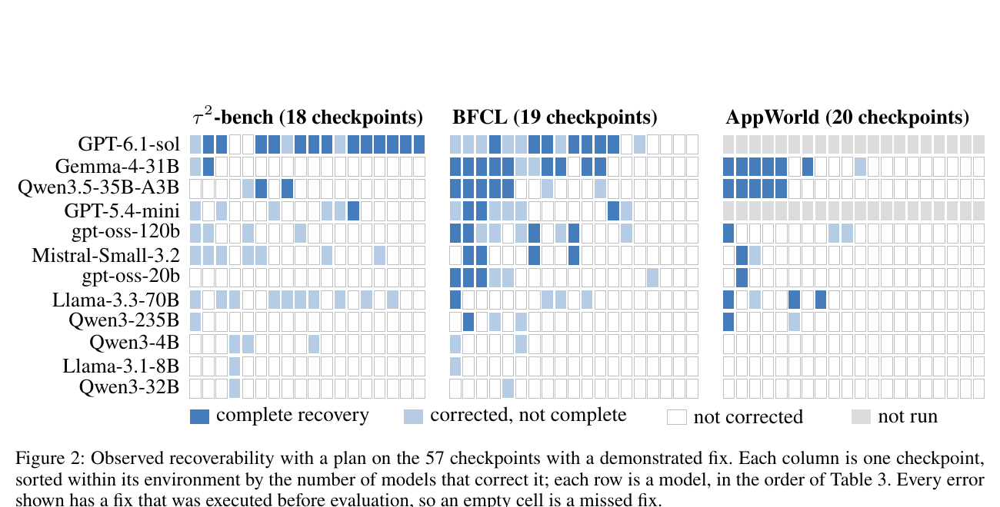

# Correction Is Not Complete Recovery

Language: English; [中文](2611.31586.md)

> Primary: [`EV`](../../../docs/categories.en.md#ev); secondary: [`SS`](../../../docs/categories.en.md#ss), [`TU`](../../../docs/categories.en.md#tu)

## Metadata

- Original title: SecondChance: Benchmarking Reliable Error Recovery in AI Agents
- Authors and affiliation: Atahan Dokme, Adar Avsian, and Larry Heck; Georgia Institute of Technology, AI Virtual Assistant Lab
- arXiv ID: 2611.31586; version: v1
- arXiv: <https://arxiv.org/abs/2611.31586>
- PDF: <https://arxiv.org/pdf/2611.31586>
- Code: <https://github.com/atahandokme/secondchance>
- Data: <https://huggingface.co/datasets/atahandokme/secondchance>
- First submission and latest revision: 2026-11-23; v1, with no later revision
- Research and review date: 2026-11-26
- Popularity evidence: at 2026-11-26 09:03 Asia/Shanghai, Hugging Face Papers showed 0 upvotes and 0 comments; the dataset showed 32 downloads and 0 likes; GitHub showed 0 stars, 0 forks, and 0 open issues
- Community sources: no verifiable third-party human discussion; no exact Hacker News hit, while all six specified Reddit communities returned HTTP 403

## Conclusion summary

- SecondChance builds 129 restorable checkpoints from natural errors made in agents' own task attempts, then resumes each under unaided, notified, localized, and plan-assisted conditions.
- Twelve models were scheduled for 5,760 main-study continuations. The best model, GPT-6.1-sol, completes 16% unaided and 27% with a plan; merely announcing or locating the error usually changes little.
- Correction, remaining-task completion, policy compliance, protected-state preservation, and durability must be measured separately. Forty of 84 successful AppWorld continuations retain the original error, while Llama-3.3-70B corrects 26% of plan-assisted τ² errors but completes no recovery.
- At commit `b0f18c799aa08907c00573c053a47937d4345d91`, all 1,652 printed table values and 684 Figure 2 cells reproduce exactly; local tests report 33 passed and 134 skipped. This verifies artifact consistency, not an independent rerun of the model calls.

## Research question and background

Most agent benchmarks start clean and score final task completion. Existing recovery benchmarks often inject visible tool failures. Real agents can instead receive successful tool responses while modifying the wrong entity, field, or record. Later correction may still leave the user goal unfinished, violate policy, damage unrelated state, or be undone.

SecondChance changes the unit of evaluation: from whether a task eventually passes to whether an agent discovers, repairs, preserves the repair, and finishes from the same natural error state.

## Method

From 4,568 source episodes in τ²-bench, BFCL, and AppWorld, the authors retain 129 checkpoints: 38 τ², 37 BFCL, and 54 AppWorld. Each stores the post-error history and restorable state. Fixability is classified as demonstrated for 57, impossible for 15, and unknown for 57.

Each model continues from the same checkpoint under four assistance conditions: none, error notice, error location, and specific repair plan. Scoring separates correction, task success, policy and protected state, correction durability, user disclosure, and calls, tokens, and cost after the checkpoint.

## Experiments and evidence

The main study spans 12 models, 129 checkpoints, and four conditions, with one run per cell in principle: 5,760 scheduled and 5,748 used. GPT-6.1-sol moves from 16% complete recovery unaided to 27% with a plan. The next highest plan-assisted rates are 12% for Gemma-4-31B and 9% for Qwen3.5-35B-A3B. Pooled over models, the first three conditions are about 2%; plan assistance reaches 5%.

Localization alone has little effect. Across models, τ² corrections rise from 9 unaided, 11 notified, and 14 localized to 54 with a plan; BFCL rises from 11 to 72 and AppWorld from 8 to 25. Even among 57 checkpoints with a demonstrated fix, 12 are never corrected by any model.

> Figure 2, page 7 of the paper PDF. Dark blue is complete recovery, light blue is correction without complete recovery, and empty cells are missed fixes known to exist. The figure covers only 57 demonstrated-fix checkpoints and does not estimate the natural distribution of all agent errors.

## Limitations and risks

The 129 checkpoints form a selected evaluation population, not an error-rate estimate. Mechanical screening and an AI scan retain 102; 27 receive individual review. The pipeline focuses on observable state effects and may retain earlier information-only errors in history. Demonstrated fixes are often single-field or single-effect; 57 checkpoints still have unknown fixability.

The main study has one run per cell. Three-sample repeats and GPT-5.5 cover only 37 checkpoints. AppWorld uses only open-weight models; hosted models come from one provider, and one uses an undated alias. Complete recovery also depends on a fixed Qwen3-235B judge plus author adjudication, while acknowledgment has limited human validation.

## Reproduction and application

The repository releases code under Apache 2.0 and annotations/results under CC BY 4.0, with checkpoints, frozen condition texts, results, scoring rules, dependency revisions, and hashes. At commit `b0f18c799aa08907c00573c053a47937d4345d91`, `scripts/verify.py` reproduces all 19 tables and Figure 2: 1,652 table values and 684 cells all match. `pytest -q` reports 33 passed and 134 skipped, and Python compilation passes.

Skipped tests require τ²/BFCL environments, external models, full state, or the judge. These checks establish internal consistency, not an independent rerun of 5,760 model continuations. The dataset showed 32 downloads and 0 likes at collection time.

For engineering use, add checkpoint replay to regression testing and verify error removal, remaining goals, authorization and policy, unrelated state, and repair durability rather than only final task score.

## Related work

- [τ²-bench](https://arxiv.org/abs/2506.07982) provides dual-control user-policy environments from which SecondChance extracts natural failures.
- [AppWorld](https://arxiv.org/abs/2407.18901) provides executable cross-application state used for recovery evaluation.
- [CUA-Recovery](https://arxiv.org/abs/2610.27645) studies recovery from agents' own computer-use errors; SecondChance expands to tool agents, users, and multidimensional recovery.
- [UndoBench](https://arxiv.org/abs/2605.03596) studies undoing state changes but mainly injects faults; SecondChance emphasizes natural silent errors.
- [ParaRecover](https://arxiv.org/abs/2606.16748) localizes parallel tool-use errors; SecondChance additionally requires task completion and policy-state preservation.

## Community response

No verifiable third-party human comment, independent rerun, or public researcher response was found. Hugging Face Papers showed 0 upvotes and 0 comments. No exact arXiv-ID post was found on Hacker News; all six specified Reddit communities returned HTTP 403; exact public Web and X searches produced no third-party original post. Access gaps do not establish that no discussion exists.

GitHub's 0 stars and the dataset's 32 downloads are early attention signals only. The low recovery rates are author results; local recomputation confirms the released tables, not community reproduction.

## Research judgment

- Reading priority: high
- Confidence: high; definitions, checkpoints, results, recomputation, and licenses are strong, while model continuations were not independently rerun
- Audience: agent evaluation, reliability, safety, tool-use, and user-interaction researchers and engineers
- Watch items: broader natural-error sources, cross-provider hosted models, more repeated runs, judge-human agreement, and production error coverage

## Sources

- [arXiv abstract](https://arxiv.org/abs/2611.31586)
- [Official PDF](https://arxiv.org/pdf/2611.31586)
- [Author repository](https://github.com/atahandokme/secondchance)
- [Hugging Face dataset](https://huggingface.co/datasets/atahandokme/secondchance)
- [Hugging Face Papers](https://huggingface.co/papers/2611.31586)
- [GitHub repository state](https://api.github.com/repos/atahandokme/secondchance)
- [Hacker News search](https://hn.algolia.com/?q=2611.31586)
