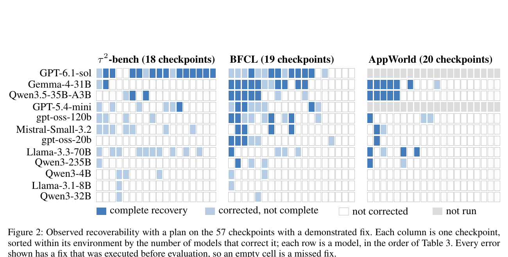

# 纠错不等于完成恢复

语言：中文；[English](2611.31586.en.md)

> 主分类：[`EV`](../../../docs/categories.md#ev)；辅助分类：[`SS`](../../../docs/categories.md#ss)、[`TU`](../../../docs/categories.md#tu)

## 元数据

- 英文标题：SecondChance: Benchmarking Reliable Error Recovery in AI Agents
- 作者与机构：Atahan Dokme、Adar Avsian、Larry Heck；Georgia Institute of Technology, AI Virtual Assistant Lab
- arXiv ID：2611.31586；版本：v1
- arXiv：<https://arxiv.org/abs/2611.31586>
- PDF：<https://arxiv.org/pdf/2611.31586>
- 代码：<https://github.com/atahandokme/secondchance>
- 数据：<https://huggingface.co/datasets/atahandokme/secondchance>
- 首次提交与最近修订：2026-11-23；v1，无后续修订
- 调研与复查日期：2026-11-26
- 热度证据：截至 2026-11-26 09:03（Asia/Shanghai），Hugging Face Papers 为 0 upvotes、0 comments；数据集 32 downloads、0 likes；GitHub 为 0 stars、0 forks、0 open issues
- 社区评价来源：未检索到可核验的第三方人工讨论；Hacker News 无精确命中，六个指定 Reddit 社区均返回 HTTP 403

## 结论摘要

- SecondChance 从 Agent 自身真实任务尝试中的自然错误建立 129 个可恢复检查点，分别在无提示、告知错误、定位错误和提供修复计划四种条件下继续执行。
- 12 个模型共安排 5,760 次主实验 continuation。最佳模型 GPT-6.1-sol 在无辅助时只有 16% 完整恢复，提供计划后为 27%；仅告知错误或位置通常几乎不改变结果。
- 「修正错误」「完成剩余任务」「遵守政策」「保留受保护状态」必须分开测量：AppWorld 的 84 次任务成功 continuation 中有 40 次仍保留原错误，Llama-3.3-70B 在计划辅助下修正 26% 的 τ² 错误，却没有一次完整恢复。
- 固定提交 `b0f18c799aa08907c00573c053a47937d4345d91` 的 19 张表和图 2 共 1,652 个表格数值、684 个图格全部重算一致；本地测试为 33 passed、134 skipped。跳过项主要依赖外部环境、模型和可选数据，不等同于主实验独立重跑。

## 研究问题与背景

多数 Agent 基准从干净状态开始，只看最终任务是否完成；现有恢复评测又常注入工具失败或删除响应，使错误天然可见。现实中的 Agent 往往收到成功响应，却修改了错误对象、错误字段或不该修改的记录。即使后来纠正，仍可能没有完成用户目标、违反政策、破坏其他状态，或再次撤销修复。

SecondChance 将评测单位从「任务是否成功」改为「从同一自然错误状态继续后，Agent 是否发现、修复、保持修复并完成任务」。

## 核心方法

作者从 τ²-bench、BFCL 和 AppWorld 的 4,568 个源 episode 中筛出 129 个检查点：38 个 τ²、37 个 BFCL、54 个 AppWorld。每个检查点保存错误发生后的历史和可恢复状态，并记录修复可行性：57 个有已执行的修复、15 个被证明无法修复、57 个未知。

每个模型从同一检查点在四种条件下继续：无辅助、只告知发生错误、指出错误位置、给出具体修复计划。评分区分错误是否被纠正、任务是否成功、政策与受保护状态是否保持、修复是否持续、是否告知用户，以及从检查点开始的调用、token 和成本。

## 实验与证据

主实验覆盖 12 个模型和 129 个检查点，每个模型—检查点—条件原则上运行一次，共安排 5,760 次，实际使用 5,748 次。汇总结果中，GPT-6.1-sol 的完整恢复率从无辅助 16% 上升到计划辅助 27%；其余模型计划辅助下最高为 Gemma-4-31B 的 12% 和 Qwen3.5-35B-A3B 的 9%。所有模型汇总时，无辅助、告知和定位三种条件均约为 2%，计划辅助为 5%。

错误定位本身帮助有限。跨模型汇总，τ² 的修正次数从无辅助 9 次、告知 11 次、定位 14 次提高到计划辅助 54 次；BFCL 从 11 次提高到 72 次；AppWorld 从 8 次提高到 25 次。即使在 57 个存在已知修复的检查点上，仍有 12 个没有任何模型修正。

> 图 2，论文 PDF 第 7 页。深蓝表示完整恢复，浅蓝表示只修正错误但未完成恢复；空格表示已知修复存在但模型未修正。该图只覆盖 57 个有已执行修复的检查点，不代表所有 Agent 错误的自然分布。

## 局限与风险

作者明确指出 129 个检查点是选择性评测集，不估计 Agent 产生错误的总体频率。102 个检查点由机械筛选和 AI 扫描保留，27 个逐项人工复核；主要覆盖可观察状态变化，纯信息错误可能留在历史中。57 个有已知修复的错误多为单字段或单效果，修复可行性仍有 57 个未知。

主实验每个 cell 只有一次运行；三次重复和 GPT-5.5 对比只覆盖 37 个检查点。AppWorld 只测试开源权重模型；托管模型来自单一供应商，其中一个使用未定日期的别名。完整恢复还依赖固定 Qwen3-235B 判分器和作者复核，部分 acknowledgment 指标缺少充分人工验证。

## 复现与应用

仓库以 Apache 2.0 发布代码，结果与标注为 CC BY 4.0，并附 129 个主检查点、条件文本、结果、评分规则、依赖 revision 与哈希。固定提交 `b0f18c799aa08907c00573c053a47937d4345d91` 下，`scripts/verify.py` 重算 19 张表与图 2，1,652 个表格数值和 684 个图格全部匹配论文；`pytest -q` 为 33 passed、134 skipped。Python 静态编译也通过。

跳过项需要 τ²／BFCL 环境、外部模型、完整状态或判分器，因此本次验证证明的是发布工件内部一致性，不是 5,760 次模型 continuation 的独立复跑。数据集采集时为 32 downloads、0 likes。

工程上可把 checkpoint 恢复加入 Agent 回归测试：同一错误状态分别测试无辅助、定位和修复计划；验收同时检查错误消除、剩余目标、权限／政策、无关状态和修复持久性，避免只看最终任务分数。

## 相关工作

- [τ²-bench](https://arxiv.org/abs/2506.07982)：提供带用户和政策的双控制环境；SecondChance 从其自然失败中提取检查点。
- [AppWorld](https://arxiv.org/abs/2407.18901)：提供跨应用状态与可执行任务；SecondChance 用其历史错误测试恢复。
- [CUA-Recovery](https://arxiv.org/abs/2610.27645)：评测计算机使用 Agent 的自身错误恢复；SecondChance 扩展到工具 Agent、用户交互和多维恢复条件。
- [UndoBench](https://arxiv.org/abs/2605.03596)：研究撤销状态变化，但主要使用注入故障；SecondChance 强调自然、静默错误。
- [ParaRecover](https://arxiv.org/abs/2606.16748)：定位并恢复并行工具调用错误；SecondChance 同时要求继续完成用户任务和保持政策状态。

## 社区评价

未检索到可核验的第三方人工评论、独立复跑或研究者公开回应。Hugging Face Papers 页面为 0 upvotes、0 comments；Hacker News 没有包含 arXiv ID 的精确帖子；六个指定 Reddit 社区均返回 HTTP 403；公开 Web 与 X 精确检索没有取得第三方原帖。访问缺口不代表不存在讨论。

GitHub 0 stars、数据集 32 downloads 只表示发布初期的关注度。论文的低恢复率来自作者实验；本地重算只验证公开结果与论文表格一致，不是社区复现。

## 调研判断

- 阅读优先级：高
- 可信度：高；评测定义、检查点、结果、表格重算和许可证完整，主模型调用尚未独立重跑
- 适用对象：Agent 评测、可靠性、安全、工具调用和用户交互系统工程人员
- 后续观察：更多自然错误来源、跨供应商托管模型、多次重复、判分器人工一致性，以及真实生产错误的覆盖率

## 来源

- [arXiv 摘要页](https://arxiv.org/abs/2611.31586)
- [官方 PDF](https://arxiv.org/pdf/2611.31586)
- [作者代码仓库](https://github.com/atahandokme/secondchance)
- [Hugging Face 数据集](https://huggingface.co/datasets/atahandokme/secondchance)
- [Hugging Face Papers 页面](https://huggingface.co/papers/2611.31586)
- [GitHub 仓库状态](https://api.github.com/repos/atahandokme/secondchance)
- [Hacker News 检索](https://hn.algolia.com/?q=2611.31586)
