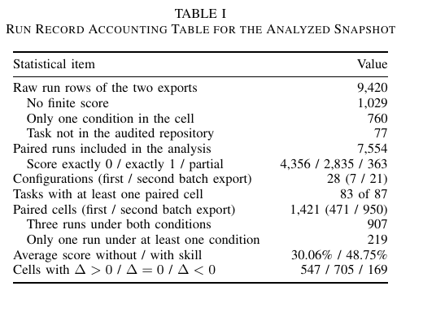

# What Skill Lift May Actually Measure

[中文](2611.33943.md) | English

> Primary: [`EV`](../../../docs/categories.en.md#ev); secondary: [`SE`](../../../docs/categories.en.md#se), [`TU`](../../../docs/categories.en.md#tu)

## Metadata

- Original title: What Does Skill Lift Actually Measure? A Source-Code-Level Audit and Noise-Aware Reanalysis of SkillsBench
- Authors and affiliations: Haozhe Zhang, Trine University; Zhen Long, National University of Singapore.
- arXiv: [2611.33943](https://arxiv.org/abs/2611.33943); [PDF](https://arxiv.org/pdf/2611.33943)
- Version and dates: v1; first submission and latest revision 2026-11-25 08:02:04 UTC; researched and checked 2026-11-27.
- Code and data: [official repository](https://github.com/rrrrr4788/skillsbench-lift-reanalysis), checked at `6c06531a06cf1912f7981d282d4be7f7938c521c`, MIT. It includes normalized tables, audit records, scripts, and frozen outputs; original SkillsBench tasks and trajectories remain external dependencies.
- Popularity evidence: Hugging Face Papers returned 404; GitHub had 0 stars, 0 forks, and 0 open issues; Hacker News had no exact arXiv-ID hit. Collected 2026-11-27 10:50 Asia/Shanghai.
- Community sources: no verifiable third-party human response. The Latest in AI mirrors the abstract and resources and is not counted as an independent evaluation.

## Conclusion summary

- The audit turns 9,420 raw SkillsBench rows into 7,554 public trials and 1,421 paired cells, showing that reported skill lift mixes real help, grader dependence, missing skill content, harness-injected skills, and sampling noise.
- Three tasks with clear instruction-evaluation gaps average 74.6 points of lift versus 18.7 overall. A few coupled tasks can materially shape the aggregate impression.
- None of 17 negative-lift tasks is significant after multiple-testing correction. With at most three runs per condition, 58% of cells could not arithmetically show a decrease, so counts of negative tasks do not establish harm.
- A gate based on no-skill score appears to gain 2–3 points in logs, but gains 4–7 points even after condition-label shuffling removes skill effects; it shows no significant gain on held-out runs.

## Research question and background

SkillsBench reports average gains from skill packages and decreases on some tasks. Later work treats these task-level differences as signals for loading or removing skills. This paper asks whether the largest gains reflect general capability or grader coupling, whether apparent decreases exceed run noise, and whether a gate trained on those differences generalizes.

## Method

- Audit task prompt, oracle, verifier, and skill package at source level to locate grading requirements declared only in skills.
- Normalize two public exports into configuration-by-task cells and retain cells containing both no-skill and with-skill runs.
- Run within-cell label-permutation tests over 83 paired tasks and control FDR at 10%.
- Evaluate gating through log replay, shuffled-label replay, and held-out runs to separate in-sample fit, selection bias, and generalization.

## Experiments and evidence

- From 9,420 rows, 1,029 lack finite scores, 760 lack one condition, and 77 refer to tasks outside the audited repository. The analysis retains 7,554 runs, 1,421 cells, and 83 of 87 tasks.
- Average no-skill and with-skill scores are 30.06% and 48.75%; 547 cells improve, 705 tie, and 169 decline. In 219 cells, at least one side has only one run.
- The three retained instruction-evaluation gaps cover 63 of 1,421 cells but account for 18% of cumulative positive lift, averaging 74.6 points.
- Twenty-six tasks are significant and all are positive. The most negative task averages -13.6 points but has two-sided p=0.30. Non-significance does not prove safety; the evidence is insufficient for a task-level harm claim.
- At the fixed commit, `check_inputs.py` passed all seven primary identity checks. `verify_paper_numbers.py` ran 134 checks: 130 passed and four exact-text expectations were MISSING. Most key values recompute, but the checker and manuscript are not perfectly synchronized.

## Limitations and risks

The analysis uses a frozen public snapshot, not all later SkillsBench runs, and some configurations cover only part of the task set. At most three runs per condition yield low task-level power. Only two of three grading-gap cases have controlled verifier experiments. The held-out gate data still comes from the same benchmark distribution.

The repository enables recomputation from normalized data but does not vendor every upstream trajectory and task file. Four MISSING checks mean the verifier is high coverage, not a fully closed 134/134 manuscript check.

## Reproduction and application

The work provides a practical audit pattern: freeze the run manifest; compare prompt, skill, verifier, and harness; report repeat counts and detectable effects; and validate gates on independent runs or tasks. Negative task lift should not be used directly as a deletion signal in a skill marketplace or automatic selector.

## Related work

- SkillsBench is the audited benchmark and source of the original aggregate and task-level lift claims.
- Agent-skill and coding-agent harness work determines whether skills are loaded and whether built-ins contaminate the treatment.
- Permutation tests and multiple-testing control constrain small-sample task-level claims.
- Data-driven skill gating is the downstream use case shown to be vulnerable to reuse of the same noisy logs.

## Community response

No verifiable third-party human response was found. The Hugging Face paper page returns 404, Hacker News has no exact hit, and all six specified Reddit communities returned HTTP 403. The Latest in AI only mirrors the paper. The available evidence supports no community-consensus claim.

## Figures and tables from the paper

Table I, paper page 2, from the official PDF. It defines the path from 9,420 raw rows to 7,554 included runs and 1,421 paired cells and shows that 219 cells have only one run on at least one side. It documents sample structure, not a causal skill effect by itself.

## Research judgment

- Priority: high. The conclusions directly affect interpretation of skill benchmarks, negative lift, and automatic gating.
- Confidence: medium-high. Audit records, normalized data, and scripts are public; small samples, upstream dependencies, and four text-check gaps constrain completeness.
- Audience: coding-agent, skill-system, benchmark, and gate/router researchers.
- Watch next: upstream fixes for grader coupling and placeholder skills, higher-repeat estimates of negative lift, and cross-task/model held-out gating.
- Score: relevance 25/25, contribution 22.5/25, evidence 18/20, reproducibility 12/15, freshness 10/10, popularity 0.5/5; total 88/100.

## Sources

- [arXiv](https://arxiv.org/abs/2611.33943)
- [Official PDF](https://arxiv.org/pdf/2611.33943)
- [Official code and audit repository](https://github.com/rrrrr4788/skillsbench-lift-reanalysis)
- [The Latest in AI mirror](https://thelatestinai.com/papers/2611.33943)
