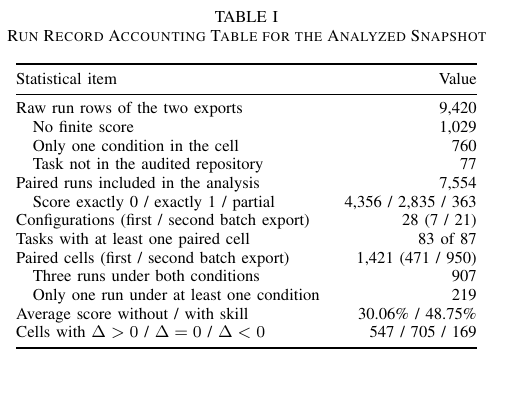

# 技能增益可能测到了什么

语言：中文；[English](2611.33943.en.md)

> 主分类：[`EV`](../../../docs/categories.md#ev)；辅助分类：[`SE`](../../../docs/categories.md#se)、[`TU`](../../../docs/categories.md#tu)

## 元数据

- 英文标题：What Does Skill Lift Actually Measure? A Source-Code-Level Audit and Noise-Aware Reanalysis of SkillsBench
- 作者与机构：Haozhe Zhang（Trine University）、Zhen Long（National University of Singapore）。
- arXiv：[2611.33943](https://arxiv.org/abs/2611.33943)；[PDF](https://arxiv.org/pdf/2611.33943)
- 版本与时间：v1；首次提交与最近修订均为 2026-11-25 08:02:04 UTC；调研与复查日期为 2026-11-27。
- 代码与数据：[官方仓库](https://github.com/rrrrr4788/skillsbench-lift-reanalysis)，核对提交 `6c06531a06cf1912f7981d282d4be7f7938c521c`；MIT。仓库包含规范化表、审计记录、分析脚本和冻结输出，原始 SkillsBench 任务与轨迹仍是外部依赖。
- 热度证据：Hugging Face Papers 页面为 404；GitHub 为 0 stars、0 forks、0 open issues；Hacker News 精确 arXiv ID 检索为 0 条。采集时间：2026-11-27 10:50（Asia/Shanghai）。
- 社区评价来源：未检索到可核验的第三方人工评价；The Latest in AI 页面只镜像论文摘要和资源，不计作独立评价。采集时间同上。

## 结论摘要

- 论文审计 SkillsBench 的 9,420 条原始记录，从 7,554 次公开 trial 构造 1,421 个配对单元，发现基准报告的平均技能增益混合了真实帮助、评分器依赖、技能内容缺失、harness 内置技能与抽样噪声。
- 三个有明确「指令—评分缺口」证据的任务平均提升 74.6 个百分点，而全体平均提升为 18.7 个百分点；少量评分耦合任务会显著放大总体印象。
- 17 个负向任务在多重检验校正后均不显著。每个条件最多只有 3 次运行，58% 的配对单元在算术上不可能呈现下降，因此「有多少任务下降」不能直接证明技能有害。
- 基于无技能分数的 gate 在日志上看似提高 2～3 个百分点，但打乱条件标签、消除技能效应后仍能得到 4～7 个百分点；留出运行上没有显著提升。基于同一噪声数据选 gate 再评 gate，会产生选择偏差。

## 研究问题与背景

SkillsBench 把技能包视为 Coding Agent 按需加载的说明、参考资料和脚本，并报告技能平均提升及部分任务下降。后续工作开始把这些任务级差值当作门控或删除技能的信号。本文追问：最大提升究竟来自通用能力还是评分器与技能内容耦合；表面下降是否超出少量运行带来的噪声；基于这些差值训练 gate 是否真的泛化。

## 核心方法

- 先在源代码层面对 task prompt、oracle、verifier 与 skill package 做四向核对，定位只有技能说明、但任务提示未声明的评分要求。
- 将两批公开运行规范化为「配置×任务」单元，只有无技能和有技能两种条件都存在时才配对。单元内分别取平均分，再计算任务级 lift。
- 对 83 个有配对单元的任务做单元内标签置换检验，并在 10% FDR 下做多重检验校正。
- 对门控策略同时做日志回放、条件标签置换和留出运行评估，区分拟合内收益、选择偏差与外部泛化。

## 实验与证据

- 9,420 条原始记录中，1,029 条无有限分数、760 条只有一个条件、77 条不在审计仓库；最终纳入 7,554 条运行、1,421 个配对单元与 83／87 个任务。
- 平均无技能／有技能得分为 30.06%／48.75%；547 个单元上升、705 个持平、169 个下降。219 个单元至少一侧仅 1 次运行。
- 三个保留的指令—评分缺口任务只占 63／1,421 个单元，却贡献累计正向 lift 的 18%；平均 lift 为 74.6 个百分点。
- 26 个任务达到显著性且全部为正向；最负任务平均为 -13.6 个百分点，但两侧检验 p=0.30。非显著不证明无害，结论只是现有样本不足以支持「技能导致任务级下降」。
- 固定仓库提交运行 `python3 -B reanalysis/check_inputs.py .`，7 项主输入身份检查全部通过。运行 `verify_paper_numbers.py` 共执行 134 项检查，其中 130 项通过、4 项因论文精确文本与检查器期望不一致而标记 MISSING；关键表格数值大多可重算，但检查器与论文仍有同步缺口。

## 局限与风险

作者分析使用冻结公开快照，不是 SkillsBench 所有后续运行；部分配置只覆盖部分任务。每个条件最多 3 次运行导致任务级检验功效低，不能把「未显著下降」解释为「一定不会下降」。三个评分缺口案例的证据等级不同，只有两个有受控评分器实验。门控留出集仍来自同一基准分布。

调研补充判断：公开仓库提供规范化数据与脚本，便于重算论文结论，但没有把上游全部原始轨迹和任务文件打包进固定快照。4 项 MISSING 说明验证脚本并非论文文本的完全闭环，应把它视为高覆盖率一致性检查，而不是 134／134 的完整验收。

## 复现与应用

该工作适合用作 Agent 基准审计模板：先固定原始运行清单，再核对 prompt、skill、verifier 和 harness；报告每个单元的重复次数与可检测效应；门控策略必须在独立运行或独立任务上验证。对技能市场或自动技能选择系统，任务级负 lift 不应直接成为删除信号。

## 相关工作

- SkillsBench：被审计的技能基准，提供原始 lift 与任务级差异。
- Agent Skills 与 Coding Agent harness：技能是否真正被加载、以及 harness 是否额外注入内置技能，会改变处理组定义。
- 多重检验与置换检验：本文用其约束小样本下的任务级显著性结论。
- 数据驱动技能门控：本文显示在同一日志上选规则和评规则会产生明显乐观偏差。

## 社区评价

未检索到可核验的第三方人工评价。Hugging Face 论文页当前返回 404；Hacker News 无精确帖子；六个指定 Reddit 社区均返回 HTTP 403。The Latest in AI 仅复述摘要和链接，不构成独立评价。当前只能报告「暂无可靠社区评价」，不能推断社区共识。

## 原文关键图表

表 1，论文第 2 页，来自官方 PDF。它给出从 9,420 条原始记录到 7,554 条纳入运行和 1,421 个配对单元的口径，并显示 219 个单元至少一侧只有 1 次运行；该表说明样本结构，不单独证明技能因果效应。

## 调研判断

- 阅读优先级：高。它直接影响如何解释技能基准、任务级负 lift 和自动门控结果。
- 可信度：中高。审计链条、规范化数据和重算脚本公开；小样本、上游依赖和 4 项文本校验缺口限制了完整性。
- 适用对象：Coding Agent、技能系统、benchmark 与 gate／router 研究者。
- 后续观察：SkillsBench 上游是否修正评分耦合和占位技能；更高重复次数下负 lift 是否仍存在；跨任务、跨模型留出门控结果。
- 评分：Agent 相关性 25／25，贡献 22.5／25，证据 18／20，可复现性 12／15，新鲜度 10／10，热度 0.5／5，总分 88／100。

## 来源

- [arXiv 摘要页](https://arxiv.org/abs/2611.33943)
- [官方 PDF](https://arxiv.org/pdf/2611.33943)
- [官方代码与审计仓库](https://github.com/rrrrr4788/skillsbench-lift-reanalysis)
- [The Latest in AI 镜像页](https://thelatestinai.com/papers/2611.33943)
