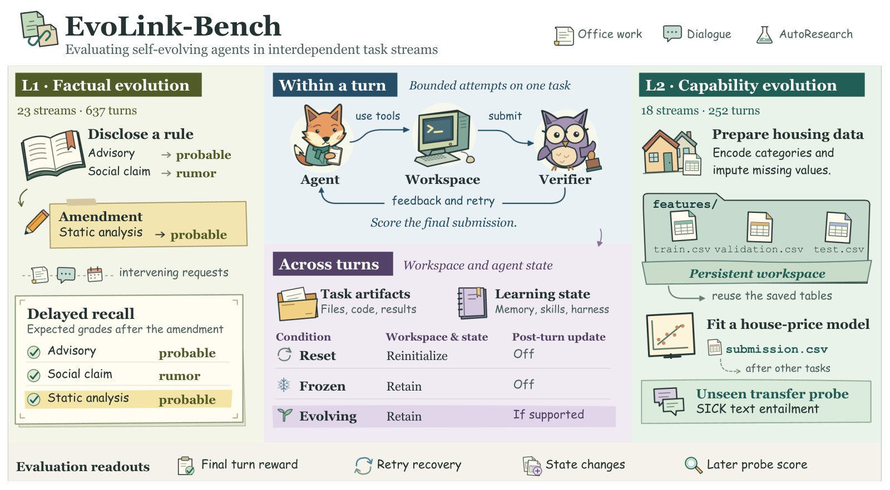

# Testing Agent Self-Evolution in Long-Horizon Task Streams

[中文](2611.34400.md) | English

> Primary: [`EV`](../../../docs/categories.en.md#ev); secondary: [`LT`](../../../docs/categories.en.md#lt), [`SY`](../../../docs/categories.en.md#sy)

## Metadata

- Original title: EvoLink-Bench: A Benchmark for Evaluating Self-Evolving Agents in Long-Horizon Interdependent Task Streams
- Authors and affiliation: Wei Chen, Xiaodong Lu, Weihao Shen, Gongxun Li, Xingyu Guo, Qihang Sun, Fuwei Zhang, Zhao Zhang, Yikun Ban, Shuang Li, Deqing Wang, and Fuzhen Zhuang; Beihang University.
- arXiv: [2611.34400](https://arxiv.org/abs/2611.34400); [PDF](https://arxiv.org/pdf/2611.34400)
- Version and dates: v1; first submission and latest revision 2026-11-25 14:00:22 UTC; researched and checked 2026-11-27.
- Code and data: [official repository](https://github.com/BUAA-Self-Evolving/EvoLink-Bench), checked at `110adacd7339040a12ecacd8da795d9fcbd0d21f`, MIT. Reproducing the reported runs still requires the authorized task package, grading assets, and runtime configuration described by the repository.
- Popularity evidence: 8 Hugging Face upvotes and 0 comments; 6 GitHub stars, 1 fork, and 0 open issues; no exact arXiv-ID Hacker News hit. Collected 2026-11-27 10:50 Asia/Shanghai.
- Community sources: machine-generated reviews from Pith and WaytoAGI, not human consensus. No verifiable third-party human discussion was found.

## Conclusion summary

- EvoLink-Bench separates L1 factual evolution from L2 capability evolution and makes later tasks depend on earlier outputs, testing whether experience is actually reused.
- It covers 19,635 scored task slots across five agent frameworks, three backbone configurations, and Reset, Frozen, and Evolving persistence conditions. No framework is consistently best at both levels.
- Retries recover only a limited fraction of failures, and a changed persistent state does not imply improved later-task performance. Knowledge updates and capability transfer require different mechanisms.
- The evidence is broad but descriptive: backbone cohorts, fifth frameworks, and runtime revisions differ, while repeated-run intervals and state-removal causal tests are absent.

## Research question and background

Streaming benchmarks can measure long operation without proving that experience was reused. EvoLink-Bench asks whether an agent correctly revises factual knowledge and whether artifacts or capabilities acquired earlier improve later dependent tasks. It contributes an evaluation design rather than a new learner and separates retry recovery, persistent-state updates, and downstream reuse.

## Method

- L1 contains 23 streams and 637 turns across nine domains, covering rule disclosure, application, amendment, and delayed recall.
- L2 contains 18 streams and 252 turns. Earlier tasks create tables, code, or intermediate results that later tasks explicitly consume, followed by unseen probes.
- Reset reinitializes workspace and learning state; Frozen retains them without post-turn learning; Evolving permits memory, skill, or harness updates where supported.
- Readouts include final score, retry recovery, learning-state digest changes, and later probe scores. A changed digest establishes a write, not useful transfer.

## Experiments and evidence

- The selected cohorts contain 19,635 scored slots across DeepSeek V4 Flash, GLM-5.3, and GPT-6.1 Terra configurations. Cohorts are not matched across backbones.
- Among runs that retried, DeepSeek and GLM recover 24.75% and 27.63%; their overall gains are 6.71 and 6.03 points. Retries help but cover a limited share of failures.
- On GPT-6.1 Terra, one configuration gains 22.95 points from Evolving over Frozen on L1 but loses 0.56 on L2. Direction varies by level, domain, and stream.
- At the fixed repository commit, `uv run pytest -q` produced 866 passed, 12 skipped, and 1 failed. The failure was caused by Docker being unavailable for a bound-task sandbox. This validates most public contracts, not the full benchmark run.

## Limitations and risks

The authors report unmatched backbone cohorts, configuration-specific fifth frameworks, different runtime revisions, uncertified model/tool budgets, no repeated-run confidence intervals, incomplete trace audits for GPT-6.1 Terra, descriptive domain analyses, and no artifact- or state-removal causal ablation.

The public repository exposes evaluators, adapters, schemas, examples, and offline tests, but not the complete task package and hidden verifiers required to replay all 19,635 slots.

## Reproduction and application

This benchmark is useful for persistent-workspace, memory, and skill-updating agents. Reproduction should fix cohorts, framework revisions, model budgets, and tool budgets; separately report Reset-to-Frozen persistence effects and Frozen-to-Evolving update effects; and add state removal, artifact removal, or retrieval-trace audits for causal claims.

## Related work

- StreamBench and SEA-Eval study long or streaming interaction but instantiate weaker cross-task dependencies.
- CL-Bench evaluates continual learning with a different task and state model.
- Adaptive Auto-Harness studies runtime adaptation; EvoLink supplies explicit persistence controls.
- LongMemEval focuses on long-term recall, while EvoLink separates factual revision from capability transfer.

## Community response

No verifiable third-party human response was found. Hugging Face recorded 8 upvotes and no comments; Hacker News had no exact hit. All six specified Reddit communities returned HTTP 403, an access gap rather than evidence of no discussion.

Pith's machine review praises the interdependent design and explicit limitations while criticizing unmatched cohorts, absent repeated-run uncertainty, missing state-removal causality, and an imperfect L1/L2 boundary. WaytoAGI's machine analysis also stresses that state change is not capability improvement. These are traceable machine analyses, not community consensus.

## Figures and tables from the paper

Figure 1, paper page 2, from the official PDF/HTML. It explains L1, L2, and the Reset/Frozen/Evolving boundary, but contains no effect size and cannot establish that persistent updates help.

## Research judgment

- Priority: high. The design distinguishes long interaction, writable state, and actual experience reuse.
- Confidence: medium-high. The scale and condition design are strong, but unmatched configurations, no repeats, and incomplete task release constrain the claims.
- Audience: researchers building long-horizon agents, memory or skill updates, harnesses, and evaluation platforms.
- Watch next: complete task release, matched repeated runs, removal ablations, and cost-normalized results.
- Score: relevance 25/25, contribution 22.5/25, evidence 18/20, reproducibility 12/15, freshness 10/10, popularity 3.5/5; total 91/100.

## Sources

- [arXiv](https://arxiv.org/abs/2611.34400)
- [Official PDF](https://arxiv.org/pdf/2611.34400)
- [Official repository](https://github.com/BUAA-Self-Evolving/EvoLink-Bench)
- [Hugging Face Papers](https://huggingface.co/papers/2611.34400)
- [Pith machine review](https://pith.science/paper/2611.34400)
- [WaytoAGI machine review](https://waytor.si/en/articles/2026/11/27/evolink-bench-interdependent-evolution/?research=arxiv-2611-34400)
