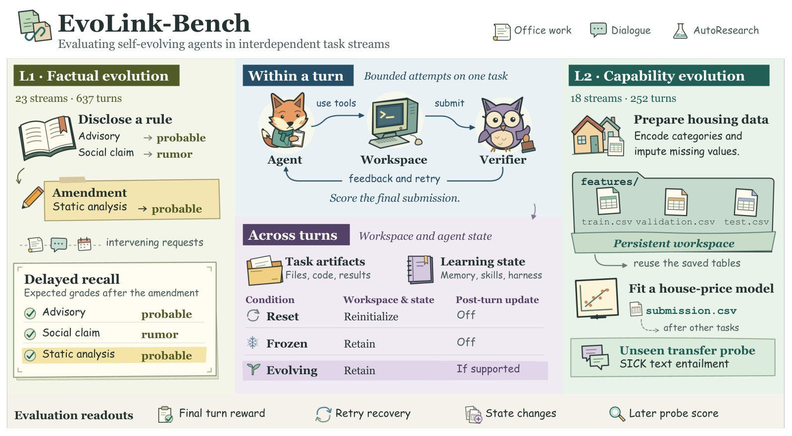

# 长期任务流如何检验 Agent 自我演化

语言：中文；[English](2611.34400.en.md)

> 主分类：[`EV`](../../../docs/categories.md#ev)；辅助分类：[`LT`](../../../docs/categories.md#lt)、[`SY`](../../../docs/categories.md#sy)

## 元数据

- 英文标题：EvoLink-Bench: A Benchmark for Evaluating Self-Evolving Agents in Long-Horizon Interdependent Task Streams
- 作者与机构：Wei Chen、Xiaodong Lu、Weihao Shen、Gongxun Li、Xingyu Guo、Qihang Sun、Fuwei Zhang、Zhao Zhang、Yikun Ban、Shuang Li、Deqing Wang、Fuzhen Zhuang；北京航空航天大学。
- arXiv：[2611.34400](https://arxiv.org/abs/2611.34400)；[PDF](https://arxiv.org/pdf/2611.34400)
- 版本与时间：v1；首次提交与最近修订均为 2026-11-25 14:00:22 UTC；调研与复查日期为 2026-11-27。
- 代码与数据：[官方仓库](https://github.com/BUAA-Self-Evolving/EvoLink-Bench)，核对提交 `110adacd7339040a12ecacd8da795d9fcbd0d21f`；MIT。完整复现实验仍需仓库说明中的授权任务包、评分资产和运行配置。
- 热度证据：Hugging Face Papers 为 8 upvotes、0 comments；GitHub 为 6 stars、1 fork、0 open issues；Hacker News 精确 arXiv ID 检索为 0 条。采集时间：2026-11-27 10:50（Asia/Shanghai）。
- 社区评价来源：Pith 与 WaytoAGI 的机器生成论文评析，均不视为人工社区共识；未检索到可核验的第三方人工讨论。采集时间同上。

## 结论摘要

- EvoLink-Bench 把自我演化拆成 L1「可语言表达的事实更新」与 L2「经执行和反馈形成的能力更新」，并用后续任务依赖前序产物来检验经验是否真正被复用。
- 基准覆盖 19,635 个已评分任务位置，比较 5 个 Agent 框架、3 组基座配置与 Reset／Frozen／Evolving 三种持久化条件；没有框架在 L1 和 L2 上持续领先。
- 重试只能挽回有限失败；持久状态发生变化不等于后续任务得分提高。知识更新和能力迁移需要不同机制，单看「写入了记忆或技能」不足以证明演化有效。
- 论文证据规模较大，但不同基座使用的任务集合、第五个框架和运行版本并不一致，也没有重复运行置信区间或状态移除实验，因此不能据此建立跨模型通用排名或因果结论。

## 研究问题与背景

现有流式 Agent 基准常把任务按时间串联，但任务之间大多独立。这样的设置可以测长期运行，却难以回答两个更严格的问题：Agent 是否能在规则被修订后正确更新知识；它是否能把早期任务中形成的产物、技能或执行经验用于后续依赖任务。EvoLink-Bench 的贡献不是提出新学习器，而是把「重试恢复」「持久状态更新」和「后续经验复用」分开计量。

## 核心方法

- L1 包含 23 条流、637 个 turn，覆盖 9 个领域。任务要求 Agent 接收规则、应用规则、处理修订，并在间隔任务后完成延迟回忆。
- L2 包含 18 条流、252 个 turn。前序任务产生表格、代码或中间结果，后续任务显式依赖这些产物，并以未见任务探针检验能力迁移。
- Reset 每轮重置工作区与学习状态；Frozen 保留工作区和状态但关闭轮后学习；Evolving 在框架支持时允许更新记忆、技能或 harness。该对照把「持久化」与「主动更新」分开。
- 评测同时记录最终得分、重试恢复、学习状态摘要变化和后续探针表现。状态摘要改变只能证明有写入，不能证明写入有用。

## 实验与证据

- 选定评测队列共 19,635 个评分位置；论文分别报告 DeepSeek V4 Flash、GLM-5.3 与 GPT-6.1 Terra 配置结果。三组配置并非同一任务队列，不能横向当作受控模型比较。
- DeepSeek 与 GLM 配置中，在发生重试的运行里，重试恢复率分别为 24.75% 和 27.63%；折算到总体得分的增量分别为 6.71 与 6.03 个百分点。证据支持「重试有用但覆盖有限」。
- GPT-6.1 Terra 上，某些框架在 L1 的 Evolving 相对 Frozen 提升可达 22.95 分，但同一配置在 L2 可能下降 0.56 分。方向随层级、领域和任务流变化，反对用单一平均分代表自我演化。
- 本地在固定提交运行 `uv run pytest -q`：866 passed、12 skipped、1 failed。失败来自运行机没有 Docker，绑定任务沙箱测试返回 Docker unavailable；这验证了大部分公开实现契约，不是对论文全部任务的复跑。

## 局限与风险

作者明确限制包括：不同基座的任务队列不匹配；第五个框架随配置变化；历史运行跨越不同运行时版本，模型调用和工具预算未统一认证；没有重复运行置信区间；GPT-6.1 Terra 缺少详细轨迹和持久状态审计；领域分析仅为描述性；没有移除源任务产物或学习状态的因果消融。

调研补充判断：公开仓库提供 evaluator、adapter、schema、示例和离线测试，但论文结果所需任务包与隐藏验证器并未完整公开。当前可验证的是框架结构和部分契约，不是 19,635 个评分位置的独立重放。

## 复现与应用

适合用于审查带持久工作区、记忆或技能更新的长期 Agent。复现时至少要固定任务队列、框架版本、模型与工具预算，并分开报告 Reset→Frozen 的持久化收益和 Frozen→Evolving 的更新收益。若要证明某次更新导致后续提升，还需增加状态移除、产物移除或检索轨迹审计。

## 相关工作

- StreamBench 与 SEA-Eval：同样关注长程或流式交互，但跨任务依赖与持久状态拆分较弱。
- CL-Bench：测持续学习，但其任务与 EvoLink 的工作区产物依赖不同。
- Adaptive Auto-Harness：研究 Agent 运行时自适应；EvoLink 提供可比较的 Reset／Frozen／Evolving 条件。
- LongMemEval：关注长期记忆召回；EvoLink 进一步把事实更新与能力迁移拆开。

## 社区评价

未检索到可核验的第三方人工评价。Hugging Face 页面有 8 次 upvote、无评论；互动量只说明有限关注，不代表质量。Hacker News 无精确帖子；六个指定 Reddit 社区均返回 HTTP 403，访问缺口不代表不存在讨论。

Pith 的机器评析肯定跨任务依赖、持久状态对照和限制披露，同时指出任务队列不匹配、无重复运行不确定性、缺少状态移除因果实验，以及 L1／L2 边界并非完全互斥。WaytoAGI 的机器评析也强调「状态变化不等于能力提升」。这些内容仅作为可追溯的机器分析，不当作社区共识。

## 原文关键图表

图 1，论文第 2 页，来源为官方 PDF／HTML。它同时展示 L1 事实演化、L2 能力演化以及 Reset／Frozen／Evolving 的状态边界，支持对基准设计的解释；图本身不提供效果量，也不能证明持久更新有效。

## 调研判断

- 阅读优先级：高。它把「长对话」「可写状态」与「真正复用经验」区分开，适合作为自演化 Agent 评测的设计参考。
- 可信度：中高。任务规模、条件拆分和限制披露较充分；跨配置不可比、无重复运行与开放任务包不完整限制了结论强度。
- 适用对象：长期 Agent、记忆／技能更新框架、Agent harness 与评测平台研究者。
- 后续观察：完整任务包和隐藏验证器开放情况；匹配任务队列下的重复实验；状态／产物移除消融；按 token、工具调用和时间归一化后的收益。
- 评分：Agent 相关性 25／25，贡献 22.5／25，证据 18／20，可复现性 12／15，新鲜度 10／10，热度 3.5／5，总分 91／100。

## 来源

- [arXiv 摘要页](https://arxiv.org/abs/2611.34400)
- [官方 PDF](https://arxiv.org/pdf/2611.34400)
- [官方代码仓库](https://github.com/BUAA-Self-Evolving/EvoLink-Bench)
- [Hugging Face Papers](https://huggingface.co/papers/2611.34400)
- [Pith 机器评析](https://pith.science/paper/2611.34400)
- [WaytoAGI 机器评析](https://waytor.si/en/articles/2026/11/27/evolink-bench-interdependent-evolution/?research=arxiv-2611-34400)
