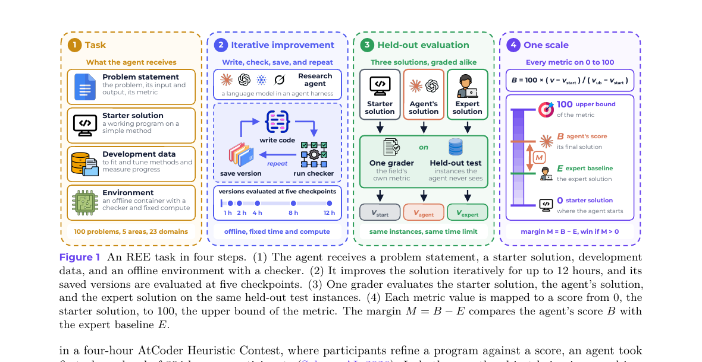

# Do Research Agents Really Beat Expert Solutions?

[中文](2611.34646.md) | Language: English

> Primary: [`EV`](../../../docs/categories.en.md#ev); secondary: [`LT`](../../../docs/categories.en.md#lt), [`RA`](../../../docs/categories.en.md#ra)

## Metadata

- Original title: REE: A Scientific Research Entrance Exam for AI Agents
- Authors and affiliations: Zeqi Zhou, Minghao Liu, Jiarui Liu, Qingcheng Zeng, Rui Yang, Tianyu Liu, Zetao Yang, Wenqiang Zu, Enduo Zhao, Heng-Jui Chang, Lun-Hsin Kuo, Meng-Fu Chen, Haokai Zhao, Weijia Zhang, Jen-Tse Huang, Stephen Huang, Eli Cheung, Zhijing Jin, Mona Diab, and Weihao Xuan; TokenWave AI and 13 universities or organizations listed in the paper.
- arXiv: [2611.34646](https://arxiv.org/abs/2611.34646); [PDF](https://arxiv.org/pdf/2611.34646)
- Version and dates: v1; first submitted and last revised 2026-11-25 16:25:19 UTC; researched and reviewed 2026-11-28.
- Code, data, and project: [official repository](https://github.com/TokenWave-AI/REE), commit `9c798525f333575f6fe073a90595eb546c2a1977`; [Hugging Face dataset](https://huggingface.co/datasets/Tokenwave-AI/REE), revision `45c5bed3b41e5db3a9255a2449d73dd737a954c9`; [project page](https://tokenwave-ai.github.io/REE/). Repository code is Apache-2.0; task data and expert implementations retain source licenses.
- Popularity evidence: 0 upvotes and 0 comments on Hugging Face Papers; 1 point and 1 comment on Hacker News; 0 GitHub stars, 0 forks, and 0 open issues; dataset API showed 18 downloads and 0 likes. Collected 2026-11-28 09:10 Asia/Shanghai.
- Community sources: the only Hacker News comment was the submitter quoting the abstract, not an independent technical assessment. No verifiable third-party human discussion was found.

## Conclusion summary

- REE turns research-agent evaluation into a 12-hour executable improvement task: an agent starts from working code, iterates on development data, and a shared grader compares the starter, agent, and expert solution on held-out instances.
- The 100 tasks cover five scientific areas and 23 domains. Claude Opus 5.5 and GPT-6.1 Sol average 39.6 and 38.2 and beat one expert solution on 86% and 81% of tasks. This is a win under REE's budget and scoring protocol, not evidence that the systems outperform communities of human experts.
- The leaders' mean margins turn positive at hour two and reach 87% of their final mean scores by hour four. Each agent-task pair has only one run; the bootstrap intervals describe variation across tasks, not repeated-run variance on a task.
- Newly public artifacts include 100 tasks, graders, held-out instances, expert solutions, run configurations, and 400 per-task result rows. Docker was unavailable locally, so the audit covers result recomputation, public structure, and static contracts rather than 12-hour container reruns.

## Research question and background

Fixed-answer tests, one-shot code submissions, and paper-replication benchmarks do not directly measure whether an agent can repeatedly propose changes, run experiments, interpret results, and retain a better method. REE defines a cross-domain evaluation unit in which every problem must be quantitatively scorable, automatically testable on held-out instances, and paired with an expert method executable within the task budget. Its primary contribution is an evaluation design and task suite, not a new research agent.

## Method

- Each task provides a statement, working starter, development data, and offline checker. The agent may modify or replace the starter and save versions for up to 12 hours.
- A shared grader evaluates the starter, final agent solution, and expert solution on unseen test instances. It also replays the last saved versions at hours 1, 2, 4, and 8, yielding five checkpoints including the final result.
- Each field keeps its native metric. The starter maps to 0 and a task upper bound to 100: `100 × (v - v_start) / (v_ub - v_start)`, clipped to 0–100. Margin is agent score minus expert baseline.
- Eighty-nine tasks use the metric's definitional optimum, seven use a computable problem bound, and four estimate an attainable bound from current methods. The expert baseline is a runnable human-designed method re-evaluated on the same held-out instances and a comparable budget.

## Experiments and evidence

- Four systems receive one run on each of 100 tasks. Claude Opus 5.5, GPT-6.1 Sol, GLM-5.3, and Grok 4.7 score 39.6, 38.2, 28.6, and 25.3; the expert-solution mean is 24.4.
- Claude and GPT-6.1 Sol have mean margins of +15.2 (95% bootstrap interval 12.0–18.3) and +13.8 (10.3–17.3), with win rates of 86% and 81%. Their mean margins are positive in every scientific area.
- At hour two, their mean margins are +5.4 and +3.4. At hour four they are +8.6 and +8.3, with both systems at 87% of final mean score. Among runs still active at hour eight, final scores rise in 60% and 76%.
- Median output and total token use are about 768k and 106.2M for GPT-6.1 Sol, versus 148k and 21.6M for Claude. Scores are similar, but token counts use different tokenizers and are not a unified cost measure.
- Local recomputation at the pinned commit found 100 rows per system across five areas and 23 domains; all four means match Table 3, and the highest single-task score is 81.7. The smallest public task, `seismic_observatory`, lists 183 files totaling about 469 KB and includes starter code, development data, held-out data, grader, expert solution, and reward scale. Python compilation, Shell syntax, and all four YAML configurations passed static checks; Harbor scoring was not run because Docker is unavailable.

## Limitations and risks

The authors state that REE covers only research problems that a program can score on held-out instances within a fixed limit, excluding physical experiments, new data collection, and human-judged outcomes. Each agent-task pair has one run; results use one 12-hour budget and specific harness; many 100-point bounds are definitional rather than demonstrably attainable; each task has one expert solution; and method-source tracing relies on an LLM judge.

Further assessment: “beating experts” means beating one expert implementation rerun under REE conditions, not competing with a live research team. Model inference sits outside the task-container compute budget, and the two leading systems differ by roughly fivefold in token use without a unified API-cost report. Held-out evaluation prevents direct test access during a run, but public tasks can enter future training data, so long-lived leaderboards need versioning and contamination audits.

## Reproduction and application

The release supports fixed-revision inspection of tasks, graders, expert methods, configurations, and per-task scores. A full rerun requires Linux x86-64, Docker, Harbor 0.23.0, at least 4 CPUs and 16 GB per task, up to 100 × 12 hours of agent work, and model-call costs; the complete task set is about 66.6 GiB. A practical audit should first run starter and oracle on one task, then repeat a small agent subset while recording run variance, API cost, retries, and hardware occupancy.

## Related work

- [RE-Bench](https://arxiv.org/abs/2411.15114) evaluates agents and live human experts in seven ML R&D environments. It is narrower, but its human comparison is more direct.
- [PaperBench](https://arxiv.org/abs/2504.01848) asks agents to replicate 20 ICML papers with fine-grained rubrics. It focuses on replication rather than improving a field-specific metric over time.
- [FrontierCS 2](https://arxiv.org/abs/2610.29932) removes a paper's contribution from released code and asks agents to restore it across 48 computer-science tasks. It similarly uses hidden tests and author-code references but covers a different task family.
- [Agent4Sci](https://arxiv.org/abs/2610.28763) asks agents to improve published ML methods across 11 scientific domains. REE adds a shared starter-to-bound scale and five time checkpoints.
- [RSI-Exam](https://github.com/aiming-lab/RSI-Exam) also uses 12-hour executable research tasks. REE expands to 100 tasks and separately reruns expert methods on the same held-out suites.

## Community response

No verifiable third-party human technical assessment was found. The Hacker News submission had 1 point and 1 comment; the only comment was the submitter reproducing part of the abstract. Hugging Face Papers showed 0 upvotes and 0 comments, and GitHub showed 0 stars. These numbers indicate limited early circulation, not research quality.

Searches across the six specified Reddit communities returned HTTP 403. Public Web and X searches found no verifiable original post. This access gap does not establish that no discussion exists. ArXivSignals, VQV, and similar pages are machine summaries or signal aggregators and were used only for discovery, not as community consensus.

## Figures and tables from the paper

Figure 1, page 2 of the official PDF. It explains the task inputs, 12-hour loop, held-out evaluation, and shared 0–100 scale. It does not demonstrate that agents beat expert solutions or represent repeated-run uncertainty.

## Research judgment

- Reading priority: high. REE compresses “research capability” into executable, replayable, long-horizon tasks compared with an expert method under a common protocol.
- Confidence: medium-high. Coverage, paired scoring, checkpoints, bootstrap analysis, and limitations are strong, and per-task artifacts are public. Single runs, one expert method, unmatched inference costs, and no contamination audit limit generalization.
- Audience: research-agent builders, long-horizon self-improvement researchers, evaluation-platform teams, research infrastructure engineers, and model-cost analysts.
- Watch next: repeated-run variance, complete trajectories and API costs, public-task contamination, same-model cross-harness comparisons, and independent reruns at pinned revisions.
- Score: agent relevance 25/25, contribution 23.5/25, evidence 18.5/20, reproducibility 14/15, freshness 10/10, verifiable attention 3/5; total 94/100.

## Sources

- [arXiv abstract](https://arxiv.org/abs/2611.34646)
- [Official PDF](https://arxiv.org/pdf/2611.34646)
- [Official repository](https://github.com/TokenWave-AI/REE)
- [Hugging Face dataset](https://huggingface.co/datasets/Tokenwave-AI/REE)
- [Project page](https://tokenwave-ai.github.io/REE/)
- [Hugging Face Papers](https://huggingface.co/papers/2611.34646)
- [Hacker News submission](https://news.ycombinator.com/item?id=50670584)
