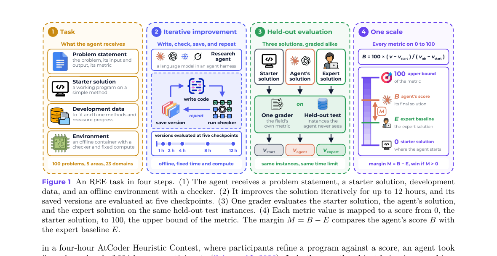

# 科研 Agent 是否真的超过专家方案

语言：中文；[English](2611.34646.en.md)

> 主分类：[`EV`](../../../docs/categories.md#ev)；辅助分类：[`LT`](../../../docs/categories.md#lt)、[`RA`](../../../docs/categories.md#ra)

## 元数据

- 英文标题：REE: A Scientific Research Entrance Exam for AI Agents
- 作者与机构：Zeqi Zhou、Minghao Liu、Jiarui Liu、Qingcheng Zeng、Rui Yang、Tianyu Liu、Zetao Yang、Wenqiang Zu、Enduo Zhao、Heng-Jui Chang、Lun-Hsin Kuo、Meng-Fu Chen、Haokai Zhao、Weijia Zhang、Jen-Tse Huang、Stephen Huang、Eli Cheung、Zhijing Jin、Mona Diab、Weihao Xuan；TokenWave AI、东京大学、卡内基梅隆大学、西北大学、威尔康奈尔医学院、耶鲁大学、南洋理工大学、Monolith Management、斯坦福大学、加州理工学院、哈佛大学、新南威尔士大学、约翰斯·霍普金斯大学、多伦多大学。
- arXiv：[2611.34646](https://arxiv.org/abs/2611.34646)；[PDF](https://arxiv.org/pdf/2611.34646)
- 版本与时间：v1；首次提交与最近修订均为 2026-11-25 16:25:19 UTC；调研与复查日期为 2026-11-28。
- 代码、数据与项目：[官方仓库](https://github.com/TokenWave-AI/REE)，核对提交 `9c798525f333575f6fe073a90595eb546c2a1977`；[Hugging Face 数据集](https://huggingface.co/datasets/Tokenwave-AI/REE)，核对 revision `45c5bed3b41e5db3a9255a2449d73dd737a954c9`；[项目页](https://tokenwave-ai.github.io/REE/)；仓库代码为 Apache-2.0，任务数据与专家方案沿用各自来源许可证。
- 热度证据：Hugging Face Papers 为 0 upvotes、0 comments；Hacker News 为 1 point、1 comment；GitHub 为 0 stars、0 forks、0 open issues；数据集 API 为 18 downloads、0 likes。采集时间：2026-11-28 09:10（Asia/Shanghai）。
- 社区评价来源：Hacker News 唯一评论为提交者摘录摘要，不构成独立技术评价；未检索到可核验的第三方人工讨论。采集时间同上。

## 结论摘要

- REE 把科研 Agent 评测改造成 12 小时的可执行迭代任务：Agent 从工作基线出发，在开发集上反复修改程序，再由同一 grader 在隔离测试集上比较 starter、Agent 与专家方案。
- 100 个任务覆盖 5 个科学领域、23 个 domain。Claude Opus 5.5 与 GPT-6.1 Sol 的均分为 39.6 和 38.2，分别在 86% 和 81% 的任务上超过单个专家方案；这表示在 REE 的预算与评分口径下胜出，不等于超过该领域的人类专家群体。
- 两个领先 Agent 的平均 margin 在第 2 小时转正，第 4 小时达到最终均分的 87%；但每个 Agent—任务组合只有一次运行，论文 bootstrap 反映任务间差异，不反映同一任务的重复运行方差。
- 新公开工件补齐了 100 个任务、grader、隔离测试实例、专家方案、运行配置和 400 条逐任务结果。当前机器无 Docker，未复跑 12 小时容器实验；本地验证仅覆盖结果重算、公开结构与静态契约。

## 研究问题与背景

固定问答、单次代码提交或论文复现任务难以测量 Agent 是否能像研究人员一样持续提出修改、执行实验、判断结果并保留更好的方案。REE 试图建立一个跨科学领域的共同评测单元：每道题都必须是可量化、可自动评分、具有隔离测试集，并存在能在任务预算内执行的专家方案。主要贡献是评测设计与任务集，而不是新的科研 Agent。

## 核心方法

- 每个任务提供问题说明、可运行的 starter、开发数据与离线 checker。Agent 可修改或替换 starter，并在 12 小时内保存多个版本。
- 运行结束后，同一 grader 在 Agent 未见的测试实例上评估 starter、Agent 最终方案与专家方案；还回放第 1、2、4、8 小时的最近保存版本，形成五个时间检查点。
- 每个领域保留自己的原始指标，再将 starter 映射为 0、任务上界映射为 100。Agent 得分为 `100 × (v - v_start) / (v_ub - v_start)`，并截断到 0～100；margin 为 Agent 得分减专家基线。
- 89 个任务使用指标定义上的最优值作为上界，7 个任务使用可计算界，4 个任务使用当前方法给出的可达值估计。专家方案是一个可执行的人类设计方法，在相同测试实例和相近预算下重新运行，不直接沿用论文中的原始分数。

## 实验与证据

- 四个系统各在 100 个任务上运行一次。Claude Opus 5.5、GPT-6.1 Sol、GLM-5.3 与 Grok 4.7 的均分依次为 39.6、38.2、28.6 和 25.3；专家方案均分为 24.4。
- Claude 与 GPT-6.1 Sol 的平均 margin 分别为 +15.2（95% bootstrap interval 12.0～18.3）与 +13.8（10.3～17.3），超过专家方案的任务比例为 86% 和 81%。两者在五个大领域中的平均 margin 均为正。
- 第 2 小时，两个领先系统的平均 margin 为 +5.4 和 +3.4；到第 4 小时为 +8.6 和 +8.3，并达到最终均分的 87%。仍运行到第 8 小时的任务中，最终分继续上升的比例为 60% 和 76%。
- GPT-6.1 Sol 的每次运行输出 token 中位数约 768k、总 token 106.2M；Claude 为 148k 与 21.6M。两者得分相近，但 token 口径来自各自 tokenizer，不宜直接当作统一成本。
- 本地对固定提交的 `paper-v1.tsv` 重算：4 个系统各 100 条记录，5 个领域、23 个 domain；四个均分与论文表 3 一致，单任务最高分为 81.7。最小公开任务 `seismic_observatory` 的 API 清单含 183 个文件、约 469 KB，包含 starter、开发数据、隔离测试数据、grader、专家方案与 reward scale。脚本编译、Shell 语法和 4 份 YAML 解析通过；无 Docker，未执行 Harbor 容器评分。

## 局限与风险

作者明确限制：REE 只覆盖能在固定时间内由程序和隔离测试集评分的问题，不包括物理实验、新数据采集或需要人类判断的研究；每个 Agent—任务组合只有一次运行；结果绑定一个 12 小时预算与特定 harness；多数任务的 100 分是指标定义上界，不保证可达；每题只有一个专家方案；方法来源追踪依赖 LLM judge。

调研补充判断：论文中的「超过专家」是超过一个在 REE 条件下重跑的专家方案，不是与实时人类研究团队对赛。GPT-6.1 Sol 与 Claude 的模型推理位于任务容器算力预算之外，且总 token 相差约 5 倍；论文未给出统一 API 成本。隔离测试防止运行时直接查看答案，但公开任务可能进入后续模型训练，长期 leaderboard 需要版本和污染审计。

## 复现与应用

公开材料已经支持按固定 revision 检查任务、grader、专家方案、配置和逐任务分数。完整复现需要 Linux x86-64、Docker、Harbor 0.23.0、每个任务至少 4 CPU／16 GB 内存，并承担最多 100 × 12 小时的 Agent 运行与模型调用成本；全部任务约 66.6 GiB。工程上更适合先选单个任务复核 starter／oracle，再复跑少量 Agent，并把重复运行、API 费用、失败重试和硬件占用单独记录。

## 相关工作

- [RE-Bench](https://arxiv.org/abs/2411.15114)：在 7 个 ML 研究工程环境中同时评估 Agent 与现场人类专家；范围较窄，但人类比较更直接。
- [PaperBench](https://arxiv.org/abs/2504.01848)：要求 Agent 复现 20 篇 ICML 论文，并用细粒度 rubric 评分；重点是论文复现，不是持续改进一个领域指标。
- [FrontierCS 2](https://arxiv.org/abs/2610.29932)：从论文代码中移除核心贡献，让 Agent 在 48 个计算机科学任务上补回；同样使用隐藏测试和作者代码参考，但覆盖领域不同。
- [Agent4Sci](https://arxiv.org/abs/2610.28763)：让 Agent 改进 11 个科学领域中的已发表 ML 方法；更贴近 in-the-wild 科学建模，REE 则提供统一 starter—上界量尺与五个时间检查点。
- [RSI-Exam](https://github.com/aiming-lab/RSI-Exam)：同样采用 12 小时可执行研究任务；REE 扩展到 100 个任务，并把专家方案放在相同测试集上单独重跑。

## 社区评价

未检索到可核验的第三方人工技术评价。Hacker News 帖子为 1 point、1 comment，唯一评论由提交者发布，只摘录论文摘要；不能视为支持、质疑或独立复现。Hugging Face Papers 为 0 upvotes、0 comments；GitHub 为 0 stars。互动量只反映论文刚公开后的有限传播，不代表质量。

六个指定 Reddit 社区的检索均返回 HTTP 403；公开 Web／X 检索未取得可核验原帖。访问缺口不代表不存在讨论。ArXivSignals、VQV 等页面为机器生成摘要或信号聚合，只用于发现线索，不计作社区共识。

## 原文关键图表

图 1，论文第 2 页，来源为官方 PDF。它展示任务输入、12 小时迭代、隔离测试与 0～100 统一量尺，支持对 REE 评测单元的解释；图本身不证明 Agent 超过专家，也不呈现重复运行不确定性。

## 调研判断

- 阅读优先级：高。REE 把「科研能力」压缩为可执行、可回放、可与专家方案同条件比较的长程任务，适合作为科研 Agent 评测设计参考。
- 可信度：中高。任务覆盖、配对评分、时间检查点、bootstrap 和限制披露较完整，逐任务工件已经公开；单次运行、单一专家方案、模型推理成本未统一和无污染审计限制了外推。
- 适用对象：科研 Agent、长程自我改进、Agent 评测平台、研究基础设施与模型成本分析团队。
- 后续观察：重复运行方差；完整轨迹与 API 费用；公开任务污染；不同 harness 的同模型对照；第三方在固定 revision 上的复跑。
- 评分：Agent 相关性 25／25，贡献 23.5／25，证据 18.5／20，可复现性 14／15，新鲜度 10／10，热度 3／5，总分 94／100。

## 来源

- [arXiv 摘要页](https://arxiv.org/abs/2611.34646)
- [官方 PDF](https://arxiv.org/pdf/2611.34646)
- [官方代码仓库](https://github.com/TokenWave-AI/REE)
- [Hugging Face 数据集](https://huggingface.co/datasets/Tokenwave-AI/REE)
- [项目页](https://tokenwave-ai.github.io/REE/)
- [Hugging Face Papers](https://huggingface.co/papers/2611.34646)
- [Hacker News 帖子](https://news.ycombinator.com/item?id=50670584)
